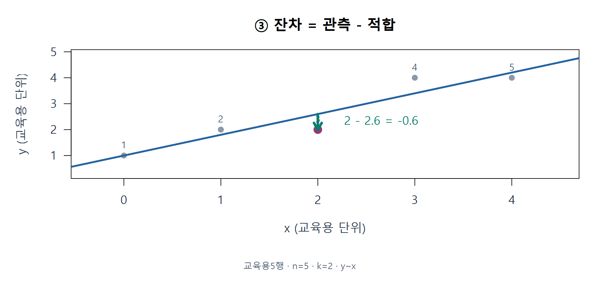
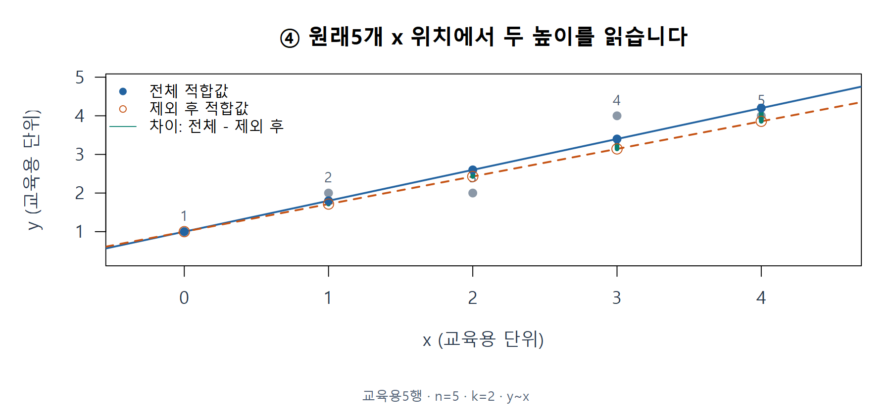
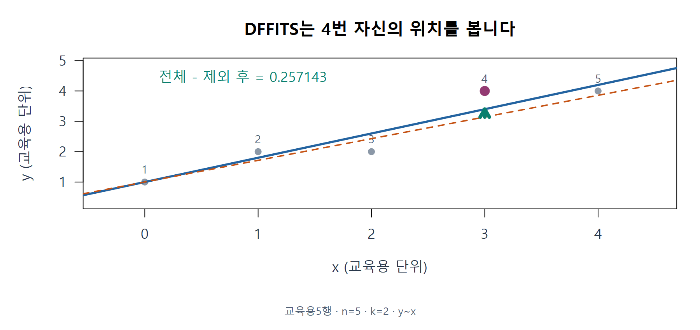
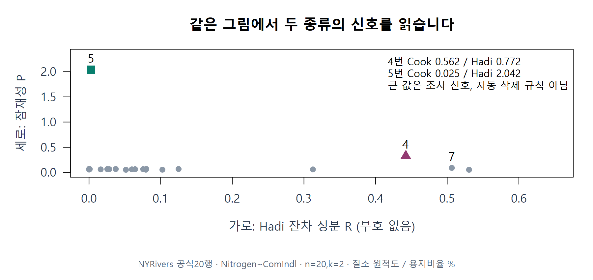
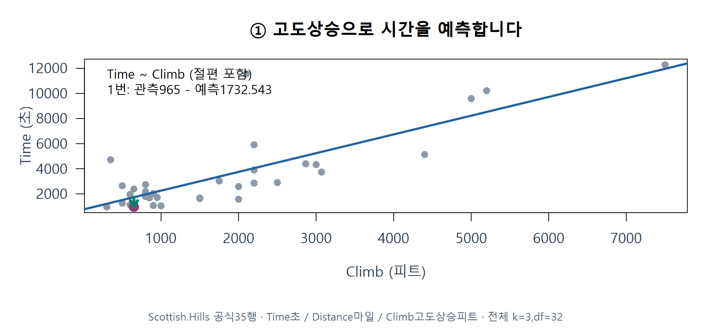
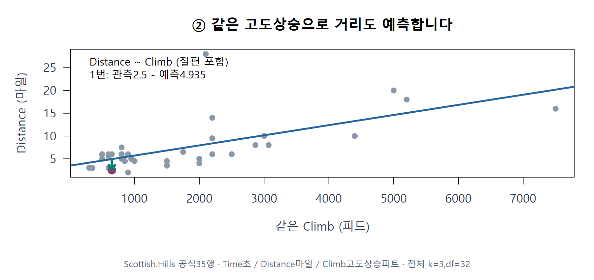
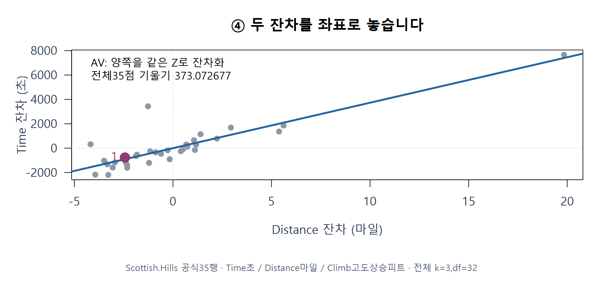
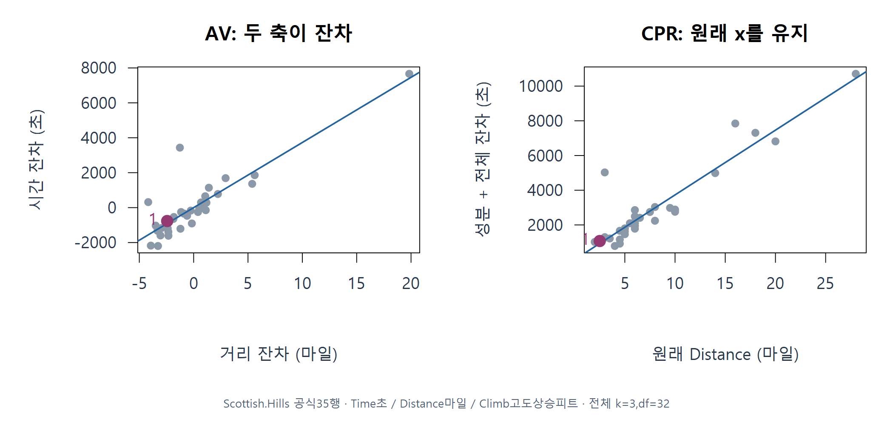
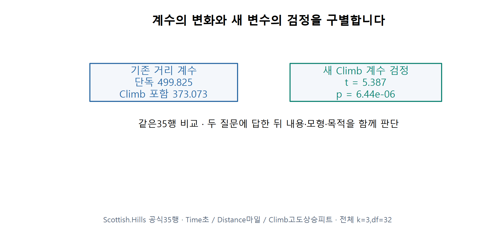
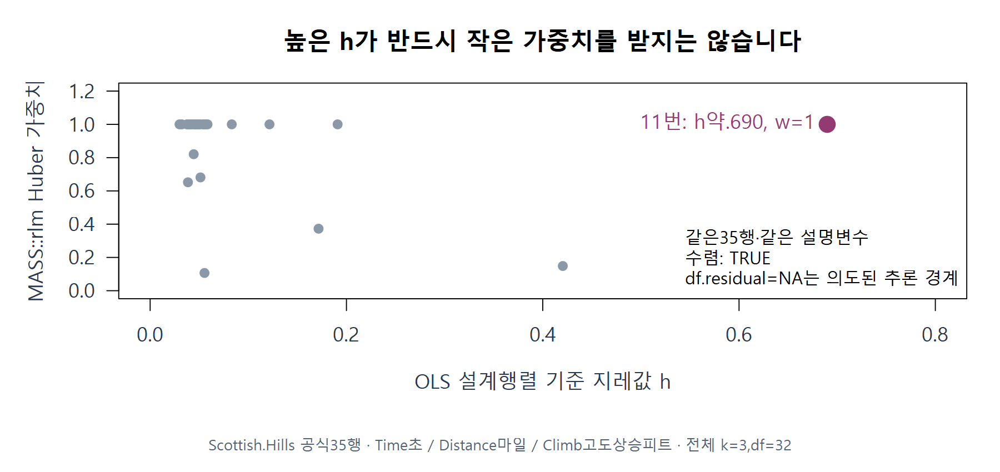



R 설치나 로그인이 필요 없습니다. 로딩이 끝나면 **Run Code**를 눌러 위에서부터 실행하세요. 앞 셀의 값을 바꾼 뒤에는 뒤의 계산도 다시 실행해야 합니다. 빈칸·디버깅 문제는 직접 고쳐 실행합니다.

<button type="button" id="download-code" class="btn btn-primary">내 R 코드 다운로드</button> <button type="button" onclick="location.reload()" class="btn btn-outline-secondary">R 세션 다시 시작</button>

실행한 코드는 이 브라우저에 보관됩니다. R 객체는 새로고침 후 다시 만들어야 합니다. 다른 컴퓨터로 옮기거나 제출할 때는 코드를 다운로드하세요.

[기존 R·QMD 다운로드](https://github.com/lunalab-ai/regre/tree/main/labs/student/w10b)


회귀분석의 이해 · 2026-11-04 · 주교재 §5.8–5.15. 이번에는 B·C를 보강하며 §6.1–6.3은 제외합니다. 성적 반영 과제나 제출 기한을 새로 정하지 않습니다.

**예상과 이유 → 손계산 → 실행 → 그림 비교 → 한 문장 해석**을 남깁니다. 설명 예제와 다른 관측을 쓰는 연습을 구별하세요. TODO는 뒤의 설명 예제를 막지 않습니다. 새로 시작하면 준비 셀부터 실행합니다.

[온라인 R](https://lunalab-ai.github.io/regre/w10b.html) · [누적 앱 편집기](https://lunalab-ai.github.io/regre/apps/w10b/edit/index.html) · [입출력과 실제 함수 정의](https://github.com/lunalab-ai/regre/blob/2026-fall-w10b/src/diagnostics-w10b-api.md)

`source()`는 정의를 읽고 `lm()`은 계수를 적합합니다. `w10b_deletion_trace(lm,원래행번호)`는 원래 모든 위치의 두 예측표와 지표를 반환합니다. `w10b_effect_trace(lm,"Distance")`는 같은 행의 두 보조회귀 잔차·원래 x·CPR좌표를 반환합니다. 함수가 자료를 자동 삭제하지 않습니다.

자료는 교육용5행(x/y교육용단위), NY20행(Nitrogen원척도/ComIndl%), Hills35행(Time초/Distance마일/Climb고도상승피트)입니다. 준비 코드는 동봉 자료→지정 캐시→고정태그 다운로드 순으로 필요한7파일을 확인하고 MD5를 대조합니다. 편집 파일을 덮어쓰거나 실패를 가짜 자료로 대체하지 않습니다. 공개 ZIP/Release의 SHA-256 검증과 구별합니다.

## 독립 준비


::: {#cell-w10b-1 .browser-cell}

```{webr}
#| label: cell-w10b-1
#| autorun: false
#| persist: true
# Prefer bundled files; otherwise download from one fixed public tag.
tag <- "2026-fall-w10b"
local_dirs <- c("data","labs/student/w10b/data","../../labs/student/w10b/data",
                "../../../labs/student/w10b/data","../data")
found <- local_dirs[file.exists(file.path(local_dirs,"diagnostics-w10b.R"))]
cache_root <- Sys.getenv("REGRE_CACHE_DIR",unset=file.path(path.expand("~"),".cache","regre"))
data_dir <- if(length(found)) found[1] else file.path(cache_root,tag)
dir.create(data_dir,recursive=TRUE,showWarnings=FALSE)
expected <- c("diagnostics-base-w10b.R"="1d6d198179eb52922e0b7da3a3836838","diagnostics-influence-w10b.R"="106f87499e0a0565f4c19d75b7e26c9a","diagnostics-effects-w10b.R"="df333742f83c7f635427673c62acf214","diagnostics-w10b.R"="bf0d09021d75d1e04dbbbfc64fd23403","hand-five-w10b.csv"="d5911a65bf38d08ef947d43cb7ebf0e9","nyrivers-w10b.csv"="6f67635643fbb5aac0b37b7a8fed0d26","scottish-hills-w10b.csv"="ea6e5b9206884d205cfa393d89e0f84a")
options(timeout=120)
for(name in names(expected)) {
 target <- file.path(data_dir,name)
 if(!file.exists(target)) {
  url <- paste0("https://raw.githubusercontent.com/lunalab-ai/regre/",tag,"/labs/student/w10b/data/",name)
  status <- download.file(url,target,mode="wb")
  if(status!=0) stop("Download failed. Check the connection and rerun preparation.")
  cat(name,": fixed-tag download\n")
 } else cat(name,": bundled/cache file\n")
 if(unname(tools::md5sum(target))!=expected[[name]])
  stop("Unexpected file bytes. Preserve edited files; use a fresh folder or cache.")
}
source(file.path(data_dir,"diagnostics-base-w10b.R"),encoding="UTF-8")
source(file.path(data_dir,"diagnostics-influence-w10b.R"),encoding="UTF-8")
source(file.path(data_dir,"diagnostics-effects-w10b.R"),encoding="UTF-8")
source(file.path(data_dir,"diagnostics-w10b.R"),encoding="UTF-8")
toy <- read.csv(file.path(data_dir,"hand-five-w10b.csv"))
ny <- read.csv(file.path(data_dir,"nyrivers-w10b.csv"))
hills <- read.csv(file.path(data_dir,"scottish-hills-w10b.csv"))
ft <- lm(y~x,toy); fn <- lm(Nitrogen~ComIndl,ny)
fh <- lm(Time~Distance+Climb,hills)
stopifnot(nrow(toy)==5,nrow(ny)==20,nrow(hills)==35,hills$Time[23]==2859)
cat("W10B_DATA_READY: toy5 / NY20 / Hills35; units unchanged\n")
```

:::

## E01 · 관측과 적합값을 따로 읽기

교육용3번의 관측과 전체 적합값을 비교합니다. 아래 출력은 설명 예제이며 L01은 다른2번으로 풉니다.




::: {#cell-w10b-2 .browser-cell}

```{webr}
#| label: cell-w10b-2
#| autorun: false
#| persist: true
print(c(observed=toy$y[3],fitted=fitted(ft)[3],residual=residuals(ft)[3],h=hatvalues(ft)[3]))
plot(toy$x,toy$y,pch=19,xlab="x (teaching units)",ylab="y (teaching units)");abline(ft,col="steelblue",lwd=2)
```

:::

## L01 · 필수 · 관측·잔차·위치

교육용5행에서 2번은 x=1,y=2입니다. 전체 적합식은 $\hat y=1+0.8x$, $\bar x=2$, $S_{xx}=10$, n=5,k=2입니다. 2번의 적합값·잔차·h를 계산하고 잔차의 방향을 그림에서 설명하세요.

힌트: $h=1/n+(x-\bar x)^2/S_{xx}$이며 잔차는 관측−적합입니다.

실행 전 예상·중간 계산·차이·해석을 워크북에 기록하세요.

::: {#cell-w10b-3 .browser-cell}

```{webr}
#| label: cell-w10b-3
#| autorun: false
#| persist: true
#| exercise: ex-w10b-3
my_L01_prediction <- NA_real_
my_L01_residual <- NA_real_
my_L01_h <- NA_real_
```

:::

## E02–E03 · 제외 후 모든 원래 위치에서 비교

w10b_deletion_trace는 원래 lm과 원래 관측 번호를 받아 실제 재적합·원래 모든 위치의 두 예측 표·지표·규모를 반환합니다. difference는 전체−제외 후, squared_change는 그 제곱입니다. 원자료를 바꾸지 않습니다.




::: {#cell-w10b-4 .browser-cell}

```{webr}
#| label: cell-w10b-4
#| autorun: false
#| persist: true
d4 <- w10b_deletion_trace(ft,4)
print(d4$predictions,digits=6)
print(c(numerator=d4$numerator,denominator=d4$denominator,Cook=d4$Cook_from_predictions))
```

:::

## E04 · 자기 위치와 삭제 규모

score의 Cook과 DFFITS는 다른 질문에 답합니다. DFFITS는 전체−제외 후의 부호와 삭제 s를 사용합니다. 원래 fit의 h를 그대로 연결합니다.




::: {#cell-w10b-5 .browser-cell}

```{webr}
#| label: cell-w10b-5
#| autorun: false
#| persist: true
print(d4$score[,c("row","h","raw","Cook","DFFITS")],digits=6)
print(c(full_s=d4$s,deleted_s=d4$s_deleted))
```

:::

## L02 · 필수 · 다른 점을 제외해 Cook 만들기

같은 교육용5행에서 이번에는 3번을 제외합니다. 제외 후 직선은 $1.15+0.8x$입니다. 원래 모든5개 위치의 두 예측 차이·제곱·합을 표로 만들고 Cook을 구하세요. 전체 SSE=0.8,n=5,k=2입니다. 제외 후 SSE=0.35,df=2일 때 DFFITS의 부호와 제외 후 자기 예측의 이동 방향도 설명하세요.

힌트: 전체−제외 후를 모든 원래 x에서 계산합니다. 전체 규모와 삭제 규모를 구별하세요.

실행 전 예상·중간 계산·차이·해석을 워크북에 기록하세요.

::: {#cell-w10b-6 .browser-cell}

```{webr}
#| label: cell-w10b-6
#| autorun: false
#| persist: true
#| exercise: ex-w10b-6
my_L02_Cook <- NA_real_
my_L02_DFFITS <- NA_real_
my_L02_reason <- ""
```

:::

## E05 · 교재 NY의 P-R

같은20행, Nitrogen~ComIndl,k=2입니다. diag_influence는 현재 모형의 원래 각 행을 반환합니다. 아래는 설명용4/5번이며 L03은7번을 직접 계산합니다. 가로R·세로P입니다.




::: {#cell-w10b-7 .browser-cell}

```{webr}
#| label: cell-w10b-7
#| autorun: false
#| persist: true
ni <- diag_influence(fn)
print(ni[c(4,5),c("row","h","Cook","DFFITS","potential","residual_component","Hadi")],digits=6)
plot(ni$residual_component,ni$potential,pch=19,xlab="Hadi residual component R",ylab="Potential P");text(ni$residual_component,ni$potential,labels=ni$row,pos=3,cex=.7)
```

:::

## L03 · 필수 · P-R 한 점과 축 오류 수정

NY 단순모형 n=20,k=2의 7번은 e=0.699492144237,h=0.082605785602,SSE=2.595399158263입니다. d²,P,R,H를 계산하고 좌표를 쓰세요. `plot(P,R,xlab="R",ylab="P")`의 어느 연결을 고쳐야 하는지도 설명하세요.

힌트: P와 R을 먼저 별도로 계산하고, 가로 R·세로 P에 놓습니다.

실행 전 예상·중간 계산·차이·해석을 워크북에 기록하세요.

::: {#cell-w10b-8 .browser-cell}

```{webr}
#| label: cell-w10b-8
#| autorun: false
#| persist: true
#| exercise: ex-w10b-8
my_L03_P <- NA_real_
my_L03_R <- NA_real_
my_L03_H <- NA_real_
```

:::

## E06-1 · 고도상승으로 시간 예측

보조회귀는 좌표를 만들기 위한 회귀입니다. 같은35행·절편·Climb을 사용합니다. 먼저1번의 관측−보조 예측을 읽습니다.




::: {#cell-w10b-9 .browser-cell}

```{webr}
#| label: cell-w10b-9
#| autorun: false
#| persist: true
aux_time <- lm(Time~Climb,hills)
print(c(observed=hills$Time[1],auxiliary=fitted(aux_time)[1],difference=residuals(aux_time)[1]))
```

:::

## E06-2 · 같은 고도상승으로 거리도 예측

Distance에서도 같은Climb의 선형 설명을 제거합니다. 원래 거리를 그대로 가로축에 넣지 않습니다. 음의 차이는 실제 음의 거리가 아닙니다.




::: {#cell-w10b-10 .browser-cell}

```{webr}
#| label: cell-w10b-10
#| autorun: false
#| persist: true
aux_distance <- lm(Distance~Climb,hills)
print(c(observed=hills$Distance[1],auxiliary=fitted(aux_distance)[1],difference=residuals(aux_distance)[1]))
```

:::

## E06-3 · 두 잔차를 AV로 연결

w10b_effect_trace는 기존 전체 lm과 관심 변수의 정확한 이름을 받아 같은 행의 원래 값·두 보조 예측·AV·CPR좌표를 반환합니다. 변수 이외의 설명변수와 절편을 양쪽에서 동일하게 유지합니다.




::: {#cell-w10b-11 .browser-cell}

```{webr}
#| label: cell-w10b-11
#| autorun: false
#| persist: true
ef <- w10b_effect_trace(fh,"Distance")
print(ef$data[1,c("row","x","observed","auxiliary_x","auxiliary_y","av_x","av_y")],digits=6)
print(c(AV_slope=ef$av_slope,full_model_coefficient=coef(fh)["Distance"]))
plot(ef$data$av_x,ef$data$av_y,pch=19,xlab="Distance residual (miles)",ylab="Time residual (seconds)");abline(0,ef$av_slope,col="steelblue",lwd=2)
```

:::

## L04 · 필수 · 두 뺄셈으로 AV 만들기

Hills2번은 Time=2901초,Distance=6마일,Climb=2500피트입니다. 같은35행·절편 포함 Time~Climb 예측은4494.933103초, Distance~Climb 예측은9.052381마일입니다. 두 잔차와 AV좌표를 구하고, 음의 거리 잔차를 말로 설명하세요.

힌트: 두 보조회귀는 같은 다른 변수와 같은 관측행을 사용합니다.

실행 전 예상·중간 계산·차이·해석을 워크북에 기록하세요.

::: {#cell-w10b-12 .browser-cell}

```{webr}
#| label: cell-w10b-12
#| autorun: false
#| persist: true
#| exercise: ex-w10b-12
my_L04_x <- NA_real_
my_L04_y <- NA_real_
my_L04_interpretation <- ""
```

:::

## E07 · 전체 잔차와 거리 성분

이번 잔차는 전체 Time~Distance+Climb의 잔차입니다. 같은1번에서 성분을 더하고 원래Distance에 놓습니다. 두 축을 AV와 비교합니다.




::: {#cell-w10b-13 .browser-cell}

```{webr}
#| label: cell-w10b-13
#| autorun: false
#| persist: true
cp <- diag_component_residual(fh,"Distance")
print(ef$data[1,c("row","fitted","residual","component","cpr_x","cpr_y")],digits=6)
plot(cp$x,cp$component_residual,pch=19,xlab="Original Distance (miles)",ylab="Component + residual (seconds)");abline(0,coef(fh)["Distance"],col="steelblue",lwd=2)
```

:::

## 변수 추가의 두 질문

같은35행의 기존 거리 계수 변화와 새 Climb계수 검정을 따로 봅니다. p값 하나를 변화량이나 인과 효과로 바꾸어 읽지 않습니다.




::: {#cell-w10b-14 .browser-cell}

```{webr}
#| label: cell-w10b-14
#| autorun: false
#| persist: true
distance_only <- lm(Time~Distance,hills)
print(c(distance_only=coef(distance_only)["Distance"],with_Climb=coef(fh)["Distance"]))
print(summary(fh)$coefficients["Climb",])
```

:::

## E08 · Huber의 잔차 가중치와 실제 한계

설명용u의 손계산과 실제 Hills적합을 구별합니다. w10b_huber_trace는 유한 숫자u와 양의c를 받아 손실·가중치를 반환합니다. 가중치는 확률이 아닙니다. rlm의 일반 OLS t/F추론은 복사하지 않습니다.




::: {#cell-w10b-15 .browser-cell}

```{webr}
#| label: cell-w10b-15
#| autorun: false
#| persist: true
print(w10b_huber_trace(c(.5,2,4)))
if(!requireNamespace("MASS",quietly=TRUE)) stop("Use R with recommended MASS or the installation-free online R route.")
rob <- MASS::rlm(Time~Distance+Climb,hills,maxit=100)
print(list(converged=rob$converged,df_residual=rob$df.residual))
print(data.frame(row=c(7,11,18),h=hatvalues(fh)[c(7,11,18)],weight=rob$w[c(7,11,18)]))
```

:::

## L05 · 필수 · 같은 경주의 CPR와 두 판단

같은 Hills2번의 전체모형 잔차는 −455.173131초, 거리 계수는373.0726769초/마일입니다. CPR좌표를 구하고 L04의 AV와 두 축을 비교하세요. Climb을 추가할 때 새 계수의 검정과 기존 거리 계수 변화가 다른 질문인 이유를 적으세요. 추가 확인: c=1.345,u=(0.25,2.5,5)의 Huber가중치를 구하세요.

힌트: CPR 가로에는 원래6마일을 놓습니다. 가중치 계산의 u는 별도 설명용 값입니다.

실행 전 예상·중간 계산·차이·해석을 워크북에 기록하세요.

::: {#cell-w10b-16 .browser-cell}

```{webr}
#| label: cell-w10b-16
#| autorun: false
#| persist: true
#| exercise: ex-w10b-16
my_L05_CPR_x <- NA_real_
my_L05_CPR_y <- NA_real_
my_L05_weights <- rep(NA_real_,3)
```

:::

## L06과 반복 연습

L06은 앱 편집기의 입력→함수→출력 연결을 고칩니다. CSV와 수정 코드를 저장하고 재시작하세요.

## L06 · 필수 · 앱 연결 수정과 저장

누적 앱 편집기에서 point_focus 출력의 Cook 필드를 DFFITS로 바꾸고 UI제목과 출력 문구도 맞추세요. 3번과4번을 선택해 먼저 예상한 부호와 결과를 비교합니다. 원래5행 예측표 CSV와 수정 코드를 저장하고 재시작하세요. 마지막에는 X01–X03 중 한 사례를 코드 없이 설명하세요.

힌트: 입력→selected_trace→selected_score→point_focus의 연결을 찾습니다. 원자료는 바꾸지 않습니다.

실행 전 예상·중간 계산·차이·해석을 워크북에 기록하세요.

::: {#cell-w10b-17 .browser-cell}

```{webr}
#| label: cell-w10b-17
#| autorun: false
#| persist: true
#| exercise: ex-w10b-17
my_L06_prediction <- ""
my_L06_saved_files <- ""
my_L06_restart_observation <- ""
```

:::

## L07 · 반복 · 단위 변경

교육용5행에서 모든 y를10배하고 같은 x로 다시 적합합니다. 보통잔차,s,h,내적 표준화잔차,Cook이 각각 어떻게 바뀌는지 먼저 예상한 뒤 검산하세요.

힌트: 분자·분모가 같은 단위 변화의 영향을 받는지 확인합니다.

실행 전 예상·중간 계산·차이·해석을 워크북에 기록하세요.

::: {#cell-w10b-18 .browser-cell}

```{webr}
#| label: cell-w10b-18
#| autorun: false
#| persist: true
#| exercise: ex-w10b-18
my_L07_prediction <- ""
```

:::

## L08 · 반복 · 성분 좌표와 정보 손실

별도 설명용 관측에서 P=0.4,R=0.8입니다. P-R좌표와 H를 쓰고, 잔차 부호를 알 수 있는지 설명하세요. 이 숫자들을 NY의 특정 강 값이라고 해석하지 않습니다.

힌트: 점의 순서는 가로값,세로값입니다.

실행 전 예상·중간 계산·차이·해석을 워크북에 기록하세요.

::: {#cell-w10b-19 .browser-cell}

```{webr}
#| label: cell-w10b-19
#| autorun: false
#| persist: true
#| exercise: ex-w10b-19
my_L08_coordinate <- c(NA_real_,NA_real_)
```

:::

## L09 · 반복 · 한 점의 비와 전체 기울기

L04에서 구한 Hills2번 AV점의 세로/가로 비와 전체35점의 AV기울기373.0726769를 비교하세요. 어떤 합을 사용해야 전체모형 계수가 되는지 설명하세요.

힌트: 한 점의 원점 연결 기울기와 전체 점을 적합한 기울기는 다릅니다.

실행 전 예상·중간 계산·차이·해석을 워크북에 기록하세요.

::: {#cell-w10b-20 .browser-cell}

```{webr}
#| label: cell-w10b-20
#| autorun: false
#| persist: true
#| exercise: ex-w10b-20
my_L09_ratio <- NA_real_
my_L09_explanation <- ""
```

:::

## L10 · 반복 · Huber와 수렴 오류 찾기

설명용 표준화 잔차 u=0의 Huber가중치를 구하세요. `if(is.na(fit$df.residual)) stop("수렴 실패")`라는 판단의 문제를 설명하고 실제 수렴 확인 항목을 적으세요. 높은 h라면 반드시 작은 가중치인가요?

힌트: 가중치가 사용하는 입력과 rlm의 반환값 설계를 구별합니다.

실행 전 예상·중간 계산·차이·해석을 워크북에 기록하세요.

::: {#cell-w10b-21 .browser-cell}

```{webr}
#| label: cell-w10b-21
#| autorun: false
#| persist: true
#| exercise: ex-w10b-21
my_L10_weight <- NA_real_
my_L10_convergence_check <- ""
```

:::

## 설명 예제 기능 점검


::: {#cell-w10b-22 .browser-cell}

```{webr}
#| label: cell-w10b-22
#| autorun: false
#| persist: true
stopifnot(nrow(toy)==5,nrow(ny)==20,nrow(hills)==35,
 abs(d4$Cook_from_predictions-cooks.distance(ft)[4])<1e-10,
 max(abs(ni$Cook-cooks.distance(fn)))<1e-9,
 abs(sum(hatvalues(ft))-2)<1e-10)
cat("W10B_INFLUENCE_RUNTIME_CHECK_PASSED\n")
stopifnot(nrow(hills)==35,hills$Time[23]==2859,
 abs(ef$av_slope-coef(fh)["Distance"])<1e-8,
 max(abs(cp$component_residual-(residuals(fh)+coef(fh)["Distance"]*hills$Distance)))<1e-8,
 rob$converged,is.na(rob$df.residual),abs(rob$w[11]-1)<1e-8)
cat("W10B_EFFECTS_RUNTIME_CHECK_PASSED\n")
```

:::

```{ojs}
//| echo: false
//| output: false
courseRuntime = { window.courseR = await webROjs.webRPromise; return true; }
```
