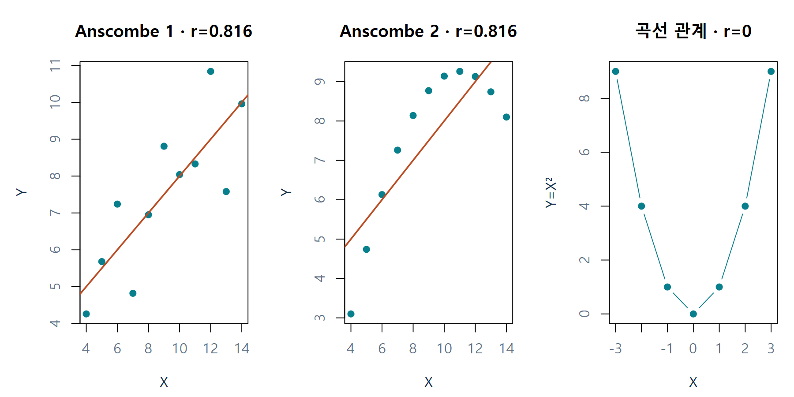
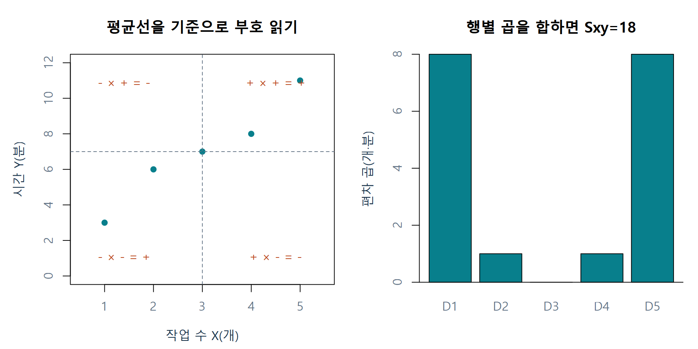
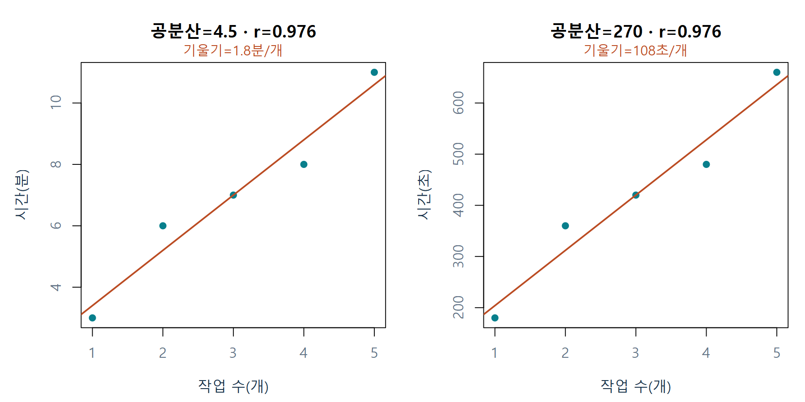
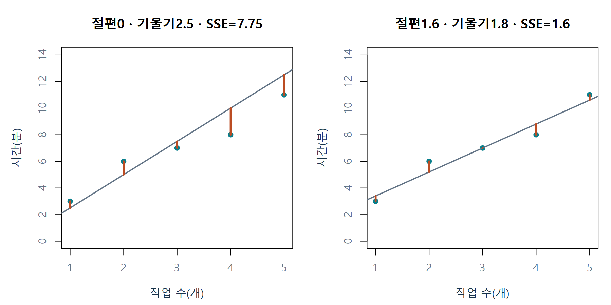
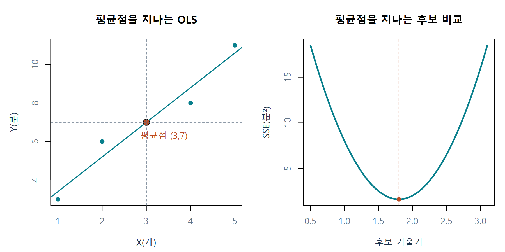
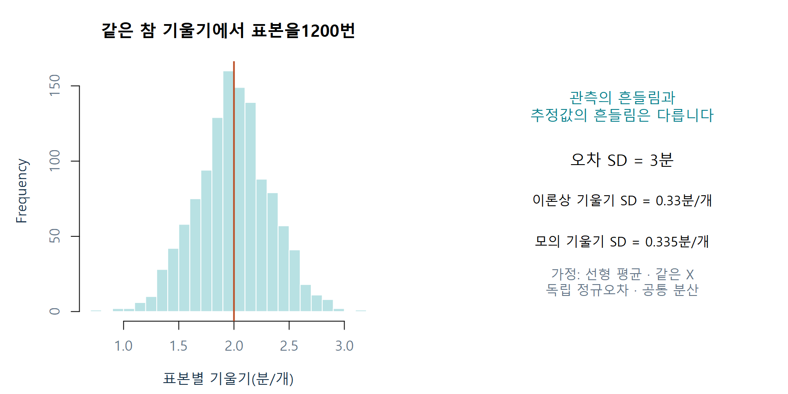
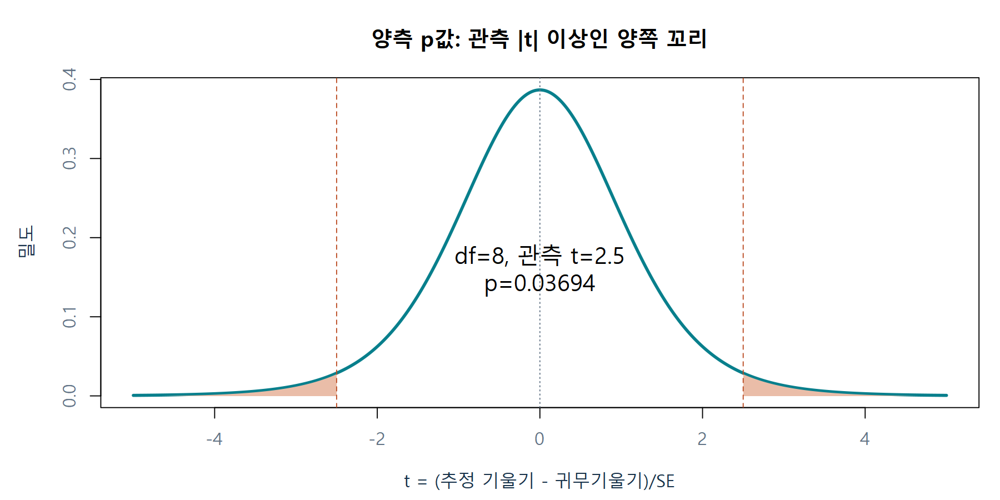
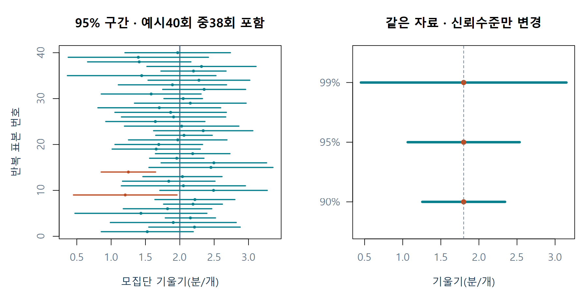

# W07A 중간고사 대비 ② · 상관과 단순선형회귀

2026-10-12 · 회귀분석의 이해 · 실제 3주차 W03A/W03B 복습 · 주교재 3.2–3.7

이번 자료는 핵심 요약과 정답 없는 60문항으로 구성됩니다. 일반 문제42개와 R 문제18개입니다. 한 번에 모두 맞히기보다, **왜 이 식을 쓰는지 한 문장으로 설명하는 것**을 목표로 해 주세요. 앞 문제의 답을 몰라도 다음 문제를 풀 수 있도록 필요한 자료를 각 문항에 다시 적었습니다.

학습 순서: 그림과 요약 읽기 → 종이에 예상·중간 계산 쓰기 → 기본 R로 확인 → 다른 결과가 나온 이유 적기 → 마지막 앱에서 설정을 바꾸어 설명하기. 손계산은 별도 지시가 없으면 소수 셋째 자리까지 보고하되 중간 값은 충분한 자릿수를 유지합니다. 아래 **설명 예제의 숫자는 연습문제와 구별**됩니다.

## 1. 이번 복습에서 연결할 여섯 질문

| 질문 | 사용할 도구 | 답에 반드시 포함할 것 |
|---|---|---|
| 두 변수가 함께 움직이는가? | 산점도·편차·공분산·상관 | 방향·모양·단위·한계 |
| 어떤 직선이 관측에 가까운가? | 수직 잔차와 최소제곱 | 무엇을 최소화하는가 |
| 직선의 계수는 무슨 뜻인가? | 기울기·절편·적합값 | Y/X단위, 관측 범위 |
| 직선과 추정값은 얼마나 흔들리는가? | SSE·자유도·s·SE | 오차의 산포와 추정의 산포 구별 |
| 특정 기울기와 다른 근거가 있는가? | t값·양측 p값 | 귀무값·조건·기각 판단 |
| 기울기를 어느 범위로 추정하는가? | 계수 신뢰구간 | 구간의 대상·단위·반복 의미 |

10월8일에는 1–2주차, 오늘은 3주차, 10월14일에는 4주차, 10월19일에는 총정리를 복습합니다. 오늘 SSE는 오차분산과 표준오차를 구하는 데 사용합니다. 제곱합 분해·R²·예측구간·F 검정의 집중 복습은 다음 시간으로 이어집니다.

## 2. 숫자 하나보다 산점도를 먼저 읽기

산점도는 같은 관측에서 얻은 X와 Y 한 쌍을 점 하나로 표시합니다. 먼저 방향(같이 증가/반대로 이동), 형태(직선/곡선), 흩어짐, 유난히 떨어진 점을 차례로 봅니다. 상관이 큰 자료라도 한 점에 지나치게 의존하는지 살펴야 합니다. 한 열만 따로 정렬하면 관측의 짝이 바뀝니다.



그림1. 왼쪽 두 패널은 R 내장 Anscombe 자료1·2를 직접 그린 것입니다. r은 약0.816으로 비슷하지만 점들의 모양은 다릅니다. 오른쪽은 수업용 $Y=X^2$ 자료입니다. 명확한 관계가 있어도 r=0입니다. 교재3.2의 그림3.2·3.3(96–97쪽)의 개념을 참고하여 독립적으로 작성한 R 그림입니다.

**Pearson 상관은 선형 연관성의 요약입니다.** r=0은 모든 관계가 없다는 말이 아니며, r이 크다는 사실은 인과관계를 입증하지 않습니다. 큰 표본·작은 p값도 이런 구별을 대신하지 못합니다.

## 3. 평균에서 벗어난 방향을 곱하기

평균을 빼면 각 관측이 “평균보다 큰가, 작은가”로 바뀝니다. 두 변수가 모두 평균보다 큰 점, 모두 작은 점은 편차 곱이 양수입니다. 서로 반대쪽에 있는 점은 음수입니다. 평균선 위의 점은 해당 편차가0입니다.

$$
d_{xi}=x_i-\bar x,\qquad d_{yi}=y_i-\bar y
$$

$$
S_{xx}=\sum_i d_{xi}^2,\quad S_{yy}=\sum_i d_{yi}^2,\quad S_{xy}=\sum_i d_{xi}d_{yi}
$$

설명용 가상 자료: 작업 수 X(개)=(1,2,3,4,5), 시간 Y(분)=(3,6,7,8,11). 평균은3개와7분입니다.

| 관측 | X | Y | X편차 | Y편차 | 편차 곱 | X편차² |
|---|---:|---:|---:|---:|---:|---:|
| D1 | 1 | 3 | −2 | −4 | 8 | 4 |
| D2 | 2 | 6 | −1 | −1 | 1 | 1 |
| D3 | 3 | 7 | 0 | 0 | 0 | 0 |
| D4 | 4 | 8 | 1 | 1 | 1 | 1 |
| D5 | 5 | 11 | 2 | 4 | 8 | 4 |
| 합 | 15 | 35 | 0 | 0 | 18 | 10 |

Y편차의 제곱합은16+1+0+1+16=34입니다. 따라서 $S_{xx}=10$, $S_{xy}=18$, $S_{yy}=34$입니다. 편차의 합이0이라는 성질과 편차 곱의 합이0이라는 주장은 다릅니다.



그림2. 왼쪽에서 평균선을 기준으로 점의 위치를 보고, 오른쪽에서 같은 행의 편차 곱을 읽습니다. 양의 기여8+1+0+1+8을 더하면18입니다. 교재 그림3.1(92–93쪽)의 부호 설명을 참고하되 예제와 배치는 새로 설계했습니다.

## 4. 공분산·상관·기울기를 구별하기

$$
s_{xy}=\frac{S_{xy}}{n-1},\qquad r=\frac{s_{xy}}{s_xs_y}=\frac{S_{xy}}{\sqrt{S_{xx}S_{yy}}}
$$

설명 예제에서 공분산은18/4=4.5개·분입니다. 상관은 $18/\sqrt{10\times34}\approx0.976$입니다. 상관의 부호는 방향을, 절댓값은 선형 연관의 정도를 요약합니다. 두 변수의 표준편차가 모두 양수여야 상관을 정의할 수 있습니다. 상수인 열이 있으면 상관0으로 대신하지 말고 계산 불가 이유를 적습니다.

| 양 | 질문 | 단위 | 설명 예제 |
|---|---|---|---|
| 공분산 | 평균보다 크고 작음이 함께 움직이는가? | X단위×Y단위 | 4.5개·분 |
| 상관 | 그 동행을 각 변수의 산포로 나누면? | 없음 | 약0.976 |
| Y-on-X 기울기 | X가1단위 다르면 적합 평균Y가 얼마나 다른가? | Y단위/X단위 | 1.8분/개 |



그림3. 시간의 단위를분에서초로 바꾸면 공분산4.5→270, 기울기1.8→108로 바뀌지만 같은 관계를 표현합니다. 두 그림의 축 눈금을 반드시 읽습니다. 공분산 숫자의 크기만으로 관계의 강도를 비교하지 않습니다. 원본 수업용 R 그림.

평행 이동 $X+a$는 편차를 바꾸지 않아 공분산·상관이 유지됩니다. 양수 배율은 공분산의 크기와 계수의 단위를 바꾸지만 상관은 유지합니다. 음수 배율은 상관의 부호를 뒤집습니다.

## 5. 참 평균선과 표본에서 구한 직선

$$
Y_i=\beta_0+\beta_1X_i+\varepsilon_i,\qquad
\hat Y_i=b_0+b_1X_i,\qquad e_i=Y_i-\hat Y_i
$$

β는 알 수 없는 모집단 모수, b는 이번 표본으로 계산한 추정값입니다. 교재의 $\hat\beta_0,\hat\beta_1$를 여기서는 읽기 쉽게 b₀,b₁로도 씁니다. 오차 ε는 **참 평균선**에서의 차이, 잔차 e는 **추정한 직선**에서의 차이입니다. 실제로 계산하는 잔차를 오차 그 자체와 동일시하지 않습니다.

최소제곱은 같은 X에서 관측과 직선 사이의 세로 잔차를 제곱하여 더한 값을 최소화합니다. 직선에 내린 가장 짧은 수선의 거리를 쓰는 방법과 구별합니다.

$$
SSE(b_0,b_1)=\sum_i\{y_i-(b_0+b_1x_i)\}^2
$$



그림4. 주황색 선은 같은 X의 관측값과 적합값을 연결합니다. 왼쪽 후보보다 오른쪽 OLS의 SSE가 작습니다. 잔차의 부호가 취소되지 않도록 각 잔차를 제곱한 뒤 더합니다. 교재3.5의 수직 잔차 개념에 연결한 새 예제입니다.

## 6. 손계산으로 OLS 직선 만들기

절편을 포함하고 $S_{xx}>0$인 단순회귀에서는 다음 공식이 성립합니다.

$$
b_1=\frac{S_{xy}}{S_{xx}}=r\frac{s_y}{s_x},\qquad b_0=\bar y-b_1\bar x
$$

설명 예제의 기울기는18/10=1.8분/개입니다. 절편은7−1.8×3=1.6분입니다. 따라서 적합식은 $\hat y=1.6+1.8x$입니다. X=2일 때5.2분을 적합하고 실제 관측6분과의 잔차는0.8분입니다.

| X | Y | 적합값 | 잔차 | 잔차² |
|---:|---:|---:|---:|---:|
| 1 | 3 | 3.4 | −0.4 | 0.16 |
| 2 | 6 | 5.2 | 0.8 | 0.64 |
| 3 | 7 | 7.0 | 0.0 | 0.00 |
| 4 | 8 | 8.8 | −0.8 | 0.64 |
| 5 | 11 | 10.6 | 0.4 | 0.16 |

잔차 합은0이지만 SSE는1.6분²입니다. 합0은 점들이 선의 위아래에서 균형을 이룬다는 뜻이며 모든 점이 직선에 일치한다는 뜻이 아닙니다.



그림5. 기울기를 바꿀 때 절편을 $\bar y-b_1\bar x$로 조정하면 모든 후보가 평균점을 지납니다. 그래도 SSE는 서로 다릅니다. “평균점을 지난다”만으로 최소제곱 해라고 확정할 수 없습니다. 원본 수업용 R 그림.

기울기의 말 해석은 “작업 수1개 차이에 대해 적합 평균시간이1.8분 높다”입니다. 절편1.6은 X=0일 때 직선이 주는 값이지만, 이 예제의 관측범위1~5개 밖이므로 실제 준비시간으로 확정하지 않습니다. Y를 X에 회귀한 식과 X를 Y에 회귀한 식도 같은 직선을 단순히 정리한 것이 아닙니다.

## 7. 남은 산포와 추정의 불확실성

$$
s^2=\frac{SSE}{n-2},\quad s=\sqrt{s^2},\quad
SE(b_1)=\frac{s}{\sqrt{S_{xx}}},\quad
SE(b_0)=s\sqrt{\frac1n+\frac{\bar x^2}{S_{xx}}}
$$

절편과 기울기 두 계수를 표본에서 추정했으므로 잔차자유도는 n−2입니다. 설명 예제에서는 n=5, SSE=1.6이므로 자유도3, s²=1.6/3≈0.533분², s≈0.730분입니다. 기울기 SE는 $0.7303/\sqrt{10}\approx0.231$분/개입니다.

**s는 관측이 참 평균선 주변에서 흩어지는 오차 규모의 추정값이고, SE는 표본을 달리했을 때 계수 추정값이 흔들리는 규모의 추정값입니다.** 표준편차와 표준오차는 같은 말이 아닙니다. 고정된 설계에서 오차가 작거나 X의 퍼짐이 커지면 기울기를 더 정밀하게 추정할 수 있습니다.



그림6. 참 기울기2분/개, 오차 표준편차3분을 가정해1200번 모의 표본을 만든 결과입니다. 실제 관측 연구 결과가 아니라 개념을 보여 주는 시뮬레이션입니다. 주황선은 고정된 참 기울기, 히스토그램은 표본별 추정값입니다. s와 SE의 대상과 단위를 오른쪽에서 비교합니다.

정확한 소표본 t추론은 주어진 X에서 평균이 선형이고 오차가 독립·평균0·등분산·정규라는 표준 가정을 사용합니다. X에는 변동이 있고 n>2여야 합니다. 이때 정규성은 모든 Y를 섞은 히스토그램이 아니라 **조건부 오차**에 대한 가정입니다. 직선을 계산하는 조건과 정확한 t추론의 조건을 구별합니다.

## 8. t값은 귀무값과의 차이를 SE로 나눈 값

$$
H_0:\beta_1=\beta_{1,0},\qquad
t=\frac{b_1-\beta_{1,0}}{SE(b_1)},\qquad df=n-2
$$

예를 들어 설명 예제의 기울기1.8을 귀무값1과 비교하면 t≈(1.8−1)/0.231≈3.464입니다. 같은 추정값이라도 귀무값0과 비교하면 다른 t값이 나옵니다. R의 기본 계수표는 계수0을 귀무값으로 사용하므로 다른 귀무값을 검정할 때 그대로 옮기지 않습니다.

양측검정은 관측한 t의 절댓값 이상으로 극단적인 **양쪽 꼬리**를 더합니다. 주어진 임계값과 절댓값을 비교하거나 p값과 유의수준을 비교합니다. 손계산 문제에는 필요한 임계값이나 p값을 제공합니다.



그림7. 별도 설명 예인 df=8, 관측 t=2.5에서 양측 p≈0.03694입니다. 음영 두 부분의 면적을 더합니다. 기울기의 실제 단위와 크기는 b₁로, 귀무값에서의 상대적인 거리는 t로 읽습니다. 교재 그림3.6(110쪽)의 양측검정 개념에 맞춰 새로 작성했습니다.

p값은 귀무가설과 모형 가정하에 이런 정도 이상으로 극단적인 결과가 나올 확률입니다. **귀무가설이 참일 확률이 아닙니다.** 기각하지 못했다는 결과는 효과0을 입증한 것이 아닙니다. 통계적 유의성·실질적 효과 크기·인과성은 각각 따로 설명합니다.

## 9. 신뢰구간은 어떤 값의 범위인가

$$
b_1\ \pm\ t_{1-\alpha/2,n-2}\,SE(b_1)
$$

설명 예제에서95% 임계값은 자유도3의3.1824입니다. 오차한계는3.1824×0.23094≈0.735, 구간은[1.065,2.535]분/개입니다. 여기서 구간의 대상은 기울기이며 다음 작업시간이 아닙니다.



그림8. 왼쪽에서 참 기울기는 고정 세로선이고 표본마다 구간이 달라집니다. 주황색 구간은 참값을 놓친 경우입니다. 유한40회에서 정확히38개가 포함된다고 보장하지 않습니다. 오른쪽은 같은 자료에서 신뢰수준만 높일 때 구간이 넓어지는 모습입니다. 원본 모의실험 그림.

95%라는 말은 같은 절차를 반복할 때 참 계수를 포함하는 장기 비율을 뜻합니다. 같은 자료와 같은 t방법의95% 양측 구간에 귀무값이 없으면5% 양측검정에서 기각합니다. 구간 안에 있다고 그 값이 참으로 확정되지는 않습니다.

## 10. 교재 수리시간 데이터로 다시 연결

교재3.3–3.7의 Computer.Repair는 부품 수 Units(개), 수리시간 Minutes(분)14건입니다. 기존3주차와 동일 자료를 사용합니다. 설명용5행 가상 자료와 구별하세요.

| 요약 | 데이터로 재계산한 값 | 의미 |
|---|---:|---|
| 상관 r | 0.993699 | 강한 양의 선형 연관 |
| 절편 b₀ | 4.161654분 | X=0의 적합값, 관측범위 밖 해석에 주의 |
| 기울기 b₁ | 15.508772분/개 | 부품1개 차이에 따른 적합 평균시간 차이 |
| SSE | 348.848371분² | 남은 잔차 제곱의 합 |
| s | 5.391725분 | 오차 표준편차 추정 |
| 기울기 SE | 0.504981분/개 | 기울기 추정의 정밀도 |
| 기울기95% 구간 | 14.408512~16.609031분/개 | 계수 구간, 개별 수리시간 구간 아님 |

위 값은 데이터로 다시 계산했으며 일부 교재 서술의 반올림 수치와 다를 수 있습니다. 높은 상관은 외삽의 타당성이나 인과관계까지 보장하지 않습니다.

## 11. 문제를 푸는 데 필요한 최소 R

| 표현 | 하는 일 | 이론 연결 |
|---|---|---|
| `c(1,2,3)` | 여러 수를 벡터로 묶음 | 한 변수의 관측 목록 |
| `length(x)` / `mean(x)` | 개수 / 산술평균 | n과 평균 |
| `x-mean(x)` | 각 값에서 평균을 뺌 | 편차 |
| `sum(a*b)` / `sum(a^2)` | 행별 곱 합 / 제곱 합 | Sxy와Sxx |
| `sqrt(v)` | 양의 제곱근 | 분산→표준편차 |
| `cov(x,y)` / `cor(x,y)` | 표본공분산 / Pearson 상관 | 같은 행의 쌍 유지 |
| `lm(y~x)` / `coef(m)` | 절편 포함 회귀 / 계수 | 왼쪽 반응, 오른쪽 설명 |
| `residuals(m)` | 관측−적합값 | 잔차 |
| `confint(m,level=.95)` | 계수 신뢰구간 | 개별 Y구간과 구별 |
| `pt(q,df)` / `qt(p,df)` | t누적확률 / t분위수 | 호출틀과 뜻을 문제에 제공 |

함수 이름을 외우기보다 무엇을 계산하는지 읽습니다. 아래 설명 예제는 실행 가능한 완성 예이고, Q43–Q60은 여러분이 풀 연습입니다.

```r
x <- c(1,2,3,4,5)
y <- c(3,6,7,8,11)
dx <- x-mean(x); dy <- y-mean(y)
b1 <- sum(dx*dy)/sum(dx^2)
b0 <- mean(y)-b1*mean(x)
print(c(intercept=b0,slope=b1))
```

## 12. 마지막 활동 · 내가 바꾼 설정을 설명하기

[설치 없는 온라인 R](https://lunalab-ai.github.io/regre/w07a.html)에서 설명 예제를 실행하고 문제 셀의 빈칸·오류를 직접 수정하세요. [누적 웹 앱 W07A 탭](https://lunalab-ai.github.io/regre/apps/w07a/)은 같은5행 가상 자료를 사용합니다. 다른 차시 탭은 복습용으로 남겨 둡니다.

앱에서는 ①후보 기울기·절편을 바꿔 세로잔차와 SSE를 관찰하고 ②분을초로 바꿔 공분산·상관·계수의 변화를 비교하며 ③귀무기울기를 바꿔 t와 p값을 읽고 ④신뢰수준을 바꿔 구간 폭을 확인합니다. 매번 “바꾸기 전 예상 → 실제 결과 → 같은 것/달라진 것의 이유”를 적으세요.

앱 편집기에서 `sliderInput("w7_slope",...)`의 기본값 `value=1.8`을 `value=2.2`로 바꾸고 Run으로 다시 실행합니다. 입력 `input$w7_slope`가 `review_line`에 전달되고 그 결과가 표·잔차 그림으로 표시되는 연결을 찾으세요. 정답 문항을 앱에 넣은 것이 아니라 설명 예제를 직접 조립하는 활동입니다.

공통 R 함수는 [입력·출력·실제 정의 바로가기](https://github.com/lunalab-ai/regre/blob/2026-fall-w07a/src/review-slr-api.md)에서 확인합니다. Colab A는 관계·추정, B는 불확실성·추론이며 각각 독립 실행됩니다. CPU만 사용합니다. 인터넷이 어려우면 동봉 R파일과 data폴더를 함께 사용하세요.

참고: 주교재 『Chatterjee 예제를 통한 회귀분석 제6판: R 활용』3.2–3.7(92–114쪽), 기존 W03A/B 자료. 추가 확인: [R 공분산·상관](https://stat.ethz.ch/R-manual/R-devel/library/stats/html/cor.html), [R 계수표](https://stat.ethz.ch/R-manual/R-devel/library/stats/html/summary.lm.html), [R 계수 신뢰구간](https://stat.ethz.ch/R-manual/R-devel/library/stats/html/confint.html), [NIST 산점도](https://www.itl.nist.gov/div898/handbook/eda/section3/scatterp.htm). 그림과 소규모 설명 자료는 별도 표시된 Anscombe·교재 데이터 외에는 수업용으로 새로 작성했습니다.


# 연습문제 60문항 · 정답 미포함

각 문항은 독립적입니다. 모든 일반 문제는 최종 답과 함께 중간 계산 또는 판단 근거를 적으세요. R은 필요한 함수 설명이 문제에 제시됩니다. 연습 코드의 의도적 빈칸·오류는 직접 고쳐 실행합니다.

## Q01 · 산점도를 문장으로 읽기

유형: 일반 · 난이도: 기초

공부시간 X(시간)와 점수 Y(점)의 관측 쌍이 (1,48), (2,55), (3,62), (4,68), (5,77)이다. 점들의 방향·형태를 설명하고, 이 자료만으로 “공부를 1시간 늘리면 누구나 점수가 오른다”고 결론낼 수 있는지 근거를 쓰시오.

**풀이 기록**: 주어진 정보 → 개념/식 → 중간 계산 또는 코드 추적 → 의미·단위

....................................................................................................

....................................................................................................

## Q02 · 상관 0인데 관계는 있을까

유형: 일반 · 난이도: 기초

X=(-2,-1,0,1,2), Y=(4,1,0,1,4)이다. X의 평균은0, Y의 평균은2이다. 편차 곱의 합을 계산해 상관의 부호를 판단하고, “두 변수 사이에 아무 관계도 없다”는 말의 타당성을 설명하시오.

**풀이 기록**: 주어진 정보 → 개념/식 → 중간 계산 또는 코드 추적 → 의미·단위

....................................................................................................

....................................................................................................

## Q03 · 같은 상관이면 같은 자료인가

유형: 일반 · 난이도: 적용

자료 A는 점들이 직선 주변에 고르게 흩어져 있고, 자료 B는 대부분의 X가 비슷하며 멀리 떨어진 점 하나가 있다. 두 자료 모두 r=0.82이다. 회귀분석 전 무엇을 확인해야 하며, r만 같다는 이유로 같은 해석을 해도 되는지 설명하시오.

**풀이 기록**: 주어진 정보 → 개념/식 → 중간 계산 또는 코드 추적 → 의미·단위

....................................................................................................

....................................................................................................

## Q04 · 양의 값인데 공분산은 음수

유형: 일반 · 난이도: 기초

세 관측의 X는(1,2,3), Y는(9,6,3)이다. 모든 숫자가 양수인데도 공분산이 음수가 될 수 있는 이유를 평균과 편차의 부호를 이용해 설명하시오.

**풀이 기록**: 주어진 정보 → 개념/식 → 중간 계산 또는 코드 추적 → 의미·단위

....................................................................................................

....................................................................................................

## Q05 · 단위 없는 상관의 비교

유형: 일반 · 난이도: 기초

키(cm)와 체중(kg)의 r=0.70, 하루 운동시간(분)과 안정시 심박수(회/분)의 r=−0.90이다. 선형 연관성의 강도가 더 큰 쪽과 각각의 방향을 설명하시오.

**풀이 기록**: 주어진 정보 → 개념/식 → 중간 계산 또는 코드 추적 → 의미·단위

....................................................................................................

....................................................................................................

## Q06 · 상관을 정의할 수 없는 경우

유형: 일반 · 난이도: 기초

X=(3,3,3,3), Y=(2,4,6,8)이다. Pearson 상관계수를 계산할 수 있는지 설명하시오. 계산할 수 없다면 r=0이라고 적어도 되는지 이유를 쓰시오.

**풀이 기록**: 주어진 정보 → 개념/식 → 중간 계산 또는 코드 추적 → 의미·단위

....................................................................................................

....................................................................................................

## Q07 · 편차 표를 완성하기

유형: 일반 · 난이도: 기초

X=(1,2,3,4), Y=(2,3,5,6)이다. 두 평균을 구하고, 각 관측의 X편차·Y편차·편차 곱을 표로 써서 편차 곱의 합을 구하시오.

**풀이 기록**: 주어진 정보 → 개념/식 → 중간 계산 또는 코드 추적 → 의미·단위

....................................................................................................

....................................................................................................

## Q08 · 표본공분산의 분모와 단위

유형: 일반 · 난이도: 기초

네 가게의 광고비 X(만원)와 매출 Y(만원)에서 편차 곱의 합이24이다. 표본공분산을 계산하고, 분모 및 결과의 단위를 쓰시오.

**풀이 기록**: 주어진 정보 → 개념/식 → 중간 계산 또는 코드 추적 → 의미·단위

....................................................................................................

....................................................................................................

## Q09 · 표준화하여 상관 구하기

유형: 일반 · 난이도: 기초

같은 자료의 표본공분산이−12, X의 표준편차가3, Y의 표준편차가8이다. 상관계수와 그 방향을 구하고, 계산 결과가 가능한 범위인지 확인하시오.

**풀이 기록**: 주어진 정보 → 개념/식 → 중간 계산 또는 코드 추적 → 의미·단위

....................................................................................................

....................................................................................................

## Q10 · 평행 이동은 무엇을 바꾸나

유형: 일반 · 난이도: 기초

X와 Y의 표본공분산이6, 상관계수가0.60이다. 모든 X에100을 더한 새 변수 Z=X+100을 만든다. Z와 Y의 공분산·상관은 어떻게 되는가? 평균에서 뺀 편차를 이용해 설명하시오.

**풀이 기록**: 주어진 정보 → 개념/식 → 중간 계산 또는 코드 추적 → 의미·단위

....................................................................................................

....................................................................................................

## Q11 · 양의 단위 변환

유형: 일반 · 난이도: 기초

거리 X(km)와 시간 Y(분)의 공분산이5, 상관이0.8이다. 거리를 m로 바꾸어 Z=1000X로 표시한다. 공분산과 상관의 새 값을 계산하고 이유를 설명하시오.

**풀이 기록**: 주어진 정보 → 개념/식 → 중간 계산 또는 코드 추적 → 의미·단위

....................................................................................................

....................................................................................................

## Q12 · 부호를 뒤집는 변환

유형: 일반 · 난이도: 적용

X와 Y의 상관이0.75, 표본공분산이4이다. Z=20−2X로 바꾼다. Z와 Y의 공분산 및 상관을 구하고, 단순 평행 이동과 다른 이유를 설명하시오.

**풀이 기록**: 주어진 정보 → 개념/식 → 중간 계산 또는 코드 추적 → 의미·단위

....................................................................................................

....................................................................................................

## Q13 · 상관과 기울기의 연결

유형: 일반 · 난이도: 기초

X의 표준편차는2시간, Y의 표준편차는5점이고 상관은0.6이다. 절편을 포함한 단순회귀에서 Y를 X에 회귀한 기울기를 계산하시오. 상관0.6과 기울기의 해석 차이도 쓰시오.

**풀이 기록**: 주어진 정보 → 개념/식 → 중간 계산 또는 코드 추적 → 의미·단위

....................................................................................................

....................................................................................................

## Q14 · 회귀 방향을 뒤집으면

유형: 일반 · 난이도: 통합

X와 Y의 상관은0.5, 표준편차는 각각2와4이다. Y를 X에 회귀한 기울기와 X를 Y에 회귀한 기울기를 각각 계산하고, 두 기울기가 항상 역수인지 판단하시오.

**풀이 기록**: 주어진 정보 → 개념/식 → 중간 계산 또는 코드 추적 → 의미·단위

....................................................................................................

....................................................................................................

## Q15 · 모형과 적합식의 기호

유형: 일반 · 난이도: 기초

모집단 모형은 $Y_i=\beta_0+\beta_1X_i+\varepsilon_i$이고 표본으로 얻은 식은 $\hat Y_i=3+2X_i$이다. β₁과2의 차이, εᵢ와 $Y_i-\hat Y_i$의 차이를 각각 설명하시오.

**풀이 기록**: 주어진 정보 → 개념/식 → 중간 계산 또는 코드 추적 → 의미·단위

....................................................................................................

....................................................................................................

## Q16 · 최소제곱이 줄이는 거리

유형: 일반 · 난이도: 기초

동일한 X에서 관측 Y=9, 후보 직선의 적합값은6이다. 이 점의 잔차와 SSE에 대한 기여를 구하시오. 최소제곱이 직선에 내린 수선의 최단거리 제곱을 최소화한다는 설명은 맞는가?

**풀이 기록**: 주어진 정보 → 개념/식 → 중간 계산 또는 코드 추적 → 의미·단위

....................................................................................................

....................................................................................................

## Q17 · 두 후보 직선 선택

유형: 일반 · 난이도: 적용

같은 세 관측에 대해 직선 A의 잔차가(−2,1,1), 직선 B의 잔차가(0,0,3)이다. SSE를 각각 계산해 두 후보 중 최소제곱 기준으로 더 나은 직선을 고르시오. 선택한 직선이 모든 가능한 직선 중 OLS라고 단정할 수 있는지도 쓰시오.

**풀이 기록**: 주어진 정보 → 개념/식 → 중간 계산 또는 코드 추적 → 의미·단위

....................................................................................................

....................................................................................................

## Q18 · 기울기와 절편 직접 구하기

유형: 일반 · 난이도: 기초

X=(1,2,3,4), Y=(2,3,5,6)이다. 평균은2.5와4, $S_{xx}=5$, $S_{xy}=7$이다. 절편을 포함한 최소제곱직선의 기울기와 절편을 구하고 식을 쓰시오.

**풀이 기록**: 주어진 정보 → 개념/식 → 중간 계산 또는 코드 추적 → 의미·단위

....................................................................................................

....................................................................................................

## Q19 · 적합값과 잔차를 표로

유형: 일반 · 난이도: 기초

X=(1,2,3,4), 관측 Y=(2,3,5,6), 적합식 ŷ=0.5+1.4x이다. 네 적합값·잔차를 각각 구하고 잔차 합을 확인하시오.

**풀이 기록**: 주어진 정보 → 개념/식 → 중간 계산 또는 코드 추적 → 의미·단위

....................................................................................................

....................................................................................................

## Q20 · 기울기의 단위와 변화량

유형: 일반 · 난이도: 기초

배달거리 X(km), 배달시간 Y(분)의 적합식이 ŷ=7+4x이다. 기울기의 뜻을 설명하고, 거리가3km에서5km로 다른 두 관측의 적합시간 차이를 구하시오.

**풀이 기록**: 주어진 정보 → 개념/식 → 중간 계산 또는 코드 추적 → 의미·단위

....................................................................................................

....................................................................................................

## Q21 · 절편의 해석 범위

유형: 일반 · 난이도: 기초

광고비 X(만원)의 관측 범위는10~30이고 매출 Y(만원)의 적합식은 ŷ=40+3x이다. 절편40의 수학적 의미와 실제 해석 시 주의점을 쓰시오.

**풀이 기록**: 주어진 정보 → 개념/식 → 중간 계산 또는 코드 추적 → 의미·단위

....................................................................................................

....................................................................................................

## Q22 · 평균점을 지나는지 확인

유형: 일반 · 난이도: 기초

절편 포함 OLS에서 X평균은4, Y평균은13이며 기울기 추정값은2이다. 절편을 구하고, 왜 평균점(4,13)이 직선에 놓이는지 식으로 확인하시오.

**풀이 기록**: 주어진 정보 → 개념/식 → 중간 계산 또는 코드 추적 → 의미·단위

....................................................................................................

....................................................................................................

## Q23 · 오차와 잔차를 따로 계산

유형: 일반 · 난이도: 적용

가상 상황에서 참 평균식이 E(Y|X)=2+3X라고 알려져 있다. 표본 적합식은 ŷ=1+3.5X이다. X=2, 관측 Y=10인 관측의 오차와 잔차를 각각 구하시오.

**풀이 기록**: 주어진 정보 → 개념/식 → 중간 계산 또는 코드 추적 → 의미·단위

....................................................................................................

....................................................................................................

## Q24 · 단위가 바뀐 회귀직선

유형: 일반 · 난이도: 적용

X는km, Y는분이고 적합식은 ŷ=5+2X이다. Z=1000X(m)로 바꿀 때 Y를 Z로 표현한 식을 구하시오.1km와1000m에서 같은 적합값이 되는지 검산하시오.

**풀이 기록**: 주어진 정보 → 개념/식 → 중간 계산 또는 코드 추적 → 의미·단위

....................................................................................................

....................................................................................................

## Q25 · 잔차제곱합과 상쇄

유형: 일반 · 난이도: 기초

어떤 절편 포함 회귀의 잔차가(−1,1,2,−2)이다. 잔차 합과 SSE를 각각 계산하고 두 값의 의미가 왜 다른지 설명하시오.

**풀이 기록**: 주어진 정보 → 개념/식 → 중간 계산 또는 코드 추적 → 의미·단위

....................................................................................................

....................................................................................................

## Q26 · 왜 n−2로 나누는가

유형: 일반 · 난이도: 기초

관측10개에 절편과 기울기를 포함한 단순선형회귀를 적합하여 SSE=72를 얻었다. 잔차자유도, 오차분산 추정값 s², 오차 표준편차 추정값 s를 구하고 분모의 이유를 설명하시오.

**풀이 기록**: 주어진 정보 → 개념/식 → 중간 계산 또는 코드 추적 → 의미·단위

....................................................................................................

....................................................................................................

## Q27 · 오차 표준편차와 기울기의 표준오차

유형: 일반 · 난이도: 기초

X는시간, Y는점수이다. s=6점, $S_{xx}=36$시간²이다. 기울기의 표준오차를 구하고 s와의 의미 차이를 설명하시오.

**풀이 기록**: 주어진 정보 → 개념/식 → 중간 계산 또는 코드 추적 → 의미·단위

....................................................................................................

....................................................................................................

## Q28 · X의 퍼짐과 정밀도

유형: 일반 · 난이도: 적용

두 연구의 오차 표준편차 추정값은 모두4이다. 연구 A의 Sxx=16, B의 Sxx=64이다. 기울기 SE를 각각 구하고 어느 쪽이 더 정밀한지, 나머지 조건이 같다는 전제에서 설명하시오.

**풀이 기록**: 주어진 정보 → 개념/식 → 중간 계산 또는 코드 추적 → 의미·단위

....................................................................................................

....................................................................................................

## Q29 · 절편의 표준오차

유형: 일반 · 난이도: 적용

n=5, X평균=2, Sxx=10, s²=4이다. 절편 표준오차 공식 $SE(b_0)=s\sqrt{1/n+\bar X^2/S_{xx}}$를 이용해 값을 구하시오. 제곱근은 마지막에 취하고 소수 셋째 자리까지 쓰시오.

**풀이 기록**: 주어진 정보 → 개념/식 → 중간 계산 또는 코드 추적 → 의미·단위

....................................................................................................

....................................................................................................

## Q30 · 정확한 t 추론의 조건

유형: 일반 · 난이도: 통합

절편 포함 단순선형회귀에서 작은 표본의 계수에 정확한 t 검정·t 신뢰구간을 적용하려 한다. 모형 평균과 오차에 필요한 표준적인 조건을 쓰고, “Y 자체가 반드시 정규분포여야 한다”는 설명을 고치시오.

**풀이 기록**: 주어진 정보 → 개념/식 → 중간 계산 또는 코드 추적 → 의미·단위

....................................................................................................

....................................................................................................

## Q31 · 기울기 t값 계산

유형: 일반 · 난이도: 기초

기울기 추정값 b₁=2.4, SE(b₁)=0.6이다. H₀:β₁=0 대 H₁:β₁≠0의 t값을 구하고, 그 값이 무엇을 표준화한 것인지 설명하시오.

**풀이 기록**: 주어진 정보 → 개념/식 → 중간 계산 또는 코드 추적 → 의미·단위

....................................................................................................

....................................................................................................

## Q32 · 귀무값이 0이 아닐 때

유형: 일반 · 난이도: 적용

b₁=2.4, SE=0.6, n=10이다. H₀:β₁=1 대 양측 대립을 검정한다. t₀.₉₇₅,₈=2.306을 주었을 때 t값과5% 수준의 결론을 쓰시오.

**풀이 기록**: 주어진 정보 → 개념/식 → 중간 계산 또는 코드 추적 → 의미·단위

....................................................................................................

....................................................................................................

## Q33 · 음의 t값 판단

유형: 일반 · 난이도: 기초

n=12, b₁=−1.5, SE=0.5이다. H₀:β₁=0 대 양측 대립,5% 임계값 t₀.₉₇₅,₁₀=2.228이다. 검정하고 기울기의 방향을 함께 해석하시오.

**풀이 기록**: 주어진 정보 → 개념/식 → 중간 계산 또는 코드 추적 → 의미·단위

....................................................................................................

....................................................................................................

## Q34 · p값의 정확한 문장

유형: 일반 · 난이도: 적용

기울기0에 대한 양측 검정의 p값이0.03이다. 유의수준0.05에서 판단하고, “귀무가설이 참일 확률이3%”라는 말을 올바른 조건부 표현으로 고치시오.

**풀이 기록**: 주어진 정보 → 개념/식 → 중간 계산 또는 코드 추적 → 의미·단위

....................................................................................................

....................................................................................................

## Q35 · 유의하지 않다는 결론

유형: 일반 · 난이도: 기초

기울기 추정값0.8, SE=0.7, 기울기0에 대한 양측 p값0.28을 얻었다.5% 수준에서 올바른 결론을 쓰고, “관계가 전혀 없음을 입증했다”가 왜 부적절한지 설명하시오.

**풀이 기록**: 주어진 정보 → 개념/식 → 중간 계산 또는 코드 추적 → 의미·단위

....................................................................................................

....................................................................................................

## Q36 · 유의성·크기·인과성

유형: 일반 · 난이도: 통합

관측 연구에서 운동시간1분당 심박수 기울기 b₁=−0.02회/분(심박수 단위)/분(운동시간 단위), p=0.001이었다. 연구자는 “운동1분의 큰 치료효과가 입증되었다”고 말했다. 이 주장에 빠진 두 가지 판단을 쓰시오.

**풀이 기록**: 주어진 정보 → 개념/식 → 중간 계산 또는 코드 추적 → 의미·단위

....................................................................................................

....................................................................................................

## Q37 · 계수 신뢰구간 계산

유형: 일반 · 난이도: 기초

n=10, 기울기 b₁=3, SE=0.5이며95% 구간의 t 임계값은2.306이다. 기울기 신뢰구간을 구하고,0을 포함하는지 쓰시오.

**풀이 기록**: 주어진 정보 → 개념/식 → 중간 계산 또는 코드 추적 → 의미·단위

....................................................................................................

....................................................................................................

## Q38 · 신뢰수준과 폭

유형: 일반 · 난이도: 적용

동일 자료에서 b₁=2, SE=0.4이다.90% 구간의 임계값1.812,95% 구간의 임계값2.228을 사용한다. 두 구간을 계산하고 신뢰수준을 높이면 왜 폭이 달라지는지 설명하시오.

**풀이 기록**: 주어진 정보 → 개념/식 → 중간 계산 또는 코드 추적 → 의미·단위

....................................................................................................

....................................................................................................

## Q39 · 구간과 같은 양측 검정

유형: 일반 · 난이도: 적용

같은 모형·자료·표준오차를 사용한 기울기의95% t 신뢰구간이[1.2,2.8]이다.5% 양측검정에서 H₀:β₁=0과 H₀:β₁=2를 각각 어떻게 판단하는지 근거를 쓰시오.

**풀이 기록**: 주어진 정보 → 개념/식 → 중간 계산 또는 코드 추적 → 의미·단위

....................................................................................................

....................................................................................................

## Q40 · 95%의 반복 의미

유형: 일반 · 난이도: 적용

같은 설계와 가정을 만족하는 표본을100번 독립적으로 얻어 매번95% 기울기 신뢰구간을 만든다고 하자. 이때 무엇이 고정되고 무엇이 달라지는지, 약95%라는 말의 뜻을 설명하시오. 정확히95개 포함을 보장하는가?

**풀이 기록**: 주어진 정보 → 개념/식 → 중간 계산 또는 코드 추적 → 의미·단위

....................................................................................................

....................................................................................................

## Q41 · 어떤 대상의 구간인가

유형: 일반 · 난이도: 기초

수리 부품 수 X(개)로 수리시간 Y(분)을 설명했으며 기울기의95% 구간이[14.4,16.6]분/개이다. “다음 컴퓨터의 수리시간이14.4~16.6분이다”라는 설명을 고치시오.

**풀이 기록**: 주어진 정보 → 개념/식 → 중간 계산 또는 코드 추적 → 의미·단위

....................................................................................................

....................................................................................................

## Q42 · 출력 전체를 한 문단으로 해석

유형: 일반 · 난이도: 통합

한 단순회귀의 계수표에서 X행은 추정값1.20, SE0.50, t=2.40, 양측 p=0.0475이다. n=9이며95% 임계값 t₀.₉₇₅,₇=2.365이다. X는시간, Y는점수이다.95% 구간을 계산하고 효과 크기·불확실성·검정 결론을 한 문단으로 쓰시오.

**풀이 기록**: 주어진 정보 → 개념/식 → 중간 계산 또는 코드 추적 → 의미·단위

....................................................................................................

....................................................................................................

## Q43 · 상관 출력과 곡선 관계

유형: R · 난이도: 기초 · 출력 예측

아래 코드의 출력과 점들의 모양을 예상하시오. cor는 Pearson 상관을 구하며, round(값,6)는 소수6자리까지 반올림한다. 출력만으로 두 변수 사이에 관계가 없다고 말할 수 있는가?

```r
x <- c(-3,-2,-1,0,1,2,3)
y <- x^2
print(round(cor(x,y),6))
plot(x,y)
```

**풀이 기록**: 주어진 정보 → 개념/식 → 중간 계산 또는 코드 추적 → 의미·단위

....................................................................................................

....................................................................................................

## Q44 · 한 열만 정렬한 오류

유형: R · 난이도: 적용 · 에러 찾기

x와 y는 같은 사람 순서로 측정한 값이다. sort는 원소를 작은 값부터 정렬한다. 다음 코드는 실행되지만 원래 자료의 상관을 바꿔 버린다. 잘못된 줄을 수정하고, 원래 상관과 잘못 계산된 상관을 비교하시오.

```r
x <- c(1,2,3,4)
y <- c(40,10,30,20)
r <- cor(x,sort(y))
print(r)
```

**풀이 기록**: 주어진 정보 → 개념/식 → 중간 계산 또는 코드 추적 → 의미·단위

....................................................................................................

....................................................................................................

## Q45 · 편차 곱의 합 빈칸

유형: R · 난이도: 기초 · 빈칸

sum은 합, mean은 평균이다. Sxy를 직접 계산하도록 ___ 두 곳을 완성하고 결과를 구하시오.

```r
x <- c(1,2,3,4)
y <- c(1,3,4,8)
dx <- x - ___
dy <- y - mean(y)
Sxy <- sum(dx ___ dy)
print(Sxy)
```

**풀이 기록**: 주어진 정보 → 개념/식 → 중간 계산 또는 코드 추적 → 의미·단위

....................................................................................................

....................................................................................................

## Q46 · 공분산에서 상관까지

유형: R · 난이도: 적용 · 빈칸

n=5, Sxy=12, Sxx=10, Syy=40이다. 아래 빈칸 두 개를 완성해 표본공분산과 상관을 구하시오. sqrt는 제곱근이다.

```r
n <- 5; Sxy <- 12; Sxx <- 10; Syy <- 40
sxy <- Sxy / ___
r <- Sxy / sqrt(___)
print(c(covariance=sxy,correlation=r))
```

**풀이 기록**: 주어진 정보 → 개념/식 → 중간 계산 또는 코드 추적 → 의미·단위

....................................................................................................

....................................................................................................

## Q47 · 결측을 각각 빼면 생기는 오류

유형: R · 난이도: 통합 · 에러 찾기

is.na는 결측이면TRUE, !는 반대, &는 두 조건이 모두TRUE인 위치를 뜻한다. 두 열에서 결측을 따로 제거한 코드의 문제를 찾고, 같은 관측에서 두 값이 모두 있는 쌍만 사용하도록 수정하시오.

```r
x <- c(1,NA,3,4)
y <- c(2,4,NA,8)
x2 <- x[!is.na(x)]
y2 <- y[!is.na(y)]
print(cor(x2,y2))
```

**풀이 기록**: 주어진 정보 → 개념/식 → 중간 계산 또는 코드 추적 → 의미·단위

....................................................................................................

....................................................................................................

## Q48 · 단위를 바꾼 출력

유형: R · 난이도: 적용 · 출력 예측

cov와 cor는 각각 표본공분산과 상관을 반환한다. 아래 두 출력 벡터를 구하고 시간 단위를분에서초로 바꿀 때 유지되는 값을 설명하시오.

```r
x <- c(1,2,3)
y <- c(2,4,6)
print(c(cov=cov(x,y),r=cor(x,y)))
print(c(cov=cov(x,60*y),r=cor(x,60*y)))
```

**풀이 기록**: 주어진 정보 → 개념/식 → 중간 계산 또는 코드 추적 → 의미·단위

....................................................................................................

....................................................................................................

## Q49 · 기울기와 절편 빈칸

유형: R · 난이도: 적용 · 빈칸

아래 코드가 기본 산술로 OLS 계수를 계산하도록 두 빈칸을 채우시오. 여기서 x,y는 이번 문항 안에서 새로 정의된다.

```r
x <- c(1,2,3,4)
y <- c(1,3,4,8)
Sxx <- sum((x-mean(x))^2)
Sxy <- sum((x-mean(x))*(y-mean(y)))
b1 <- ___
b0 <- mean(y) - ___
print(c(intercept=b0,slope=b1))
```

**풀이 기록**: 주어진 정보 → 개념/식 → 중간 계산 또는 코드 추적 → 의미·단위

....................................................................................................

....................................................................................................

## Q50 · 적합값과 잔차 빈칸

유형: R · 난이도: 기초 · 빈칸

아래 식의 계수는 이미 주어졌다. 예측값과 잔차를 계산하도록 빈칸을 채우고 마지막 출력의 네 값을 구하시오.

```r
x <- c(1,2,3,4); y <- c(1,3,4,8)
b0 <- -1.5; b1 <- 2.2
yhat <- ___
e <- ___
print(round(e,3))
```

**풀이 기록**: 주어진 정보 → 개념/식 → 중간 계산 또는 코드 추적 → 의미·단위

....................................................................................................

....................................................................................................

## Q51 · 제곱 위치의 조용한 오류

유형: R · 난이도: 적용 · 에러 찾기

아래 코드는 오류 메시지 없이 숫자를 출력하지만 SSE가 아니다. 잘못된 식을 고쳐 SSE를 구하고, 원래 코드가 왜0을 내는지 설명하시오.

```r
e <- c(-2,-1,1,2)
SSE <- sum(e)^2
print(SSE)
```

**풀이 기록**: 주어진 정보 → 개념/식 → 중간 계산 또는 코드 추적 → 의미·단위

....................................................................................................

....................................................................................................

## Q52 · 반응변수를 뒤집은 코드

유형: R · 난이도: 적용 · 에러 찾기

lm(y ~ x)는 왼쪽 y를 오른쪽 x로 설명하는 절편 포함 회귀이다. coef는 절편과 기울기를 돌려준다. “공부시간 hours로 점수 score를 설명”하려는 코드가 아래와 같다. 모형 식을 고치고 수정 전후 기울기의 단위를 설명하시오.

```r
hours <- c(1,2,3,4)
score <- c(3,5,6,10)
m <- lm(hours ~ score)
print(coef(m))
```

**풀이 기록**: 주어진 정보 → 개념/식 → 중간 계산 또는 코드 추적 → 의미·단위

....................................................................................................

....................................................................................................

## Q53 · 오차분산과 표준편차

유형: R · 난이도: 기초 · 빈칸

n=8인 절편 포함 단순회귀에서 SSE=54이다. 분산 추정값과 표준편차 추정값을 구하도록 두 빈칸을 완성하시오.

```r
n <- 8; SSE <- 54
s2 <- SSE / ___
s <- ___
print(c(variance=s2,sd=s))
```

**풀이 기록**: 주어진 정보 → 개념/식 → 중간 계산 또는 코드 추적 → 의미·단위

....................................................................................................

....................................................................................................

## Q54 · 기울기 SE의 제곱근 오류

유형: R · 난이도: 적용 · 에러 찾기

기울기 표준오차 공식은 s/√Sxx이다. 아래 코드의 문제를 고치고 결과를 구하시오. 이때 s의 단위는점, X의 단위는시간이다.

```r
s <- 3; Sxx <- 25
se_b1 <- s/Sxx
print(se_b1)
```

**풀이 기록**: 주어진 정보 → 개념/식 → 중간 계산 또는 코드 추적 → 의미·단위

....................................................................................................

....................................................................................................

## Q55 · 임의의 귀무기울기

유형: R · 난이도: 적용 · 빈칸

b1은 추정 기울기, null은 귀무기울기, se는 표준오차이다. t통계량 빈칸을 채우고 값을 해석하시오.

```r
b1 <- 1.8; null <- 1; se <- 0.4
t_value <- ___
print(t_value)
```

**풀이 기록**: 주어진 정보 → 개념/식 → 중간 계산 또는 코드 추적 → 의미·단위

....................................................................................................

....................................................................................................

## Q56 · 양측 p값의 두 꼬리

유형: R · 난이도: 적용 · 에러 찾기

pt(q,df)는 자유도df의 t분포에서 q이하일 누적확률이다. abs는 절댓값이다. 관측 t=−2.5, df=8일 때 양측 p값을 계산하려는 코드에서 빠진 부분을 고치시오.

```r
t_value <- -2.5; df <- 8
p_two <- pt(-abs(t_value),df=df)
print(round(p_two,6))
```

**풀이 기록**: 주어진 정보 → 개념/식 → 중간 계산 또는 코드 추적 → 의미·단위

....................................................................................................

....................................................................................................

## Q57 · 계수표의 열 읽기

유형: R · 난이도: 적용 · 출력 예측

다음 출력에서 각 열 이름의 뜻이 주어져 있다. n=10, 귀무기울기0에 대한 양측검정이다. t값이 Estimate/SE와 일치하는지 확인하고5%수준에서 X계수 결론을 쓰시오. coef나 객체 내부구조를 암기할 필요는 없다.

```r
# 계수표: Estimate=추정값, Std.Error=표준오차
#          Estimate  Std.Error  t value  Pr(>|t|)
# X           2.00       0.50     4.00    0.0040
# 마지막 열은 양측 p값이다.
```

**풀이 기록**: 주어진 정보 → 개념/식 → 중간 계산 또는 코드 추적 → 의미·단위

....................................................................................................

....................................................................................................

## Q58 · 기울기 구간 빈칸

유형: R · 난이도: 적용 · 빈칸

c(-1,1)은 두 부호를 담은 벡터이다. 아래 코드가95% 계수 구간의 하한·상한을 만들도록 빈칸을 완성하시오. 임계값은 주어진2.306을 그대로 사용한다.

```r
b1 <- 1.5; se <- 0.3; critical <- 2.306
ci <- b1 + c(-1,1) * ___
print(ci)
```

**풀이 기록**: 주어진 정보 → 개념/식 → 중간 계산 또는 코드 추적 → 의미·단위

....................................................................................................

....................................................................................................

## Q59 · 구간에 귀무값이 포함되는가

유형: R · 난이도: 적용 · 빈칸

ci[1]은 하한, ci[2]는 상한이다. 아래 빈칸에 비교 연산자를 넣어 구간[−0.2,1.4]가 귀무값0을 포함하는지 판정하고, 같은95% 구간/5% 양측검정의 결론을 쓰시오.

```r
ci <- c(-0.2,1.4); null <- 0
contains <- (ci[1] ___ null) & (null ___ ci[2])
print(contains)
```

**풀이 기록**: 주어진 정보 → 개념/식 → 중간 계산 또는 코드 추적 → 의미·단위

....................................................................................................

....................................................................................................

## Q60 · confint 결과와 단위

유형: R · 난이도: 통합 · 출력 예측

confint(m,level=0.95)는 각 회귀계수의95% 구간을 반환한다. 다음은 Minutes(분)를 Units(개)로 설명한 모형에서 기울기 행만 보인 출력이다. 두 숫자를 해석하고, Units를 dozens=Units/12로 바꿨을 때 새 기울기 구간을 구하시오. 동일한 적합을 다른 단위로 표시한다.

```r
#                2.5 %    97.5 %
# Units          14.40     16.60
# 단위: 분/개. 표시된 끝점을 정확한 값으로 취급한다.
```

**풀이 기록**: 주어진 정보 → 개념/식 → 중간 계산 또는 코드 추적 → 의미·단위

....................................................................................................

....................................................................................................

