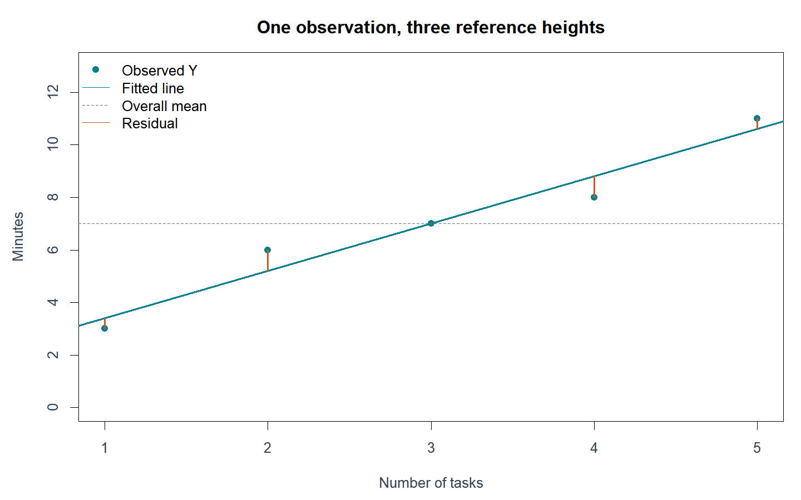
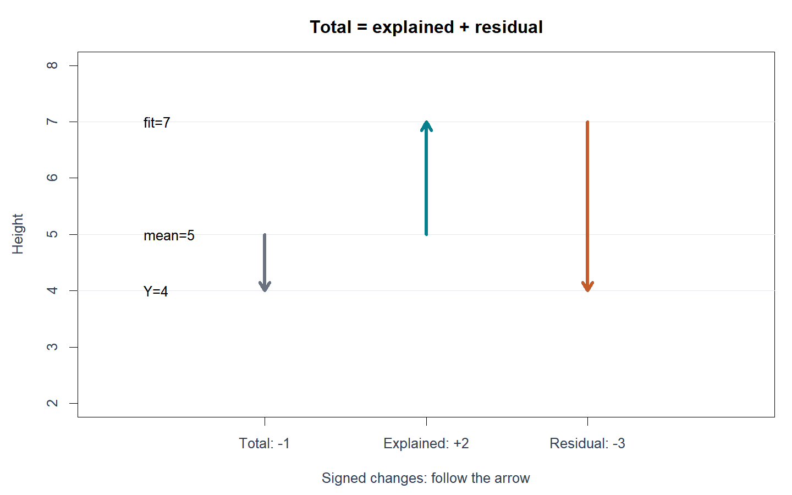
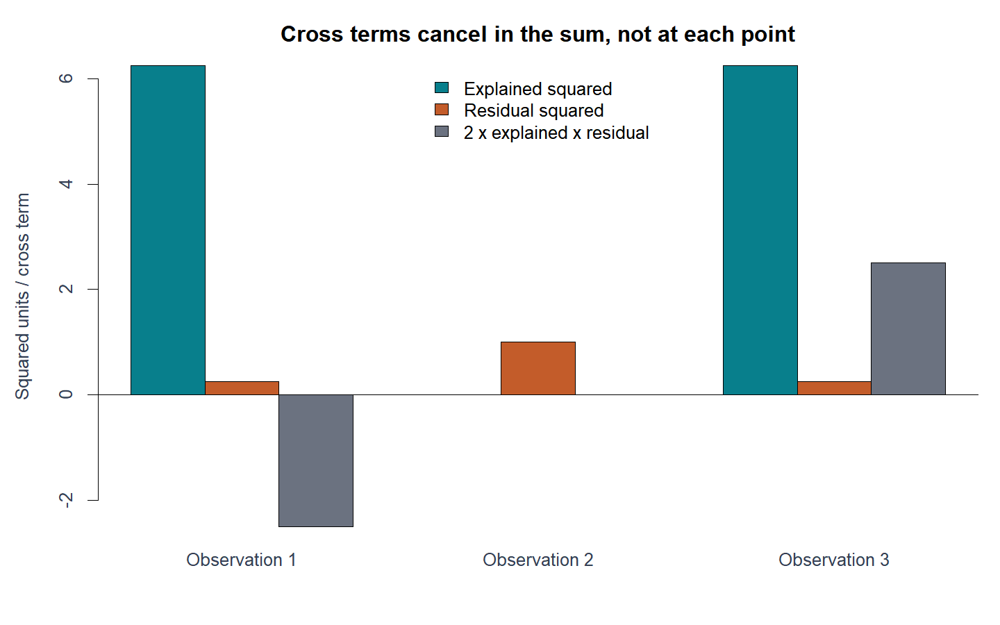
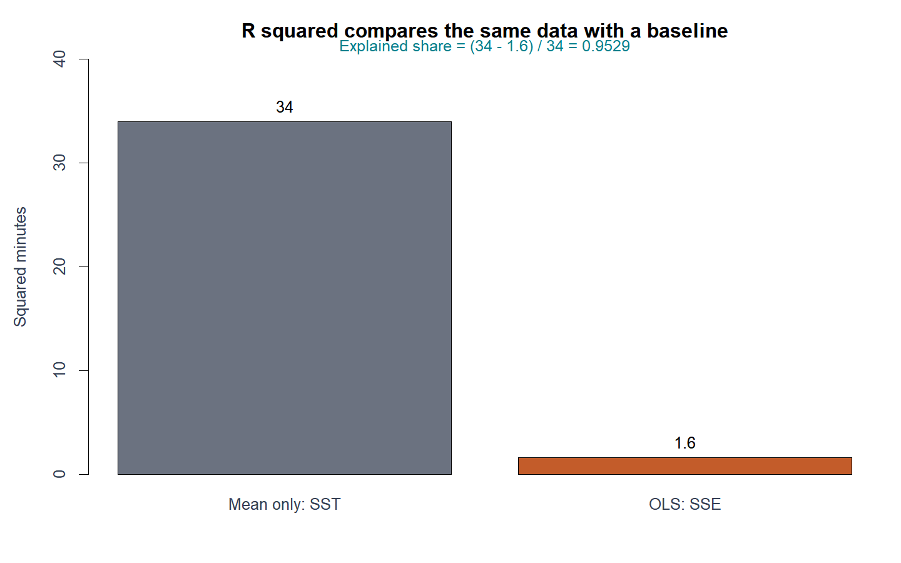
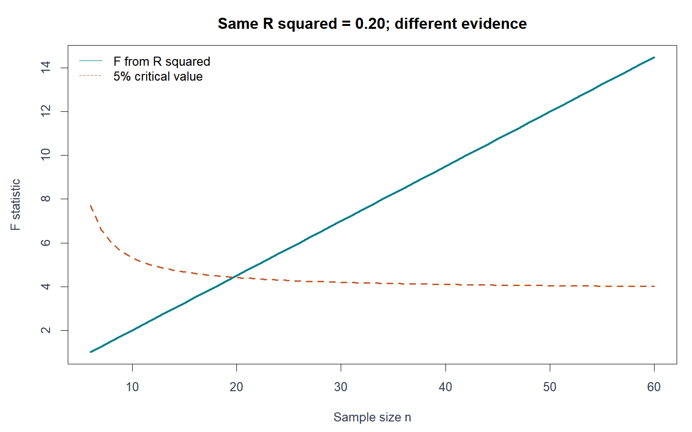
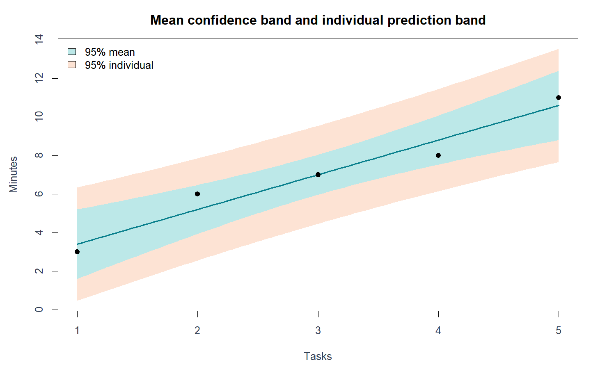
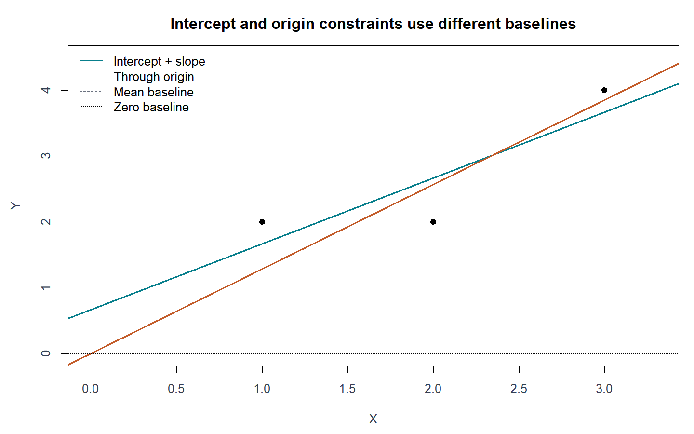
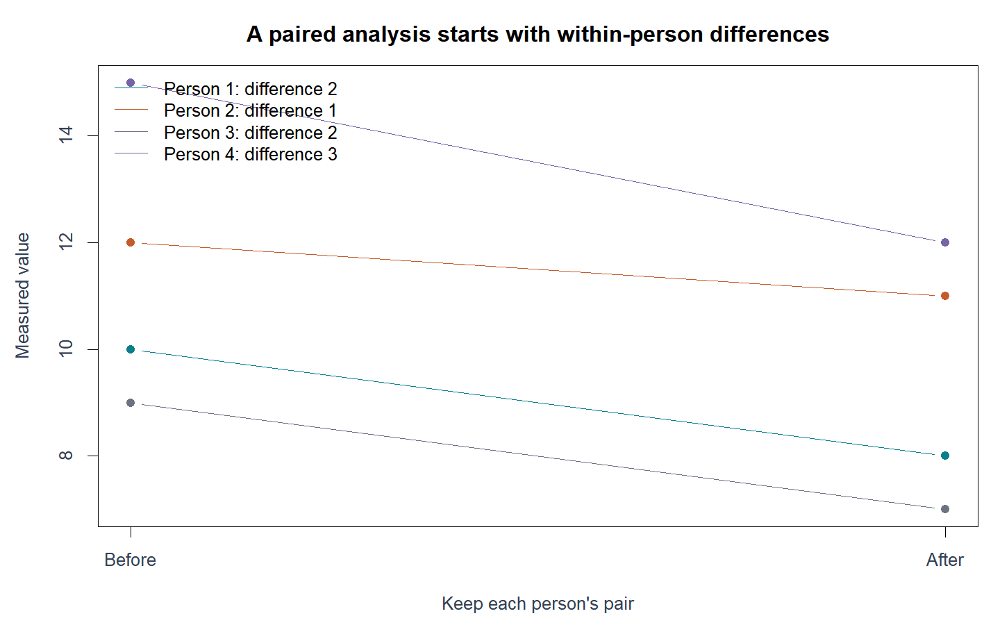

# W07B · 중간고사 대비 복습 ③

2026년10월14일 · 회귀분석의 이해 · 실제4주차 복습

이번 자료는 주교재3.8~3.12와 단순회귀의 F검정 연결을 복습합니다. 일반42문항과 기본R18문항, 총60문항입니다. 처음부터 전부 풀어 오실 필요는 없습니다. 핵심 그림을 읽고 대표 문제부터 차근차근 풀어 보세요. 답의 숫자뿐 아니라 어떤 대상을 어떤 기준과 비교했는지를 설명하는 것이 목표입니다.

복습 일정:10/8은1~2주차,10/12는3주차,오늘은4주차,10/19는총정리입니다. 별도 성적 반영 과제나 새 제출 기한은 없습니다. 상세 해설의 학생 공개 시점은 별도 안내합니다.

## 1. 평균에서 회귀선으로 이동하면 무엇이 바뀌는가

설명 예제는 가상의 작업 수 X=(1,2,3,4,5), 작업시간 Y=(3,6,7,8,11)입니다. 연습문항의 정답을 모두 보여 주는 자료가 아니라 개념을 따라가기 위한 작은 예제입니다. 같은 X에서 관측값, 회귀 예측, 전체 평균이라는 세 높이를 구분합니다.



그림의 회색 선은 모든 작업에 같은 평균7분을 예측하는 기준입니다. 청록 회귀선은 작업 수에 따라 예측을 바꿉니다. 관측 점과 회귀선 사이의 세로 차이가 잔차입니다. 가로 거리가 아닙니다.

$$
y_i-\bar y=(\hat y_i-\bar y)+(y_i-\hat y_i)
$$

| 이름 | 계산 | 학생의 말로 설명 |
|---|---|---|
| 전체편차 | $y_i-\bar y$ | 평균만 썼을 때 남는 차이 |
| 설명편차 | $\hat y_i-\bar y$ | X를 사용하면서 평균 예측이 이동한 양 |
| 잔차 | $e_i=y_i-\hat y_i$ | 회귀 예측을 쓰고도 남은 차이 |



설명편차와 잔차는 서로 반대 방향일 수 있습니다. 절댓값의 길이를 무조건 쌓는 그림으로 읽지 마세요. 전체편차=설명편차+잔차는 어떤 적합값에 대해서도 성립하는 차이의 항등식입니다. 하지만 다음의 제곱합 분해에는 조건이 더 필요합니다.

## 2. 편차를 제곱해 합하는 이유와 조건

음의 잔차와 양의 잔차를 그냥 더하면 상쇄됩니다. 잔차 합이0이어도 예측이 완벽하지 않을 수 있습니다. 제곱합은 부호 상쇄를 없애고 큰 차이에 더 큰 벌점을 줍니다. 세 제곱합의 단위는 Y단위의 제곱입니다.

$$
SST=\sum_i(y_i-\bar y)^2,\qquad SSR=\sum_i(\hat y_i-\bar y)^2,\qquad SSE=\sum_i(y_i-\hat y_i)^2
$$

점별로 제곱하면 교차항이 생깁니다. 이 항을 이유 없이 지워서는 안 됩니다.

$$
SST=SSR+SSE+2\sum_i(\hat y_i-\bar y)e_i
$$

절편이 있는 동일 훈련자료의 보통최소제곱(OLS) 적합에서는 잔차가 모형의 열벡터들과 직교합니다. 특히 잔차 합0, 적합값과 잔차의 내적0이므로 교차항의 합이0입니다. 따라서 SST=SSR+SSE가 됩니다. 각 관측마다 제곱이 분해된다는 뜻은 아닙니다.



실습 출력에서 `-2.2e-15`처럼 매우 작은 값이 보일 수 있습니다. 약 −0.0000000000000022라는 뜻으로, 이 설명 예제의 이론상0인 교차항을 컴퓨터가 유한한 정밀도로 계산하면서 생긴 수치오차입니다. 모든 작은 수를 무조건0으로 취급하라는 뜻은 아닙니다.

정규성은 이 대수적 분해에 필요하지 않습니다. 임의의 직선, 절편 없는 모형, 새로운 평가자료에 자동으로 같은 분해를 적용하지 않습니다.

## 3. R²는 어떤 개선의 비율인가

$$
R^2=1-\frac{SSE}{SST}=\frac{SSR}{SST}
$$

두 번째 등식은 앞의 분해 조건과 SST>0을 전제로 합니다. 평균만 사용한 예측의 오차 SST 중 회귀 후에도 남은 몫이 SSE/SST입니다.1에서 그 몫을 빼면 설명된 비율입니다.



예를 들어 설명 예제에서 SST=34,SSE=1.6이므로 R²≈0.9529입니다. 이는 관측된 Y의 평균 주변 변동에 대한 적합 지표입니다. 인과관계의 증명, 미래 예측95%정답, 기울기 부호, 모형 가정의 타당성을 보장하지 않습니다.

Y를60배 하여 분에서 초로 바꾸면 세 제곱합은3600배가 되지만 R²는 같습니다. 절편 있는 단순회귀에서는 R²=r²이지만 음의 기울기 방향은 제곱으로 사라집니다. Y가 모두 같으면 SST=0이므로 통상적인 비율은 정의되지 않습니다.

## 4. 제곱합에서 F검정으로

제곱합은 적합의 크기를 요약합니다. 검정에서는 자유도당 평균제곱을 비교합니다. 절편과 기울기를 추정한 단순회귀에서 전체 자유도 n−1은 회귀1과 잔차n−2로 나뉩니다.

| 변동 | 제곱합 | 자유도 | 평균제곱 |
|---|---|---|---|
| 회귀 | SSR |1| MSR=SSR |
| 잔차 | SSE |n−2| MSE=SSE/(n−2) |
| 전체 | SST |n−1| — |

$$
F=\frac{SSR/1}{SSE/(n-2)},\qquad F=t_{\hat\beta_1,\,H_0:\beta_1=0}^{\,2}
$$

고전적 정규 선형모형에서 기울기0을 양측 검정할 때 t와 F는 같은 p값을 줍니다. 동일한 모형·관측·귀무가설이라는 조건을 확인합니다. F는 제곱이므로 기울기의 방향을 보여 주지 않습니다. 기울기0이 아닌 다른 귀무값에 대한 t를 기존 ANOVA F와 비교하면 같은 검정이 아닙니다.



R²가 같아도 표본 수와 자유도가 다르면 통계적 증거는 다를 수 있습니다. 실질적 영향의 크기, 적합의 정도, 통계적 유의성은 서로 다른 질문입니다.

## 5. 평균을 알고 싶은가, 다음 한 건을 알고 싶은가

$$
\hat y_0=\hat\beta_0+\hat\beta_1x_0,\quad
h_0=\frac1n+\frac{(x_0-\bar x)^2}{S_{xx}},\quad
s^2=\frac{SSE}{n-2}
$$

| 대상 | 중심 | 표준오차 | 구간 |
|---|---|---|---|
| 조건부 평균 $E(Y\mid X=x_0)$ | $\hat y_0$ | $s\sqrt{h_0}$ | 평균 신뢰구간 |
| 독립인 새 한 관측 $Y_0$ | $\hat y_0$ | $s\sqrt{1+h_0}$ | 개별 예측구간 |

둘 다 중심±t임계값×표준오차입니다. t의 자유도는n−2입니다. 같은 자료·위치·수준에서 개별 예측구간이 더 넓습니다. 새 관측은 평균 자체를 정확히 알아도 오차를 갖기 때문입니다.



x0가 X평균에서 멀수록 거리 항이 커집니다. 신뢰수준을 높여도 구간은 넓어집니다. 표본 수가 늘면 평균 추정 오차는 줄지만 새 한 관측의 변동은 남습니다.

95% 신뢰구간은 같은 표집·계산 절차를 반복할 때 생성된 구간의 장기 약95%가 참 평균을 포함한다는 뜻입니다. 평균의 구간을 개별 관측95%가 놓이는 범위로 읽지 않습니다. 관측 X범위 밖의 외삽에서는 선형관계가 계속 유지되는지도 확인해야 합니다. 프로그램의 구간은 모형 자체가 바뀔 가능성을 자동으로 모두 반영하지 않습니다.

## 6. 원점을 지나는 회귀는 다른 제약을 가진 모형

$$
y_i=\beta_1x_i+\varepsilon_i,\qquad
\hat\beta_1=\frac{\sum_i x_i y_i}{\sum_i x_i^2},\qquad
s^2=\frac{SSE}{n-1}
$$

절편을 추정하지 않고0으로 고정합니다. 중심화한 기울기 공식과 n−2를 그대로 사용하지 않습니다. 잔차 합은0이 아닐 수 있지만 X와 잔차의 내적은0입니다.



R의 summary.lm은 절편이 없을 때 기본 R²의 분모로0기준 총제곱합을 사용합니다.

$$
R^2_{0}=1-\frac{SSE}{\sum_i y_i^2},\qquad
R^2_{\text{mean}}=1-\frac{SSE}{\sum_i(y_i-\bar y)^2}
$$

기준선이 달라진 숫자끼리 비교하지 마세요. 원점 제약 아래에서는 평균 기준 지표가 음수가 될 수도 있습니다. 절편 검정에서 유의하지 않았다는 사실만으로 참 절편이0이라고 증명된 것은 아닙니다. X=0의 실제 의미, 준비시간 같은 고정 성분, 관측 범위를 함께 검토합니다.

## 7. 절편만 있는 모형과 대응 비교

$$
y_i=\beta_0+\varepsilon_i,\quad \hat\beta_0=\bar y,\quad
s^2=\frac{\sum_i(y_i-\bar y)^2}{n-1},\quad
SE(\bar y)=\frac{s}{\sqrt n}
$$

절편만 있는 모형은 모든 관측에 평균을 예측합니다. 절편 없는 원점회귀와 다릅니다. 이 모형의 절편 검정은 한 표본 평균의 t검정과 연결됩니다.

같은 사람의 전·후 자료는 먼저 사람별 차이를 계산합니다. 차이자료에 절편만 있는 모형을 적합하면 평균차이 검정이 됩니다. 각 시점 값을 따로 정렬하여 사람의 짝을 바꾸면 안 됩니다.



차이의 방향을 전−후에서 후−전으로 바꾸면 평균과 t부호가 반대로 바뀌지만 양측 p값은 같습니다. 구간 끝점은 부호를 바꾼 후 작은 값부터 다시 배열합니다.

## 8. 손계산과 R을 연결하는 순서

1. 구하는 대상과 기준을 문장으로 적습니다.
2. 식을 쓰고 먼저 작은 숫자로 계산합니다.
3. R코드가 그 식의 어느 항에 대응하는지 표시합니다.
4. 실행 전 출력을 예상하고, 실행 후 값·부호·단위를 확인합니다.
5. 오류가 나지 않았어도 목적에 맞는 계산인지 다시 확인합니다.

기본R 문법: `mean(y)`는 평균,`sum(e^2)`는 제곱 후 합,`sd(y)`는 표본 SD,`length(y)`는 관측 수,`sqrt(n)`는 제곱근입니다. 문제에서 사용하는 lm/predict/t분포 함수의 역할과 필요한 인수는 문제에 제공합니다. 라이브러리의 내부 클래스나 메소드 암기는 요구하지 않습니다.

[온라인 R에서 직접 편집·실행](https://lunalab-ai.github.io/regre/w07b.html) · [누적 웹 앱](https://lunalab-ai.github.io/regre/apps/w07b/) · [앱 코드 편집](https://lunalab-ai.github.io/regre/apps/w07b/edit/index.html)

마지막에는 앱의 W07B 탭에서 평균·개별 구간을 비교하고 x0 기본값 한 줄을 바꾸어 실행합니다. 앱은 개념을 관찰하는 도구이며 문항 자동 정답표가 아닙니다.

## 출처와 범위

주교재3.8~3.12(인쇄115~126쪽), 실제 W04A 노트·실습을 기준으로 구성했습니다. 그림·수치 예제·60문항은 이 복습을 위해 새로 설계했습니다. 교재의 절편 제거 논의를 적용할 때 비유의성이0의 증명은 아니라는 주의는 이해를 위한 보강입니다. 수식의 SSR은 회귀 설명제곱합, SSE는 잔차제곱합이라는 이 과목의 표기를 유지합니다.

R 공식 문서: [predict.lm](https://stat.ethz.ch/R-manual/R-devel/library/stats/html/predict.lm.html), [summary.lm](https://stat.ethz.ch/R-manual/R-devel/library/stats/html/summary.lm.html), [anova.lm](https://stat.ethz.ch/R-manual/R-devel/library/stats/html/anova.lm.html), [t.test](https://stat.ethz.ch/R-manual/R-devel/library/stats/html/t.test.html).


# 연습문제 60문항 · 정답 미포함

각 문항은 독립적입니다. 모든 일반 문제는 최종 답과 함께 중간 계산 또는 판단 근거를 적으세요. R은 필요한 함수 설명이 문제에 제시됩니다. 연습 코드의 의도적 빈칸·오류는 직접 고쳐 실행합니다.

## Q01 · 세 높이를 구별하기

유형: 일반 · 난이도: 기초

한 학생의 점수는 $y_i=9$, 회귀모형의 적합값은 $\hat y_i=7$, 전체 평균은 $\bar y=5$이다. 전체편차·설명편차·잔차를 구하고 각각 무엇과 무엇의 차이인지 설명하시오.

**풀이 기록**: 주어진 정보 → 개념/식 → 중간 계산 또는 코드 추적 → 의미·단위

....................................................................................................

....................................................................................................

## Q02 · 반대 방향의 편차

유형: 일반 · 난이도: 기초

$y_i=4$, $\hat y_i=6$, $\bar y=5$이다. 세 편차를 부호를 포함해 계산하고, 전체편차의 절댓값이 설명편차·잔차 절댓값의 합과 같은지 설명하시오.

**풀이 기록**: 주어진 정보 → 개념/식 → 중간 계산 또는 코드 추적 → 의미·단위

....................................................................................................

....................................................................................................

## Q03 · 두 편차에서 관측값 복원

유형: 일반 · 난이도: 기초

평균은10분, 설명편차는3분, 잔차는−1분이다. 적합값과 관측값, 전체편차를 차례대로 복원하시오.

**풀이 기록**: 주어진 정보 → 개념/식 → 중간 계산 또는 코드 추적 → 의미·단위

....................................................................................................

....................................................................................................

## Q04 · 행별 편차 표 완성

유형: 일반 · 난이도: 기초

$x=(1,2,3)$, $y=(2,3,7)$에 절편 포함 최소제곱직선을 적합했다. 적합값은 $(1.5,4,6.5)$이다. 평균을 구하고 각 행의 전체편차·설명편차·잔차를 표로 작성하여 편차분해를 확인하시오.

**풀이 기록**: 주어진 정보 → 개념/식 → 중간 계산 또는 코드 추적 → 의미·단위

....................................................................................................

....................................................................................................

## Q05 · 제곱하면 생기는 교차항

유형: 일반 · 난이도: 적용

세 관측의 전체편차는 $(-2,-1,3)$, 설명편차는 $(-2.5,0,2.5)$, 잔차는 $(0.5,-1,0.5)$이다. 첫 행에서 전체편차²와 설명편차²+잔차²를 비교하시오. 세 행의 $2\times$설명편차$\times$잔차를 더하면 무엇이 되는가?

**풀이 기록**: 주어진 정보 → 개념/식 → 중간 계산 또는 코드 추적 → 의미·단위

....................................................................................................

....................................................................................................

## Q06 · 잔차 합 0의 의미

유형: 일반 · 난이도: 기초

잔차가 $(1,-2,1)$이다. 잔차 합과 잔차제곱합을 구하고, “잔차 합이0이므로 모든 관측을 정확히 예측했다”라는 주장을 평가하시오.

**풀이 기록**: 주어진 정보 → 개념/식 → 중간 계산 또는 코드 추적 → 의미·단위

....................................................................................................

....................................................................................................

## Q07 · 아무 직선에도 제곱합 분해가 성립할까

유형: 일반 · 난이도: 통합

$y=(2,3,7)$의 평균은4이다. 최소제곱직선이 아닌 후보선의 예측값이 $(2,4,6)$이다. SST, 평균 기준 후보 예측편차 제곱합, SSE를 구하고, 잔차 합0만으로 SST=SSR+SSE가 보장되는지 판단하시오.

**풀이 기록**: 주어진 정보 → 개념/식 → 중간 계산 또는 코드 추적 → 의미·단위

....................................................................................................

....................................................................................................

## Q08 · 오차와 잔차의 기준선

유형: 일반 · 난이도: 기초

모형의 오차 $\varepsilon_i$와 적합 후 잔차 $e_i$의 기준선을 각각 설명하시오. 절편 포함 OLS에서 $\sum e_i=0$이면 이번 표본의 참 오차 합도 반드시0인가?

**풀이 기록**: 주어진 정보 → 개념/식 → 중간 계산 또는 코드 추적 → 의미·단위

....................................................................................................

....................................................................................................

## Q09 · 작은 표에서 세 제곱합과 R²

유형: 일반 · 난이도: 기초

절편 포함 OLS의 관측값은 $(2,3,7)$, 적합값은 $(1.5,4,6.5)$, 평균은4이다. SST, SSR, SSE와 R²를 직접 구하고 R²를 한 문장으로 해석하시오.

**풀이 기록**: 주어진 정보 → 개념/식 → 중간 계산 또는 코드 추적 → 의미·단위

....................................................................................................

....................................................................................................

## Q10 · 기준 오차 대비 감소율

유형: 일반 · 난이도: 기초

동일 자료의 절편 포함 OLS에서 SST=200분², SSE=50분²이다. SSR과 R²를 구하고, 평균 예측에 비해 무엇이 얼마나 감소했는지 설명하시오.

**풀이 기록**: 주어진 정보 → 개념/식 → 중간 계산 또는 코드 추적 → 의미·단위

....................................................................................................

....................................................................................................

## Q11 · R²와 상관의 부호

유형: 일반 · 난이도: 기초

절편 포함 단순선형회귀에서 SST=100, R²=0.64이고 기울기는 음수이다. SSR, SSE, X와 Y의 표본상관 r을 구하시오. X와 Y에는 변동이 있다.

**풀이 기록**: 주어진 정보 → 개념/식 → 중간 계산 또는 코드 추적 → 의미·단위

....................................................................................................

....................................................................................................

## Q12 · 완전 적합이 알려 주는 것

유형: 일반 · 난이도: 기초

절편 포함 OLS에서 SST>0이고 SSE=0이다. R²와 각 잔차에 대해 말할 수 있는 것을 쓰고, 미래 관측도 반드시 정확히 예측하는지 판단하시오.

**풀이 기록**: 주어진 정보 → 개념/식 → 중간 계산 또는 코드 추적 → 의미·단위

....................................................................................................

....................................................................................................

## Q13 · 분모가 0인 결정계수

유형: 일반 · 난이도: 기초

관측값이 모두5이고 절편 포함 모형이 모든 값을5로 적합했다. 평균 기준 SST와 SSE를 계산하시오. R²=1−SSE/SST를 이용해 R²=1이라고 결론내려도 되는가?

**풀이 기록**: 주어진 정보 → 개념/식 → 중간 계산 또는 코드 추적 → 의미·단위

....................................................................................................

....................................................................................................

## Q14 · 분을 초로 바꾸면

유형: 일반 · 난이도: 적용

시간 Y를 분으로 표시한 절편 포함 OLS에서 SST=80, SSR=60, SSE=20이다. 같은 시간을 초로 바꿔 다시 적합하면 세 제곱합과 R²는 어떻게 되는가? 이유를 식으로 쓰시오.

**풀이 기록**: 주어진 정보 → 개념/식 → 중간 계산 또는 코드 추적 → 의미·단위

....................................................................................................

....................................................................................................

## Q15 · 새 자료에서 음의 평가값

유형: 일반 · 난이도: 적용

다른 학습 자료로 만든 모형을 새 평가 자료에 적용했다. 평가 자료 평균을 기준으로 한 SST는10이고 모형 예측의 SSE는15이다. 평가용 $1-SSE/SST$를 구하고 의미를 설명하시오. 이것이 절편 포함 학습 OLS의 R² 범위와 모순인가?

**풀이 기록**: 주어진 정보 → 개념/식 → 중간 계산 또는 코드 추적 → 의미·단위

....................................................................................................

....................................................................................................

## Q16 · 높은 R²가 답하지 않는 질문

유형: 일반 · 난이도: 적용

관측자료에서 광고비와 매출의 절편 포함 회귀 R²=0.92를 얻었다. “광고비를 늘리면 매출이 반드시 증가하며, 새 가게에서도92% 정확도로 예측된다”라는 문장을 두 부분으로 나누어 평가하고 올바른 해석을 쓰시오.

**풀이 기록**: 주어진 정보 → 개념/식 → 중간 계산 또는 코드 추적 → 의미·단위

....................................................................................................

....................................................................................................

## Q17 · 분산분석표의 분모를 채우기

유형: 일반 · 난이도: 기초

관측 수7인 절편 포함 단순회귀에서 SST=50, SSE=10이다. 회귀·오차·전체의 자유도와 제곱합, 회귀·오차의 평균제곱, F값을 구하시오. $H_0:\beta_1=0$을 검정한다.

**풀이 기록**: 주어진 정보 → 개념/식 → 중간 계산 또는 코드 추적 → 의미·단위

....................................................................................................

....................................................................................................

## Q18 · R²에서 F로 연결

유형: 일반 · 난이도: 기초

절편 포함 단순회귀에서 n=12, R²=0.8이고 SSE>0이다. $F=\{SSR/1\}/\{SSE/(n-2)\}$를 R²로 나타내고 값을 구하시오.

**풀이 기록**: 주어진 정보 → 개념/식 → 중간 계산 또는 코드 추적 → 의미·단위

....................................................................................................

....................................................................................................

## Q19 · 음의 t와 양의 F

유형: 일반 · 난이도: 기초

같은 자료의 절편 포함 단순회귀에서 기울기0에 대한 t=−3, 양측 p=0.015이다. 동일 가설의 전체 F값과 p값, 5% 수준의 결론을 쓰시오.

**풀이 기록**: 주어진 정보 → 개념/식 → 중간 계산 또는 코드 추적 → 의미·단위

....................................................................................................

....................................................................................................

## Q20 · F=t²를 적용할 수 없는 비교

유형: 일반 · 난이도: 통합

절편 포함 단순회귀의 출력에서 전체 F=16이다. 별도로 $H_0:\beta_1=2$를 검정했더니 t=1이었다. 두 결과가 모순인지, 각 검정의 귀무가설을 적어 설명하시오.

**풀이 기록**: 주어진 정보 → 개념/식 → 중간 계산 또는 코드 추적 → 의미·단위

....................................................................................................

....................................................................................................

## Q21 · 같은 R²와 다른 표본 수

유형: 일반 · 난이도: 적용

두 절편 포함 단순회귀에서 R²는 모두0.2이다. A는 n=8, B는 n=52이다. F를 각각 구하시오. 5% 임계값은 A가5.99, B가4.03일 때 판단하고, 통계적 유의성과 설명 비율을 구별하시오.

**풀이 기록**: 주어진 정보 → 개념/식 → 중간 계산 또는 코드 추적 → 의미·단위

....................................................................................................

....................................................................................................

## Q22 · 계산 성질과 추론 가정

유형: 일반 · 난이도: 적용

절편 포함 OLS의 SST=SSR+SSE와, $H_0:\beta_1=0$ 아래 F분포를 이용한 정확한 소표본 검정을 구별하시오. 어느 쪽에 정규오차 가정이 필요한가?

**풀이 기록**: 주어진 정보 → 개념/식 → 중간 계산 또는 코드 추적 → 의미·단위

....................................................................................................

....................................................................................................

## Q23 · 같은 중심과 다른 질문

유형: 일반 · 난이도: 기초

적합식이 $\hat y=2+3x$일 때 x₀=4에서 점예측을 구하시오. “이 조건의 평균 수리시간”과 “다음 한 건의 수리시간” 중 어느 구간이 더 넓어야 하는지 같은 신뢰수준·표준 모형 조건에서 설명하시오.

**풀이 기록**: 주어진 정보 → 개념/식 → 중간 계산 또는 코드 추적 → 의미·단위

....................................................................................................

....................................................................................................

## Q24 · 두 구간을 끝까지 계산하기

유형: 일반 · 난이도: 적용

절편 포함 단순회귀에서 n=10, $\bar x=3$, $S_{xx}=20$, s=2분, 적합식은 $\hat y=2+3x$이다. x₀=4의95% 평균반응 신뢰구간과 개별 예측구간을 구하시오. 임계값 t*=2.306을 사용한다.

**풀이 기록**: 주어진 정보 → 개념/식 → 중간 계산 또는 코드 추적 → 의미·단위

....................................................................................................

....................................................................................................

## Q25 · 추가 분산은 어디에 들어가는가

유형: 일반 · 난이도: 기초

어떤 x₀에서 점예측20, s=4, h₀=0.25, 임계값2가 주어졌다. 평균반응 추정분산과 개별 예측오차 분산, 두 구간을 구하시오.

**풀이 기록**: 주어진 정보 → 개념/식 → 중간 계산 또는 코드 추적 → 의미·단위

....................................................................................................

....................................................................................................

## Q26 · 평균 X에서 가까울수록

유형: 일반 · 난이도: 적용

한 회귀 적합에서 n=10, $\bar x=5$, $S_{xx}=40$, s=3이다. x₀=5와 x₀=9의 h₀ 및 평균반응 표준오차를 계산하고 어느 구간이 더 좁은지 설명하시오. 같은 신뢰수준을 사용한다.

**풀이 기록**: 주어진 정보 → 개념/식 → 중간 계산 또는 코드 추적 → 의미·단위

....................................................................................................

....................................................................................................

## Q27 · 신뢰수준을 높일 때

유형: 일반 · 난이도: 기초

같은 적합과 x₀에서 평균반응의 SE=1.2분이다.95% 임계값2.262,99% 임계값3.250을 사용한다. 두 구간의 전체 폭을 계산하고, 신뢰수준을 높일 때의 변화를 설명하시오.

**풀이 기록**: 주어진 정보 → 개념/식 → 중간 계산 또는 코드 추적 → 의미·단위

....................................................................................................

....................................................................................................

## Q28 · 표본이 늘어도 한 건은 흔들린다

유형: 일반 · 난이도: 적용

x₀가 각 표본의 X평균과 같다고 하자. s=2, 임계값2로 고정하여 n=4와 n=16에서 평균반응 구간과 개별 예측구간의 반쪽 폭을 계산하시오. n이 커질 때 두 불확실성의 차이를 설명하시오. 실제 임계값 변화는 이번 비교에서 제외한다.

**풀이 기록**: 주어진 정보 → 개념/식 → 중간 계산 또는 코드 추적 → 의미·단위

....................................................................................................

....................................................................................................

## Q29 · 계산 가능한 외삽의 위험

유형: 일반 · 난이도: 적용

수리 부품 수1~10개 자료로 직선을 적합했다. 소프트웨어가25개의 예측값과95% 예측구간을 출력했다. 이 결과만으로25개 상황의 예측이 타당하다고 말할 수 있는가? 두 종류의 불확실성을 구별해 설명하시오.

**풀이 기록**: 주어진 정보 → 개념/식 → 중간 계산 또는 코드 추적 → 의미·단위

....................................................................................................

....................................................................................................

## Q30 · 구간의 대상과 반복 의미

유형: 일반 · 난이도: 적용

x₀=4에서95% 평균반응 신뢰구간이[10,14]분이다. “이 조건의 개별 작업95%가10~14분이며, 평균 수리시간이 이 구간에 있을 확률은 정확히95%이다”라는 설명을 수정하시오. 빈도주의 신뢰구간의 반복 의미를 사용한다.

**풀이 기록**: 주어진 정보 → 개념/식 → 중간 계산 또는 코드 추적 → 의미·단위

....................................................................................................

....................................................................................................

## Q31 · 원점을 지나는 최소제곱 직선

유형: 일반 · 난이도: 기초

$x=(1,2,3), y=(2,2,4)$에 $\hat y=bx$를 적합한다. $b=\sum x_i y_i/\sum x_i^2$를 사용하여 기울기·잔차·SSE를 구하시오.

**풀이 기록**: 주어진 정보 → 개념/식 → 중간 계산 또는 코드 추적 → 의미·단위

....................................................................................................

....................................................................................................

## Q32 · 어떤 방향과 직교하는가

유형: 일반 · 난이도: 기초

원점회귀의 X는$(1,2,3)$, 잔차는$(5,-4,1)/7$이다. $\sum e_i$와 $\sum x_i e_i$를 계산하고, $\sum\hat y_i e_i$가0인 이유를 설명하시오.

**풀이 기록**: 주어진 정보 → 개념/식 → 중간 계산 또는 코드 추적 → 의미·단위

....................................................................................................

....................................................................................................

## Q33 · 원점회귀의 자유도

유형: 일반 · 난이도: 기초

원점회귀에서 n=6, SSE=20, $\sum x_i^2=25$이다. 오차분산 추정값과 s를 구하시오. 독립·등분산 오차 가정 아래 $SE(\hat b)=s/\sqrt{\sum x_i^2}$도 계산하시오.

**풀이 기록**: 주어진 정보 → 개념/식 → 중간 계산 또는 코드 추적 → 의미·단위

....................................................................................................

....................................................................................................

## Q34 · R이 보고하는 두 R제곱

유형: 일반 · 난이도: 통합

$y=(2,2,4)$이고 원점회귀 SSE=$6/7$이다. 평균 기준 SST=$8/3$, 0 기준 총제곱합=$24$가 주어진다. $1-SSE/(8/3)$와 $1-SSE/24$를 계산하고 서로 다른 이유를 설명하시오.

**풀이 기록**: 주어진 정보 → 개념/식 → 중간 계산 또는 코드 추적 → 의미·단위

....................................................................................................

....................................................................................................

## Q35 · 음의 중심화 R제곱

유형: 일반 · 난이도: 적용

$x=(1,2),y=(10,11)$에 원점회귀를 적합한 결과 $b=6.4$이다. 잔차·SSE·평균 기준 SST와 $1-SSE/SST$를 구하고 음수가 가능한 이유를 설명하시오.

**풀이 기록**: 주어진 정보 → 개념/식 → 중간 계산 또는 코드 추적 → 의미·단위

....................................................................................................

....................................................................................................

## Q36 · 절편을 없앨 근거

유형: 일반 · 난이도: 통합

수리시간 회귀에서 절편의 p값이0.30이다. “유의하지 않으므로 참 절편은0이고 원점회귀가 맞다”를 비판하고, 적절한 모형 선택 근거 두 가지를 제시하시오.

**풀이 기록**: 주어진 정보 → 개념/식 → 중간 계산 또는 코드 추적 → 의미·단위

....................................................................................................

....................................................................................................

## Q37 · 절편만 있는 모형

유형: 일반 · 난이도: 기초

$y=(2,4,6,8)$에 $y_i=\beta_0+\varepsilon_i$를 적합한다. 절편·잔차·SSE·잔차 자유도·오차분산 추정값을 구하시오.

**풀이 기록**: 주어진 정보 → 개념/식 → 중간 계산 또는 코드 추적 → 의미·단위

....................................................................................................

....................................................................................................

## Q38 · 평균에 대한 t검정

유형: 일반 · 난이도: 기초

독립 정규표본$(2,4,6,8)$에서 평균0을 양측 검정한다. 표본평균5, 표본분산20/3을 사용하여 평균 SE, t와 자유도를 구하시오.5% 양측 임계값3.182로 결론을 내리시오.

**풀이 기록**: 주어진 정보 → 개념/식 → 중간 계산 또는 코드 추적 → 의미·단위

....................................................................................................

....................................................................................................

## Q39 · 대응 차이로 바꾸기

유형: 일반 · 난이도: 적용

같은 네 사람의 처치 전 값은$(10,12,9,15)$, 처치 후 값은$(8,11,7,12)$이다. 전−후 차이의 평균·분산·평균 SE와 평균차이0에 대한 t를 구하시오.

**풀이 기록**: 주어진 정보 → 개념/식 → 중간 계산 또는 코드 추적 → 의미·단위

....................................................................................................

....................................................................................................

## Q40 · 차이의 순서를 바꾸면

유형: 일반 · 난이도: 기초

전−후 차이를 사용한 대응 검정의 평균차이는2, t=4.9, 양측 p=0.016,95% 구간은[0.7,3.3]이라고 하자. 후−전으로 바꾸면 네 결과와 해석은 어떻게 달라지는가?

**풀이 기록**: 주어진 정보 → 개념/식 → 중간 계산 또는 코드 추적 → 의미·단위

....................................................................................................

....................................................................................................

## Q41 · 정렬이 대응을 깨뜨린다

유형: 일반 · 난이도: 적용

같은 사람 순서로 전$(10,12,9,15)$, 후$(8,11,7,12)$가 기록되어 있다. 후 값만$(7,8,11,12)$로 정렬하면 차이의 평균과 표본분산이 어떻게 바뀌는가? 대응 분석에 적절한지 설명하시오.

**풀이 기록**: 주어진 정보 → 개념/식 → 중간 계산 또는 코드 추적 → 의미·단위

....................................................................................................

....................................................................................................

## Q42 · 세 모형을 같은 기준에서 보기

유형: 일반 · 난이도: 통합

n=8인 동일 자료에 A:절편만, B:절편+기울기, C:원점회귀를 적합했다. SSE는 각각40,10,18이다. 각 잔차 자유도와 평균 기준 $1-SSE/40$을 구하고, 이 결과만으로 C의 원점 가정이 맞는지 판단 가능한지 설명하시오.

**풀이 기록**: 주어진 정보 → 개념/식 → 중간 계산 또는 코드 추적 → 의미·단위

....................................................................................................

....................................................................................................

## Q43 · 세 편차를 코드로

유형: R · 난이도: 기초 · 빈칸

평균5, 적합7, 관측6이다. ____를 채워 전체·설명·잔차를 계산하시오.

```r
y <- 6; fitted_value <- 7; ybar <- 5
total <- y - ____
explained <- ____ - ybar
residual <- y - ____
print(c(total, explained, residual))
```

필요한 기본 문법: c는 벡터, mean은 평균, sum은 합, ^2는 각 원소 제곱, sqrt는 제곱근, length는 원소 수입니다. 지정한 코드의 계산 이유까지 설명하세요.

**풀이 기록**: 주어진 정보 → 개념/식 → 중간 계산 또는 코드 추적 → 의미·단위

....................................................................................................

....................................................................................................

## Q44 · 합의 제곱 오류

유형: R · 난이도: 기초 · 에러 찾기

잔차제곱합을 구하려는 코드이다. 실행은 되지만 개념적으로 잘못된 한 줄을 고치고 원래 출력과 수정 출력을 비교하시오.

```r
e <- c(-2,1,1)
SSE <- sum(e)^2
print(SSE)
```

필요한 기본 문법: c는 벡터, mean은 평균, sum은 합, ^2는 각 원소 제곱, sqrt는 제곱근, length는 원소 수입니다. 지정한 코드의 계산 이유까지 설명하세요.

**풀이 기록**: 주어진 정보 → 개념/식 → 중간 계산 또는 코드 추적 → 의미·단위

....................................................................................................

....................................................................................................

## Q45 · 한 점의 부호 읽기

유형: R · 난이도: 기초 · 출력 예측

실행하기 전에 출력 벡터의 세 수와 부호의 의미를 적으시오.

```r
y <- 3; fitted_value <- 5; ybar <- 4
print(c(y-ybar,fitted_value-ybar,y-fitted_value))
```

필요한 기본 문법: c는 벡터, mean은 평균, sum은 합, ^2는 각 원소 제곱, sqrt는 제곱근, length는 원소 수입니다. 지정한 코드의 계산 이유까지 설명하세요.

**풀이 기록**: 주어진 정보 → 개념/식 → 중간 계산 또는 코드 추적 → 의미·단위

....................................................................................................

....................................................................................................

## Q46 · 교차항 확인

유형: R · 난이도: 적용 · 빈칸

a는 설명편차, e는 잔차이다. 점별 제곱합 분해에는 교차항이 필요하다. ____를 채워 합의 분해를 확인하시오.

```r
a <- c(-1,0,1); e <- c(1,-2,1)
cross <- 2*sum(____)
print(c(sum((a+e)^2),sum(a^2)+sum(e^2)+cross))
```

필요한 기본 문법: c는 벡터, mean은 평균, sum은 합, ^2는 각 원소 제곱, sqrt는 제곱근, length는 원소 수입니다. 지정한 코드의 계산 이유까지 설명하세요.

**풀이 기록**: 주어진 정보 → 개념/식 → 중간 계산 또는 코드 추적 → 의미·단위

....................................................................................................

....................................................................................................

## Q47 · 기준 대비 줄어든 오차

유형: R · 난이도: 기초 · 빈칸

SST=80, SSE=20이다. R²를 구하는 빈칸과 해석을 쓰시오.

```r
SST <- 80; SSE <- 20
R2 <- 1 - ____/____
print(R2)
```

필요한 기본 문법: c는 벡터, mean은 평균, sum은 합, ^2는 각 원소 제곱, sqrt는 제곱근, length는 원소 수입니다. 지정한 코드의 계산 이유까지 설명하세요.

**풀이 기록**: 주어진 정보 → 개념/식 → 중간 계산 또는 코드 추적 → 의미·단위

....................................................................................................

....................................................................................................

## Q48 · SST는 무엇에서 빼는가

유형: R · 난이도: 기초 · 에러 찾기

평균 기준 SST를 구하려 한다. 잘못된 줄을 고치고 두 값의 차이를 설명하시오.

```r
y <- c(4,6,8)
SST <- sum(y^2)
print(SST)
```

필요한 기본 문법: c는 벡터, mean은 평균, sum은 합, ^2는 각 원소 제곱, sqrt는 제곱근, length는 원소 수입니다. 지정한 코드의 계산 이유까지 설명하세요.

**풀이 기록**: 주어진 정보 → 개념/식 → 중간 계산 또는 코드 추적 → 의미·단위

....................................................................................................

....................................................................................................

## Q49 · 단위 변경 출력

유형: R · 난이도: 적용 · 출력 예측

분을 초로 바꾸면 제곱합은60²배가 된다. 아래 두 출력값을 예상하고 이유를 쓰시오.

```r
SST <- 50; SSE <- 10
print(c(1-SSE/SST,1-(60^2*SSE)/(60^2*SST)))
```

필요한 기본 문법: c는 벡터, mean은 평균, sum은 합, ^2는 각 원소 제곱, sqrt는 제곱근, length는 원소 수입니다. 지정한 코드의 계산 이유까지 설명하세요.

**풀이 기록**: 주어진 정보 → 개념/식 → 중간 계산 또는 코드 추적 → 의미·단위

....................................................................................................

....................................................................................................

## Q50 · 설명 비율을 거꾸로

유형: R · 난이도: 적용 · 에러 찾기

절편 있는 OLS에서 SST=60, SSR=45, SSE=15이다. R²를 구하려는 코드의 의미 오류를 고치시오.

```r
SST <- 60; SSR <- 45; SSE <- 15
R2 <- 1-SSR/SST
print(R2)
```

필요한 기본 문법: c는 벡터, mean은 평균, sum은 합, ^2는 각 원소 제곱, sqrt는 제곱근, length는 원소 수입니다. 지정한 코드의 계산 이유까지 설명하세요.

**풀이 기록**: 주어진 정보 → 개념/식 → 중간 계산 또는 코드 추적 → 의미·단위

....................................................................................................

....................................................................................................

## Q51 · F의 분모 자유도

유형: R · 난이도: 기초 · 빈칸

절편과 기울기를 추정하는 단순회귀이다. n=9, SSR=28, SSE=14일 때 F를 완성하시오.

```r
n <- 9; SSR <- 28; SSE <- 14
df_error <- n - ____
F_value <- (SSR/1)/(SSE/df_error)
print(F_value)
```

필요한 기본 문법: c는 벡터, mean은 평균, sum은 합, ^2는 각 원소 제곱, sqrt는 제곱근, length는 원소 수입니다. 지정한 코드의 계산 이유까지 설명하세요.

**풀이 기록**: 주어진 정보 → 개념/식 → 중간 계산 또는 코드 추적 → 의미·단위

....................................................................................................

....................................................................................................

## Q52 · t와 F의 연결 출력

유형: R · 난이도: 적용 · 출력 예측

같은 절편 있는 단순회귀에서 기울기0을 양측 검정한다. t=-2.5, 자유도8이다. pt는 t분포 누적확률, pf는 F분포 누적확률이다. 출력과 p값의 관계를 설명하시오.

```r
t_value <- -2.5; df <- 8
F_value <- t_value^2
p_t <- 2*pt(-abs(t_value),df)
p_F <- pf(F_value,1,df,lower.tail=FALSE)
print(round(c(F_value,p_t,p_F),4))
```

필요한 기본 문법: c는 벡터, mean은 평균, sum은 합, ^2는 각 원소 제곱, sqrt는 제곱근, length는 원소 수입니다. 지정한 코드의 계산 이유까지 설명하세요.

**풀이 기록**: 주어진 정보 → 개념/식 → 중간 계산 또는 코드 추적 → 의미·단위

....................................................................................................

....................................................................................................

## Q53 · 평균반응의 표준오차

유형: R · 난이도: 적용 · 빈칸

h=1/n+(x0−xbar)²/Sxx이다. 평균반응 표준오차를 완성하시오.

```r
n <- 5; x0 <- 4; xbar <- 3; Sxx <- 10; s <- 2
h <- 1/n+(x0-xbar)^2/Sxx
SE_mean <- s*sqrt(____)
print(SE_mean)
```

필요한 기본 문법: c는 벡터, mean은 평균, sum은 합, ^2는 각 원소 제곱, sqrt는 제곱근, length는 원소 수입니다. 지정한 코드의 계산 이유까지 설명하세요.

**풀이 기록**: 주어진 정보 → 개념/식 → 중간 계산 또는 코드 추적 → 의미·단위

....................................................................................................

....................................................................................................

## Q54 · 개별 예측의 빠진 1

유형: R · 난이도: 적용 · 에러 찾기

새 한 관측의 예측 표준오차를 구하려 한다. 잘못된 줄을 수정하고 빠진 변동이 무엇인지 설명하시오.

```r
s <- 3; h <- .25
SE_prediction <- s*sqrt(h)
print(SE_prediction)
```

필요한 기본 문법: c는 벡터, mean은 평균, sum은 합, ^2는 각 원소 제곱, sqrt는 제곱근, length는 원소 수입니다. 지정한 코드의 계산 이유까지 설명하세요.

**풀이 기록**: 주어진 정보 → 개념/식 → 중간 계산 또는 코드 추적 → 의미·단위

....................................................................................................

....................................................................................................

## Q55 · 새 자료와 예측 대상

유형: R · 난이도: 적용 · 빈칸

아래 lm은 직선을 적합하고 predict는 새 X의 예측을 계산한다. 새 한 건의95% 구간을 구하려면 두 빈칸을 어떻게 채우는가? 선택어: newdata, data, confidence, prediction.

```r
d <- data.frame(x=1:5,y=c(4,5,9,10,12))
m <- lm(y~x,data=d)
new <- data.frame(x=3)
predict(m,____=new,interval="____",level=.95)
```

필요한 기본 문법: c는 벡터, mean은 평균, sum은 합, ^2는 각 원소 제곱, sqrt는 제곱근, length는 원소 수입니다. 지정한 코드의 계산 이유까지 설명하세요.

**풀이 기록**: 주어진 정보 → 개념/식 → 중간 계산 또는 코드 추적 → 의미·단위

....................................................................................................

....................................................................................................

## Q56 · 실행되는 잘못된 대상

유형: R · 난이도: 적용 · 에러 찾기

x=3인 집단의 평균반응에 대한95% 신뢰구간이 목적이다. 실행 가능한 코드에서 목적과 다른 한 단어를 고치시오.

```r
d <- data.frame(x=1:5,y=c(4,5,9,10,12))
m <- lm(y~x,data=d)
ans <- predict(m,newdata=data.frame(x=3),interval="prediction",level=.95)
print(ans)
```

필요한 기본 문법: c는 벡터, mean은 평균, sum은 합, ^2는 각 원소 제곱, sqrt는 제곱근, length는 원소 수입니다. 지정한 코드의 계산 이유까지 설명하세요.

**풀이 기록**: 주어진 정보 → 개념/식 → 중간 계산 또는 코드 추적 → 의미·단위

....................................................................................................

....................................................................................................

## Q57 · 원점회귀 코드

유형: R · 난이도: 적용 · 빈칸

절편0을 고정한 원점회귀의 기울기와 잔차 자유도를 완성하시오.

```r
x <- c(1,2,3); y <- c(1,3,3)
b <- sum(x*y)/sum(____)
e <- y-b*x
df <- length(y)-____
print(c(b,sum(e^2),df))
```

필요한 기본 문법: c는 벡터, mean은 평균, sum은 합, ^2는 각 원소 제곱, sqrt는 제곱근, length는 원소 수입니다. 지정한 코드의 계산 이유까지 설명하세요.

**풀이 기록**: 주어진 정보 → 개념/식 → 중간 계산 또는 코드 추적 → 의미·단위

....................................................................................................

....................................................................................................

## Q58 · 두 기준의 출력 비교

유형: R · 난이도: 적용 · 출력 예측

SSE6, 평균 기준 SST10,0기준 총제곱합100이 주어진다. 두 출력을 예상하고 어떤 기준의 지표인지 쓰시오.

```r
SSE <- 6; SST_mean <- 10; SST_zero <- 100
print(c(mean_baseline=1-SSE/SST_mean,zero_baseline=1-SSE/SST_zero))
```

필요한 기본 문법: c는 벡터, mean은 평균, sum은 합, ^2는 각 원소 제곱, sqrt는 제곱근, length는 원소 수입니다. 지정한 코드의 계산 이유까지 설명하세요.

**풀이 기록**: 주어진 정보 → 개념/식 → 중간 계산 또는 코드 추적 → 의미·단위

....................................................................................................

....................................................................................................

## Q59 · 절편만 있는 모형의 SE

유형: R · 난이도: 기초 · 빈칸

sd는 n−1로 나눈 표본분산의 제곱근이다. 평균의 SE를 완성하시오.

```r
y <- c(3,5,7,9)
b0 <- mean(y)
SE_b0 <- sd(y)/sqrt(____)
print(c(b0,SE_b0))
```

필요한 기본 문법: c는 벡터, mean은 평균, sum은 합, ^2는 각 원소 제곱, sqrt는 제곱근, length는 원소 수입니다. 지정한 코드의 계산 이유까지 설명하세요.

**풀이 기록**: 주어진 정보 → 개념/식 → 중간 계산 또는 코드 추적 → 의미·단위

....................................................................................................

....................................................................................................

## Q60 · 대응 자료의 오류 수정

유형: R · 난이도: 통합 · 에러 찾기

같은 위치가 같은 사람이다. sort는 크기순 정렬이다. 대응 차이에 대한 평균과 SE를 계산할 때 잘못된 줄을 고치시오.

```r
before <- c(6,10,8,12)
after <- c(5,7,7,9)
d <- before-sort(after)
print(c(mean(d),sd(d)/sqrt(length(d))))
```

필요한 기본 문법: c는 벡터, mean은 평균, sum은 합, ^2는 각 원소 제곱, sqrt는 제곱근, length는 원소 수입니다. 지정한 코드의 계산 이유까지 설명하세요.

**풀이 기록**: 주어진 정보 → 개념/식 → 중간 계산 또는 코드 추적 → 의미·단위

....................................................................................................

....................................................................................................

