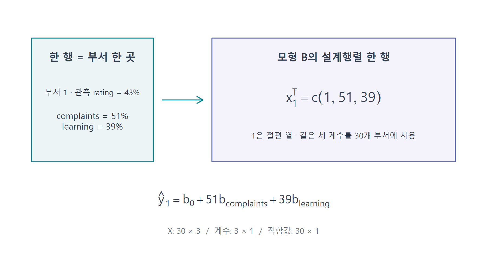
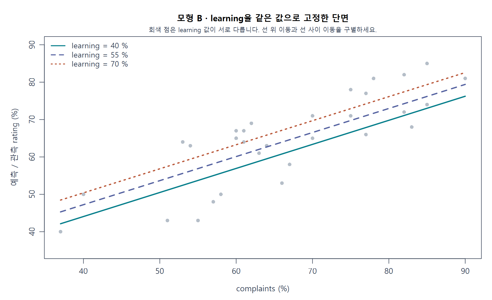
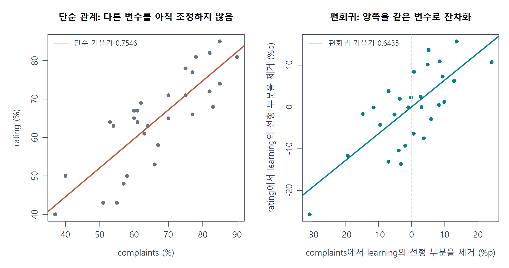
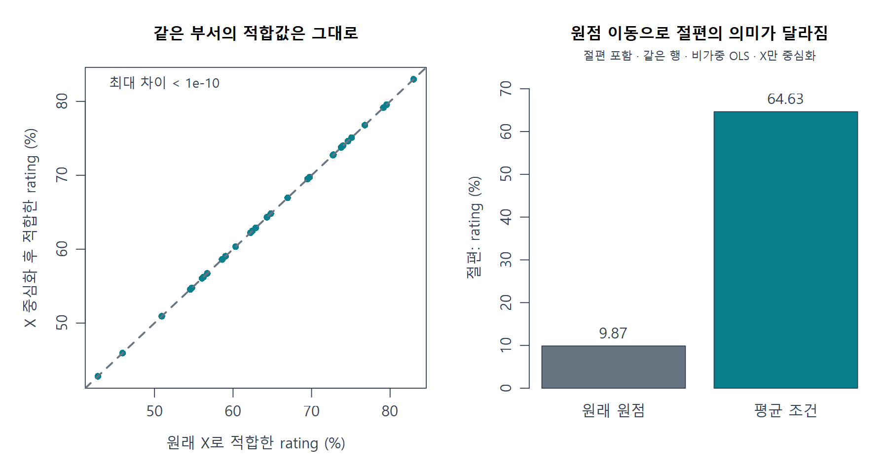
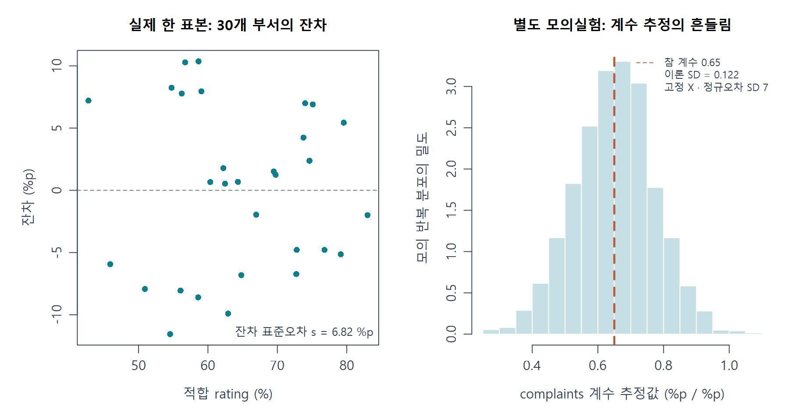
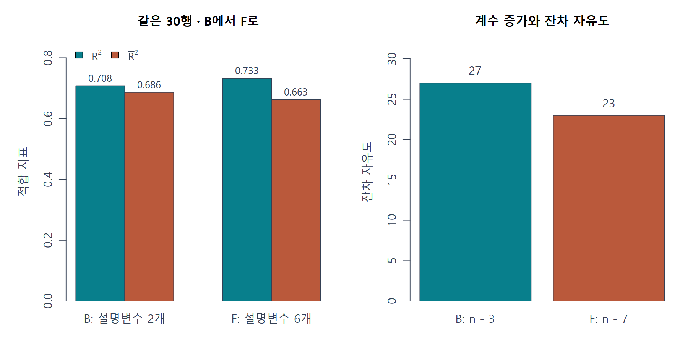
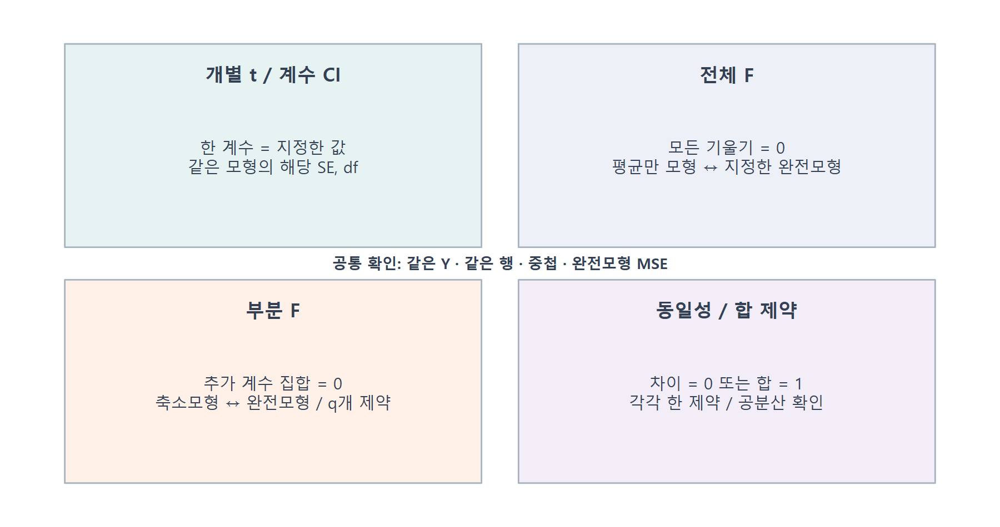
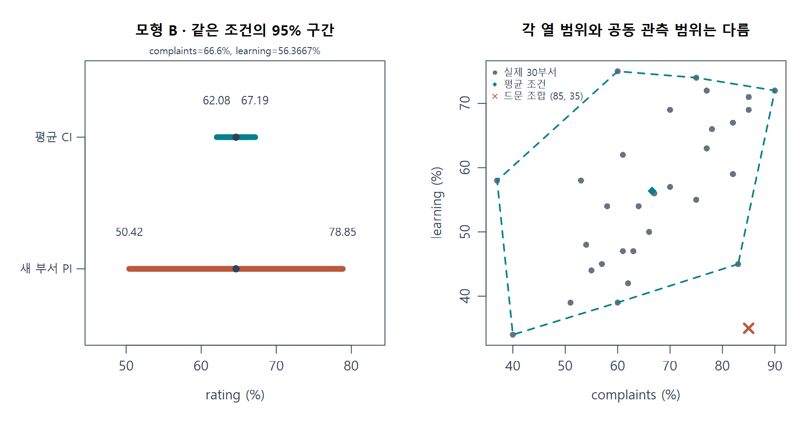

# W08A · 중간고사 대비 복습 ④

회귀분석의 이해 · 2026년 10월 19일 · 5주차 다중회귀 복습과 문제풀이

다중회귀의 숫자를 읽기 전에 **대상 → 고정 조건 → 모형과 자료 → 계산 → 해석의 한계**를 확인합니다. 이 자료는 실제 W05A·W05B 수업의 주교재 §4.1–4.12를 연결합니다. 일반 42문항과 R 18문항, 총 60문항은 수업과 자율 복습을 위한 문제은행입니다. 수업에서는 대표 문항을 함께 풀고, 나머지는 헷갈리는 개념을 찾아 복습하는 데 사용합니다. 새 성적 반영 과제나 제출 기한은 없습니다.

각 문제는 필요한 조건을 다시 제시합니다. 앞 문제의 답을 다음 문제에 옮기지 않아도 풀 수 있습니다. 먼저 손으로 결과를 예상하고, 계산 또는 짧은 근거를 쓴 다음 R 출력과 비교하세요. 정답·완성 연습코드는 이 문제편에 포함하지 않습니다. 아래의 완성 예제는 개념 설명용이며 연습문제 풀이와 구별합니다.

## 1. 같은 자료에서도 모형을 먼저 적는다

주 자료 `datasets::attitude`는 **30개 부서**의 설문 집계입니다. 한 행은 직원 한 명이 아니라 부서 하나입니다. 각 열은 해당 문항에 긍정적으로 응답한 비율(%)입니다. 60%에서 64%로 변하면 4퍼센트포인트(%p) 차이입니다. ‘4% 증가’와 구별합니다.

| 이름 | 모형식 | 이번 복습에서의 역할 |
|---|---|---|
| 모형 A | `rating ~ complaints + privileges` | W05A에서 읽었던 두 변수 모형 |
| 모형 B | `rating ~ complaints + learning` | W05B와 이번 복습의 주 경로 |
| 모형 F | `rating ~ complaints + privileges + learning + raises + critical + advance` | 여섯 설명변수, 부분 검정의 완전모형 |

세 모형 모두 동일한 30개 완전 관측행과 절편을 사용합니다. ‘두 변수 모형’이라는 말만으로 A와 B의 계수·SSE를 섞으면 안 됩니다. `complaints`는 불만 건수가 아니라 불만 처리 문항의 긍정 응답 비율입니다. 기울기는 비교에 사용하는 다른 설명변수들이 같은 조건에서 해석합니다.



**그림 1 읽기.** 왼쪽의 부서 한 곳이 오른쪽의 한 행으로 들어갑니다. 첫 원소 1은 절편에 대응합니다. 설명변수 2개에 절편 1개를 더하므로 모형 B의 설계행렬은 $30\times3$, 계수 벡터는 $3\times1$입니다. 모든 부서가 같은 계수 세 개를 사용합니다. R 내장 자료로 새로 작성한 도식입니다.

| 기호 | 이 자료에서 고정한 뜻 | 모형 B / F |
|---|---|---|
| $n$ | 실제 적합에 사용한 관측행 수 | 30 / 30 |
| $p$ | 설명변수 수 | 2 / 6 |
| $k=p+1$ | 절편 포함 독립 계수 수 | 3 / 7 |
| $\nu=n-k$ | 잔차 자유도 | 27 / 23 |
| $q$ | 비교에서 부과하는 독립 제약 수 | 검정마다 정함 |
| $\varepsilon_i$ / $e_i$ | 참 평균모형의 오차 / 적합한 모형의 잔차 | 같은 양이 아님 |

R 공식 문서에는 계수 수를 $p$라고 부르는 곳도 있습니다. 여기서는 교재와 연결하기 위해 설명변수 수 $p$, 계수 수 $k$를 구별합니다. 설계행렬은 열의 선형독립성을 가정합니다. 열이 중복되어 순위가 낮아지는 경우에는 단순히 열 개수를 세어 자유도를 정하지 않습니다.

## 2. 기울기는 같은 조건에서의 예측 차이다

$$
E(Y_i\mid X)=\beta_0+\beta_1x_{i1}+\cdots+\beta_px_{ip},\qquad
\hat y_i=b_0+b_1x_{i1}+\cdots+b_px_{ip}.
$$

모형 B에서 learning을 같은 값으로 두면 complaints가 $\Delta x$만큼 다른 두 조건의 예측 차이는 $b_{\mathrm{complaints}}\Delta x$입니다. 실제 두 부서의 learning까지 함께 다르면 이 한 항만으로 차이를 설명할 수 없습니다.



**그림 2 읽기.** 같은 선을 따라 이동할 때는 learning이 같습니다. 선 사이를 이동하면 learning도 달라집니다. 회색 관측점의 learning 값은 서로 다르므로 모두 한 선에 놓일 이유가 없습니다. 관측 자료의 조건부 관계이며 정책을 바꾸었을 때의 인과효과를 증명하지 않습니다.

**별도 설명 예제.** 가상의 두 변수 적합식이 $\hat y=8+0.4x_1+0.3x_2$라고 합시다. $x_2=50$을 같게 두고 $x_1$을 55에서 60으로 바꾸면 예측은 45에서 47로 변합니다. 직접 대입한 차이 $47-45=2$는 $0.4\times5=2$와 같습니다. 비율 변수라면 변화 단위는 %p입니다. 이 식은 실제 attitude의 적합식이 아닙니다.

단순회귀 기울기와 다중회귀 기울기가 다를 수 있습니다. 관심 설명변수와 반응변수 **양쪽에서 동일한 다른 설명변수의 선형 부분을 제거**한 잔차끼리 비교하면 편회귀계수를 얻습니다.



**그림 3 읽기.** 오른쪽의 가로축은 complaints 자체가 아니라 learning으로 설명하고 남은 complaints의 잔차입니다. 세로축도 같은 방식으로 얻은 rating의 잔차입니다. 오른쪽 기울기는 모형 B의 complaints 계수와 같습니다. 잔차화는 숨은 모든 교란요인을 제거했다는 뜻이 아니며, 관측하지 않은 변수를 자동 조정하지 않습니다.

## 3. 최소제곱, 자유도, 서로 다른 두 표준오차

$$
\mathrm{SSE}=\sum_{i=1}^{n}(y_i-\hat y_i)^2,\qquad
X^{\mathsf T}e=0,\qquad
s^2=\frac{\mathrm{SSE}}{n-k},\quad s=\sqrt{s^2}.
$$

OLS는 같은 관측값에서 계수를 움직여 SSE를 최소화합니다. 정규방정식의 $X^{\mathsf T}e=0$은 잔차가 설계행렬의 각 열과 직교한다는 뜻입니다. 절편이 있으면 잔차 합도 0입니다. 잔차 합 0이 모든 관측의 잔차가 0이라는 뜻은 아닙니다. 이 대수적 성질 자체에 정규오차 가정은 필요하지 않습니다.

**별도 설명 예제.** $n=12$, 설명변수 2개, 절편 포함, SSE=81인 합성 자료라면 $k=3$, 잔차 자유도는 9, $s^2=81/9=9$, $s=3$입니다. 반응의 단위가 %p라면 SSE와 $s^2$는 $(\%p)^2$, $s$는 %p입니다. $\sqrt{\mathrm{SSE}/n}$인 훈련 RMSE와 $s$는 분모가 다릅니다.

$$
\widehat{\operatorname{Var}}(b)=s^2(X^{\mathsf T}X)^{-1},\qquad
\operatorname{SE}(b_j)=s\sqrt{[(X^{\mathsf T}X)^{-1}]_{jj}}.
$$

$s$는 한 관측의 오차 규모를 추정한 값입니다. $\operatorname{SE}(b_j)$는 표본을 다시 모을 때 계수 추정값이 얼마나 흔들리는지에 대한 추정입니다. 계수별 SE에는 오차 규모뿐 아니라 설명변수의 배치가 반영됩니다. 모든 계수에 같은 $s$를 그대로 붙이지 않습니다.

## 4. 좌표를 바꾸어도 같은 예측을 할 수 있다

| 변환 | 식 | 변환 후 확인할 것 |
|---|---|---|
| 중심화 | $x_c=x-\bar x$ | 평균 0, 원 단위 유지 |
| SD 표준화 | $z=(x-\bar x)/s_x$ | 표본 SD 1, 제곱합 $n-1$ |
| 단위길이 척도화 | $u=(x-\bar x)/\sqrt{\sum_i(x_i-\bar x)^2}$ | 제곱합 1, SD $1/\sqrt{n-1}$ |

같은 행, 절편 포함 비가중 OLS에서 상수가 아닌 설명변수에 가역적인 중심·척도 변환을 일관되게 적용하면 같은 회귀공간을 표현합니다. X만 중심화하면 기울기는 유지되고 절편은 평균 X조건의 예측으로 바뀝니다. 원단위 적합값·잔차·SSE는 같습니다. Y까지 변환했다면 예측을 Y의 원 단위로 복원한 뒤 비교해야 합니다.

$$
b_{0,c}=b_0+\sum_{j=1}^{p}b_j\bar x_j.
$$



**그림 4 읽기.** 왼쪽 점은 같은 부서의 두 적합값이므로 대각선 위에 겹칩니다. 오른쪽 절편은 서로 다른 원점의 높이를 말합니다. 원점이 바뀌었다고 자료가 새로 생기거나 적합이 좋아진 것은 아닙니다. 모형 B의 학습평균 조건에서 절편은 rating의 표본평균과 일치합니다.

**새 부서도 학습한 평균과 척도를 사용합니다.** 학습 X에서 계산한 중심과 SD를 저장하고 새 행에 그대로 적용합니다. 새 한 행에 `scale()`을 따로 하면 자기 자신의 평균을 빼게 되고 SD도 계산할 수 없어 원래 좌표계가 사라집니다. `scale(x, center=FALSE)`의 기본 척도는 중심화 후 표본 SD와 같다고 가정하지 않습니다.

**별도 설명 예제.** 학습 평균 40, 학습 SD 8인 변수에서 새 값 52의 표준화 값은 $(52-40)/8=1.5$입니다. 새 값 52를 새로운 평균으로 사용하지 않습니다.

## 5. 추정량의 성질과 정확한 추론의 가정을 나눈다

| 결론 | 핵심 조건과 의미 |
|---|---|
| OLS 불편성 | 올바른 선형 평균, 열 완전순위, $E(\varepsilon\mid X)=0$. 반복 표본에서 평균이 참 계수 |
| BLUE | 위 조건과 $\operatorname{Var}(\varepsilon\mid X)=\sigma^2I$. 선형 불편 추정량 중 분산이 가장 작음 |
| 정확한 소표본 t·F 및 구간 | 고전적 선형모형에 정규오차 가정을 더함. 지정한 자유도의 분포로 추론 |

불편성이 이번 표본에서 $b=\beta$라는 뜻은 아닙니다. BLUE의 ‘최선’은 모든 가능한 추정량·모든 예측 문제에서 최고라는 뜻이 아닙니다. 정규성은 불편성과 Gauss–Markov의 BLUE 결론에 반드시 필요한 가정은 아니지만, 여기서 사용하는 정확한 소표본 t·F 추론에는 추가합니다.



**그림 5 읽기.** 왼쪽은 실제 모형 B의 30개 잔차, 오른쪽은 같은 X에 새 정규오차를 반복 생성한 별도 모의실험입니다. 오른쪽의 알려진 참 계수는 0.65로 설정했습니다. 실제 부서 설문을 2,500번 새로 수집한 결과가 아닙니다. 잔차의 단위와 계수 추정 분포의 가로축 단위를 구별하세요.

## 6. 변수가 늘면 무엇이 좋아지고 무엇이 줄어드는가

같은 반응·같은 관측행·절편 포함 OLS에서 더 작은 모형을 포함하는 설명변수 추가는 SSE를 증가시키지 않습니다. SST는 고정이므로 $R^2$는 감소하지 않습니다. 증가량이 아주 작아도 이 성질은 성립합니다.

$$
R^2=1-\frac{\mathrm{SSE}}{\mathrm{SST}},\qquad
\bar R^2=1-\frac{\mathrm{SSE}/(n-k)}{\mathrm{SST}/(n-1)}.
$$

수정 $R^2$는 잔차 자유도 감소를 함께 반영하므로 하락할 수 있습니다. $R^2$의 비율에는 SST>0이 필요합니다. 반응과 적합값이 모두 상수가 아닐 때 다중상관 $R=\sqrt{R^2}$는 이 조건에서 반응과 적합값의 비음수 상관과 같습니다. 어느 특정 회귀계수의 부호를 나타내지 않으며, 적합값이 상수일 때는 통상적인 상관 계산이 정의되지 않는 점을 구별합니다. 수정 $R^2$를 제곱근으로 바꿔 다중상관이라고 하지 않습니다.



**그림 6 읽기.** 실제 30행을 고정한 B→F 비교입니다. $R^2$는 약 0.708→0.733, 수정 $R^2$는 약 0.686→0.663, 잔차 자유도는 27→23으로 바뀝니다. ‘설명변수를 더 썼다’와 ‘추가 변수들이 유의하다’와 ‘미래 예측이 더 좋다’는 서로 다른 판단입니다.

## 7. 검정은 숫자보다 귀무가설을 먼저 쓴다

$$
t=\frac{b_j-\beta_{j,0}}{\operatorname{SE}(b_j)},\qquad
\text{계수 CI}:\ b_j\pm t_{1-\alpha/2,n-k}\operatorname{SE}(b_j).
$$

양측 검정에서는 t의 절댓값을 임계값과 비교합니다. 기본 R 계수표의 p값은 해당 모형에서 계수가 0이라는 귀무가설의 양측 p값입니다. 0이 아닌 귀무값을 검정하려면 분자에서 그 값을 빼야 합니다. p값은 귀무가설이 참일 확률이 아닙니다.



**그림 7 읽기.** 개별 t는 한 계수, 전체 F는 모든 기울기, 부분 F는 지정한 추가 계수 집합을 묻습니다. 어떤 검정이든 **같은 Y·같은 관측행·중첩 모형·완전모형의 MSE**를 확인합니다. 전체 F가 유의하다고 모든 계수가 각각 유의하다고 결론내리지 않습니다.

$$
F=\frac{(\mathrm{SSE}_{R}-\mathrm{SSE}_{F})/q}
{\mathrm{SSE}_{F}/(n-k_F)},\qquad q=k_F-k_R.
$$

분자는 제약 하나당 잃은 적합, 분모는 완전모형의 잔차 변동입니다. 전체 F에서는 축소모형이 절편만 있는 모형이며 $q=p_F$입니다. B→F에서는 두 기울기는 유지하고 네 기울기를 0으로 제한하므로 $q=4$, 분모 자유도는 23입니다. q와 잔차 자유도를 바꾸어 넣지 않습니다.

**별도 설명 예제.** 같은 반응·12행의 중첩 모형에서 축소 SSE=120, 완전 SSE=90, $k_R=2$, $k_F=3$이면 $q=1$, 완전 자유도는 9입니다. 따라서 $F=[(120-90)/1]/(90/9)=3$입니다. 임계값과 유의수준을 주지 않았다면 이 값만으로 기각 여부까지 단정하지 않습니다.

같은 자료·같은 완전모형·같은 한 개 선형 제약에서 양측 t와 F는 $F=t^2$로 대응합니다. 여섯 변수 모형의 전체 F에 아무 계수 t를 제곱해 비교하지 않습니다. t의 방향 정보는 제곱하면서 사라집니다.

| 제약 | 간단한 재표현 | 반드시 확인할 점 |
|---|---|---|
| $\beta_1=\beta_2$ | $y=\beta_0+\gamma(x_1+x_2)+\varepsilon$ | 차이의 분산에는 $-2\operatorname{Cov}(b_1,b_2)$ 포함 |
| $\beta_1+\beta_2=1$ | $y-x_2=\beta_0+\beta_1(x_1-x_2)+\varepsilon$ | 예측에 $x_2$를 다시 더해 원래 Y에서 SSE 비교 |

합 제약의 변환된 반응과 원래 반응 모형을 `anova()`로 직접 비교하지 않습니다. 동일성과 합 제약을 각각 기각하지 못했다고 두 계수가 정확히 0.5라고 입증된 것은 아닙니다. 비기각은 자료가 지정한 차이를 충분히 드러내지 못했다는 판단입니다. 큰 행렬 역행렬 계산과 긴 증명은 보충 학습으로 둡니다.

## 8. 계수, 평균반응, 새 부서를 구별한다

$$
\hat y_0=\mathbf x_0^{\mathsf T}b,\qquad
h_0=\mathbf x_0^{\mathsf T}(X^{\mathsf T}X)^{-1}\mathbf x_0.
$$

$\mathbf x_0$의 첫 원소는 절편을 위한 1입니다. 같은 조건에서 평균반응 CI와 새 부서 PI는 같은 점예측을 중심으로 합니다. 새 부서는 평균 추정의 불확실성에 새로운 오차가 더해집니다.

| 대상 | 표준오차 | 구간 중심 |
|---|---|---|
| 계수 $\beta_j$ | $\operatorname{SE}(b_j)$ | $b_j$ |
| 조건부 평균 $E(Y_0\mid\mathbf x_0)$ | $s\sqrt{h_0}$ | $\hat y_0$ |
| 독립인 새 부서 $Y_0$ | $s\sqrt{1+h_0}$ | $\hat y_0$ |

모든 구간은 해당 중심에 같은 모형의 t임계값×해당 표준오차를 더하고 빼서 만듭니다. 같은 수준·같은 위치에서는 새 관측 PI가 평균 CI보다 넓습니다. 신뢰수준을 높이면 폭은 넓어지지만 같은 모형의 계수나 점예측이 바뀌지는 않습니다. 95%는 고정된 참 모수가 매번 움직일 확률이 아니라 반복 절차의 포함률로 해석합니다.



**그림 8 읽기.** 왼쪽의 두 검은 점은 같은 점예측입니다. 오른쪽의 붉은 ×는 두 열의 개별 범위만 보면 가능한 듯하지만 공동 관측영역과 멀리 떨어져 있습니다. 각 축의 최소–최대 검사만으로 새로운 조합을 충분히 관측했다고 할 수 없습니다. 볼록껍질 안이라는 사실도 모형의 정확성이나 인과성을 보장하지는 않습니다.

## 9. 계산과 R 출력을 나란히 읽는 참고표

| 계산에서 찾는 것 | R에서 확인할 위치 | 읽는 방법 |
|---|---|---|
| 추정계수 $b$ | `coef(fit)` | 값·변수 이름·모형식 함께 확인 |
| SSE / 잔차 df | `sum(resid(fit)^2)` / `df.residual(fit)` | 제곱 후 합, 사용 행과 계수 수 확인 |
| $s$ | `summary(fit)$sigma` | 잔차 표준오차이며 계수 SE와 다름 |
| 계수 SE·t·양측 p | `summary(fit)$coefficients` | 추정값, 표준오차, t값, 마지막 양측 p값 열 |
| 계수 CI | `confint(fit, level=.95)` | lm에서는 t 기반 구간 |
| 중첩 모형 비교 | `anova(reduced, full)` | 같은 Y·행, q와 완전모형 df |
| 평균 / 새 관측 구간 | `predict(fit, newdata=..., interval="confidence")` / `"prediction"` | 새 행 이름·단위·학습 변환·구간 대상 |

함수명 암기보다 각 값이 어떤 식의 어느 항에 대응하는지 확인합니다. `anova(fit)` 하나의 표는 변수 순서에 따른 순차제곱합이므로 모든 변수를 조정한 계수 t검정과 자동으로 같지 않습니다. `predict(..., se.fit=TRUE)`의 `se.fit`은 평균 예측의 표준오차이며 새 부서의 예측 표준오차가 아닙니다. 표시값은 마지막에 반올림하고, 가능하면 객체의 원래 정밀도로 계산하세요.

## 10. 실습 환경과 복습 경로

[설치 없는 온라인 R](https://lunalab-ai.github.io/regre/w08a.html)에서 코드를 편집·실행합니다. R Colab A/B 또는 내려받은 R/QMD를 대체 경로로 사용할 수 있습니다. 모든 환경을 중복 수행할 필요는 없습니다. 학습용 빈칸·오류는 해당 문항 안에서 해결하고, 미완성 문항을 건너뛰어도 다음 독립 문항을 시작할 수 있습니다.

**APP01 · Q55와 Q59를 다시 확인하기.** 마지막에는 [누적 앱](https://lunalab-ai.github.io/regre/apps/w08a/)의 ‘W08A 다중회귀 복습’ 탭과 [코드 편집기](https://lunalab-ai.github.io/regre/apps/w08a/edit/index.html)를 사용합니다. 모형·신뢰수준·새 부서 입력 중 하나만 바꾸세요. Q55의 ‘비교하는 모형과 자유도’, Q59의 ‘구간 대상과 폭’을 먼저 예상한 뒤 출력과 비교합니다. 코드의 `W08A_APP01` 표식에서 구간 선택 입력 `w8_kind`의 한 줄을 찾아, 앱을 열었을 때 처음 선택되는 구간을 평균에서 새 부서로 바꿉니다. 재실행한 뒤 선택값과 출력 설명이 함께 바뀌는지 확인하고 편집 코드를 내려받으세요. 이는 새 61번 문항이 아니라 기존 두 문항을 같은 계산으로 관찰하는 활동입니다.

조건·단위가 헷갈리면 Q01–09, 변환은 Q10–16, 가정은 Q17–21, 적합도는 Q22–26, 검정은 Q27–37, 구간은 Q38–42로 돌아갑니다. 해당 R 문항 Q43–60을 짝지어 실행 전 예상과 실행 후 해석을 비교하세요.

## 출처와 제작 구분

실제 W05A·W05B 노트와 주교재 『Chatterjee 예제를 통한 회귀분석 제6판: R 활용』 §4.1–4.12를 기준으로 재구성했습니다. 교재 절·쪽 대조는 기존 수업의 출처기록에 따릅니다. 그림 8개는 실제 R 내장 attitude 또는 명시한 별도 모의실험을 이용해 새로 그렸으며 교재 스캔을 복제하지 않았습니다. 합성 손계산 예제는 실제 30개 부서의 결과와 구별했습니다.

[W05A 원 강의](https://github.com/lunalab-ai/regre/blob/main/course/notion/w05a/w05a-multiple-regression.md) · [W05B 해석](https://github.com/lunalab-ai/regre/blob/main/course/notion/w05b/w05b-interpretation.md) · [W05B 추론·예측](https://github.com/lunalab-ai/regre/blob/main/course/notion/w05b/w05b-inference.md) · [W05B 수학 보충](https://github.com/lunalab-ai/regre/blob/main/course/notion/w05b/w05b-math.md).

R 공식 문서: [summary.lm](https://stat.ethz.ch/R-manual/R-devel/library/stats/html/summary.lm.html), [confint](https://stat.ethz.ch/R-manual/R-devel/library/stats/html/confint.html), [predict.lm](https://stat.ethz.ch/R-manual/R-devel/library/stats/html/predict.lm.html), [anova.lm](https://stat.ethz.ch/R-manual/R-devel/library/stats/html/anova.lm.html), [scale](https://stat.ethz.ch/R-manual/R-devel/library/base/html/scale.html), [attitude](https://stat.ethz.ch/R-manual/R-devel/library/datasets/html/attitude.html). 공식 문서의 출력 의미·변환·구간 대상을 확인하여 설명을 보완했습니다.


# 연습문제 60문항 · 문제편

모든 문항은 독립적입니다. 계산 과정이나 판단 근거를 남기고, 마지막에 대상·조건·단위를 확인하세요. 필요한 R 함수의 뜻은 해당 문제에 제공합니다.

## Q01 · 한 행과 하나의 회귀식

유형: 일반 · 난이도: 기초

R 내장 attitude 자료는 30개 부서에서 집계한 7개 긍정 응답 비율(%)이다. 모형 A의 반응변수는 rating이며 $Y_i=rating_i$로 쓴다. 모형식은 $Y_i=\beta_0+\beta_1\,complaints_i+\beta_2\,privileges_i+\varepsilon_i$이다. (가) 관측단위와 반응변수를 쓰시오. (나) $n,p,k=p+1$을 쓰시오. (다) 모든 부서가 같은 계수를 사용하는지, 부서마다 별도 계수를 추정하는지 설명하시오.

### 풀이 기록

대상·주어진 조건 → 식/코드 추적 → 중간 계산 → 결과·단위 → 해석

....................................................................................................

....................................................................................................

....................................................................................................

## Q02 · 오차와 잔차는 같은 값인가

유형: 일반 · 난이도: 기초

모형 A에서 모집단 오차는 $\varepsilon_i=Y_i-E(Y_i\mid X)$이고 표본 잔차는 $e_i=y_i-\hat y_i$이다. R이 적합 후 출력한 잔차를 모집단 오차의 실제 관측값이라고 부를 수 있는가? 또한 잔차의 합이 0이라는 사실만으로 모집단 오차가 독립·등분산이라고 결론내릴 수 있는가? 두 판단의 이유를 쓰시오.

### 풀이 기록

대상·주어진 조건 → 식/코드 추적 → 중간 계산 → 결과·단위 → 해석

....................................................................................................

....................................................................................................

....................................................................................................

## Q03 · 설계행렬의 행과 열

유형: 일반 · 난이도: 기초

모형 A는 30개 부서에 절편·complaints·privileges를 사용한다. 첫 부서의 두 입력은 complaints=51, privileges=30이다. (가) 설계행렬 $X$의 크기와 첫 행을 쓰시오. (나) $\hat{\boldsymbol\beta}$와 $X\hat{\boldsymbol\beta}$의 크기를 쓰시오. (다) 첫 열의 1이 하는 일을 설명하시오.

### 풀이 기록

대상·주어진 조건 → 식/코드 추적 → 중간 계산 → 결과·단위 → 해석

....................................................................................................

....................................................................................................

....................................................................................................

## Q04 · 다른 변수를 같게 둔 비교

유형: 일반 · 난이도: 기초

30개 부서에 적합한 모형 A의 식은 $\hat y=15.327620+0.780343\,complaints-0.050160\,privileges$이다. privileges=50%를 유지하면서 complaints를 60%에서 70%로 바꿀 때 예측 rating의 차이를 구하시오. 비교 조건·단위를 포함해 한 문장으로 쓰고, 이를 정책 변경의 인과효과라고 단정할 수 있는지도 설명하시오.

### 풀이 기록

대상·주어진 조건 → 식/코드 추적 → 중간 계산 → 결과·단위 → 해석

....................................................................................................

....................................................................................................

....................................................................................................

## Q05 · 후보 계수와 잔차제곱합

유형: 일반 · 난이도: 기초

다음은 attitude와 다른 합성 자료이며 y의 단위는 점수(점)이다. $(x_1,x_2,y)$의 네 행은 $(1,1,4),(1,3,4),(3,1,6),(3,3,10)$이다. 후보식 I는 $\hat y=2x_1+x_2$, 후보식 II는 $\hat y=1+2x_1+x_2$이다. 각 후보의 잔차벡터와 SSE를 구해 두 후보 중 어느 쪽의 적합 손실이 작은지 설명하시오. 계수를 바꿀 때 관측자료도 바꾸는지 쓰시오.

### 풀이 기록

대상·주어진 조건 → 식/코드 추적 → 중간 계산 → 결과·단위 → 해석

....................................................................................................

....................................................................................................

....................................................................................................

## Q06 · 오차분산의 분모

유형: 일반 · 난이도: 기초

30개 부서에 절편과 설명변수 2개를 사용한 모형 A의 설계행렬은 열 완전순위(full column rank)이며 SSE=1361.863852이다. 잔차 자유도, 오차분산 추정값 $s^2$, 잔차 표준편차 $s$를 구하시오. SSE의 단위는 %p²이다. $s$를 rating 전체의 표본 표준편차라고 불러도 되는지 설명하시오.

### 풀이 기록

대상·주어진 조건 → 식/코드 추적 → 중간 계산 → 결과·단위 → 해석

....................................................................................................

....................................................................................................

....................................................................................................

## Q07 · 정규방정식이 말하는 것

유형: 일반 · 난이도: 적용

절편을 포함해 두 설명변수로 적합한 합성 예에서 $x_1=(1,1,3,3)$, $x_2=(1,3,1,3)$, 잔차 $e=(1,-1,-1,1)$이다. $\sum e_i$, $\sum x_{i1}e_i$, $\sum x_{i2}e_i$를 구하시오. 세 합이 0이라는 사실이 각 잔차가 0이거나 오차의 독립성이 입증되었다는 뜻인지 설명하시오.

### 풀이 기록

대상·주어진 조건 → 식/코드 추적 → 중간 계산 → 결과·단위 → 해석

....................................................................................................

....................................................................................................

....................................................................................................

## Q08 · 두 잔차의 회귀계수

유형: 일반 · 난이도: 기초

별도 합성 자료에서 Y와 X2를 각각 동일한 X1에 절편 포함 회귀해 남긴 잔차가 $r_Y=(1,0,-1,0)$, $r_{X2}=(-1,-1,1,1)$이다. 두 잔차의 평균은 0이다. 잔차끼리 회귀한 기울기 $b=\sum r_{X2}r_Y/\sum r_{X2}^2$를 구하고, 원래 모형 $Y\sim X1+X2$의 어떤 계수와 연결되는지 설명하시오. $r_{X2}=1$을 원래 X2 값 1로 해석해도 되는가?

### 풀이 기록

대상·주어진 조건 → 식/코드 추적 → 중간 계산 → 결과·단위 → 해석

....................................................................................................

....................................................................................................

....................................................................................................

## Q09 · 두 입력이 함께 변한 예측 차이

유형: 일반 · 난이도: 통합

모형 A는 $\hat y=15.327620+0.780343\,complaints-0.050160\,privileges$이다. 조건 U=(complaints 60%, privileges 50%), V=(70%,60%)를 비교한다. 예측 차이를 두 설명변수의 기여로 나누어 계산하시오. 그 전체 차이를 complaints만의 기울기 효과라고 부르면 왜 잘못인지 설명하시오.

### 풀이 기록

대상·주어진 조건 → 식/코드 추적 → 중간 계산 → 결과·단위 → 해석

....................................................................................................

....................................................................................................

....................................................................................................

## Q10 · 중심화한 입력의 뜻

유형: 일반 · 난이도: 기초

모형 B의 학습 평균은 complaints=66.6%, learning=56.3667%이다. 새 조건은 complaints=70%, learning=60%이다. X만 중심화할 때 두 새 입력을 구하고, 중심화 좌표 (0,0)이 원래 어떤 조건인지 설명하시오. 좌표가 바뀌면 부서의 실제 응답 비율도 바뀌는가?

### 풀이 기록

대상·주어진 조건 → 식/코드 추적 → 중간 계산 → 결과·단위 → 해석

....................................................................................................

....................................................................................................

....................................................................................................

## Q11 · X만 중심화와 X·Y 중심화

유형: 일반 · 난이도: 기초

절편 포함 비가중 OLS 모형 B를 같은 30개 부서에 적합했다. 학습 rating 평균은 64.6333%이다. (가) X만 각 학습 평균으로 중심화하면 새 절편은 얼마인가? (나) X와 Y를 모두 각 평균으로 중심화하면 새 절편은 얼마인가? 두 경우의 기울기와 원래 rating 단위로 복원한 적합값이 달라지는지도 설명하시오.

### 풀이 기록

대상·주어진 조건 → 식/코드 추적 → 중간 계산 → 결과·단위 → 해석

....................................................................................................

....................................................................................................

....................................................................................................

## Q12 · 중심화 전후에 같은 예측 읽기

유형: 일반 · 난이도: 기초

모형 B의 적합식은 $\hat y=9.870880+0.643518\,complaints+0.211192\,learning$이다. 같은 30개 부서의 학습 평균은 complaints=66.6%, learning=56.3667%이며 SSE=1254.649이다. X만 중심화한 식의 절편을 계산하시오. 새 절편의 의미, 두 기울기와 원단위 적합값·SSE의 변화 여부를 설명하시오. 반올림된 수치이므로 0.001 이내 차이는 무시한다.

### 풀이 기록

대상·주어진 조건 → 식/코드 추적 → 중간 계산 → 결과·단위 → 해석

....................................................................................................

....................................................................................................

....................................................................................................

## Q13 · 표준편차 1과 길이 1

유형: 일반 · 난이도: 기초

학습자료 30개에서 한 설명변수의 평균은 70, 표본 표준편차는 5이다. 원래 값 80의 z 표준화 값과 단위길이 척도화 값을 구하시오. $z=(x-\bar x)/s$, $u=z/\sqrt{n-1}$을 사용한다. 전체 30개 z 값의 제곱합과 u 값의 제곱합도 쓰시오.

### 풀이 기록

대상·주어진 조건 → 식/코드 추적 → 중간 계산 → 결과·단위 → 해석

....................................................................................................

....................................................................................................

....................................................................................................

## Q14 · 표준화 계수의 단위 환산

유형: 일반 · 난이도: 적용

별도 예에서 X와 Y를 모두 표준화한 다중회귀의 X1 계수는 0.6이다. 학습 표본 SD는 $s_{X1}=10$단위, $s_Y=12$점이다. 원래 단위의 X1 기울기를 구하시오. 다른 설명변수를 같게 두고 X1이 2표준편차 증가할 때 예측 Y가 몇 점 변하는지 구하고, 표준화 계수만으로 인과적 중요도 순위를 확정할 수 있는지 설명하시오.

### 풀이 기록

대상·주어진 조건 → 식/코드 추적 → 중간 계산 → 결과·단위 → 해석

....................................................................................................

....................................................................................................

....................................................................................................

## Q15 · 중심화하지 않은 척도화

유형: 일반 · 난이도: 적용

두 값 $x=(3,4)$에 중심화를 하지 않고 $a=\sqrt{\sum_i x_i^2/(n-1)}$로 나누는 변환을 적용한다. 이 정의는 R에서 center=FALSE, scale=TRUE일 때의 분모이다. (가) a와 변환값을 구하시오. (나) 변환값의 평균을 구하시오. (다) 이 변환을 평균 0·표본 SD 1 표준화라고 부를 수 있는가?

### 풀이 기록

대상·주어진 조건 → 식/코드 추적 → 중간 계산 → 결과·단위 → 해석

....................................................................................................

....................................................................................................

....................................................................................................

## Q16 · 학습 좌표로 예측하고 원단위로 복원

유형: 일반 · 난이도: 통합

합성 다중회귀에서 학습 중심은 $(\bar x_1,\bar x_2,\bar y)=(60,50,65)$이고 학습 SD는 $(s_1,s_2,s_Y)=(10,5,8)$이다. X와 Y를 모두 표준화한 적합식은 $\hat z_Y=0.5z_1+0.25z_2$이다. 새 입력 $(x_1,x_2)=(70,60)$의 표준화 좌표, 표준화 예측, 원단위 Y 예측을 구하시오. 새 한 행의 평균·SD를 따로 쓰면 왜 안 되는지 설명하시오.

### 풀이 기록

대상·주어진 조건 → 식/코드 추적 → 중간 계산 → 결과·단위 → 해석

....................................................................................................

....................................................................................................

....................................................................................................

## Q17 · 추정값 하나와 추정량의 성질

유형: 일반 · 난이도: 기초

모형 B에서 이번 자료의 complaints 계수 추정값은 약 0.6435이다. 올바른 조건부 평균·열 완전순위(full column rank) 설계행렬·평균 0 오차를 가정했을 때 OLS의 불편성을 설명하시오. “불편하므로 이번 0.6435가 참 계수와 반드시 같다”는 주장이 옳은지, 추정값과 추정량을 구분해 답하시오.

### 풀이 기록

대상·주어진 조건 → 식/코드 추적 → 중간 계산 → 결과·단위 → 해석

....................................................................................................

....................................................................................................

....................................................................................................

## Q18 · 추정 오차와 표준오차

유형: 일반 · 난이도: 기초

알려진 참 기울기를 0.65로 둔 합성 모의실험에서 한 번 얻은 추정값은 0.70, 그 표준오차 추정값은 0.10이다. (가) 이번 계수의 추정 오차를 구하시오. (나) “표준오차가 0.10이므로 이번 추정은 정확히 0.10만큼 틀렸다”는 말을 고치시오. (다) 실제 설문자료에서는 같은 추정 오차를 항상 직접 계산할 수 있는가?

### 풀이 기록

대상·주어진 조건 → 식/코드 추적 → 중간 계산 → 결과·단위 → 해석

....................................................................................................

....................................................................................................

....................................................................................................

## Q19 · BLUE가 보장하는 범위

유형: 일반 · 난이도: 기초

선형 조건부 평균이 올바르고, $X$는 열 완전순위(full column rank)이며, $E(\varepsilon\mid X)=0$, $\operatorname{Var}(\varepsilon\mid X)=\sigma^2I$라고 가정한다. (가) OLS가 BLUE라는 말의 비교 대상과 최소화하는 불확실성을 설명하시오. (나) 이 결론에 정규오차가 반드시 필요한가? (다) 정확한 소표본 t·F 추론에서는 이 수업이 어떤 가정을 더 사용하는가?

### 풀이 기록

대상·주어진 조건 → 식/코드 추적 → 중간 계산 → 결과·단위 → 해석

....................................................................................................

....................................................................................................

....................................................................................................

## Q20 · 오차 규모와 계수 분포

유형: 일반 · 난이도: 적용

고정한 X와 같은 참 계수를 사용하는 합성 실험에서 $\operatorname{Var}(\hat\beta_j\mid X)=\sigma^2c_j$이며 $c_j$는 변하지 않는다. 오차 SD를 7에서 14로 바꾸면 (가) 계수 추정량의 분산과 SD는 각각 몇 배인가? (나) 불편성이 유지될 때 분포의 이론적 중심은 달라지는가? (다) 유한한 모의 추정값의 평균이 참값과 정확히 같아야 하는가?

### 풀이 기록

대상·주어진 조건 → 식/코드 추적 → 중간 계산 → 결과·단위 → 해석

....................................................................................................

....................................................................................................

....................................................................................................

## Q21 · 계수별 표준오차 읽기

유형: 일반 · 난이도: 적용

두 기울기의 추정 공분산행렬이 $\widehat{\operatorname{Var}}((\hat\beta_1,\hat\beta_2)^{\mathsf T})=\begin{bmatrix}0.04&-0.01\\-0.01&0.09\end{bmatrix}$이다. 두 계수의 표준오차를 구하시오. 대각 원소 0.04를 모형의 공통 오차분산 $s^2$라고 바로 읽을 수 있는지 설명하시오. 두 계수의 단위는 각각 점/단위라고 한다.

### 풀이 기록

대상·주어진 조건 → 식/코드 추적 → 중간 계산 → 결과·단위 → 해석

....................................................................................................

....................................................................................................

....................................................................................................

## Q22 · 다중상관 R의 부호

유형: 일반 · 난이도: 기초

같은 표본에 적합한 절편 포함 비가중 OLS에서 적합값은 상수가 아니고 $R^2=0.64$이다. 다중상관 $R=\operatorname{cor}(y,\hat y)$를 구하시오. 설명변수 하나의 기울기가 음수라는 사실 때문에 R을 −0.8로 써야 하는가? 수정 R²도 R의 제곱이라고 할 수 있는가?

### 풀이 기록

대상·주어진 조건 → 식/코드 추적 → 중간 계산 → 결과·단위 → 해석

....................................................................................................

....................................................................................................

....................................................................................................

## Q23 · 평균 예측보다 줄어든 손실

유형: 일반 · 난이도: 기초

합성 자료의 같은 관측행에 절편 포함 OLS를 적합했다. SST=400점², SSE=120점²이다. SSR과 R²를 구하고, “새 관측 70%를 정확히 맞힌다”라는 해석을 올바른 문장으로 바꾸시오.

### 풀이 기록

대상·주어진 조건 → 식/코드 추적 → 중간 계산 → 결과·단위 → 해석

....................................................................................................

....................................................................................................

....................................................................................................

## Q24 · 수정 R²의 자유도

유형: 일반 · 난이도: 기초

같은 30행의 합성 자료에서 절편과 설명변수 2개를 사용하는 OLS 모형의 SSE=81점², SST=290점²이다. $R^2$와 $R^2_{adj}=1-[SSE/(n-p-1)]/[SST/(n-1)]$를 계산하시오. 수정 R² 계산의 두 분모가 왜 27과 29인지 설명하시오.

### 풀이 기록

대상·주어진 조건 → 식/코드 추적 → 중간 계산 → 결과·단위 → 해석

....................................................................................................

....................................................................................................

....................................................................................................

## Q25 · 변수가 늘어도 수정 R²가 내려가는 이유

유형: 일반 · 난이도: 적용

같은 attitude 30개 부서에서 모형 B는 complaints+learning(절편 포함 계수3개), 모형 F는 여섯 설명변수(계수7개)를 사용한다. SST=4296.9667, SSE_B=1254.649, SSE_F=1149.000이다. 두 모형의 R²와 수정 R²를 계산하고, SSE와 R²가 개선되었는데 수정 R²는 낮아질 수 있는 이유를 설명하시오. 제곱합 단위는 %p²이다.

### 풀이 기록

대상·주어진 조건 → 식/코드 추적 → 중간 계산 → 결과·단위 → 해석

....................................................................................................

....................................................................................................

....................................................................................................

## Q26 · R² 비감소의 적용 조건

유형: 일반 · 난이도: 적용

“설명변수를 추가하면 R²는 내려가지 않는다”는 문장을 사용하려 한다. 아래 상황을 판단하시오. (가) 같은 y·같은 행·절편 포함 OLS의 중첩모형. (나) 새 변수의 결측값 때문에 관측행이 바뀐 두 적합. (다) 같은 평균만 모형에서 $R=cor(y,\hat y)$를 계산하는 경우. 각 상황에서 해당 주장 또는 상관 계산을 그대로 사용할 수 있는지 이유를 쓰시오.

### 풀이 기록

대상·주어진 조건 → 식/코드 추적 → 중간 계산 → 결과·단위 → 해석

....................................................................................................

....................................................................................................

....................................................................................................

## Q27 · 귀무값이 0이 아닌 t검정

유형: 일반 · 난이도: 기초

30개 관측, 설명변수 2개와 절편을 가진 정규오차 OLS 모형에서 한 기울기 추정값은 0.60, SE는 0.20이다. $H_0:\beta=0.20$ 대 양측 대립가설을 검정한다. t통계량과 자유도를 구하시오. 5% 양측 임계값은 $t_{0.975,27}=2.052$이다. 결론을 쓰시오.

### 풀이 기록

대상·주어진 조건 → 식/코드 추적 → 중간 계산 → 결과·단위 → 해석

....................................................................................................

....................................................................................................

....................................................................................................

## Q28 · 계수 t와 95% 신뢰구간 연결

유형: 일반 · 난이도: 적용

30개 부서의 모형 F는 절편과 여섯 설명변수를 사용한다. complaints 계수 추정값은 0.613188, SE는 0.160983이다. 정규오차 가정 아래 $H_0:\beta_{complaints}=0$의 t와 95% 계수 신뢰구간을 구하시오. $t_{0.975,23}=2.068658$을 사용한다. 구간의 대상·단위와 5% 양측검정 결론을 쓰시오.

### 풀이 기록

대상·주어진 조건 → 식/코드 추적 → 중간 계산 → 결과·단위 → 해석

....................................................................................................

....................................................................................................

....................................................................................................

## Q29 · 유의하지 않음의 정확한 문장

유형: 일반 · 난이도: 기초

모형 F의 learning 계수에 대한 95% CI는 [−0.0283,0.6689]이고, $H_0:\beta_{learning}=0$에 대한 양측 p값은 0.0699이다. 독립·등분산 정규오차 모형을 가정한다. (가) 미리 정한 유의수준 0.05와 0.10에서 각각 기각 여부를 쓰시오. (나) “learning은 rating과 아무 관계가 없다”는 결론을 고치시오. 자료를 본 뒤 유리한 유의수준만 선택해도 되는가?

### 풀이 기록

대상·주어진 조건 → 식/코드 추적 → 중간 계산 → 결과·단위 → 해석

....................................................................................................

....................................................................................................

....................................................................................................

## Q30 · 전체 F의 분자와 분모

유형: 일반 · 난이도: 기초

합성 자료 30개에서 절편과 설명변수 6개를 포함한 완전모형을 OLS로 적합했다. 설계행렬은 열 완전순위이고 독립·등분산 정규오차를 가정한다. SST=400점², SSE=100점²이다. 모든 기울기가 0이라는 전체 F검정의 귀무가설, 축소모형, 두 자유도와 F값을 구하시오. p값은 0.001보다 작다고 주어질 때 5% 결론을 쓰시오.

### 풀이 기록

대상·주어진 조건 → 식/코드 추적 → 중간 계산 → 결과·단위 → 해석

....................................................................................................

....................................................................................................

....................................................................................................

## Q31 · 전체 검정과 개별 검정의 결론

유형: 일반 · 난이도: 적용

동일한 attitude 30개 부서의 모형 F에서 전체 F검정 p≈0.0000124, learning 개별 양측 t검정 p≈0.0699가 나왔다. 정규오차 가정과 유의수준 0.05를 사용한다. 두 결론은 모순인가? 각 귀무가설을 써서 설명하고, 전체 검정이 유의하므로 여섯 변수를 반드시 모두 유지해야 한다는 주장도 판단하시오.

### 풀이 기록

대상·주어진 조건 → 식/코드 추적 → 중간 계산 → 결과·단위 → 해석

....................................................................................................

....................................................................................................

....................................................................................................

## Q32 · 부분 F에서 무엇을 제한하는가

유형: 일반 · 난이도: 적용

같은 attitude 30개 부서에서 모형 B는 complaints+learning, 모형 F는 complaints+privileges+learning+raises+critical+advance를 사용하며 둘 다 절편을 포함한다. F에 비해 B가 가하는 귀무가설을 쓰시오. 독립 제약 수 q와 완전모형 잔차 자유도, F식의 SSE 분자·분모를 기호로 쓰시오. 두 모형이 반드시 만족해야 할 자료 비교 조건도 쓰시오.

### 풀이 기록

대상·주어진 조건 → 식/코드 추적 → 중간 계산 → 결과·단위 → 해석

....................................................................................................

....................................................................................................

....................................................................................................

## Q33 · 부분 F를 계산하고 결론 쓰기

유형: 일반 · 난이도: 적용

같은 attitude 30개 부서에서 모형 B(rating~complaints+learning)의 SSE=1254.649이다. 모형 F는 rating을 반응으로, complaints·privileges·learning·raises·critical·advance와 절편을 사용하며 SSE=1149.000이다. B는 계수3개, F는 계수7개이다. 독립·등분산 정규오차 OLS 모형에서 추가 네 기울기가 모두 0이라는 부분 F검정을 계산하시오. p≈0.7158이 주어질 때 5% 결론을 쓰고, F의 R²가 더 높다는 사실과 모순인지 설명하시오.

### 풀이 기록

대상·주어진 조건 → 식/코드 추적 → 중간 계산 → 결과·단위 → 해석

....................................................................................................

....................................................................................................

....................................................................................................

## Q34 · 한 제약에서 F와 t의 연결

유형: 일반 · 난이도: 적용

동일한 30개 부서의 모형 B에서 learning 계수=0을 검정한 양측 t값은 1.5713, 잔차 자유도는 27이다. 축소모형은 complaints만 사용한다. 같은 한 제약의 부분 F값을 계산하고 두 자유도를 쓰시오. F만으로 learning 추정값의 양·음 방향을 알 수 있는가? 이 관계를 여러 계수를 동시에 제한하는 F에도 임의의 개별 t 하나로 적용할 수 있는가?

### 풀이 기록

대상·주어진 조건 → 식/코드 추적 → 중간 계산 → 결과·단위 → 해석

....................................................................................................

....................................................................................................

....................................................................................................

## Q35 · 두 기울기 차이의 표준오차

유형: 일반 · 난이도: 적용

Y·x1·x3의 단위가 모두 점인 합성 자료에 독립·등분산 정규오차 OLS 모형 $Y=\beta_0+\beta_1x_1+\beta_3x_3+\varepsilon$을 적합했다. $\hat\beta_1=0.6$, $\hat\beta_3=0.2$이고 추정 분산은 각각 0.04, 0.01, 공분산은 0.01이다. $\operatorname{Var}(A-B)=\operatorname{Var}(A)+\operatorname{Var}(B)-2\operatorname{Cov}(A,B)$를 사용해 $H_0:\beta_1=\beta_3$의 차이·SE·t를 구하시오. 자유도27의 5% 양측 임계값은 2.052이다.

### 풀이 기록

대상·주어진 조건 → 식/코드 추적 → 중간 계산 → 결과·단위 → 해석

....................................................................................................

....................................................................................................

....................................................................................................

## Q36 · 동일성 가설을 축소모형으로 만들기

유형: 일반 · 난이도: 통합

Y·x1·x3의 단위가 모두 점인 합성 자료 30행의 완전모형은 $Y=\beta_0+\beta_1x_1+\beta_3x_3+\varepsilon$이다. 독립·등분산 정규오차·열 완전순위 설계행렬을 가정하여 OLS로 적합했다. 같은 반응·같은 행에서 $H_0:\beta_1=\beta_3$를 검정한다. 공통 기울기를 $\gamma$라 할 때 축소모형을 쓰고 q를 구하시오. 완전 SSE=100점², 축소 SSE=116점²이며 $F_{0.95;1,27}=4.210$이다. F와 5% 결론을 구하시오.

### 풀이 기록

대상·주어진 조건 → 식/코드 추적 → 중간 계산 → 결과·단위 → 해석

....................................................................................................

....................................................................................................

....................................................................................................

## Q37 · 계수 합 제약과 원래 반응

유형: 일반 · 난이도: 통합

Y·x1·x3의 단위가 모두 점인 합성 자료 30행의 완전모형은 $Y=\beta_0+\beta_1x_1+\beta_3x_3+\varepsilon$이다. 독립·등분산 정규오차·열 완전순위 설계행렬을 가정하여 같은 행에 OLS로 적합하고 $H_0:\beta_1+\beta_3=1$을 검정한다. $\beta_3=1-\beta_1$을 대입해 변환 반응의 축소식을 쓰고, 그 적합값을 원래 Y로 복원하는 식을 쓰시오. 원래 Y 기준의 축소 SSE=110점², 완전 SSE=100점²이다. q와 F를 구하고 임계값 $F_{0.95;1,27}=4.210$으로 판단하시오. 비기각이면 두 계수가 각각 0.5인가?

### 풀이 기록

대상·주어진 조건 → 식/코드 추적 → 중간 계산 → 결과·단위 → 해석

....................................................................................................

....................................................................................................

....................................................................................................

## Q38 · 새 조건의 점예측

유형: 일반 · 난이도: 기초

30개 부서로 적합한 모형 B는 $\hat y=9.870880+0.643518\,complaints+0.211192\,learning$이다. 새 조건 complaints=65%, learning=50%의 설계벡터와 점예측을 구하시오. 이 숫자가 해당 조건의 평균반응 추정인지, 다음 부서의 실제 관측값을 정확히 보장하는지 설명하시오.

### 풀이 기록

대상·주어진 조건 → 식/코드 추적 → 중간 계산 → 결과·단위 → 해석

....................................................................................................

....................................................................................................

....................................................................................................

## Q39 · 세 종류의 구간을 구별하기

유형: 일반 · 난이도: 기초

동일한 다중회귀 분석에서 (I) 한 기울기의 95% CI=[0.2,0.8]점/단위, (II) 새 조건의 평균반응 95% CI=[62,67]점, (III) 같은 새 조건의 새 관측 95% PI=[50,79]점이 주어졌다. 다음 한 관측값의 범위를 안내할 때 어느 구간을 쓰는가? II와 III의 폭을 구하고, I의 SE를 새 관측 구간 계산에 그대로 쓰면 안 되는 이유를 설명하시오.

### 풀이 기록

대상·주어진 조건 → 식/코드 추적 → 중간 계산 → 결과·단위 → 해석

....................................................................................................

....................................................................................................

....................................................................................................

## Q40 · 같은 중심의 평균 CI와 새 부서 PI

유형: 일반 · 난이도: 적용

모형 B는 같은 attitude 30개 부서에 절편을 포함해 적합했다. 두 X의 학습 평균 조건에서 $\hat y_0=64.6333$%, $h_0=1/30$, $s=6.816779$%p, 잔차 자유도27이다. $t^*=2.05183$을 사용해 95% 평균반응 CI와 새 부서 PI를 구하시오. $SE_{mean}=s\sqrt{h_0}$, $SE_{new}=s\sqrt{1+h_0}$가 주어졌다. PI 식의 추가 1이 뜻하는 불확실성을 설명하시오.

### 풀이 기록

대상·주어진 조건 → 식/코드 추적 → 중간 계산 → 결과·단위 → 해석

....................................................................................................

....................................................................................................

....................................................................................................

## Q41 · 신뢰수준만 바꾸면 무엇이 달라지는가

유형: 일반 · 난이도: 적용

어떤 정규오차 다중회귀의 같은 새 조건에서 점예측은 70점, $s=5$점, $h_0=0.04$이다. 자료와 적합모형은 그대로 두고 구간 임계값만 2.0에서 2.6으로 높인다. 평균 CI와 새 관측 PI의 SE를 구한 뒤, 두 구간의 폭이 각각 몇 배가 되는지 계산하시오. 점예측과 모형 계수도 바뀌는가?

### 풀이 기록

대상·주어진 조건 → 식/코드 추적 → 중간 계산 → 결과·단위 → 해석

....................................................................................................

....................................................................................................

....................................................................................................

## Q42 · 각 열의 범위 안이면 충분한가

유형: 일반 · 난이도: 적용

모형 B의 학습 부서들은 complaints와 learning이 대체로 함께 높아지는 패턴을 보인다. 새 조건은 높은 complaints와 낮은 learning의 조합이며, 각 값은 각각의 학습 최소–최대 범위 안에 있다. “두 값 모두 범위 안이므로 이 조합의 예측은 안전하고 모형 가정도 확인되었다”는 주장을 판단하시오. 구간을 제시할 때 추가로 확인할 내용을 설명하시오.

### 풀이 기록

대상·주어진 조건 → 식/코드 추적 → 중간 계산 → 결과·단위 → 해석

....................................................................................................

....................................................................................................

....................................................................................................

## Q43 · 행마다 같은 계수를 적용하기

유형: R · 난이도: 기초 · 빈칸

합성자료 네 행에서 설명변수는 두 개이다. 절편을 포함한 주어진 식은 $\hat y=5+2x_1-x_2$이며 모든 변수는 이 문제의 점수 단위이다. `cbind`는 열을 나란히 묶고, `%*%`는 행렬 곱, `drop`은 결과의 불필요한 차원 표시를 없앤다. 함수 이름을 새로 작성할 필요는 없다.

빈칸을 채우고 $X$의 크기와 출력되는 네 예측값을 쓰시오. 관측 수와 계수 수가 코드의 어느 방향에 해당하는지도 설명하시오.

```r
x1 <- c(1, 2, 3, 4)
x2 <- c(1, 4, 1, 4)
X <- cbind(1, x1, x2)
b <- c(5, 2, -1)
prediction <- drop(X %*% ____)
print(prediction)
```

### 풀이 기록

대상·주어진 조건 → 식/코드 추적 → 중간 계산 → 결과·단위 → 해석

....................................................................................................

....................................................................................................

....................................................................................................

## Q44 · 잔차분산의 분모 고치기

유형: R · 난이도: 기초 · 에러 찾기

절편과 설명변수 두 개를 포함한 완전계수 OLS 모형에서 $n=12$, $k=3$은 **절편까지 포함한 계수 수**, $SSE=18$이다. 다음 코드는 실행되지만 단순회귀의 자유도를 잘못 사용한다. 틀린 한 줄을 고치고 잔차 자유도와 오차분산 추정값을 구하시오.

```r
n <- 12
k <- 3
SSE <- 18
residual_df <- n - 2
s2 <- SSE / residual_df
print(c(df = residual_df, s2 = s2))
```

### 풀이 기록

대상·주어진 조건 → 식/코드 추적 → 중간 계산 → 결과·단위 → 해석

....................................................................................................

....................................................................................................

....................................................................................................

## Q45 · 정규방정식의 작은 계산

유형: R · 난이도: 적용 · 빈칸

절편을 포함한 합성자료의 모형행렬은 $X^\mathsf TX=\operatorname{diag}(4,4,4)$, $X^\mathsf Ty=(40,8,-4)^\mathsf T$를 만족한다. 완전계수이므로 정규방정식의 각 좌표는 $4\hat\beta_j=(X^\mathsf Ty)_j$이다. `*`는 좌표별 곱, `sum`은 합이다.

빈칸을 채워 세 계수와 $x_0=(1,2,1)^\mathsf T$에서의 예측값을 구하시오. 긴 역행렬 계산은 필요하지 않다.

```r
Xty <- c(40, 8, -4)
b <- Xty / ____
x0 <- c(1, 2, 1)
prediction <- sum(x0 * b)
print(b)
print(prediction)
```

### 풀이 기록

대상·주어진 조건 → 식/코드 추적 → 중간 계산 → 결과·단위 → 해석

....................................................................................................

....................................................................................................

....................................................................................................

## Q46 · X 중심화 뒤 절편

유형: R · 난이도: 기초 · 빈칸

주어진 예측식은 $\hat y=5+2x_1-x_2$이고 설명변수 평균은 $(5,2)$이다. 반응변수는 그대로 두고 $x_1^c=x_1-5$, $x_2^c=x_2-2$로 바꾼다. 아래에서 `b[-1]`은 두 기울기이며 `centers`는 원래 설명변수 평균이다.

빈칸을 채우고 새 절편과 두 기울기를 쓰시오. 같은 관측의 예측값이 왜 유지되는지도 설명하시오.

```r
b <- c(5, 2, -1)
centers <- c(5, 2)
new_intercept <- b[1] + sum(b[-1] * ____)
print(c(new_intercept, b[-1]))
```

### 풀이 기록

대상·주어진 조건 → 식/코드 추적 → 중간 계산 → 결과·단위 → 해석

....................................................................................................

....................................................................................................

....................................................................................................

## Q47 · 새 자료를 자기 평균으로 바꾼 오류

유형: R · 난이도: 적용 · 에러 찾기

학습 자료에서 $\bar x=10$, $s_x=2$, $\bar y=50$, $s_y=10$으로 표준화했고, 적합한 표준화 식은 $\hat z_y=0.6z_x$이다. 새 입력은 원단위로 $(12,14)$이다. 다음 코드는 실행되지만 새 자료의 평균·표준편차로 다른 좌표계를 만든다.

틀린 줄을 학습 때의 기준으로 고치고 새 $z_x$와 원단위 예측값 두 개를 구하시오. 새 자료의 평균을 다시 계산하면 안 되는 이유를 쓰시오. `mean`과 `sd`는 입력한 벡터의 평균과 표본 표준편차를 계산한다.

```r
new_x <- c(12, 14)
z_new <- (new_x - mean(new_x)) / sd(new_x)
predicted_z_y <- 0.6 * z_new
predicted_y <- 50 + 10 * predicted_z_y
print(z_new)
print(predicted_y)
```

### 풀이 기록

대상·주어진 조건 → 식/코드 추적 → 중간 계산 → 결과·단위 → 해석

....................................................................................................

....................................................................................................

....................................................................................................

## Q48 · 표준편차 1과 길이 1의 출력

유형: R · 난이도: 기초 · 출력 예측

합성벡터 $x=(2,4,6)$을 사용한다. `sd`는 분모 $n-1$인 표본 표준편차, `length`는 원소 수, `sqrt`는 양의 제곱근이다. 출력되는 세 값을 순서대로 쓰고 두 변환의 차이를 설명하시오.

```r
x <- c(2, 4, 6)
z <- (x-mean(x)) / sd(x)
u <- z / sqrt(length(x)-1)
print(c(sd_z = sd(z), squared_length_z = sum(z^2),
        squared_length_u = sum(u^2)))
```

### 풀이 기록

대상·주어진 조건 → 식/코드 추적 → 중간 계산 → 결과·단위 → 해석

....................................................................................................

....................................................................................................

....................................................................................................

## Q49 · 잡음의 SD가 두 배일 때

유형: R · 난이도: 기초 · 출력 예측

같은 완전계수 설계행렬 X에서 OLS 계수의 분산은 $\sigma^2$에 비례한다. 어떤 계수의 기존 분산 추정값이0.04이고 오차의 **표준편차**를 두 배로 바꾼 상황에서, 같은 X의 분산비례식을 적용하여 새 분산 추정값을 계산한다. 출력 두 값과 그 이유를 쓰시오. 계수 추정값 자체가 반드시 두 배가 된다는 뜻인지도 설명하시오.

```r
v_old <- 0.04
sigma_factor <- 2
v_new <- sigma_factor^2 * v_old
print(c(variance = v_new, SE = sqrt(v_new)))
```

### 풀이 기록

대상·주어진 조건 → 식/코드 추적 → 중간 계산 → 결과·단위 → 해석

....................................................................................................

....................................................................................................

....................................................................................................

## Q50 · 평균모형 대비 오차 감소

유형: R · 난이도: 기초 · 빈칸

절편을 포함한 동일 자료의 OLS 적합에서 $SST=80$, $SSE=20$이다. 평균만 예측하는 기준에 대한 $R^2$를 구하는 빈칸을 채우고, 결과를 정확히 한 문장으로 해석하시오. 관측을 맞힌 비율로 해석하지 않는다.

```r
SST <- 80
SSE <- 20
R2 <- 1 - SSE / ____
print(R2)
```

### 풀이 기록

대상·주어진 조건 → 식/코드 추적 → 중간 계산 → 결과·단위 → 해석

....................................................................................................

....................................................................................................

....................................................................................................

## Q51 · 수정 R²에서 빠진 절편

유형: R · 난이도: 적용 · 에러 찾기

동일한 완전계수·절편 포함 OLS 자료에서 $n=12$, **설명변수 수** $p=2$, $SSE=18$, $SST=66$이다. 다음 수정 $R^2$ 계산은 잔차 자유도를 잘못 사용한다. 한 줄을 수정하고 올바른 값과 두 분모의 의미를 쓰시오.

```r
n <- 12
p <- 2
SSE <- 18
SST <- 66
adjusted_R2 <- 1 - (SSE/(n-p)) / (SST/(n-1))
print(adjusted_R2)
```

### 풀이 기록

대상·주어진 조건 → 식/코드 추적 → 중간 계산 → 결과·단위 → 해석

....................................................................................................

....................................................................................................

....................................................................................................

## Q52 · 변수 추가 후 두 지표 읽기

유형: R · 난이도: 적용 · 출력 예측

같은10개 관측과 같은 반응변수에서 절편 포함 축소모형과 중첩 완전모형을 적합했다. 축소모형의 설명변수 수는1, 완전모형은3이며 $SST=100$, SSE는 각각40과36이다. 출력되는 R²·수정 R²를 쓰고, 어느 지표가 왜 증가 또는 감소했는지 설명하시오. 이 두 수치만으로 미래 예측 우열을 확정할 수 있는지도 답하시오.

```r
n <- 10
SST <- 100
p <- c(1, 3)
SSE <- c(40, 36)
R2 <- 1-SSE/SST
adj <- 1-(SSE/(n-p-1))/(SST/(n-1))
print(data.frame(model=c("reduced","full"), R2=R2, adjusted_R2=adj))
```

### 풀이 기록

대상·주어진 조건 → 식/코드 추적 → 중간 계산 → 결과·단위 → 해석

....................................................................................................

....................................................................................................

....................................................................................................

## Q53 · 귀무값과 계수 신뢰구간

유형: R · 난이도: 기초 · 빈칸

어떤 다중회귀 계수의 추정값은0.8, SE는0.2이다. 귀무가설은 $H_0:\beta=0.2$이며, 해당 자유도·신뢰수준의 양측 임계값은 이 문제에서2.0으로 제공한다. `c`는 두 끝점을 묶는다.

t 통계량의 빈칸을 채우고 t와 계수 신뢰구간을 구하시오. 주어진 양측 기준에서 귀무값0.2가 구간 안에 있는지도 설명하시오.

```r
estimate <- 0.8
null <- 0.2
SE <- 0.2
critical <- 2.0
t_value <- (estimate - ____) / SE
CI <- estimate + c(-1, 1)*critical*SE
print(t_value)
print(CI)
```

### 풀이 기록

대상·주어진 조건 → 식/코드 추적 → 중간 계산 → 결과·단위 → 해석

....................................................................................................

....................................................................................................

....................................................................................................

## Q54 · 전체 F의 분자 자유도

유형: R · 난이도: 적용 · 에러 찾기

같은24개 관측에 절편과 설명변수 세 개를 넣은 완전계수 OLS 모형이다. $SST=500$, $SSE=200$이며 전체 귀무가설은 세 기울기가 모두0이다. 다음 코드는 분자의 자유도 나눗셈이 빠졌다. F 계산 한 줄을 고치고 분자·분모 자유도 및 F를 쓰시오.

```r
n <- 24
p <- 3
SST <- 500
SSE <- 200
SSR <- SST-SSE
F_value <- SSR / (SSE/(n-p-1))
print(F_value)
```

### 풀이 기록

대상·주어진 조건 → 식/코드 추적 → 중간 계산 → 결과·단위 → 해석

....................................................................................................

....................................................................................................

....................................................................................................

## Q55 · 부분 F의 두 모형을 연결하기

유형: R · 난이도: 적용 · 빈칸

같은20개 완전 관측과 같은 반응변수에 중첩 OLS 모형을 적합했다. 축소모형은 절편+설명변수1개, 완전모형은 절편+설명변수3개이다. 따라서 절편 포함 계수 수는 $k_R=2$, $k_F=4$이며 $SSE_R=180$, $SSE_F=120$이다. 추가된 두 기울기가 모두0인지 검정한다.

빈칸 두 개를 채우고 $q$, 완전모형 잔차 자유도, F를 계산하시오. 실제 수업의 A=`rating ~ complaints + privileges`, B=`rating ~ complaints + learning`처럼 설명변수만 서로 다른 두 모형을 같은 식으로 비교해도 되는지도 답하시오.

```r
n <- 20
k_reduced <- 2
k_full <- 4
SSE_reduced <- 180
SSE_full <- 120
q <- k_full-k_reduced
df_full <- n-k_full
F_value <- ((SSE_reduced-SSE_full)/____) / (SSE_full/____)
print(c(q=q, df_full=df_full, F=F_value))
```

### 풀이 기록

대상·주어진 조건 → 식/코드 추적 → 중간 계산 → 결과·단위 → 해석

....................................................................................................

....................................................................................................

....................................................................................................

## Q56 · 계수 차이에서 공분산을 빠뜨리면

유형: R · 난이도: 통합 · 에러 찾기

같은 다중회귀 모형의 두 기울기 추정값이0.8과0.3이고, 추정된 분산·공분산은 $v_1=0.04$, $v_2=0.09$, $c_{12}=0.01$이다. 같은 단위의 두 설명변수 계수가 같은지 검정한다. 차이의 분산은 $v_1+v_2-2c_{12}$이고 한 제약에서는 $F=t^2$이다.

오류 줄을 수정하고 차이·차이의 분산·SE·F를 구하시오. 표준오차끼리 단순히 빼면 안 되는 이유를 쓰시오. 필요한 분산 공식은 위에 제공하였다.

```r
b <- c(0.8, 0.3)
v1 <- 0.04
v2 <- 0.09
cov12 <- 0.01
difference <- b[1]-b[2]
v_difference <- v1+v2
SE_difference <- sqrt(v_difference)
F_value <- difference^2/v_difference
print(c(difference=difference, variance=v_difference,
        SE=SE_difference, F=F_value))
```

### 풀이 기록

대상·주어진 조건 → 식/코드 추적 → 중간 계산 → 결과·단위 → 해석

....................................................................................................

....................................................................................................

....................................................................................................

## Q57 · 계수 합 제약의 원단위 SSE

유형: R · 난이도: 통합 · 빈칸

합성자료에서 완전모형은 $y=\beta_0+\beta_1x_1+\beta_2x_2+\varepsilon$이다. $H_0:\beta_1+\beta_2=1$을 대입하면 $y-x_2=\beta_0+\beta_1(x_1-x_2)+\varepsilon$이다. 아래 `lm`의 호출틀은 제공되어 있다. `fitted`는 적합값, `sum(...^2)`는 제곱합이다.

빈칸 두 개를 채우고 축소모형의 적합값에 $x_2$를 다시 더하는 이유를 설명하시오. 제공 코드로 $SSE_F$, $SSE_R$, F를 구하시오. 반응변수가 다른 두 `lm` 객체를 그대로 `anova`에 넣어 비교하지 않는다.

```r
d <- data.frame(x1=c(-1,-1,0,0,1,1), x2=c(-1,1,-1,1,-1,1))
d$y <- c(10.1,8.7,7.7,12.3,11.3,9.9)
full <- lm(y ~ x1+x2, data=d)
yr <- d$y - ____
xr <- d$x1 - ____
restricted <- lm(yr ~ xr)
fitted_original_y <- fitted(restricted)+d$x2
SSE_full <- sum((d$y-fitted(full))^2)
SSE_restricted <- sum((d$y-fitted_original_y)^2)
F_value <- ((SSE_restricted-SSE_full)/1)/(SSE_full/(6-3))
print(c(SSE_full=SSE_full, SSE_restricted=SSE_restricted, F=F_value))
```

### 풀이 기록

대상·주어진 조건 → 식/코드 추적 → 중간 계산 → 결과·단위 → 해석

....................................................................................................

....................................................................................................

....................................................................................................

## Q58 · 새 조건의 예측 중심

유형: R · 난이도: 기초 · 빈칸

주어진 절편 포함 적합식은 $\hat y=5+2x_1-x_2$이다. 새 조건은 $x_1=3,x_2=4$이며 `x0`는 절편 열을 포함한다. 빈칸을 채우고 점예측을 구하시오. 같은 조건에서 평균반응 신뢰구간과 개별값 예측구간의 중심이 같은지, 폭도 같은지를 설명하시오.

```r
b <- c(5,2,-1)
x0 <- c(1,3,4)
prediction <- sum(b * ____)
print(prediction)
```

### 풀이 기록

대상·주어진 조건 → 식/코드 추적 → 중간 계산 → 결과·단위 → 해석

....................................................................................................

....................................................................................................

....................................................................................................

## Q59 · 평균과 다음 한 건의 구간 출력

유형: R · 난이도: 적용 · 출력 예측

같은 다중회귀 모형과 같은 새 조건에서 점예측은50, 잔차 표준편차 추정값은 $s=6$, $h_0=0.25$이다. 해당 신뢰수준·잔차 자유도의 양측 임계값은2.0으로 제공한다. 표준 회귀모형의 가정이 성립한다고 가정한다.

출력되는 두 구간을 계산하고, 같은 조건의 평균을 묻는 경우와 다음 관측 한 건을 묻는 경우에 각각 어느 행을 사용해야 하는지 설명하시오. 제곱근을 포함한 정확한 식도 허용한다.

```r
fit <- 50
s <- 6
h0 <- 0.25
critical <- 2
mean_half <- critical*s*sqrt(h0)
prediction_half <- critical*s*sqrt(1+h0)
print(c(mean_lower=fit-mean_half, mean_upper=fit+mean_half))
print(c(pred_lower=fit-prediction_half, pred_upper=fit+prediction_half))
```

### 풀이 기록

대상·주어진 조건 → 식/코드 추적 → 중간 계산 → 결과·단위 → 해석

....................................................................................................

....................................................................................................

....................................................................................................

## Q60 · 열 순서가 바뀐 새 입력

유형: R · 난이도: 적용 · 에러 찾기

주어진 식은 $\hat y=3+1.5x_1-0.5x_2$이고 계수 벡터 순서는 절편,x1,x2이다. 새로운 조건은 $x_1=8,x_2=2$이다. 아래 코드는 실행되지만 두 설명변수의 위치가 바뀌었다.

잘못된 줄을 수정하고 올바른 예측값을 구하시오. 잘못된 코드의 예측값도 계산하여, 벡터 길이가 맞는 것만으로 올바른 예측을 보장하지 못하는 이유를 설명하시오.

```r
b <- c(3, 1.5, -0.5)
new <- data.frame(x1=8, x2=2)
x0 <- c(1, new$x2, new$x1)
prediction <- sum(x0*b)
print(prediction)
```

### 풀이 기록

대상·주어진 조건 → 식/코드 추적 → 중간 계산 → 결과·단위 → 해석

....................................................................................................

....................................................................................................

....................................................................................................

