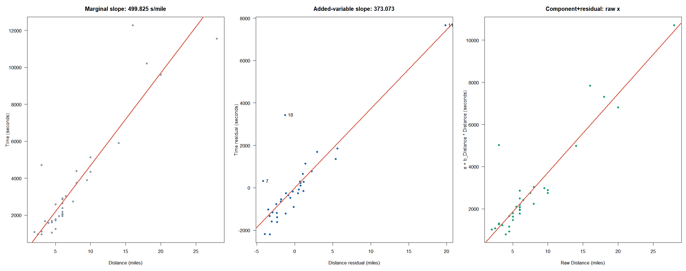
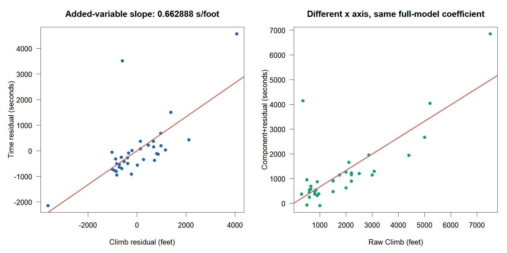

# C · 변수 효과를 분리해서 읽기

W09B · 주교재 §5.13–5.14, pp.221–228

한 설명변수의 효과는 다른 설명변수를 어떻게 다루는지에 따라 달라집니다. 원 산점도의 기울기, 첨가변수플롯의 기울기, 성분잔차플롯의 축을 구별하며 실제 계산으로 연결합니다. 여기서 말하는 효과는 적합한 모형의 조건부 선형 관계입니다.

## 1. 같은 경주 자료·같은 행·같은 단위

공식 `Scottish.Hills.txt`의 35개 경주를 사용합니다. Time은 초, Distance는 마일, Climb은 고도 상승량 피트입니다. $p=2$, $k=3$, $\nu=35-3=32$입니다. 전체 모형의 적합식은 다음과 같습니다.

$$
\widehat{\mathrm{Time}}=-539.482907
+373.072677\,\mathrm{Distance}
+0.662888\,\mathrm{Climb}.
$$

Climb이 같은 조건에서 Distance 1마일의 차이는 예측 시간 약 373.073초의 차이에 대응합니다. Distance가 같은 조건에서 Climb 1피트의 차이는 약 0.662888초의 차이에 대응합니다. 거리·상승량이 모두 다른 두 경주의 실제 시간 차이를 한 계수만으로 설명하지 않습니다. 관측 연구의 이 기울기로 거리나 코스를 변경하는 인과효과를 확정하지도 않습니다.

절편은 Distance와 Climb이 모두 0인 조건의 적합값입니다. 그 조건은 관측된 경주의 범위와 거리가 있으므로 음수 절편을 실제 음수 기록 시간으로 해석하지 않습니다.

**자료 버전 주석.** `MASS::hills`는 시간을 분으로 기록합니다. 공식 교재 파일은 초입니다. 또한 공식 파일 23행 2859초와 `MASS::hills`의 대응 값에 60을 곱한 2857.98초에는 단위 변환 외의 차이도 있습니다. 이번 실습은 공식 교재 파일을 정본으로 고정합니다. 단위를 바꾼 근사 자료로 교재의 계수를 정확하게 재현했다고 말하지 않습니다.

## 2. 첨가변수플롯: 양쪽에서 같은 것을 제거한다 (§5.13.1)

Distance의 효과를 보려면 Time과 Distance 양쪽에서 Climb의 선형 부분을 제거합니다. 절편도 함께 포함합니다.

$$
u_i=\mathrm{Distance}_i-\widehat{\mathrm{Distance}}_i(\mathrm{Climb}),
\qquad
v_i=\mathrm{Time}_i-\widehat{\mathrm{Time}}_i(\mathrm{Climb}).
$$

가로축은 $u_i$, 세로축은 $v_i$입니다. 이 둘은 원래 거리와 시간이 아니라 각각 다른 설명변수를 선형적으로 제거한 잔차입니다. 잔차 단위는 원래 거리·시간 단위와 같습니다.

### E07 · 첨가변수 기울기를 직접 만들기 — 핵심

같은 35행에서 두 잔차를 만들면 다음 합을 얻습니다. 표시값은 반올림했습니다.

$$
\begin{aligned}
\sum_i u_iv_i&\approx222340.0652,\\
\sum_i u_i^2&\approx595.9698,\\
\frac{\sum_i u_iv_i}{\sum_i u_i^2}&\approx373.072677
=b_{\mathrm{Distance}}.
\end{aligned}
$$

따라서 전체 다중회귀의 Distance 계수는 양쪽 잔차의 원점을 지나는 회귀 기울기와 같습니다. 잔차들은 평균 0이므로 절편을 함께 추정해도 절편은 수치 오차 범위에서 0입니다. Time만 잔차화하고 Distance는 원래 값으로 두면 이 계산이 아닙니다.

```r
rx <- residuals(lm(Distance ~ Climb, data=hills))
ry <- residuals(lm(Time ~ Climb, data=hills))
sum(rx*ry) / sum(rx^2)
coef(lm(Time ~ Distance + Climb, data=hills))["Distance"]
```

R의 첫 두 줄은 각각 다른 종속변수를 가진 보조 회귀입니다. 마지막 두 줄은 같은 조건부 기울기를 서로 다른 방식으로 계산합니다. 이 코드는 설명용 E07의 검산이며, 관측·관심 변수를 바꾼 L04의 완성 답안은 포함하지 않습니다.



왼쪽은 다른 변수를 제거하지 않은 원 산점도입니다. 가운데는 두 축에서 Climb을 제거했으며 기울기가 전체 모형의 373.073초/마일입니다. 7·11·18번 같은 관측이 관계와 적합에 어떻게 관여하는지도 함께 봅니다. 이 그림은 교재 그림 5.11–5.12의 구분을 공식 파일로 재계산해 구성했습니다.

**확인 C07.** Distance의 첨가변수플롯에서 Time만 Climb에 대해 잔차화하면 되는지 판단하고, 필요한 두 축을 말하세요.

## 3. 성분잔차플롯: 원래 설명변수 축을 유지한다 (§5.13.2)

관심 변수의 적합 성분을 전체 모형의 잔차에 다시 더합니다.

$$
c_{ij}=e_i+b_jx_{ij}.
$$

가로축은 원래 $x_{ij}$, 세로축은 성분잔차 $c_{ij}$입니다. 첨가변수플롯과 달리 가로축을 잔차화하지 않습니다. 원래 변수 척도에서 곡선 등 평균 형태를 살펴보는 데 도움이 되지만, 다른 설명변수와의 강한 상관이 형태를 가릴 수 있으므로 이 그림만으로 모형을 확정하지 않습니다.

### E08 · 첫 경주의 성분잔차 한 행 — 핵심

첫 경주 Greenmantle New Year Dash는 Time 965초, Distance 2.5마일, Climb 650피트입니다. 먼저 전체 모형으로 적합값과 잔차를 계산합니다.

$$
\begin{aligned}
\hat y_1&=-539.482907+373.072677(2.5)+0.662888(650)
\approx824.0760,\\
e_1&=965-824.0760\approx140.9240,\\
c_{1,\mathrm{Distance}}&=140.9240+373.072677(2.5)
\approx1073.6057.
\end{aligned}
$$

성분잔차도에서 이 점의 좌표는 (2.5마일, 약 1073.6057초)입니다. 1073.6057을 실제 완주 시간이라고 읽지 않습니다. 설명변수 한 성분을 잔차에 더한 진단 좌표입니다. 첨가변수플롯의 첫 좌표와 다르지만 같은 전체 모형 계수와 연결됩니다.

| 구분 | 가로축 | 세로축 | 읽는 초점 |
|---|---|---|---|
| 원 산점도 | $x_j$ | $y$ | 주변 관계 |
| 첨가변수플롯 | $x_j$를 다른 변수에 회귀한 잔차 | $y$를 같은 다른 변수에 회귀한 잔차 | 조정된 선형 기울기·영향 관측 |
| 성분잔차플롯 | 원래 $x_j$ | $e+b_jx_j$ | 원래 척도에서의 성분 형태 |



여기서는 관심 변수를 Climb으로 바꾸었습니다. 두 축에서 제거하는 변수는 Distance입니다. 오른쪽 성분잔차도는 여전히 원래 Climb을 가로축으로 사용합니다. 기울기 단위는 초/피트입니다.

**확인 C08.** E08의 성분잔차 1073.6057초가 실제 관측 Time 965초와 달라도 계산 오류가 아닌 이유를 설명하세요.

## 4. 새 변수의 효과는 두 질문으로 읽는다 (§5.14)

새 변수의 계수에 대한 유의성과 기존 계수의 변화는 다른 질문입니다. 교재의 경우 A–D를 다음과 같이 보존합니다. ‘큰 변화’의 판단에는 연구 척도·불확실성과 변수의 역할을 함께 고려합니다.

| 교재 경우 | 새 계수 | 기존 계수 | 검토 방향 |
|---|---|---|---|
| A | 유의하지 않음 | 큰 변화 없음 | 이론적 필요 등 외부 조건과 함께 포함 여부 검토 |
| B | 유의함 | 큰 변화 있음 | 새 변수의 역할과 공선성 탐색 |
| C | 유의함 | 큰 변화 없음 | 교재가 이상적 상황으로 설명; 새 정보의 기여 검토 |
| D | 유의하지 않음 | 큰 변화 있음 | 공선성 등 구조를 점검한 뒤 결정 |

이 표를 p값 하나로 실행하는 자동 선택 규칙으로 사용하지 않습니다. 모형의 가정·변수 측정·분석 목적과 진단 결과를 함께 검토합니다. 새 변수가 유의하더라도 인과적 해석이나 새 자료 예측 성능이 자동으로 보장되지는 않습니다.

### E09 · Distance만 적합한 뒤 Climb 추가 — 추가 반복

같은 공식 경주 35행을 사용합니다.

| 모형 | Distance 계수 (초/마일) | Climb 계수 (초/피트) | 잔차 df |
|---|---:|---:|---:|
| `Time ~ Distance` | 499.8253 | 포함하지 않음 | 33 |
| `Time ~ Distance + Climb` | 373.0727 | 0.662888 | 32 |

새 Climb 계수의 t값은 약 5.387060, p값은 약 $6.44\times10^{-6}$입니다. Distance 추정값은 약 126.753초/마일 감소했습니다. 단순 기울기를 기준으로 하면 약 25.36%의 차이입니다. 같은 자료에서도 두 기울기가 답하는 조건이 다르다는 것을 E07의 잔차화가 보여 줍니다.

‘새 계수 유의 + 기존 추정값 변화’는 교재 B형 상황을 검토하게 하는 관찰입니다. 위 표만으로 계수 차이에 대한 별도 유의성 검정을 한 것은 아닙니다. 두 모형의 p값을 비교해 계수 차이의 p값으로 대신하지 않습니다. 변화가 곧 교란 제거의 완료나 인과관계의 입증이라는 뜻도 아닙니다.

**확인 C09.** 새 Climb의 p값이 작다는 사실과 Distance 계수가 바뀌었다는 사실이 같은 검정 결과인지 구별하세요.

## 출처와 구현

주교재 §5.13–5.14, 그림 5.10–5.13, 식 (5.26), pp.221–228. [공식 경주 파일](https://www1.aucegypt.edu/faculty/hadi/RABE6/Data6/Scottish.Hills.txt) · [R car 첨가변수도 설명](https://search.r-project.org/CRAN/refmans/car/html/avPlots.html) · [R car 성분잔차도 설명](https://search.r-project.org/CRAN/refmans/car/html/crPlots.html).

실습은 `car`를 필수 설치하지 않고 같은 정의를 기본 R과 `diag_added_variable()`·`diag_component_residual()`로 계산합니다. [공통 함수의 정확한 입력·출력·정의 줄](https://github.com/lunalab-ai/regre/blob/2026-fall-w09b/src/diagnostics-influence-api.md).
