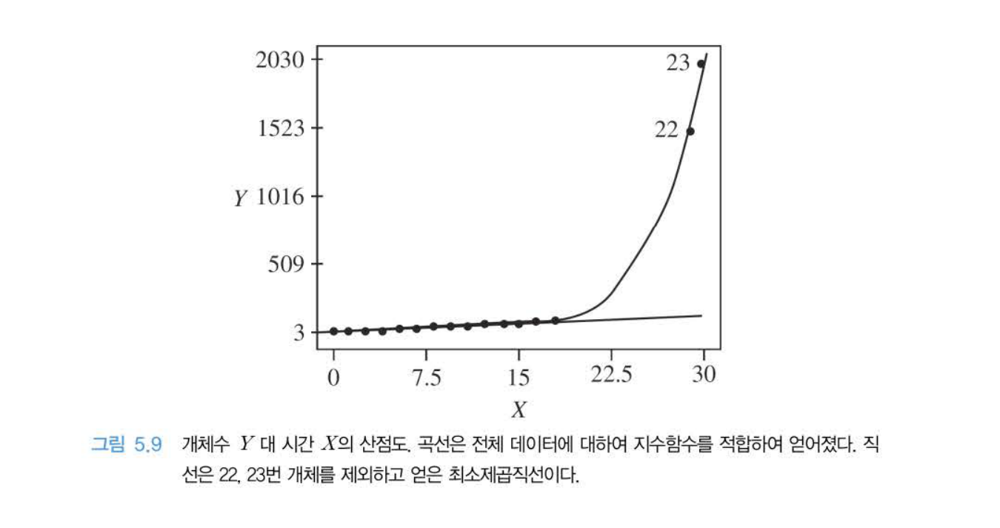
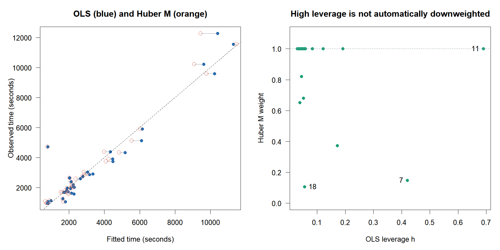

# D · 특이 관측의 처리와 로버스트 회귀 도입

W09B · 주교재 §5.12 및 §5.15, pp.220–221, 228

진단의 목적은 자료를 편하게 정리하는 것이 아니라 분석이 무엇에 의존하는지 밝히는 것입니다. 의심 관측이 오류인지, 중요한 실제 조건인지, 평균식이 잘못된 것인지 조사하고 조치의 근거를 남깁니다.

## 1. 특이한 점이 모형의 한계를 알려 줄 수 있다 (§5.12)



**원본 그림 발췌:** 『Chatterjee 예제를 통한 회귀분석 제6판: R 활용』, 5장 p.220 그림 5.9. 교수자가 제공한 교재에서 수업에 필요한 그림만 선별했습니다. 곡선은 전체 자료에 대한 지수함수 적합이고, 직선은 22·23번을 제외한 최소제곱 적합입니다.

처음에는 대부분의 작은 값이 직선에 가까워 보이므로 22·23번을 지우면 문제가 사라지는 것처럼 보일 수 있습니다. 그러나 두 점은 성장이 가속되는 중요한 정보를 담고 있습니다. 직선이라는 평균식의 선택을 먼저 재검토해야 합니다. ‘잔차가 크므로 오기’라는 결론은 그림만으로 성립하지 않습니다.

**확인 C10.** 위 그림에서 두 관측을 제외한 직선의 잔차가 작아졌다는 사실만으로 그 제외를 정당화할 수 있는지 설명하세요.

## 2. 조사·수정·비교·보고의 순서

| 확인된 상황 | 가능한 조치 | 남길 기록 |
|---|---|---|
| 입력·측정 오류가 확인됨 | 근거를 보존해 정정 | 원값, 정정값, 확인 자료 |
| 다른 모집단·수집 조건일 가능성 | 조건 조사, 모형 구분 검토 | 관측 단위·선정 기준·조건 |
| 평균의 비선형성 | 변환·추가 항·다른 평균식 검토 | 선택 이유·원단위 해석·재진단 |
| 실제로 드문 유효 관측 | 유지, 민감도와 적용 범위 보고 | 유지 근거·포함/제외 비교 |
| 특정 관측에 민감한 추정 | 목적에 맞는 로버스트 적합 등 비교 | 추정 대상·가중치·한계 |
| 자료가 부족함 | 추가 조사·수집·설계 재검토 | 부족한 조건·수집 계획 |

원자료는 그대로 보존합니다. 제외 재적합은 ‘이 점이 없었다면’의 진단적 비교로 표시합니다. 실제 분석에서 제외를 확정하려면 별도의 내용 근거가 필요합니다. 결과가 마음에 드는 모형을 고르기 위해 관측을 반복 삭제하는 과정은 적절한 검증이 아닙니다.

## 3. 로버스트 회귀의 좁고 정확한 도입 (§5.15)

교재 §5.15는 로버스트 회귀를 짧게 소개하고 자세한 알고리즘을 §14.5로 넘깁니다. 이번에는 같은 경주 자료에 OLS와 `MASS::rlm`의 기본 Huber M 적합을 적용하여 계수·가중치를 비교합니다. 전체 로버스트 알고리즘의 유도는 선택 보충으로 남깁니다.

OLS의 제곱 손실은 큰 잔차에 큰 벌점을 줍니다. Huber M 적합은 표준화 잔차의 크기에 따라 큰 잔차의 상대적 기여를 줄입니다. 반복 가중 적합이라는 관점으로 이해할 수 있습니다. 이 가중치는 자료가 유효할 확률이나 학생이 임의로 정하는 삭제 여부가 아닙니다.

### E10 · 같은 35경주의 OLS와 Huber M 비교 — 추가 반복

Time 초, Distance 마일, Climb 피트를 유지하며 두 모형 모두 같은 35행을 사용합니다.

| 계수 | OLS | Huber M (`MASS::rlm`) |
|---|---:|---:|
| 절편 (초) | -539.482907 | -576.383657 |
| Distance (초/마일) | 373.072677 | 393.037461 |
| Climb (초/피트) | 0.662888 | 0.497789 |

공식 자료의 이 적합은 수렴했습니다. 대표 관측의 가중치를 OLS의 지레값과 나란히 봅니다.

| 경주 번호 | OLS 지레값 | Huber M 가중치 |
|---|---:|---:|
| 7 | 0.420435 | 0.148497 |
| 11 | 0.689816 | 1.000000 |
| 18 | 0.055355 | 0.106648 |



11번은 지레값이 높지만 이 Huber M 적합에서 가중치 1을 유지합니다. **잔차에 기초한 M 가중치가 높은 지레값을 모두 자동으로 낮추지는 않습니다.** 교재의 로버스트 접근에 대한 일반적 소개와 이번에 실제 사용한 Huber M의 성질을 구별합니다. 다른 로버스트 방법들의 성질을 이 한 방법으로 대표시키지 않습니다.

```r
robust_fit <- MASS::rlm(Time ~ Distance + Climb, data=hills)
robust_fit$converged
coef(robust_fit)
robust_fit$w
robust_fit$df.residual
```

`rlm`의 `df.residual`은 의도적으로 `NA`입니다. 이를 일반 `lm`의 자유도·통상적인 t/F 검정으로 읽거나, 이번 OLS 전용 영향력 함수에 그대로 넣지 않습니다. 로버스트 회귀로 계수를 추정하는 일과 OLS 계수에 로버스트 표준오차를 붙이는 일도 다른 절차입니다. 좋은 평균식·수집 과정·새 자료 검증의 필요성은 남습니다.

**확인 C11.** 지레값이 가장 큰 11번의 가중치가 1이라는 사실이 계산 실패를 의미하는지 설명하세요.

## 4. 마지막은 입력–함수–표·그림 연결

[설치 없는 R 실습](https://lunalab-ai.github.io/regre/w09b.html)에서 계산한 뒤 [누적 Shiny 편집기](https://lunalab-ai.github.io/regre/apps/w09b/edit/index.html)를 엽니다. 기존 차시 기능에 W09B 진단·변수 효과·로버스트 비교를 더했습니다.

1. NY 단순모형에서 관측 4와 5를 선택하고 표와 P-R 그림의 같은 관측을 연결합니다.
2. 경주 자료에서 관심 변수를 Distance와 Climb으로 바꾸고 두 진단도의 축을 확인합니다.
3. L06에서 출력 연결 한 곳을 직접 수정합니다. Run 후 입력을 바꾸어 수정이 반영되는지 봅니다.
4. 관찰표 CSV와 편집한 R 코드를 내려받고, 원상 복구 후 준비 단계부터 다시 실행합니다.

**확인 C12.** 앱에서 바꾼 입력 하나, 이를 읽는 공통 함수 하나, 달라진 출력 하나를 연결해 말하세요.

브라우저에 보관한 코드는 서버에 제출된 결과가 아닙니다. 초기 엔진·패키지 준비에는 인터넷이 필요합니다. 다운로드한 R/QMD를 사용할 때에는 `data` 폴더를 함께 보관합니다. 온라인 R, 데스크톱 R/QMD, R Colab은 대체 실행 경로입니다.

## 학습을 마무리하며

출구 X01: 지레값이 큰데 Cook은 작은 관측을 다른 관측 하나에 적용해 설명합니다.

출구 X02: Climb의 첨가변수플롯에서 두 축을 어떤 두 회귀로 만드는지 말합니다.

출구 X03: 특이 관측을 유지·제외하거나 평균식을 바꿀 때, 진단 수치 외에 필요한 근거 하나를 제시합니다.

주교재 §5.12, §5.15 및 그림 5.9. [MASS 공식 `rlm` 문서](https://stat.ethz.ch/R-manual/R-devel/library/MASS/html/rlm.html) · [MASS `hills`의 공식 단위](https://stat.ethz.ch/R-manual/R-devel/library/MASS/html/hills.html). 표와 로버스트 그림은 공식 교재 파일을 사용한 실제 R 계산입니다.
