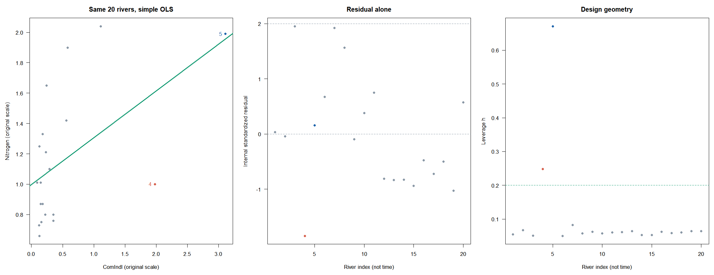
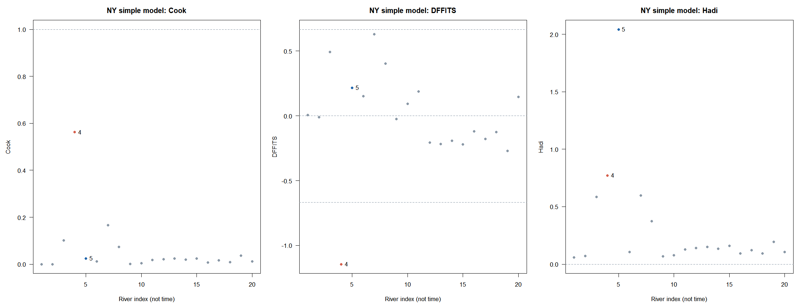
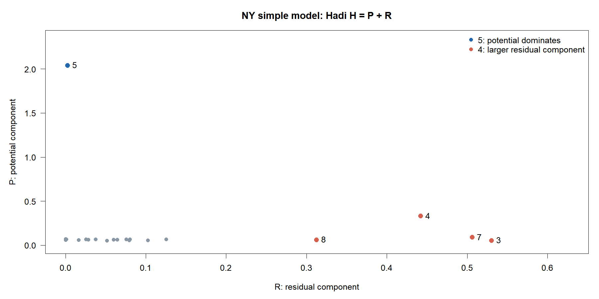

# B · 지레값·영향력·잠재성–잔차도

W09B · 주교재 §5.8–5.11, pp.205–219

이 노트의 질문은 어느 관측을 더 살펴봐야 하며, 그 관측이 적합 결과에 어떻게 관여했는가입니다. 큰 잔차, 높은 지레값, 큰 영향력을 구별합니다. $p$는 설명변수 수, $k=p+1$은 절편 포함 계수 수, $\nu=n-k$입니다.

## 1. 세 개념을 한 관측에서 구별하기 (§5.8)

| 개념 | 비교하는 공간·결과 | 대표 도구 |
|---|---|---|
| 반응 방향 특이값 | 같은 설명변수 조건에서 평균식으로부터의 거리 | 내적·외적 표준화잔차 |
| 높은 지레점 | 다른 관측과 비교한 $X$ 공간의 위치 | $h_i=p_{ii}$ |
| 영향력 있는 관측 | 관측을 제외했을 때 적합 결과의 변화 | Cook·DFFITS·재적합 민감도 등 |

영향력은 선택한 모형·결과에 의존합니다. 실제로 드문 조건을 잘 측정한 관측도 높은 지레점을 가질 수 있습니다. 큰 진단값을 오류의 확정이나 삭제 명령으로 읽지 않습니다.

$$
H=X(X^\top X)^{-1}X^\top,\quad h_i=H_{ii},\quad
\sum_i h_i=k,\quad \bar h=k/n.
$$

절편 포함 단순회귀에서는 $h_i=1/n+(x_i-\bar x)^2/S_{xx}$입니다. 지레값은 $X$만으로 정해집니다. $Y$를 바꾸면 잔차·Cook은 변할 수 있지만 같은 $X$의 지레값은 유지됩니다. $2k/n$은 관측을 살펴보는 경험적 기준이지 확정 검정이나 삭제 기준이 아닙니다.

### E03 · 6행 표의 지레값과 표준화 분모 — 핵심

A의 6행 표에서 $n=6$, $k=2$, $\bar x=2.5$, $S_{xx}=17.5$입니다. 4행은 $x_4=3$입니다.

$$
\begin{aligned}
h_4&=\frac16+\frac{(3-2.5)^2}{17.5}=0.18095238,\\
1-h_4&=0.81904762,\qquad
r_4=\frac{0.6}{\sqrt{0.2}\sqrt{0.81904762}}=1.48245554.
\end{aligned}
$$

1행과 6행은 $h=0.52380952$로 더 높습니다. 그러나 두 행의 잔차는 수치 오차를 제외하면 0입니다. 이 표에서는 가장 높은 지레값도 $2k/n=2/3$을 넘지 않습니다. ‘자료 안에서 상대적으로 높다’와 ‘경험적 기준을 넘는다’를 구분합니다.

**확인 C03.** 4행의 $y$만 바꾸면 $h_4$도 바뀌는지 예상하고 이유를 쓰세요.

## 2. 영향력은 실제 제외 전·후와 연결한다 (§5.9)

Cook의 거리는 관측 $i$를 제외해 적합한 식이 **원래 모든 관측 위치에서** 얼마나 달라졌는지를 전체 자료의 오차 규모로 표준화합니다.

$$
C_i=\frac{\sum_{j=1}^{n}(\hat y_j-\hat y_{j(i)})^2}{ks^2}
=\frac{r_i^2}{k}\frac{h_i}{1-h_i}.
$$

DFFITS는 관측 $i$ 위치의 적합값 변화를 삭제 후 오차 규모로 표준화합니다. 방향을 갖습니다.

$$
\mathrm{DFFITS}_i=
\frac{\hat y_i-\hat y_{i(i)}}{s_{(i)}\sqrt{h_i}}
=r_i^*\sqrt{\frac{h_i}{1-h_i}}.
$$

Cook에는 내적 $r_i$와 전체 $s$를, DFFITS에는 외적 $r_i^*$와 삭제 $s_{(i)}$를 사용합니다. DFFITS가 음수이면 해당 위치에서 전체 적합값이 삭제 후 적합값보다 낮다는 뜻입니다. 절댓값으로 크기를 보고 부호로 방향을 읽습니다.

### E04 · 같은 4행으로 Cook·DFFITS·Hadi를 끝까지 계산 — 핵심

6행 표의 $e_4=0.6$, $h_4=0.18095238$, $\mathrm{SSE}=0.8$, $k=2$, $\nu=4$를 그대로 사용합니다.

$$
\begin{aligned}
s_{(4)}^2&=\frac{0.8-0.6^2/(1-0.18095238)}{4-1}
\approx0.12015504,\\
r_4^*&=\frac{0.6}{\sqrt{0.12015504}\sqrt{0.81904762}}
\approx1.91260673,\\
C_4&=\frac{1.48245554^2}{2}\frac{0.18095238}{0.81904762}
\approx0.24276636,\\
\mathrm{DFFITS}_4&=1.91260673\sqrt{0.18095238/0.81904762}
\approx0.89898668.
\end{aligned}
$$

실제 4행을 제외해 회귀식을 다시 적합하고 원래 6개 $x$에서 예측하면 Cook의 정의식도 같은 값을 줍니다. 분모의 $s^2$는 전체 모형의 $0.2$로 유지합니다. 제외한 5개 행만으로 예측 차이의 합을 구하면 정의식과 다른 계산입니다.

Hadi는 잔차를 $\sqrt{\mathrm{SSE}}$로 정규화한 $d_i=e_i/\sqrt{\mathrm{SSE}}$를 사용합니다. 이 $d_i$는 $r_i$나 $r_i^*$와 다릅니다.

$$
P_i=\frac{h_i}{1-h_i},\qquad
R_i=\frac{k}{1-h_i}\frac{d_i^2}{1-d_i^2},\qquad
H_i=P_i+R_i.
$$

$$
\begin{aligned}
d_4^2&=0.6^2/0.8=0.45,\\
P_4&=0.18095238/0.81904762\approx0.22093023,\\
R_4&=\frac{2}{0.81904762}\frac{0.45}{0.55}\approx1.99788584,\\
H_4&\approx2.21881607.
\end{aligned}
$$

이 세 수치는 서로 다른 정의입니다. 크기를 같은 자로 비교하거나 모두에 임계값 1을 적용하지 않습니다. 3행으로 바꾼 독립 계산이 L02입니다.

**확인 C04.** 잔차가 0이고 $h_i>0$인 점의 Cook과 Hadi가 둘 다 0이어야 하는지 설명하세요.

## 3. 잔차만 보면 놓치는 이유: 가면·수렁 (§5.8.3)

가면(masking)은 실제로 살펴볼 특이 관측이 다른 관측들의 영향 등으로 숨는 경우입니다. 수렁(swamping)은 특이하지 않은 관측이 특이한 것으로 잘못 표시되는 경우입니다. 일부 관측이 적합선을 자기 쪽으로 끌어당기면 자신의 잔차는 작아지고 다른 관측의 잔차는 커질 수 있습니다.

$$
h_i+\frac{e_i^2}{\mathrm{SSE}}\leq1.
$$

이 관계는 높은 지레값에서 보통잔차가 작게 나타날 수 있는 구조를 보여 줍니다. 작은 잔차 하나로 그 관측의 중요성을 판단하지 않는 이유입니다. 여러 특이 관측이 서로 가릴 수 있으므로 한 행씩 제외하는 분석도 모든 군집 영향을 해결하지 못합니다.

### E05 · NYRivers에서 모형을 적은 뒤 비교하기 — 추가 반복

먼저 교재 식 (5.18)의 단순모형 `Nitrogen ~ ComIndl`을 사용합니다. $n=20$, $k=2$, $\nu=18$입니다. 아래 숫자는 공식 파일을 재계산한 값입니다.

| 관측 | 내적 $r_i$ | 외적 $r_i^*$ | $h_i$ | Cook | DFFITS |
|---|---:|---:|---:|---:|---:|
| 4 Neversink | -1.847232 | -1.994123 | 0.247865 | 0.562255 | -1.144754 |
| 5 Hackensack | 0.155291 | 0.151017 | 0.671010 | 0.024593 | 0.215674 |

5번은 내적 잔차가 작지만 지레값이 큽니다. 4번은 잔차와 Cook·DFFITS가 눈에 띕니다. 5번의 작은 Cook을 ‘자료가 평범하다’로 바꾸어 말하면 $X$ 공간의 특수성을 놓칩니다.

**교재 수치 검산 주석.** p.215 본문에는 DFFITS 기준의 수치가 2.3으로 인쇄되어 있지만, 같은 식에 $n=20,p=1$을 넣으면 다음과 같습니다. 같은 쪽 R 코드도 $\pm2/3$ 선을 그립니다.

$$
2\sqrt{\frac{p+1}{n-p-1}}=2\sqrt{\frac2{18}}=\frac23.
$$

여기서는 해당 식을 직접 계산한 $2/3$을 사용합니다. 출판사의 공식 정오표로 확인했다는 뜻은 아닙니다. Cook 1 또는 DFFITS의 경험적 선을 넘지 않아도 상대적으로 중요한 관측을 검토할 수 있습니다.

다음 표는 **다른 모형**, 즉 교재 표 5.2의 `Nitrogen ~ Agr + Forest + Rsdntial + ComIndl`입니다. 여기서는 $k=5$이고 전체 자료의 잔차 자유도는 15입니다. 각 제외 모형은 19행을 사용합니다.

| 계수의 t값 | 전체 | 4번 제외 | 5번 제외 |
|---|---:|---:|---:|
| 절편 | 1.3955 | 1.2060 | 2.0817 |
| Agr | 0.3864 | 0.9229 | 0.2466 |
| Forest | -0.9308 | -0.7424 | -1.4476 |
| Rsdntial | -0.2136 | -3.1470 | 4.0811 |
| ComIndl | 1.8620 | 4.4483 | 0.6636 |

Rsdntial의 부호와 t값이 크게 바뀝니다. 이는 결과가 특정 관측에 민감하다는 진단입니다. 유리한 p값을 만들기 위해 해당 관측을 삭제하는 근거로 삼지 않습니다. 단순모형에서의 5번 Cook 값과 이 네 변수 모형의 계수 변화를 섞어 같은 모형의 결론처럼 보고하지 않습니다.

**확인 C05.** 5번의 작은 단순모형 잔차를 보고 네 변수 모형에서도 영향이 없다고 말할 수 있는지 판단하세요.

## 4. 잠재성–잔차도의 축을 읽기 (§5.10)

### E06 · NY 4번·5번의 Hadi 성분 비교 — 핵심

계속 단순모형을 사용합니다. $P_i=h_i/(1-h_i)$는 $X$ 공간의 잠재성 성분이고, $R_i$는 잔차 성분입니다.

| 관측 | $P_i$ | $R_i$ | $H_i=P_i+R_i$ |
|---|---:|---:|---:|
| 4 Neversink | 0.329549 | 0.442189 | 0.771738 |
| 5 Hackensack | 2.039602 | 0.002681 | 2.042283 |

예를 들어 5번은 $P_5=0.6710096/(1-0.6710096)\approx2.039602$입니다. 잔차 성분이 작더라도 잠재성 성분이 남습니다. Cook·DFFITS가 잔차와 지레의 결합을 곱 형태로 반영하는 데 비해 Hadi는 두 성분을 더합니다.

가로축은 $R_i$, 세로축은 $P_i$입니다. 교재 그림 5.8 및 `plot(res, pot)` 코드와 맞춥니다. 위쪽은 잠재성이 큰 관측, 오른쪽은 잔차 성분이 큰 관측입니다. 두 축을 별도로 보고 관측이 어디에 놓이는지 설명합니다. 일반 잔차–지레값 산점도와는 축의 정의가 다릅니다.

**확인 C06.** 5번 점은 P-R 그림의 위쪽과 오른쪽 중 어느 방향으로 두드러지는지, 그 이유를 성분으로 설명하세요.

## 5. 손계산을 R 함수에 연결하기 (§5.11)

| 교재의 양 | 기본 R 또는 이번 공통 함수 | 결과를 읽는 기준 |
|---|---|---|
| 보통잔차 $e_i$ | `residuals(fit)` | 원래 반응 단위 |
| 내적 $r_i$ / 외적 $r_i^*$ | `rstandard(fit)` / `rstudent(fit)` | 전체 / 삭제 오차 규모 |
| 지레값 $p_{ii}=h_i$ | `hatvalues(fit)` | 설계행렬의 기하 |
| Cook / DFFITS | `cooks.distance(fit)` / `dffits(fit)` | 전체 변화 / 해당 위치의 방향 있는 변화 |
| Hadi의 세 성분 | `diag_influence(fit)` | `potential`, `residual_component`, `Hadi` |
| 실제 삭제 재적합 | `diag_deleted_fit(fit, i)` | 원래 모든 행의 예측 비교 |

교재 표 5.5의 `ols_leverage`, `ols_plot_dffits`, `ols_hadi`, `ols_plot_hadi`, `ols_plot_resid_pot`는 추가 패키지 `olsrr`의 도구입니다. 이번에는 추가 설치 부담을 줄이기 위해 지레값·Cook·DFFITS는 기본 R로, Hadi와 P-R은 교재 식 (5.24)–(5.25)을 구현한 공개 함수로 계산합니다. 함수 이름을 외우기 전에 각 열의 정의를 확인합니다.

지레값이 1이거나 삭제 후 순위가 떨어지면 일부 진단이 정의되지 않습니다. 표의 `NA`와 상태 메시지를 읽습니다. 이를 0으로 채우거나 작은 수를 분모에 임의로 넣어 정상 결과처럼 만들지 않습니다. 로버스트 `rlm`, 가중회귀, 변환·상호작용 모형은 이번 공통 OLS 함수의 입력 계약 밖입니다.

주교재 §5.8–5.11, 식 (5.17), (5.20)–(5.25), 표 5.2–5.5, 그림 5.5–5.8을 공식 데이터로 재계산·재구성했습니다. [R 공식 진단 문서](https://stat.ethz.ch/R-manual/R-devel/library/stats/html/influence.measures.html) · [고정 버전 함수와 정의 줄](https://github.com/lunalab-ai/regre/blob/2026-fall-w09b/src/diagnostics-influence-api.md)
