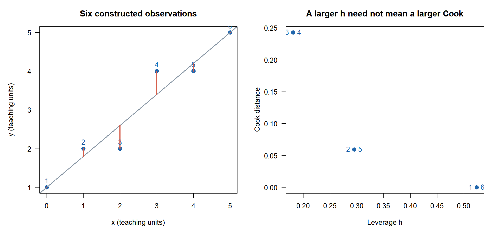
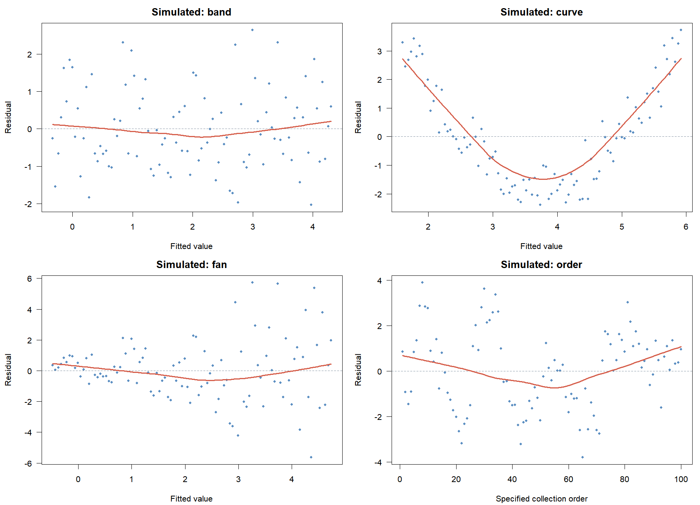
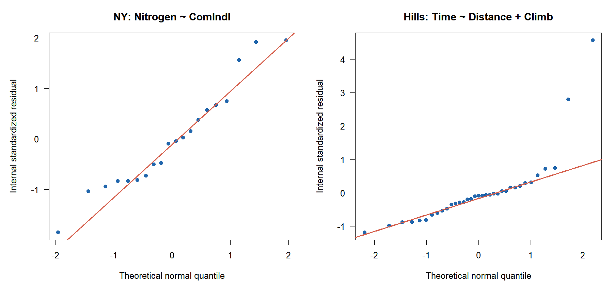

# A · 잔차에서 가정 점검으로

회귀분석의 이해 · W09B · 2026년 10월 28일

주교재 『Chatterjee 예제를 통한 회귀분석 제6판: R 활용』 §5.1–5.6을 복습하고 §5.7의 선형성·정규성 진단으로 이어갑니다. 중간고사 이후에도 기호를 기억하는 것과 한 관측을 계산하는 것은 다를 수 있습니다. 이번에는 모형을 쓰고 → 한 행을 계산하고 → 그림에서 같은 행을 찾고 → R과 비교하고 → 판단의 근거를 설명합니다.

설명용 완성 예제 E01–E10과 직접 풀 연습 L01–L12를 구별합니다. 핵심 계산 예제는 E02·E03·E04·E06·E07·E08입니다. 연습은 L01–L06을 먼저 수행하고, L07–L12를 반복·확장에 사용합니다. 개념 점검 Q01–Q10의 해설은 별도 자료입니다. 새 성적 반영 과제나 제출 기한은 없습니다.

## 1. 세 가지 자료와 한 가지 복습 자료

| 자료 | 한 행과 크기 | 모형·용도 | 단위와 주의 |
|---|---|---|---|
| 추가 구성한 6행 표 | 교육용 관측 6개 | $y\sim x$; 계산 과정을 손으로 확인 | 임의 교육용 단위, 실제 조사 자료로 해석하지 않음 |
| NYRivers | 강 20개 | 단순모형은 영향력, 네 변수 모형은 민감도 비교 | 공식 파일의 농도·토지이용 비율 척도 유지 |
| Scottish.Hills | 경주 35개 | 변수 효과·변수 추가·로버스트 비교 | Time 초, Distance 마일, Climb 고도 상승량 피트 |
| attitude | 부서 30개 | W06A의 잔차 복습에만 사용 | 긍정 응답 비율(%), 차이는 %p |

NYRivers의 이 차시 검토 원문과 파일에는 물리 농도 단위가 명시되어 있지 않습니다. 숫자에 새 물리 단위를 붙이지 않고 원자료 척도로 계산합니다. `ComIndl`은 상업·산업 토지이용 비율입니다. Scottish.Hills의 `Climb`은 교재의 ‘경사’ 변수이며 각도나 기울기 비율이 아니라 피트로 기록한 상승량입니다.

모든 계산에서 $p$는 설명변수 수, $k=p+1$은 절편을 포함한 계수 수, $\nu=n-k$는 잔차 자유도입니다. 설계행렬은 완전열계수이고, 이번 계산은 절편을 포함한 비가중 OLS입니다. 교재의 지레값 $p_{ii}$를 이 자료에서는 $h_i$로도 씁니다.

## 2. 오차·잔차·분모를 다시 연결하기 (§5.1–5.3)

$$
Y_i=\beta_0+\sum_{j=1}^{p}\beta_jx_{ij}+\varepsilon_i,
\qquad \hat y_i=b_0+\sum_{j=1}^{p}b_jx_{ij},
\qquad e_i=y_i-\hat y_i.
$$

오차는 참 조건부 평균과 관측의 차이이고, 잔차는 자료로 추정한 적합값과 관측의 차이입니다. 우리가 직접 계산하는 것은 잔차입니다. 관측이 적합식 계산에 참여하기 때문에 잔차의 산포는 관측별로 달라집니다.

$$
\operatorname{Var}(e_i\mid X)=\sigma^2(1-h_i),\qquad
s^2=\frac{\mathrm{SSE}}{\nu},\qquad
r_i=\frac{e_i}{s\sqrt{1-h_i}},\qquad
r_i^*=\frac{e_i}{s_{(i)}\sqrt{1-h_i}}.
$$

내적 표준화잔차 $r_i$는 전체 자료의 $s$를, 외적 표준화잔차 $r_i^*$는 관측 $i$를 제외한 오차 규모 $s_{(i)}$를 사용합니다. 두 식의 분자는 모두 전체 자료에서 얻은 $e_i$입니다. R에서는 각각 `rstandard()`와 `rstudent()`에 대응합니다.

### E01 · 익숙한 부서 한 행을 복원하기 — 추가 반복

W06A와 같은 `rating ~ complaints + learning`을 사용합니다. $n=30$, $p=2$, $k=3$, $\nu=27$입니다. 첫 부서의 실제 rating은 43%, 적합값은 약 50.926760%입니다.

$$
\begin{aligned}
e_1&=43-50.926760=-7.926760\text{ %p},\\
s\sqrt{1-h_1}&=6.816780\sqrt{1-0.1132912}\approx6.419,\\
r_1&\approx-1.234884,\qquad r_1^*\approx-1.247542.
\end{aligned}
$$

음수는 실제 응답 비율이 예측보다 낮다는 방향입니다. 표준화잔차에는 단위가 없습니다. 분모에서 $\sqrt{1-h_1}$를 빼면 교재의 내적 표준화잔차가 되지 않습니다. 끝자리 차이는 표시값을 먼저 반올림한 데서 생길 수 있으므로 검산에서는 원래 정밀도를 사용합니다.

**확인 C01.** 잔차합이 0이면 조건부 오차 평균이 0이라는 가정도 확인된 것인지 먼저 판단하세요.

## 3. 6행 계산표의 회귀식 만들기 — E02, 핵심

아래는 계산을 위해 추가 구성한 표입니다. 원 교재의 실제 사례를 대체하는 자료가 아닙니다.

| 행 $i$ | $x_i$ | $y_i$ | $\hat y_i=1+0.8x_i$ | $e_i$ |
|---|---:|---:|---:|---:|
| 1 | 0 | 1 | 1.0 | 0.0 |
| 2 | 1 | 2 | 1.8 | 0.2 |
| 3 | 2 | 2 | 2.6 | -0.6 |
| 4 | 3 | 4 | 3.4 | 0.6 |
| 5 | 4 | 4 | 4.2 | -0.2 |
| 6 | 5 | 5 | 5.0 | 0.0 |

$$
\begin{aligned}
\bar x&=2.5,\quad \bar y=3,\quad S_{xx}=17.5,\quad S_{xy}=14,\\
b_1&=\frac{14}{17.5}=0.8,\qquad b_0=3-0.8(2.5)=1,\\
\mathrm{SSE}&=0^2+0.2^2+(-0.6)^2+0.6^2+(-0.2)^2+0^2=0.8,\\
\nu&=6-2=4,\quad s^2=0.8/4=0.2,\quad s=\sqrt{0.2}\approx0.447214.
\end{aligned}
$$

그림은 추가 구성 자료를 직접 계산해 그렸습니다. 왼쪽의 주황 선분은 관측과 적합값의 차이입니다. 오른쪽에서는 높은 지레값과 큰 Cook의 거리가 서로 다른 관측에 나타납니다. 3·4행은 같은 지레값과 반대 부호의 잔차를 가지므로 Cook은 같고 DFFITS의 부호는 반대가 됩니다. 이 표의 지레값과 영향력은 다음 B 노트에서 계산합니다.

**부분 완성.** 4행에서 $e_4=4-(1+0.8\times\square)$의 마지막 항을 채운 뒤, 관측을 바꾼 L01을 풀어 보세요. 이 빈칸은 E02의 계산을 되짚는 설명 단계입니다.

## 4. 적합 전·후 그림은 서로 다른 질문에 답한다 (§5.4–5.6 복습)

적합 전에는 각 변수의 분포, 쌍별 관계, 관측 단위·측정 오류, 결합 관계를 확인합니다. 쌍별 상관이 작다는 이유만으로 다른 변수를 통제한 관계도 작다고 결정할 수 없습니다. W06A의 Hamilton 사례는 쌍별 투영과 함께 보는 관계의 차이를 보여 주었습니다.

적합 후에는 가정 위반, 특이값·영향 관측, 변수의 효과를 진단합니다. 한 개의 높은 $R^2$나 작은 p값은 이 검토를 대신하지 못합니다. 절편을 포함한 OLS의 $\sum e_i=0$은 적합 방식의 대수적 성질이며 좋은 모형의 인증서가 아닙니다.

## 5. 선형성과 정규성을 구별해 읽기 (§5.7)

| 그래프 | 먼저 읽을 것 | 추가로 확인할 것 |
|---|---|---|
| 잔차–적합값 | 0 주변의 띠, 곡선, 산포 변화 | 평균식·분산 구조·특이 관측 |
| 잔차–각 설명변수 | 특정 변수 방향의 곡선·구간 | 변환·추가 항의 필요성, 변수 범위 |
| 정규 Q-Q | 이론 분위수와 잔차 분위수의 관계 | 꼬리·비대칭·개별 관측·모형 형태 |
| 잔차–수집순서 | 실제 수집 과정에 따른 연속 패턴 | 의존성, 측정 조건의 변화 |

이 그림은 W06A의 공개 함수 `diag_patterns()`로 만든 모의 자료입니다. 각 패널은 각각의 자료에 직선을 적합한 결과입니다. 곡선 패턴은 평균식의 재검토, 부채꼴은 분산 구조의 재검토, 실제 순서 패턴은 의존성의 재검토를 제안합니다. 원인을 확정하는 그림으로 사용하지 않습니다. `attitude`의 부서 번호나 경주 파일의 행 번호를 시간순서로 간주하지 않습니다.

**확인 C02.** Q-Q가 직선에 가까우면 $X$의 분포가 정규라는 결론을 내릴 수 있는지 설명하세요.

두 패널은 서로 다른 자료·모형을 명시해 그린 실제 잔차입니다. 정확한 소표본 t/F 추론의 정규성은 주어진 $X$에서 오차의 분포에 관한 가정입니다. $X$나 $Y$의 주변 히스토그램이 정규여야 한다는 뜻이 아닙니다. Q-Q의 직선 근사만으로 모든 가정을 입증할 수도 없습니다. 잔차는 적합에 의해 서로 연관되며 유한 표본의 그림에는 변동이 있습니다.

**관찰 기록 형식:** ‘무엇이 보였다 → 가능한 설명은 무엇이다 → 무엇을 더 확인한다’의 세 문장으로 씁니다. 먼저 그림의 축·모형·자료를 적은 뒤 해석합니다.

## 출처와 연결

주교재 §5.1–5.7, pp.188–205. 공식 데이터: [저자 6판 자료실](https://www1.aucegypt.edu/faculty/hadi/RABE6/). 잔차 함수 대응: [R 공식 진단 문서](https://stat.ethz.ch/R-manual/R-devel/library/stats/html/influence.measures.html). 그림은 표시한 모의 자료·공식 자료·추가 6행 자료로 새로 계산했습니다.

[온라인 R 실습](https://lunalab-ai.github.io/regre/w09b.html) · [고정 버전의 함수 안내](https://github.com/lunalab-ai/regre/blob/2026-fall-w09b/src/diagnostics-influence-api.md)
