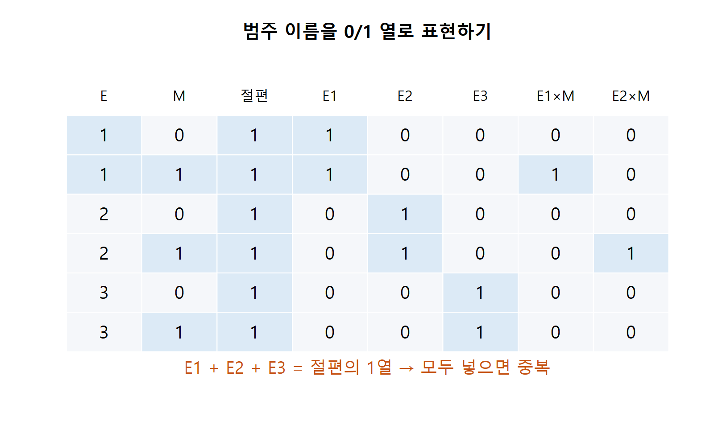
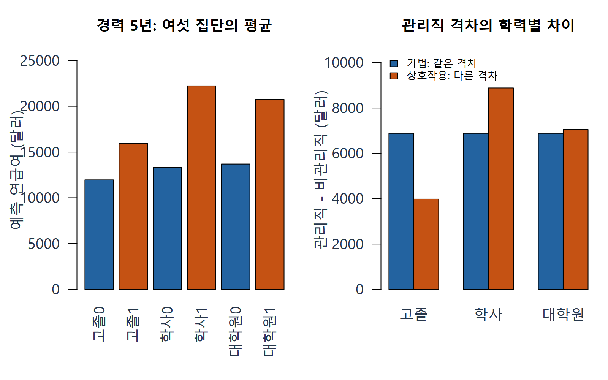
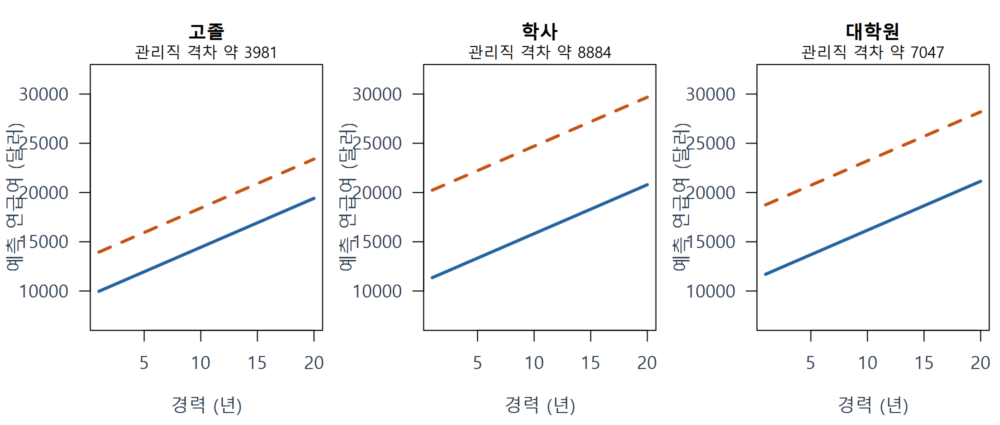
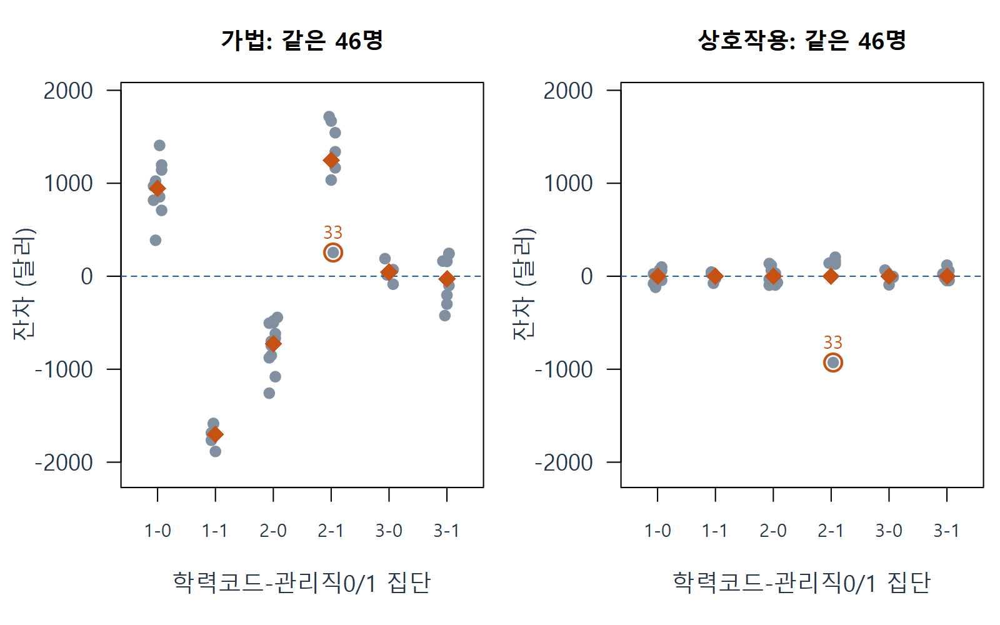
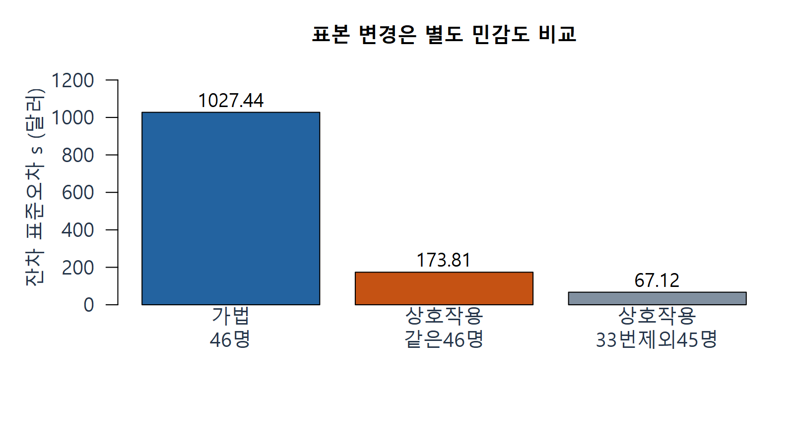

# W10A D · 범주형 예측변수와 상호작용을 급여로 이해하기

회귀분석의 이해 · 2026년 11월 2일 · 주교재 §6.1–6.3

앞의 진단은 모형을 비판하는 데서 끝나지 않습니다. 집단별로 잔차가 한쪽으로 남으면 평균모형에 어떤 구조가 빠졌는지 생각할 수 있습니다. 이번에는 **범주형 예측변수**와 **상호작용**을 넣어 이 질문을 이어 갑니다. 반응변수는 계속 연속형 급여이며, 이진 반응 회귀를 배우는 범위가 아닙니다.

## 1. 숫자로 적힌 범주 이름은 수량과 다르다 (§6.1)

범주형 또는 질적 변수는 집단의 이름을 나타냅니다. 학력코드 1·2·3이 있다 해도 3이 1의 세 배인 학력이나, 각 단계 사이의 같은 거리라는 뜻은 아닙니다. 코드를 그대로 수치형 회귀에 넣으면 의도하지 않은 등간격 효과를 가정하게 됩니다.

교재의 Salary Survey는 직원 46명의 익명 수치 자료입니다. 각 열은 다음 뜻입니다.

| 열 | 뜻 | 값·단위 |
|---|---|---|
| S | 연급여, 반응변수 | 달러/년 |
| X | 경력, 수치형 예측변수 | 년 |
| E | 교육수준 범주 | 1 고졸, 2 학사, 3 대학원 |
| M | 관리직 여부 범주 | 0 비관리직, 1 관리직 |

이 자료에서 읽는 집단 차이는 관찰 자료의 조건부 연관입니다. 학력을 바꾸거나 승진시키면 특정인의 급여가 그만큼 바뀐다는 인과효과로 단정하지 않습니다.

## 2. 더미변수: ‘해당하면 1, 아니면 0’ (§6.2)

**지시변수 또는 더미변수**는 특정 범주에 속하는지를 0/1로 표시한 열입니다. E1은 고졸일 때 1, E2는 학사일 때 1로 만듭니다. 대학원은 두 값이 모두 0인 **기준범주**로 둡니다. 기준범주는 비교의 출발점이지 우열이나 좋은 집단을 뜻하지 않습니다.

| 교육수준 | E1 | E2 | 이 행의 의미 |
|---|---:|---:|---|
| 고졸 | 1 | 0 | 고졸 차이를 더함 |
| 학사 | 0 | 1 | 학사 차이를 더함 |
| 대학원 | 0 | 0 | 기준범주 값에서 시작 |

왜 세 집단인데 두 열만 쓸까요? 절편의 1열과 고졸·학사·대학원 세 지시열을 모두 넣으면, 세 지시열의 합이 항상 절편의 1열입니다. 같은 정보를 중복해서 넣어 계수를 유일하게 정할 수 없게 됩니다. 이를 흔히 **더미변수 함정**이라고 부릅니다. 절편을 두고 한 범주를 기준으로 빼면 이 중복을 피할 수 있습니다.

E3 열은 중복을 설명하기 위해 그림에 표시했습니다. **절편·E1·E2와 함께 E3까지 적합한다는 뜻은 아닙니다.** 오른쪽 곱 열은 뒤에서 상호작용을 만들 때 씁니다. 출처: 교재 범주 정의로 구성한 자체 부호화 표.

**확인 C15.** E=3인 관측의 E1과 E2가 모두 0이라고 해서 교육수준 정보가 없어진 것인가요? 절편과 세 더미를 모두 넣으면 무엇이 중복되나요?

## 3. 가법모형: 각 효과를 더하되 차이는 일정하게

**가법**은 각 항의 효과를 더한다는 뜻입니다. 교재 식6.1은 경력·교육수준·관리직 효과를 다음과 같이 더합니다.

급여 계수의 첨자는 **대응하는 예측항의 이름**으로 통일합니다. $b_X$는 경력 X, $b_{E1}$과 $b_{E2}$는 학력 더미, $b_M$은 관리직, $b_{E1M}$과 $b_{E2M}$은 두 곱항의 계수입니다. 보충 카드·질문 해설도 같은 표기를 씁니다.

교재 기호와 비교하면 경력의 $\beta_1$은 $b_X$, 학력의 $\gamma_1,\gamma_2$는 $b_{E1},b_{E2}$, 관리직의 $\delta_1$은 $b_M$, 상호작용의 $\alpha_1,\alpha_2$는 $b_{E1M},b_{E2M}$에 대응합니다. 절편은 $b_0$입니다. 급여 자료의 X열은 경력(년)이며, 여러 설명 항을 모은 설계행렬 $\mathbf X$와 구별합니다.

$$
\widehat S=b_0+b_X X+b_{E1}E1+b_{E2}E2+b_M M.
$$

각 계수의 뜻을 먼저 구분합니다. $b_0$는 경력 0인 기준범주 대학원·비관리직의 모형값, $b_X$은 경력 1년의 평균 차이입니다. $b_{E1}$과 $b_{E2}$는 같은 경력·관리직 여부에서 기준 학력과의 차이입니다. $b_M$는 같은 경력·학력에서 관리직과 비관리직의 차이입니다. 경력 0은 이 자료의 실제 관측 범위 밖이므로 절편을 관측된 직원 급여라고 말하지 않습니다.

같은 46행으로 적합하면 교재 표6.2와 다음 수치가 재현됩니다.

$$
\widehat S=11031.807892+546.184019X
-2996.210262E1+147.824948E2+6883.531006M.
$$

### E11 · 경력 5년·고졸·관리직의 급여 예측

먼저 범주를 0/1로 바꿉니다. 고졸이므로 E1=1, E2=0이고, 관리직이므로 M=1입니다. 경력은 X=5입니다.

$$
\begin{aligned}
\widehat S
&=11031.807892+546.184019\times5\\
&\quad-2996.210262\times1+147.824948\times0+6883.531006\times1\\
&\approx17650.048730\text{ 달러/년}.
\end{aligned}
$$

같은 조건의 비관리직은 마지막 관리직 항만 빠집니다. 따라서 이 모형에서 관리직 격차는 6883.531006달러입니다. 학력이 고졸·학사·대학원 중 무엇이든 이 격차가 같도록 정한 모형입니다. 이 제약이 자료와 맞는지 잔차로 살펴봅니다.

여기서 실제 원래 예측변수는 경력·학력·관리직 세 가지이지만, 추정하는 계수는 절편·경력·학력 더미 둘·관리직의 **5개**입니다. 범주형 변수가 들어오면 ‘원래 변수 수 + 1’로 계수 수를 세면 안 됩니다. k는 실제 모형행렬의 계수 수이며, 완전계수 모형에서는 그 rank입니다.

## 4. 상호작용: 한 차이가 다른 조건에 따라 달라짐 (§6.3)

‘관리직과 비관리직 차이가 학력마다 다를 수 있다’는 가정을 표현하려면 E1×M과 E2×M을 추가합니다. 곱이 낯설어도 0/1 스위치로 읽으면 됩니다. E1×M은 고졸이면서 관리직일 때만 1입니다. E2×M은 학사이면서 관리직일 때만 1입니다.

$$
\widehat S=b_0+b_X X+b_{E1}E1+b_{E2}E2+b_M M
+b_{E1M}E1M+b_{E2M}E2M.
$$

이번 식의 상호작용은 **교육수준 × 관리직**입니다. 경력 X와의 곱이 없으므로, 교육수준·관리직 집단별 경력 기울기를 다르게 만드는 식은 아닙니다. 계수는 7개이고, 46행의 잔차 자유도는 46-7=39입니다.

같은 46명을 유지한 교재 표6.3의 적합값은 다음과 같습니다. 가법모형을 적합할 때와 표본을 바꾸지 않았습니다.

$$
\begin{aligned}
\widehat S={}&11203.433772+496.987011X\\
&-1730.748323E1-349.077692E2+7047.412024M\\
&-3066.035125E1M+1836.487946E2M.
\end{aligned}
$$

### E12 · 관리직 격차를 세 번 계산하기

먼저 경력과 학력을 같게 두고 M만 0에서 1로 바꿉니다. 두 예측을 빼면 경력과 학력의 공통 항이 사라집니다.

| 학력 | 관리직 - 비관리직의 식 | 격차 (달러/년) |
|---|---|---:|
| 대학원: E1=0,E2=0 | $b_M$ | 7047.412024 |
| 고졸: E1=1,E2=0 | $b_M+b_{E1M}$ | 3981.376900 |
| 학사: E1=0,E2=1 | $b_M+b_{E2M}$ | 8883.899970 |

고졸의 경우 $7047.412024-3066.035125=3981.376900$입니다. 학사의 $b_{E2M}=1836.487946$은 학사 관리직 격차 자체가 아니라 **기준범주 관리직 격차에 더해지는 차이**입니다. 그래서 총 격차는 약 8883.900달러입니다. 이 계산은 집단 차이를 읽는 대수적 비교이며 별도의 인과 연구설계를 뜻하지 않습니다.

왼쪽의 0/1은 비관리직/관리직을 뜻합니다. 오른쪽 파란 막대는 가법모형의 같은 격차, 주황 막대는 상호작용 모형의 학력별 격차입니다. 경력은 모두 5년으로 같습니다. 출처: 공식 Salary.Survey46행 재계산.

| 경력 5년의 집단 | 비관리직 예측 | 관리직 예측 |
|---|---:|---:|
| 고졸 | 11957.621 | 15938.997 |
| 학사 | 13339.291 | 22223.191 |
| 대학원 | 13688.369 | 20735.781 |

위 표는 상호작용 모형의 **집단 평균 예측**입니다. 앞 E11의 17650.049는 가법모형 값이므로 서로 다른 모형의 숫자를 한 계산에 섞지 않습니다.

**확인 C16.** 학사 관리직 격차를 구할 때 1836.488만 읽으면 왜 틀리나요? 기준범주 격차와 추가 차이를 각각 짚으세요.

## 5. 상호작용인데 경력 직선들이 평행한 이유

이번 모형에는 X×M이나 X×학력 항이 없습니다. 따라서 어떤 집단이든 경력이 1년 달라질 때 예측의 기울기는 496.987011달러/년으로 같습니다. 학력별 관리직과 비관리직의 **세로 간격**은 다르지만 경력에 따른 기울기는 공통입니다.

각 패널에서 파란 실선은 비관리직, 주황 점선은 관리직입니다. 세 패널은 같은 축 척도입니다. 상호작용이라는 말만 보고 모든 직선이 교차하거나 기울기가 달라져야 한다고 생각하지 않습니다. **어떤 변수끼리 곱했는지** 식으로 확인합니다.

**확인 C17.** 이번 상호작용 모형에서 경력이 5년에서 6년으로 바뀌면 여섯 집단의 예측은 각각 얼마나 달라지나요? 관리직 격차도 경력에 따라 달라지나요?

## 6. 잔차로 연결하기: 모형을 바꾼 뒤에도 다시 확인

가법모형에서 학력×관리직 집단별 잔차가 한쪽으로 치우치면, 같은 관리직 격차라는 제약이 충분하지 않을 가능성을 생각할 수 있습니다. 아래는 같은 46명의 두 모형 잔차를 **같은 세로 척도**에 놓은 그림입니다.

가로의 1-0은 고졸·비관리직, 1-1은 고졸·관리직처럼 읽습니다. 주황 마름모는 집단별 평균 잔차입니다. 오른쪽 집단 평균이 0에 가깝다는 사실만으로 좋은 모형이 입증되지는 않습니다. 여섯 집단의 절편을 표현하는 이번 OLS 모형에서는 집단별 잔차합 0이 적합 계산의 성질로 생깁니다. **집단 안의 곡선·산포·순서 구조와 개별 관측**도 다시 살펴야 합니다.

**확인 C18.** 상호작용을 넣은 뒤 집단 평균 잔차가 0이면 모든 가정이 만족됐다고 말할 수 있나요? 적합 계산으로 생기는 성질과 추가 진단을 구별하세요.

## 7. 교재의 33번 관측: 표본 변경은 별도 민감도 분석

교재는 33번을 따로 살펴본 뒤 제외한 분석도 보여 줍니다. 우리 원자료 46행은 보존합니다. 33번의 실제 S=23780, X=10, E=2, M=1입니다. 같은 관측도 가법모형 잔차는 약 +254.996달러, 상호작용 모형 잔차는 약 -928.126달러로 달라집니다. 특이성은 모형과 연결되어 있다는 앞 내용을 다시 확인합니다.

| 분석 | 사용 관측 | k | 잔차 자유도 | 잔차 표준오차 s |
|---|---:|---:|---:|---:|
| 가법 | 전체 46 | 5 | 41 | 1027.437 |
| 상호작용 | 같은 46 | 7 | 39 | 173.809 |
| 상호작용·33번 제외 민감도 | 45 | 7 | 38 | 67.119 |

앞 두 줄은 표본을 같게 두고 모형을 비교했습니다. 마지막 줄은 표본도 달라졌으므로 별도 민감도 비교입니다. s가 작아졌다는 이유만으로 33번을 오류로 확정하거나 제외를 자동 결정하지 않습니다. 교재 표6.4–6.5와 비교할 때도 45행 분석임을 먼저 적습니다.

45행 모형의 경력 계수는 약 498.418이고 95% 신뢰구간은 약 [494.062, 502.774]입니다. 이는 모형 가정 아래 **공통 평균 경력 기울기**의 구간입니다. 특정 직원의 내년 급여 변화가 반드시 이 범위에 든다는 뜻은 아닙니다. 교재 표6.5의 경력0 집단 평균과 그 신뢰구간은 개념 카드에서 별도로 읽습니다.

## 8. R로 표현하고, 기준범주를 바꾸어 검산하기

R에서 범주를 `factor()`로 표시하고 기준수준을 명시합니다. `S ~ X + Education + M`은 가법모형, `S ~ X + Education * M`은 Education·M·Education:M을 포함한 이번 상호작용 모형입니다. 별표가 모든 변수끼리 곱한다는 뜻은 아닙니다. 경력 X는 이 곱에 포함되지 않습니다.

기준범주를 바꾸면 절편과 차이 계수의 숫자는 바뀔 수 있습니다. 하지만 같은 모형공간과 같은 자료를 표현했다면 **각 관측의 적합값과 여섯 집단 예측은 같습니다.** 모형이 바뀐 것과 표현 기준이 바뀐 것을 구분하는 검산입니다.

**확인 C19.** 대학원 대신 고졸을 기준으로 바꾸면 기존 직원의 적합 급여까지 바뀌어야 하나요? 계수와 예측을 나누어 답하세요.

## 9. 이해를 확인하고 실습으로 옮기기

설치 없는 [온라인 R](https://lunalab-ai.github.io/regre/w10a.html)에서 먼저 실행 전 예상값을 적습니다. 점 이동 코드에서는 같은 x의 자기 예측과 잔차 변화량을 비교합니다. 급여 코드에서는 가법/상호작용을 바꾸고 세 관리직 격차를 비교합니다. 마지막에는 [누적 앱 편집기](https://lunalab-ai.github.io/regre/apps/w10a/edit/index.html)의 `W10A_L06` 출력 필드 한 곳을 수정해 입력–함수–결과를 연결합니다.

**출구 X01.** 큰 h, 큰 잔차, 큰 영향력을 서로 다른 말로 한 문장씩 설명하세요.

**출구 X02.** Q-Q와 수집순서 플롯의 축을 각각 쓰고, 어느 그림이 순서 구조를 놓칠 수 있는지 설명하세요.

**출구 X03.** 학력×관리직 모형에서 학사 관리직 격차와 공통 경력 기울기가 어떤 계수 조합인지 설명하세요.

## 출처

주교재 『Chatterjee 예제를 통한 회귀분석 제6판: R 활용』 §6.1–6.3, 인쇄242–253쪽의 §6.4 시작 전. 표6.2–6.4는 [저자 공식 Salary Survey](https://www1.aucegypt.edu/faculty/hadi/RABE6/)46행과 명시한45행 민감도로 재현했습니다. 설명과 그림은 자체 작성이며 교재 원본 전체 파일은 배포하지 않습니다.

[R: 모형행렬과 더미·상호작용](https://stat.ethz.ch/R-manual/R-devel/library/stats/html/model.matrix.html) · [R: 기준수준 변경](https://stat.ethz.ch/R-manual/R-devel/library/stats/html/relevel.html) · [반복 계산 워크북](w10a-workbook.md) · [개념 카드와 선택 수학 보충](w10a-concept-cards.md)
