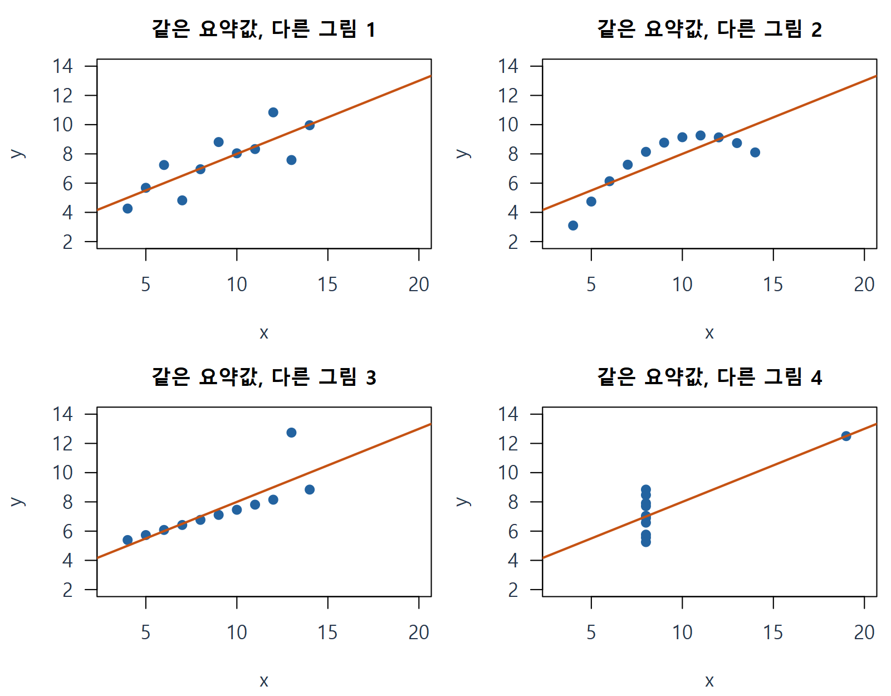

# W10A · 개념 카드와 선택 수학 보충

이 문서는 강의 중 필요한 정의를 다시 찾고 반복 계산을 검산하는 보충입니다. 먼저 [기초 본문](w10a-foundations.md)과 [워크북](w10a-workbook.md)의 필수 경로를 읽습니다. 계산 공식은 모형의 조건과 함께 사용합니다.

## 카드 1 · 같은 식을 쓰기 전 자료를 먼저 그리기

가로는 각 자료의 x, 세로는 y입니다. 네 자료는 비슷한 평균·상관·직선 계수를 갖지만 곡선, 특이 위치, 산포 구조가 다릅니다. 기울기 하나가 자료의 구조를 대신하지 않습니다. 출처: R datasets::anscombe, 자체 재그림. 이는 교재 원자료가 아닌 개념 보강 자료입니다.

## 카드 2 · 기호와 단위 사전

| 기호 | 정의 | 단위/조건 |
|---|---|---|
| y, yhat, e=y−yhat | 관측, 적합 평균, 잔차 | 모두 반응변수 단위 |
| ε | 알려지지 않은 참 평균에서 관측까지의 오차 | 반응변수 단위, 직접 관측 불가 |
| $\mathbf X$ | 절편과 설명 항을 열로 모은 설계행렬 | 급여 자료의 X열(경력 년)과 구분 |
| n, k, ν=n−k | 사용 관측 수, X의 rank, 잔차 자유도 | 완전계수 OLS에서 사용 |
| SSE, s | sum(e²), sqrt(SSE/ν) | y단위², y단위 |
| h_i | 모자행렬 대각, 자기 관측이 자기 적합값에 미치는 선형 민감도 | X로 결정되는 무단위 양 |
| r_i, r_i* | 내적·외적 표준화잔차 | 각각 전체 s·삭제 s 사용 |
| P,R,H | 잠재성, Hadi 잔차성분, 그 합 | 확률이 아님 |
| Education, M | 학력 factor, 관리직 0/1 지시변수 | 범주 코드의 산술 크기와 구분 |

## 카드 3 · h를 더 정확히: 선택 유도

완전계수 비가중 OLS에서 $H=\mathbf X(\mathbf X^\mathsf T\mathbf X)^{-1}\mathbf X^\mathsf T$, $\hat{\boldsymbol y}=H\boldsymbol y$입니다. 따라서 모든 X를 고정할 때 ∂yhat_i/∂y_i=H_ii=h_i입니다. 자기 관측이 자기 예측에 들어가는 가중치이지 오류 확률이 아닙니다. 다른 관측의 영향은 대각 이외 H_ij로 표현됩니다. 절편 포함 단순회귀에서는 h_i=1/n+(x_i−xbar)²/Sxx이고 sum(h)=k입니다.

고정 X와 등분산·무상관 오차의 분산 σ²를 가정하면 Var(yhat_i|X)=σ²h_i, Var(e_i|X)=σ²(1−h_i)입니다. 예측 **평균**의 추정오차와 적합에 사용한 관측의 잔차 산포는 서로 다른 양입니다. 미래 개인 관측의 예측오차에는 새로운 오차까지 포함됩니다. h가 큰 점의 잔차가 작아 보일 수 있는 이유를 이 두 분산을 혼동하지 않고 설명합니다.

## 카드 4 · 두 표준화와 삭제 항등식

$$
r_i=\frac{e_i}{s\sqrt{1-h_i}},\quad
r_i^*=\frac{e_i}{s_{(i)}\sqrt{1-h_i}},\quad
s_{(i)}^2=\frac{\mathrm{SSE}-e_i^2/(1-h_i)}{\nu-1}.
$$

삭제 후 적합으로 구한 SSE와 자유도로 s_(i)를 얻습니다. 위 빠른 식은 같은 설계에서 해당 삭제가 정의될 때만 씁니다. 외적 잔차의 분자는 여전히 원래 적합의 e_i이고, 삭제 적합으로 새로 계산한 잔차를 무작정 대입하지 않습니다. 정규 오차·완전계수 등 조건에서 외적 잔차는 t_(ν−1) 분포를 갖지만 내적 잔차가 정확히 표준정규라는 뜻은 아닙니다. 여러 잔차는 서로 독립인 표본이 아닙니다. h=1·삭제 rank 상실·삭제 분산0 등은 따로 보고합니다.

## 카드 5 · Q-Q 좌표와 기준선

잔차를 작은 순서로 e_(j)에 놓고 p_j=(j−a)/(n+1−2a), z_j=qnorm(p_j)를 구합니다. R ppoints 기본은 n≤10에서 a=3/8, 그보다 크면 a=1/2입니다. 점은 (z_j,e_(j))입니다. z는 표준정규 **이론 분위수**이며 실제 x나 순서 번호가 아닙니다. qqline은 기본적으로 자료와 정규분포의 1/4·3/4 분위수를 연결하는 선입니다. 원자료 y~x를 적합한 회귀선과 다른 선입니다. 유한 표본의 흔들림을 함께 읽으며 Q-Q가 직선처럼 보인다고 정규성을 증명했다고 하지 않습니다.

## 카드 6 · 세 가지 플롯의 질문

| 플롯 | 가로 / 세로 | 먼저 확인하는 것 |
|---|---|---|
| 잔차–적합값 | 적합 평균 / 잔차 | 평균의 곡선 구조·산포 변화 |
| 정규 Q-Q | 정규 이론 분위수 / 정렬 잔차 | 분포 꼬리·치우침 등 정규 형태와 차이 |
| 잔차–수집순서 | 실제 기록순서/시간 / 원순서 잔차 | 시간 드리프트·주기·인접 구조 |

잔차 플롯 하나로 모든 가정을 확정하지 않습니다. 원자료 산점도, 데이터 수집과정, 모형 설정도 확인합니다. 독립성 위반과 정규성 위반은 같은 개념이 아닙니다.

## 카드 7 · 영향력 지표의 비교와 교재 검산 주석

$$
D_i=\frac{\sum_j(\hat y_j-\hat y_{j(i)})^2}{k s^2}
=\frac{r_i^2}{k}\frac{h_i}{1-h_i},\quad
\mathrm{DFFITS}_i=r_i^*\sqrt{\frac{h_i}{1-h_i}}.
$$

Cook은 원래 모든 위치의 적합값 변화 제곱을 모으고, DFFITS는 자기 위치의 변화에 방향을 남깁니다. P=h/(1−h), d²=e²/SSE, R=k/(1−h)×d²/(1−d²), H=P+R입니다. Hadi의 R 분모를 임의로 `(1−h)*SSE−e²`로 바꾸지 않습니다. 이 교재 P-R 축은 가로 R, 세로 P입니다.

교재 p215의 DFFITS 수치 2.3은 함께 제시된 계산식·R 코드와 일치하지 않습니다. 해당 n=20,k=2 조건에서 코드의 2sqrt(2/18)은 0.666667입니다. 원문을 보존하고 계산 결과를 병기합니다. 공식 출판사 정오표로 확인한 것은 아니므로 공식 정오표라고 부르지 않습니다. 경험적 기준선은 자동 삭제 규칙이 아닙니다.

## 카드 8 · AV와 성분잔차, 같은 계수의 다른 좌표

AV는 관심 변수 x_j와 반응 y를 각각 같은 다른 변수 Z(절편 포함)에 회귀하고 잔차 rx,ry를 그립니다. 같은 관측을 유지하면 b_j=sum(rx×ry)/sum(rx²)입니다. 공식 Hills35행에서 합은 약 222340.065229와 595.969844, 비는 373.072677초/마일입니다. 전체 Time~Distance+Climb의 거리 계수와 같습니다. 성분잔차는 원래 x_j를 가로, e+b_j x_j를 세로에 놓습니다. AV의 음수 거리는 조정된 차이이고 실제 음수 이동거리가 아닙니다. 다른 조건을 통제한 선형 연관이며 인과성은 별도 설계 근거가 필요합니다.

## 카드 9 · 변수 추가의 두 질문: 교재 §5.14

| 새 변수의 유의성 | 기존 관심 계수 변화 | 읽을 내용 |
|---|---|---|
| 있음 | 작음 | 추가 설명은 있지만 기존 계수 해석은 비교적 안정적 |
| 있음 | 큼 | 추가 설명과 조건부 계수 변화가 모두 있음 |
| 없음 | 큼 | 유의성 하나만으로 빼지 말고 불확실성·변수 관계·목적 확인 |
| 없음 | 작음 | 이 표본에서 추가 근거가 약함; 내용상 필요성은 별도 확인 |

‘큼/작음’의 실질 기준은 단위와 분석 목적에 연결합니다. p값 하나로 인과적 혼란변수 여부나 최적 모형을 자동 결정하지 않습니다. 모형 간 결측으로 사용 행이 바뀌지 않았는지도 먼저 봅니다.

## 카드 10 · 삭제·변환·로버스트의 역할

특이 관측이 보이면 원기록과 단위, 측정·입력 오류를 확인하고 평균함수/변환/누락 구조를 다시 살핍니다. 원자료를 보존한 채 전체 분석과 근거 있는 민감도 분석을 함께 보고합니다. Huber M은 잔차가 큰 관측의 적합 기여를 완화하지만 모든 높은 지레점을 자동 방어하지 않습니다. 가중치는 오류 확률이 아닙니다. MASS::rlm은 일반 lm의 t/F 추론을 그대로 적용하지 않도록 df.residual을 NA로 둡니다. 수렴은 converged를 따로 봅니다.

## 카드 11 · 여섯 집단식과 공통 경력 기울기

본문 D와 같은 기호를 사용합니다. 기준은 대학원, E1은 고졸, E2는 학사입니다. 계수의 첨자는 해당 예측항의 이름입니다.

$$
\widehat S=b_0+b_X X+b_{E1}E1+b_{E2}E2+b_M M+b_{E1M}E1M+b_{E2M}E2M.
$$

| 집단 | 적합 평균식 |
|---|---|
| 대학원 비관리 | $b_0+b_X X$ |
| 대학원 관리 | $b_0+b_X X+b_M$ |
| 고졸 비관리 | $b_0+b_{E1}+b_X X$ |
| 고졸 관리 | $b_0+b_{E1}+b_X X+b_M+b_{E1M}$ |
| 학사 비관리 | $b_0+b_{E2}+b_X X$ |
| 학사 관리 | $b_0+b_{E2}+b_X X+b_M+b_{E2M}$ |

절편 차이와 경력 기울기를 분리합니다. 모든 집단의 경력 기울기는 $b_X$로 같고 관리직 격차는 학력별로 $b_M$, $b_M+b_{E1M}$, $b_M+b_{E2M}$입니다. 가법모형 k=5, 이번 상호작용 k=7입니다. 원래 열 수+1이라는 셈은 더미·상호작용에 맞지 않습니다. §6.4의 경력별 기울기 차이는 이번 필수 범위에 포함하지 않습니다.

## 카드 12 · 표6.5를 읽는 방법과 외삽

아래는 공식 Salary 자료에서 33번을 제외한 **45행 상호작용 모형**으로, 교재 표6.5의 방법을 다시 계산한 값입니다. 전체46행의 기본 분석과 섞지 않습니다. X=0은 관측 경력 범위1~20 밖이므로 외삽입니다. 해당 조건의 집단 **평균** 신뢰구간이지 개인 예측구간이 아닙니다.

| X=0 집단 | 추정 평균 달러/년 | 평균의95%신뢰구간 |
|---|---:|---|
| 고졸 비관리 | 9458.378 | [9395.539,9521.216] |
| 고졸 관리 | 13447.195 | [13382.933,13511.456] |
| 학사 비관리 | 10842.672 | [10789.719,10895.624] |
| 학사 관리 | 19880.782 | [19814.090,19947.474] |
| 대학원 비관리 | 11199.714 | [11137.902,11261.525] |
| 대학원 관리 | 18240.294 | [18182.503,18298.084] |

교재 인쇄 표의 반올림 값과 일부 차이가 있으므로 이 표를 원표의 문자 그대로 전사한 것으로 보지 않습니다. 원자료·사용 행·추정법을 명시한 재계산입니다. 차이를 모두 반올림 탓으로 단정하거나 공식 정오표라고 부르지 않습니다.

## 자가 점검 Q01–Q10

Q01. x를 고정하고 y만 바꿀 때 h는 바뀌나요?

Q02. 외적 표준화잔차에서 삭제 후 다시 추정하는 것은 무엇인가요?

Q03. 정규 Q-Q의 가로축은 무엇인가요?

Q04. 잔차–수집순서 플롯을 그리기 전에 확인할 정보는 무엇인가요?

Q05. Cook의 정의는 어느 위치들의 예측 변화량을 모으나요?

Q06. 이 교재 P-R 플롯의 가로축과 세로축은 무엇인가요?

Q07. AV 플롯에서 잔차화하는 것은 어느 축인가요?

Q08. Huber 가중치가1이면 높은 지레점이 아니라고 확정할 수 있나요?

Q09. 학력 세 범주를 절편과 함께 표현할 때 필요한 더미는 몇 개인가요?

Q10. 학력×관리직 모형에서 학사 관리직 격차는 어떤 계수 조합인가요?

## 출처

주교재 §5.1–5.15 및 §6.1–6.3의 정의와 문제 구성을 바탕으로 자체 설명·유도를 추가했습니다. [R 회귀 진단](https://stat.ethz.ch/R-manual/R-devel/library/stats/html/influence.measures.html), [R Q-Q](https://stat.ethz.ch/R-manual/R-devel/library/stats/html/qqnorm.html), [R ppoints](https://stat.ethz.ch/R-manual/R-devel/library/stats/html/ppoints.html), [MASS rlm](https://stat.ethz.ch/R-manual/R-devel/library/MASS/html/rlm.html), [공식 예제 자료](https://www1.aucegypt.edu/faculty/hadi/RABE6/). 수업 중 명시적으로 선택하지 않은 수학 유도는 보충으로 읽습니다.
