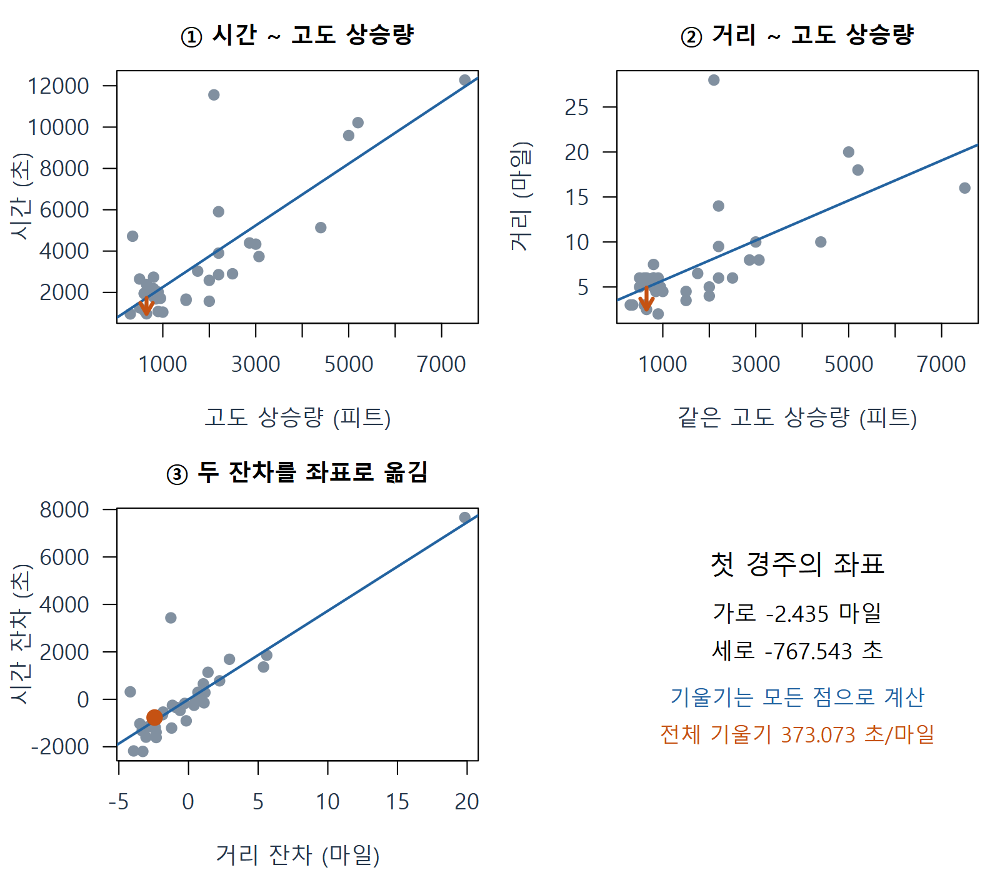
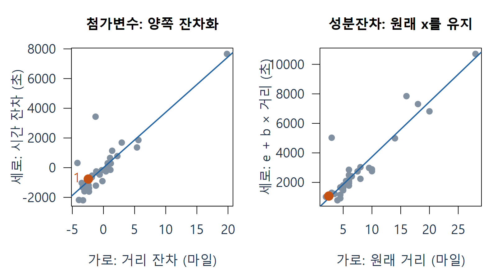
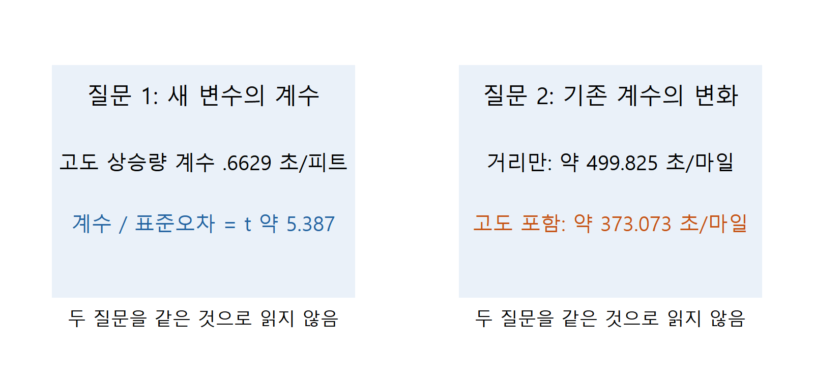
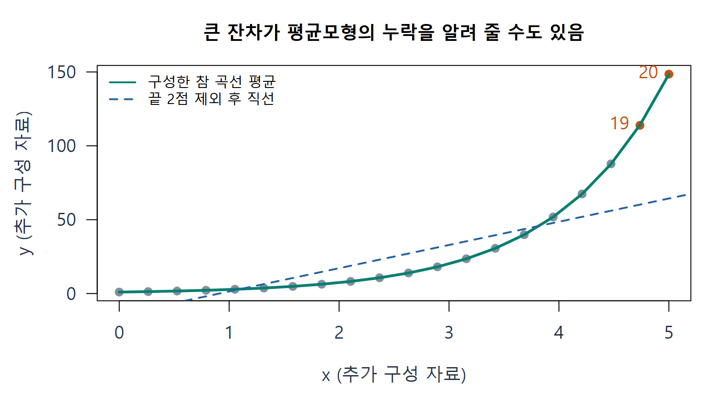
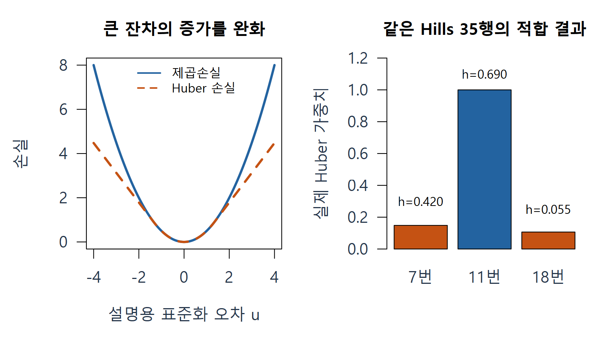

# W10A C · 다른 변수를 고려하는 그림과 관측 처리

회귀분석의 이해 · 2026년 11월 2일

이 부분은 처음 배우는 내용으로 읽습니다. **잔차화**라는 말은 어떤 변수를 다른 변수로 예측한 뒤, 실제 값에서 그 예측을 빼는 계산을 뜻합니다. 자료 행을 실제로 없애거나 원인을 실험적으로 통제했다는 뜻이 아닙니다. A의 ‘관측 - 예측’을 두 번 사용하는 것이 출발점입니다.

## 1. 경주 자료의 한 행과 단위를 먼저 읽기

Scottish.Hills의 한 행은 스코틀랜드 언덕 경주 하나이며 총 35행입니다. Time은 경주 기록 **초**, Distance는 거리 **마일**, Climb은 총 고도 상승량 **피트**입니다. 교재의 ‘경사’라는 말이 각도나 경사 비율을 뜻하는 것이 아닙니다.

첫 경주는 시간 965초, 거리 2.5마일, 상승량 650피트입니다. 긴 거리의 경주가 고도 상승량도 큰 편이라면, 거리와 시간만 그린 산점도에서 보이는 관계에는 다른 변수와 함께 움직이는 부분도 포함됩니다. 거리의 조건부 관계를 읽으려면 고도 상승량을 함께 고려해야 합니다.

같은 35행의 다중회귀 적합식은 다음과 같습니다.

$$
\widehat{\mathrm{Time}}
=-539.482907+373.072677\,\mathrm{Distance}
+0.662888\,\mathrm{Climb}.
$$

거리 계수는 다른 설명변수를 모형에서 함께 고려했을 때의 기울기입니다. 단위는 초/마일입니다. 이 관찰 자료의 조건부 연관을 인과효과라고 단정하지 않습니다.

## 2. 첨가변수플롯: 두 잔차를 만들어 한 점으로 놓기

첨가변수플롯(added-variable plot, 편회귀플롯)은 관심 변수의 다중회귀 계수를 그림으로 읽는 방법입니다. 관심 변수가 Distance라면, **같은 다른 변수 Climb과 절편**을 두 보조회귀에 사용합니다. 보조회귀는 좌표를 만들기 위한 작은 회귀입니다.

| 단계 | 적합할 작은 회귀 | 관측에서 뺄 값 | 남는 값 |
|---|---|---|---|
| ① 시간 쪽 | Time ~ Climb | 상승량으로 예측한 시간 | 시간 잔차 $r_Y$ |
| ② 거리 쪽 | Distance ~ Climb | 상승량으로 예측한 거리 | 거리 잔차 $r_X$ |
| ③ 좌표 만들기 | 새 보조회귀가 아님 | 각 경주의 두 잔차를 연결 | 가로 $r_X$, 세로 $r_Y$ |

시간만 잔차화하고 거리는 원래 값으로 두는 그림이 아닙니다. 같은 관측행, 같은 다른 변수 집합, 같은 절편 조건을 사용해야 합니다.

### E08 · 첫 경주의 첨가변수 좌표

첫 경주의 Climb=650피트를 ①의 보조회귀에 넣으면 시간 예측은 약 1732.543초입니다. 시간 잔차는 $965-1732.543=-767.543$초입니다. 같은 650피트를 ②에 넣으면 거리 예측은 약 4.935094마일입니다. 거리 잔차는 $2.5-4.935094=-2.435094$마일입니다.

따라서 이 경주의 첨가변수 점은 다음 좌표입니다.

$$
(r_X,r_Y)=(-2.435094\text{ 마일},-767.542917\text{ 초}).
$$

음수 거리는 실제 거리가 음수라는 말이 아닙니다. **그 상승량에서 보조회귀가 예측한 거리보다 짧다**는 뜻입니다. 시간 쪽도 같은 방식으로 읽습니다.

위 두 그림의 주황 화살표는 첫 경주의 각 보조회귀 잔차입니다. 아래 왼쪽은 모든 경주의 두 잔차를 좌표로 놓은 결과입니다. 출처: 주교재 §5.13의 공식 Hills 자료와 자체 단계별 그림.

두 잔차 좌표 전체에 최소제곱 직선을 적합한 기울기는 약 373.072677초/마일로, 앞 다중회귀의 Distance 계수와 같습니다. **첫 한 점의 세로/가로 비율**이 그 계수라는 뜻은 아닙니다. 점에는 여전히 잔차가 있기 때문입니다. 전체 기울기는 모든 점으로 구합니다.

$$
b_{\mathrm{Distance}}
=\frac{\sum_i r_{Xi}r_{Yi}}{\sum_i r_{Xi}^2}.
$$

이 식의 분자는 두 잔차가 함께 움직인 정도를 더한 값, 분모는 남은 거리 변동의 제곱합입니다. 행렬을 이용한 증명은 선택 보충으로 둡니다.

**확인 C10.** 첨가변수플롯에서 가로축도 잔차여야 하는 이유는 무엇인가요? 첫 경주의 음수 거리 잔차가 실제 음수 거리가 아닌 이유도 설명하세요.

## 3. 성분잔차플롯: 원래 x축을 유지하기

**성분**은 여기서 관심 변수의 적합값 기여분 $b_jx_j$입니다. 성분잔차플롯(component-plus-residual plot, 편잔차플롯)은 전체 다중모형의 잔차 e에 그 기여분을 다시 더합니다.

$$
\text{가로}=x_j,\qquad
\text{세로}=e+b_jx_j.
$$

첨가변수플롯과 달리 **가로는 원래 설명변수**입니다. 관심 변수와 반응 사이에 남은 곡선 같은 형태를 살피는 데 도움을 줍니다. 세로의 성분잔차는 원래 y 관측값 자체가 아닙니다.

### E09 · 첫 경주의 성분잔차를 한 행 계산하기

전체 모형에 거리 2.5, 상승량 650을 넣으면 시간 예측은 약 824.075979초입니다. 잔차는 $965-824.075979=140.924021$초입니다. 거리 성분을 다시 더하면 다음과 같습니다.

$$
e_1+b_{\mathrm{Distance}}x_1
=140.924021+373.072677\times2.5
\approx1073.605713\text{ 초}.
$$

이 점은 가로 2.5마일, 세로 1073.605713초입니다. 앞 E08의 점 (-2.435094, -767.542917)과 다릅니다. 같은 경주·같은 전체모형을 **다른 목적으로 좌표 변환**한 것입니다.

| 그림 | 가로 | 세로 | 먼저 읽을 질문 |
|---|---|---|---|
| 원 산점도 | 원래 거리 | 원래 시간 | 주변 관계가 어떻게 보이나 |
| 첨가변수 | 다른 변수로 설명되지 않은 거리 부분 | 같은 다른 변수로 설명되지 않은 시간 부분 | 조건부 기울기와 이를 좌우하는 점은 무엇인가 |
| 성분잔차 | 원래 거리 | 전체 잔차 + 거리 성분 | 관심 변수에 곡선 형태가 남아 있나 |

**확인 C11.** 두 그림의 점 번호 1은 같은 관측인데 왜 좌표가 다른가요? 각 가로축을 정확히 말해 보세요.

## 4. 새 변수를 넣을 때 따로 물을 두 질문

첫째는 **새 변수의 계수가 0과 구별되는가**입니다. 일반 OLS 출력의 계수 t값은 추정 계수를 그 표준오차로 나눈 값입니다. 다른 변수들이 모형에 있을 때 새 변수의 추가적인 선형 연관에 관한 질문이며, 가정과 함께 읽습니다.

둘째는 **새 변수를 넣으면 기존 변수의 계수가 얼마나 달라지는가**입니다. 새 변수의 유의확률만 읽어서는 이 변화가 보이지 않을 수 있습니다. 계수 변화량 자체를 새 변수의 t검정 결과와 같은 검정이라고 부르지 않습니다.

이 Hills 자료에서는 거리를 혼자 넣은 기울기가 약 499.825초/마일이고, 상승량을 함께 넣으면 약 373.073초/마일입니다. 새 상승량 계수의 t값은 약 5.387입니다. 두 질문 모두 필요합니다. 전후 계수 변화만으로 인과적 교란이나 공선성을 확정하지는 않습니다.

교재 §5.14는 ‘새 계수의 유의성’과 ‘기존 계수의 큰 변화’ 유무를 조합한 네 상황을 비교합니다. 각 경우의 자세한 읽기는 개념 카드에 있습니다. 실제 변수 선택은 분석 목적·가정·자료 지지·계수 안정성도 함께 고려합니다.

**확인 C12.** ‘새 계수가 유의하다’와 ‘기존 거리 계수가 달라졌다’는 같은 질문인가요? 위 두 숫자 묶음을 각각 어느 질문에 연결할지 설명하세요.

## 5. 특이 관측을 발견한 뒤의 순서

먼저 자료 기록과 분석 맥락을 확인합니다. 입력·단위 오류가 확인되면 원본과 수정 근거를 보존합니다. 실제로 관측된 드문 사례라면 단순히 불편하다는 이유로 없애지 않습니다. 평균모형에서 중요한 곡선·집단·상호작용을 빠뜨렸을 수도 있습니다.

이 그림은 교재 그림5.9의 **문제의식을 새 자료로 재현**한 것으로 원교재 자료와 같지 않습니다. 초록 곡선은 구성한 참 평균, 파란 점선은 마지막 두 점을 제외한 직선입니다. 뒤의 큰 점은 곡선 관계를 알려 주는 정보일 수 있습니다. 이를 삭제하면 평균형태를 잘못 정한 문제를 놓칠 수 있습니다.

실무 기록은 ‘관측한 현상 → 가능한 원인 → 확인한 사실 → 선택한 처리 → 전체/민감도 비교’ 순서로 남깁니다. 제외 분석은 원자료 유지 상태에서 따로 비교하고, 제외 이유와 결과 변화를 함께 보고합니다.

**확인 C13.** 큰 잔차가 발견되면 기록 오류 확인, 평균모형 재검토, 삭제 민감도 비교 중 무엇을 어떤 근거로 진행할지 설명하세요. 큰 잔차 자체가 삭제 이유가 되나요?

## 6. 로버스트 회귀: 큰 잔차의 작용을 완화하는 도입

최소제곱은 잔차를 제곱해 더합니다. 절댓값이 1에서 4로 커지면 제곱은 1에서 16으로 커져 큰 잔차의 작용이 빠르게 커집니다. **로버스트(강건) 회귀**는 일부 큰 잔차가 전체 적합을 지나치게 좌우하는 문제를 줄이려는 접근입니다. 교재 §5.15는 이 아이디어를 도입하며 전체 알고리즘은 뒤 장에서 다룹니다.

### E10 · Huber의 직관과 가중치 한 번 읽기

추가 시연인 Huber M 적합은 작은 잔차 부근에서는 제곱손실처럼 반응하지만 큰 잔차에서는 손실 증가를 완화합니다. 반복해서 적합하며 잔차의 상대적 크기에 따라 가중치가 달라집니다. 설명용으로 표준화 잔차 u와 기준 1.345를 쓰면 가중치는 $\min(1,1.345/|u|)$입니다. u=0.5이면 1, u=2이면 약 0.6725입니다. 실제 u의 규모 추정도 로버스트 적합 과정에 들어갑니다.

왼쪽은 손실의 원리를 보여 주는 추가 도식입니다. 오른쪽은 **같은 Hills35행을 유지한** `MASS::rlm()` Huber 적합 결과입니다. 7번 가중치는 약 0.1485, 18번은 약 0.1066으로 작지만, h가 약 0.690인 11번은 가중치 1입니다. 잔차 기반 Huber가 모든 높은 지레점을 자동으로 처리하는 것은 아닙니다.

가중치는 관측이 맞을 확률이 아닙니다. 작은 가중치를 받았다고 오류가 확정되는 것도 아닙니다. OLS와 로버스트의 계수·예측·가중치 변화를 비교하고 자료 맥락을 확인합니다. R `rlm`의 잔차 자유도는 일반 `lm`의 규모 추론을 잘못 적용하지 않도록 NA로 설정됩니다. 일반 OLS t/F 출력과 같은 방식으로 해석하지 않습니다.

**확인 C14.** ‘h가 큰 점은 Huber에서 항상 작은 가중치를 받는다’고 말할 수 있나요? 11번 경주가 보여 주는 한계를 설명하세요.

## 출처와 다음 연결

주교재 §5.12–5.15, 인쇄220–228쪽. 공식 Hills는 초·마일·피트 단위를 유지했습니다. R의 내장 `MASS::hills`는 분 단위이고 일부 값에도 차이가 있어 이 자료를 조용히 대체하지 않았습니다. 잔차화는 선형 조정이며 인과 통제 실험이 아닙니다. Huber의 구체적 손실·가중치 시연은 교재 도입을 보완한 추가 설명입니다.

[R car: 첨가변수플롯](https://search.r-project.org/CRAN/refmans/car/html/avPlots.html) · [R car: 성분잔차플롯](https://search.r-project.org/CRAN/refmans/car/html/crPlots.html) · [MASS: 로버스트 적합](https://stat.ethz.ch/R-manual/R-devel/library/MASS/html/rlm.html)

이제 집단별 잔차 구조를 이용해 범주형 변수와 상호작용을 배웁니다. [D · 급여 자료의 범주형 예측변수](w10a-categorical.md).
