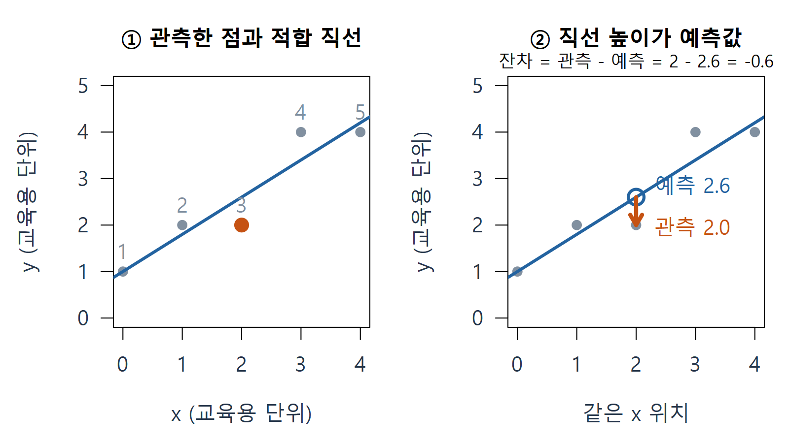
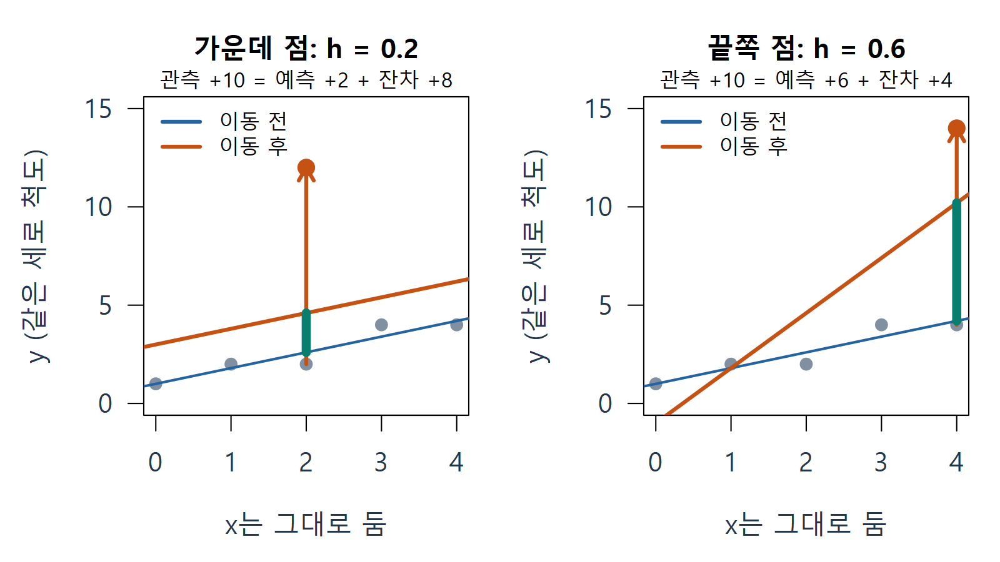
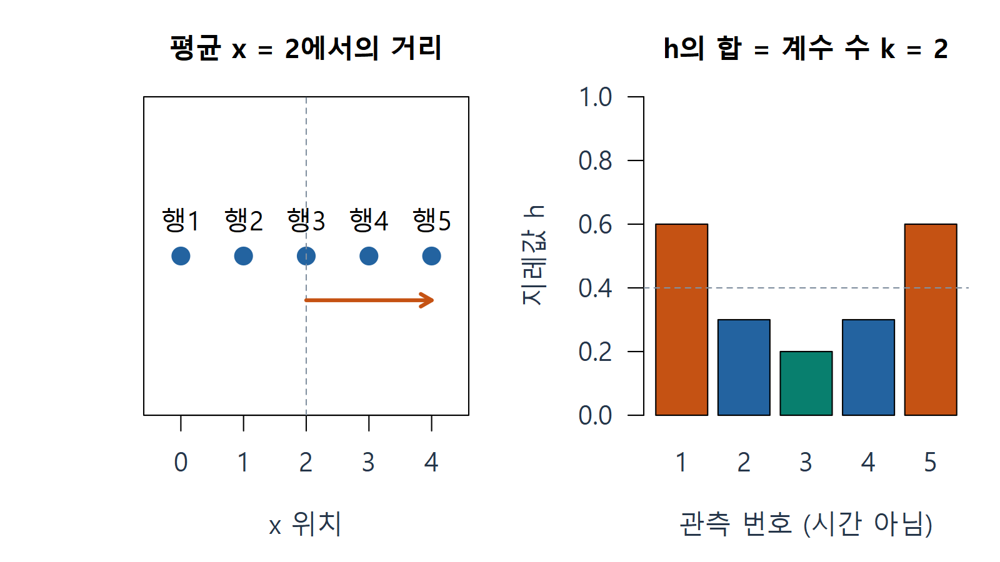
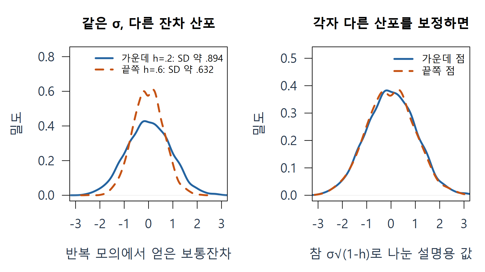
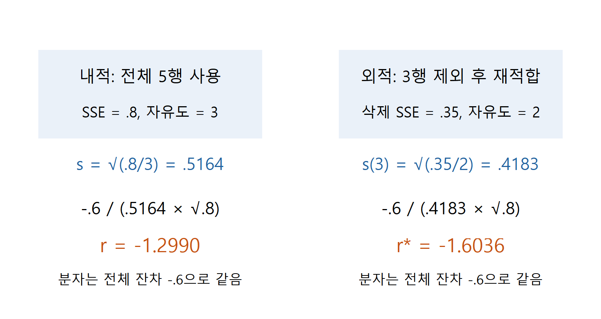
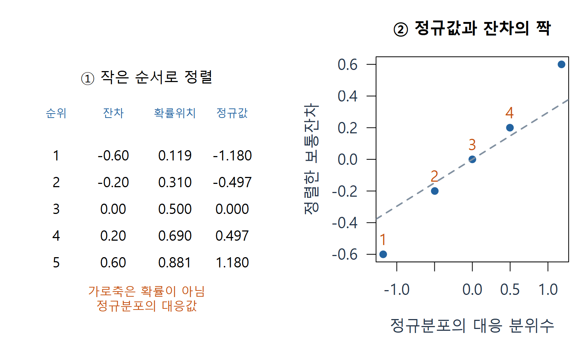
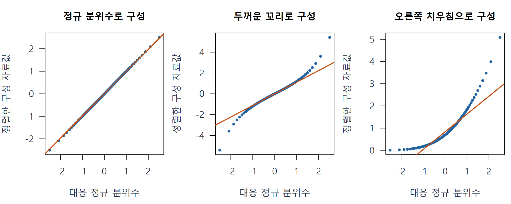
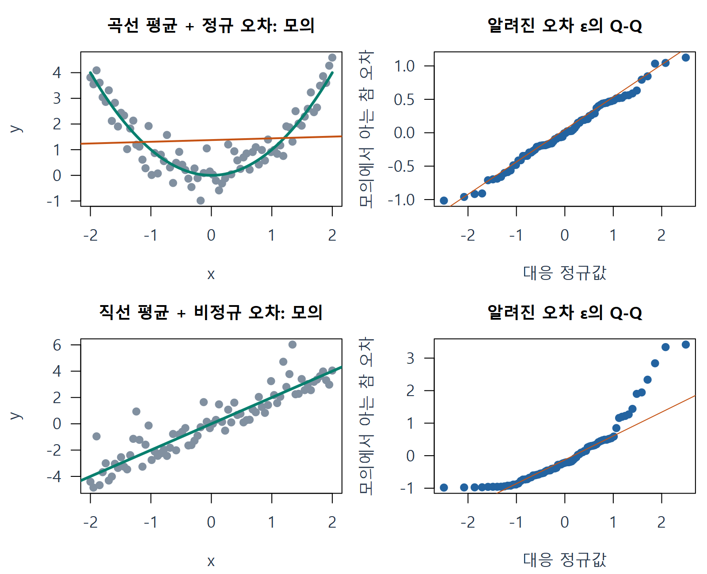
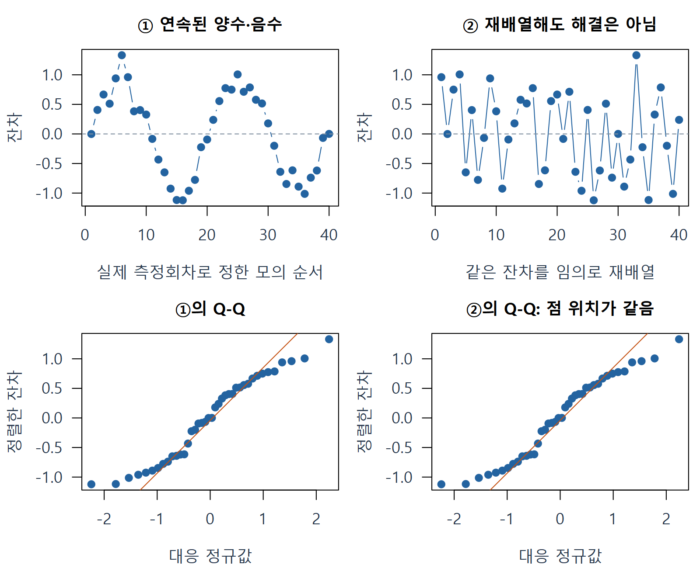

# W10A A · 한 점에서 잔차와 진단 그림까지

회귀분석의 이해 · 2026년 11월 2일 · 10주차 1차시

지난 자료를 이해하지 못했어도 여기서 다시 시작합니다. 먼저 점 하나를 읽고, 작은 숫자를 계산한 다음 수식으로 정리합니다. 이 본문 → [B 지레·영향력](w10a-influence.md) → [C 변수 효과·관측 처리](w10a-effects.md) → [D 범주형 예측변수](w10a-categorical.md) 순서로 읽습니다. 설명용 완성 예제 E01–E12와 직접 풀 연습 L01–L12를 구분합니다. 연습 L01–L06을 먼저 하고, 나머지는 반복 학습에 사용합니다. 새 성적 반영 과제나 제출 기한은 없습니다.

## 1. 관측값·예측값·잔차: 같은 x에서 세로 차이를 읽기

**관측값**은 실제로 얻은 숫자입니다. **예측값 또는 적합값**은 자료로 구한 회귀식이 그 조건에서 내놓는 숫자입니다. 적합 직선의 높이를 읽으면 됩니다. **잔차**는 관측값에서 적합값을 뺀 차이입니다. 직선과의 수직 거리에 방향을 붙인 것이며, 점에서 직선까지의 가장 짧은 사선 거리가 아닙니다.

다음은 손계산을 위해 추가 구성한 자료입니다. 실제 조사 결과가 아니며 x와 y의 단위는 교육용 단위입니다. 한 행은 하나의 관측입니다.

| 관측 번호 | x | 관측 y | 적합값 | 잔차 |
|---|---:|---:|---:|---:|
| 1 | 0 | 1 | 1.0 | 0.0 |
| 2 | 1 | 2 | 1.8 | 0.2 |
| 3 | 2 | 2 | 2.6 | -0.6 |
| 4 | 3 | 4 | 3.4 | 0.6 |
| 5 | 4 | 4 | 4.2 | -0.2 |

### E01 · 3번 점의 잔차를 끝까지 계산하기

이 다섯 점의 최소제곱 적합식은 다음과 같습니다. 모자 기호는 관측 자체가 아니라 추정한 값을 나타냅니다.

$$
\hat y=1+0.8x,\qquad e_i=y_i-\hat y_i.
$$

3번 점에서 x=2이므로 예측값은 $1+0.8\times2=2.6$입니다. 실제 y는 2이므로 잔차는 $2-2.6=-0.6$입니다. 음수는 관측이 예측보다 낮다는 뜻입니다. 잔차의 단위는 y의 단위와 같습니다.

그림 읽기: 회색 점은 관측, 파란 선은 적합 직선입니다. 빈 원은 같은 x에서 읽은 예측값이며, 주황 화살표가 잔차의 방향과 크기를 보여 줍니다. 출처: 위 추가 구성 자료를 R로 계산한 자체 그림.

**확인 C01.** 잔차가 음수인 것은 관측이 예측보다 높다는 뜻인가요, 낮다는 뜻인가요? 3번의 두 숫자를 짚으며 설명하세요.

## 2. 오차와 잔차가 다른 이유

**조건부 평균**은 x 등 조건을 정했을 때 모집단의 y가 평균적으로 놓이는 위치입니다. 참 조건부 평균은 보통 모릅니다. 그래서 자료로 회귀식을 추정합니다.

$$
\underbrace{Y_i}_{\text{관측}}
=\underbrace{\beta_0+\beta_1x_i}_{\text{참 조건부 평균}}+\underbrace{\varepsilon_i}_{\text{오차}},
\qquad
\underbrace{e_i}_{\text{계산 가능한 잔차}}=Y_i-\hat y_i.
$$

오차는 참 평균과의 차이, 잔차는 추정한 평균과의 차이입니다. 실제 자료에서 우리가 바로 계산하는 것은 잔차입니다. 설명용 모의실험에서는 생성한 참 평균을 알기 때문에 오차도 볼 수 있지만, 실제 자료에서도 참 오차를 관찰한 것처럼 말하지 않습니다.

절편을 포함한 최소제곱 적합에서는 잔차의 합이 0이 됩니다. 곡선 관계에 잘못 직선을 적합해도 이 성질은 생깁니다. 따라서 잔차합 0은 모형이 맞다는 보증이 아닙니다.

## 3. 지레값 h: 내 관측값이 내 예측값을 얼마나 끌어당기는가

지레값을 배우는 첫 질문은 다음과 같습니다. 다른 조건은 고정하고 **한 점의 y만 바꾸어 다시 적합하면, 그 점의 자기 예측값은 얼마나 변할까요?** 그 전달 비율을 $h_i$라고 부릅니다. 교재에서는 같은 값을 $p_{ii}$로 씁니다. i는 관측 번호입니다.

### E02 · 같은 +10 이동, 서로 다른 자기 예측 변화

먼저 원래 자료로 돌아온 뒤 3번의 y만 2에서 12로 바꿉니다. 새 직선을 적합하면 3번의 예측은 2.6에서 4.6으로 바뀝니다. 관측이 10 증가할 때 자기 예측은 2 증가했습니다. 이 점의 h는 0.2입니다.

별도의 비교에서는 다시 원래 자료로 돌아온 뒤 5번의 y만 4에서 14로 바꿉니다. 자기 예측은 4.2에서 10.2로, 6 증가합니다. 이 점의 h는 0.6입니다. 두 점을 동시에 움직인 결과가 아닙니다.

$$
\Delta\hat y_i=h_i\Delta y_i,\qquad
\Delta e_i=(1-h_i)\Delta y_i.
$$

그림 읽기: 파랑은 이동 전, 주황은 이동 후 직선입니다. 긴 주황 화살표는 관측의 +10, 초록 굵은 선분은 자기 예측의 +2 또는 +6입니다. 같은 관측 증가가 예측 변화와 잔차 변화로 나뉩니다. 출처: 위 5행 자료의 실제 재적합.

여기서 h는 확률이나 관측이 틀렸을 가능성이 아닙니다. **주어진 x 배치에서 생기는 기하학적 성질**입니다. x를 고정하면 y를 바꾸어도 h 자체는 바뀌지 않습니다. h가 큰 점도 직선에 잘 맞을 수 있으므로 실제 영향력은 B에서 따로 확인합니다.

### 3.1 행렬 없이 h를 한 번 계산하기

절편을 포함한 단순회귀에서는 다음 식을 쓸 수 있습니다. n은 관측 수, $\bar x$는 x의 평균, $S_{xx}$는 x가 평균에서 떨어진 정도를 제곱해 모두 더한 값입니다.

$$
h_i=\frac1n+\frac{(x_i-\bar x)^2}{S_{xx}},
\qquad S_{xx}=\sum_{j=1}^{n}(x_j-\bar x)^2.
$$

지금은 $n=5$, $\bar x=(0+1+2+3+4)/5=2$이고 $S_{xx}=4+1+0+1+4=10$입니다. 가운데 3번은 $1/5+0/10=0.2$, 끝쪽 5번은 $1/5+4/10=0.6$입니다. x가 평균에서 멀수록 단순회귀의 h가 커지는 이유가 식에도 보입니다. 다중회귀에서는 각 x를 따로 보는 대신 설명변수들의 **공동 배치**를 봅니다.

점선 높이 0.4는 지레값의 평균 k/n입니다. k는 절편을 포함한 실제 계수 수이며 지금은 2입니다. h의 합은 k=2입니다. 관측 번호는 이 자료의 식별자이고 시간순서가 아닙니다. 출처: 위 5행 자료의 계산.

**확인 C02.** x를 그대로 둔 채 y만 바꾸면 h가 바뀔까요? h=0.6이라는 말이 ‘오류일 확률 60%’가 아닌 이유도 설명하세요.

## 4. 왜 잔차를 그냥 크기로 비교하지 않는가

직선을 추정할 때 각 관측이 그 직선을 자기 쪽으로 끌어당깁니다. h가 큰 점의 보통잔차는 그 작용 때문에 작게 보일 수 있습니다. 모형의 평균형태와 같은 오차분산 가정이 맞고 x 배치를 고정하면, 반복해서 자료를 얻을 때의 잔차 분산은 다음과 같습니다.

$$
\operatorname{Var}(e_i\mid X)=\sigma^2(1-h_i).
$$

분산은 반복 관측에서 얼마나 퍼지는지를 제곱 단위로 나타낸 값이고, 표준편차는 그 제곱근입니다. $\sigma$는 참 오차의 표준편차입니다. 우리가 알고 있는 값은 아니므로 뒤에서 자료로 추정합니다. h=0.2라면 잔차 표준편차는 $\sigma\sqrt{0.8}$, h=0.6이라면 $\sigma\sqrt{0.4}$입니다. 같은 원래 오차 규모에서도 보통잔차의 비교 척도가 다릅니다.

왼쪽의 끝점 잔차는 더 좁게 퍼집니다. 오른쪽은 원리를 보여 주려고 **모의에서 아는 참 σ**로 나눈 그림입니다. 실제 내적 표준화잔차를 소표본에서 정확히 정규분포로 만드는 실험이라고 해석하지 않습니다. 출처: 고정 x에서 정규 오차를 반복 생성한 추가 모의실험.

## 5. s·자유도·내적/외적 표준화: 분모를 풀어 읽기

먼저 잔차를 제곱해 더한 **잔차제곱합 SSE**를 구합니다. 큰 양수와 큰 음수가 서로 지워지지 않도록 제곱합니다. 그 합을 잔차 자유도로 나누고 제곱근을 취하면 오차 규모의 추정값 s를 얻습니다.

$$
\mathrm{SSE}=\sum e_i^2=0^2+0.2^2+(-0.6)^2+0.6^2+(-0.2)^2=0.8,
\quad \nu=n-k=5-2=3,
\quad s=\sqrt{\frac{0.8}{3}}\approx0.5164.
$$

자유도 3은 다섯 관측으로 절편과 기울기 두 계수를 추정한 뒤의 잔차 자유도입니다. 표에서 두 관측을 실제로 삭제했다는 뜻은 아닙니다. 분모를 무조건 n으로 두지 않습니다. s의 단위는 y의 단위입니다.

**내적(내부) 표준화잔차**는 전체 자료에서 추정한 s를 사용합니다. **외적(외부) 표준화잔차**는 i번을 빼고 나머지 자료로 다시 적합해서 추정한 $s_{(i)}$를 사용합니다. 이 용어는 벡터의 내적·외적 연산을 말하는 것이 아닙니다.

$$
r_i=\frac{e_i}{s\sqrt{1-h_i}},\qquad
r_i^*=\frac{e_i}{s_{(i)}\sqrt{1-h_i}}.
$$

분모는 ‘비교에 쓸 잔차의 표준편차 추정값’입니다. 잔차를 그 척도로 나누므로 결과는 무단위입니다. 두 식의 **분자는 모두 전체 모형의 같은 잔차**입니다. 외적이라고 분자를 삭제 후 예측오차로 바꾸지 않습니다.

### E03 · 3번의 두 표준화 값을 비교하기

3번은 $e_3=-0.6$, $h_3=0.2$입니다. 전체 규모로 만든 분모는 $0.5164\sqrt{0.8}\approx0.4619$이므로 내적 값은 약 -1.2990입니다.

3번을 제외한 나머지 네 점을 **다시 적합**하면 SSE는 0.35, 잔차 자유도는 $4-2=2$입니다. 따라서 $s_{(3)}=\sqrt{0.35/2}\approx0.4183$이고, 외적 값은 $-0.6/(0.4183\sqrt{0.8})\approx-1.6036$입니다.

전체 SSE에서 단순히 3번의 $e_3^2$만 빼는 계산이 아닙니다. 재적합하면 다른 점의 잔차도 변합니다. 자세한 삭제 항등식은 개념 카드에 있습니다. 이 예에서는 외적 절댓값이 더 크지만 항상 그런 것은 아닙니다. R의 `rstandard()`와 `rstudent()`가 각각 두 값에 대응합니다.

**확인 C03.** 외적 표준화에서 달라지는 것은 분자인가요, 오차 규모를 추정하는 분모인가요? ‘다시 적합’이 필요한 이유도 말해 보세요.

## 6. 정규 Q-Q: 정렬하고 같은 순위의 값을 짝짓는 그림

**분위수**는 분포에서 어느 정도 아래쪽에 위치하는지를 나타내는 경계값입니다. 예를 들어 중앙값은 아래쪽 절반의 경계입니다. **정규 Q-Q 플롯**은 자료를 작은 순서로 정렬한 값과, 정규분포에서 비슷한 순위에 대응하는 값을 짝지어 그린 그림입니다. Q 두 개는 두 분위수(quantile)를 가리킵니다.

### E04 · 표의 한 행을 Q-Q 점 하나로 만들기

그림을 만드는 법을 배우기 위해 먼저 위 **보통잔차** 다섯 개를 씁니다. 정렬하면 -0.6, -0.2, 0, 0.2, 0.6입니다. R 기본 규칙으로 구한 대응 정규값은 약 -1.180, -0.497, 0, 0.497, 1.180입니다.

첫 점의 가로는 -1.180, 세로는 -0.6입니다. 두 번째 점은 (-0.497, -0.2)입니다. 가로축은 관측 번호, x 설명변수, 확률 자체가 아닙니다. 정규분포의 대응 **수치**입니다. 세로축에는 정렬한 잔차를 놓습니다.

회색 참고선은 원래 y~x의 회귀직선이 아닙니다. R의 `qqline()`은 기본적으로 첫째·셋째 사분위수의 대응점을 지나는 선을 그립니다. 작은 표본의 확률위치 근사 규칙에는 여러 방법이 있으며, 여기서는 `qnorm(ppoints(n))`으로 `qqnorm()`과 같은 좌표를 만듭니다. 출처: 추가 구성 자료 및 R 공식 `qqnorm`·`ppoints` 정의.

정규분포로 자료의 분포 모양을 대략 설명할 수 있으면 점들이 참고 직선 부근에 놓일 것으로 기대합니다. 꼬리에서 멀어지거나 한쪽으로 휘면 분포 모양을 더 살펴볼 단서입니다. 다섯 점만으로 정규성 여부를 확정하지 않습니다.

이 세 패널은 차이를 선명하게 보여 주려고 분포의 분위수로 구성한 설명용 자료입니다. 실제 표본이나 회귀잔차의 검정 결과가 아닙니다. 실제 진단에서는 적합한 모형의 내적 표준화잔차 등을 사용하며, 작은 표본의 표준화잔차가 정확한 정규 독립표본이라고 가정하지 않습니다.

**확인 C04.** Q-Q의 점 하나를 만들려면 어떤 두 숫자가 필요한가요? 원래 설명변수 x가 정규분포인지 보는 그림인가요?

## 7. 선형성과 정규성은 다른 질문

선형성은 **평균 관계의 형태**, 정규성은 **주어진 조건에서 평균 주위 오차의 분포 모양**에 관한 질문입니다. 직선 주위에서 오차가 한쪽으로 치우칠 수도 있고, 곡선 평균 주위의 오차가 정규분포일 수도 있습니다.

왼쪽 초록 선이 모의에서 정한 참 평균입니다. 위의 주황 직선은 곡선 관계를 놓칩니다. 오른쪽은 **모의에서 아는 참 오차 ε**의 Q-Q입니다. 실제 자료에서는 참 오차 대신 잔차를 보므로, 평균모형이 틀리면 잔차의 Q-Q도 달라질 수 있습니다. 먼저 평균 관계가 타당한지 살핀 뒤 분포 진단을 함께 읽습니다.

선형회귀의 ‘선형’은 지정한 설명변수에 대한 계수의 선형성을 뜻합니다. x²를 설명변수에 넣은 다항회귀도 계수에 대해서는 선형모형일 수 있습니다. 여기서 직선과 곡선을 비교하는 것은 먼저 적합한 **y~x 모형의 평균 형태**를 점검하는 사례입니다. 정규성은 x나 y의 주변분포가 정규여야 한다는 요구가 아닙니다. 최소제곱 계수 계산 자체에 정규성이 필수인 것도 아닙니다.

## 8. 잔차–수집순서 플롯: 실제로 얻은 순서대로 놓기

**수집순서**는 자료를 실제로 얻은 순서입니다. 잔차–수집순서 플롯의 가로축에는 측정회차나 실제 시간을, 세로축에는 그 순서의 잔차를 놓습니다. 순서대로 양수·음수가 이어지거나 위치·산포가 변하는지 살핍니다.

### E05 · 같은 잔차인데 순서 그림만 달라지는 이유

아래 추가 모의자료에서는 1~40을 실제 측정회차로 정했습니다. 1회차 잔차는 (1, 해당 잔차), 2회차 잔차는 (2, 해당 잔차)에 놓습니다. 왼쪽 위에는 양수와 음수가 덩어리로 이어지는 구조가 있습니다. 오른쪽 위는 **동일한 잔차 집합을 임의로 섞어 표시**했습니다.

아래 Q-Q 두 개의 점 위치는 같습니다. Q-Q를 만들 때 크기순으로 정렬해 순서 정보가 사라지기 때문입니다. 따라서 Q-Q가 괜찮아 보여도 순서 의존을 놓칠 수 있습니다. 순서를 섞는 것은 문제를 고치는 방법이 아닙니다.

부서 번호나 강 번호처럼 임의로 붙인 식별자를 시간으로 해석하지 않습니다. Scottish.Hills의 **Time은 경주 기록 시간이라는 반응변수**이며, 자료 수집순서를 뜻하지 않습니다. 순서 정보가 없다면 ‘시간 의존을 검토했다’고 보고하지 않습니다.

**확인 C05.** 잔차들을 다시 정렬해 시간순서 그림을 그려도 될까요? Q-Q가 같은 두 그림의 순서 구조는 왜 다를 수 있나요?

## 9. 그림을 고르는 작은 지도

| 확인할 질문 | 주로 보는 그림 | 점 하나의 좌표 | 관찰할 단서 |
|---|---|---|---|
| 평균 관계에 남은 구조가 있나 | 잔차–적합값, 잔차–설명변수 | (적합값 또는 설명변수, 잔차) | 곡선·집단별 치우침 |
| 산포가 일정한가 | 잔차–적합값 등 | 같은 좌표 | 부채꼴·집단별 다른 폭 |
| 오차 분포 모양이 정규에 가까운가 | 정규 Q-Q | (대응 정규 분위수, 정렬한 잔차) | 꼬리·비대칭 |
| 순서 구조가 남아 있나 | 잔차–실제 수집순서 | (실제 순서, 잔차) | 연속 덩어리·추세·산포 변화 |

어떤 그림도 가정 전체를 증명하지 않습니다. ‘보인 패턴 → 가능한 설명 → 추가로 확인할 기록’을 구분해 씁니다. 예를 들어 곡선 패턴은 평균모형의 누락을 의심할 단서이지, 그 그림만으로 오차가 비정규라고 확정하는 근거는 아닙니다.

## 출처와 다음 연결

주교재 『Chatterjee 예제를 통한 회귀분석 제6판: R 활용』 §5.1–5.7, 인쇄188–205쪽. 기하학·분산 설명은 교재 정의를 풀어 썼고, 5행 표·점 이동·순서/오차 모의실험은 추가 교육용 구성입니다.

[R: 회귀 삭제 진단](https://stat.ethz.ch/R-manual/R-devel/library/stats/html/influence.measures.html) · [R: 정규 Q-Q](https://stat.ethz.ch/R-manual/R-devel/library/stats/html/qqnorm.html) · [R: 확률위치](https://stat.ethz.ch/R-manual/R-devel/library/stats/html/ppoints.html) · [NIST: 수집순서 그림](https://www.itl.nist.gov/div898/handbook/eda/section3/runseqpl.htm)

이제 h가 높다는 것과 실제로 적합을 크게 바꾼다는 것을 구분합니다. [B · 지레·영향력·P-R로 계속](w10a-influence.md).
