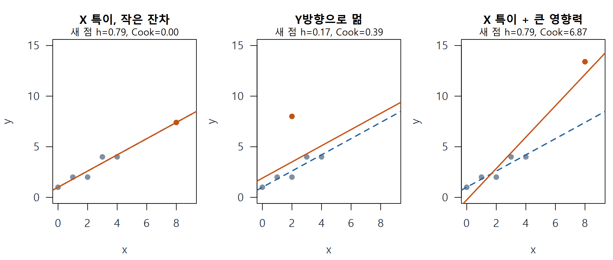
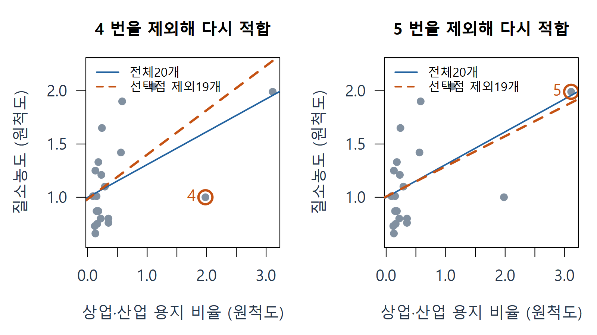
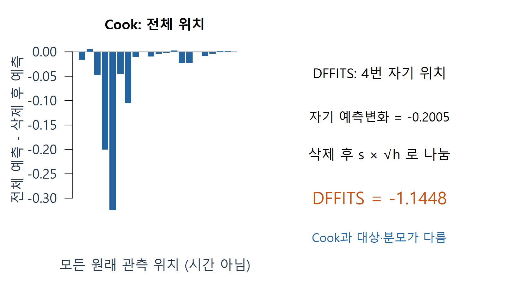
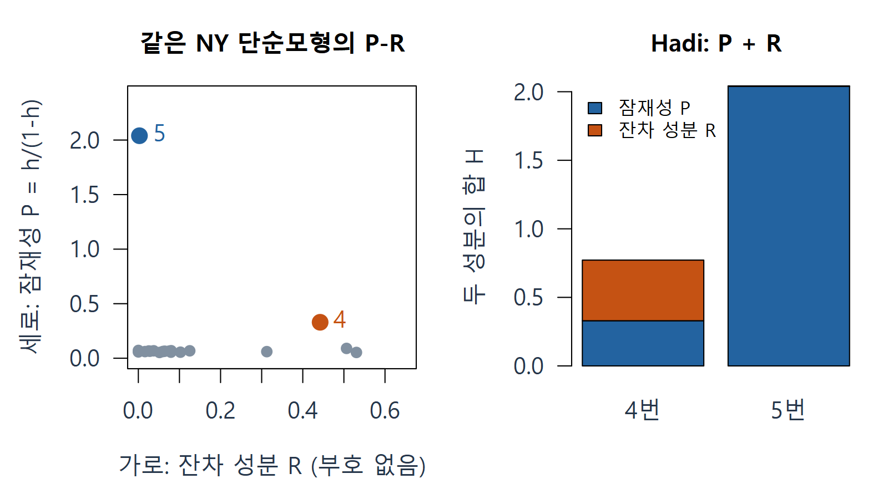

# W10A B · 지레값·영향력·P-R를 한 단계씩

회귀분석의 이해 · 2026년 11월 2일

[A의 잔차·h 설명](w10a-foundations.md)을 먼저 읽습니다. 이 자료에서 h는 주어진 x 배치의 자기 예측 민감도, 잔차 e는 관측에서 전체 모형의 적합값을 뺀 값입니다. 둘을 안 뒤 ‘그 점을 빼면 적합 결과가 얼마나 달라지는가’를 살핍니다.

## 1. 서로 다른 세 질문부터 구별하기

| 질문 | 부르는 이름 | 확인하는 대상 |
|---|---|---|
| 설명변수 배치에서 다른 점들과 떨어져 있나 | 높은 지레점 | X 공간의 특이성, h |
| 적합한 평균에서 Y방향으로 멀리 있나 | 반응 방향의 특이값 | 잔차와 적절한 표준화 |
| 제외하고 다시 적합하면 결과가 크게 바뀌나 | 영향력 있는 관측 | 계수·예측 등의 실제 변화 |

‘높은 지레값’은 잠재적으로 적합을 크게 바꿀 수 있는 위치를 말합니다. 실제로 바꾸었는지는 잔차와 삭제 재적합을 함께 봅니다. 특이값도 반드시 기록 오류는 아닙니다. 어떤 모형을 적합했는지에 따라 특이해 보이는 정도가 달라집니다.

세 패널은 각각 원래 5행에 **여섯 번째 점을 따로 추가**한 교육용 예입니다. 파란 점선은 추가 전 직선, 주황 실선은 추가 후 직선입니다. 왼쪽 점은 h가 크지만 두 직선이 거의 겹칩니다. 오른쪽은 직선이 크게 바뀝니다. 그림의 6행 모형 수치를 앞의 5행 계산에 섞지 않습니다. 출처: 추가 구성 자료의 실제 OLS 적합.

**확인 C06.** h가 더 큰 점의 Cook 값이 반드시 더 클까요? 왼쪽과 오른쪽 패널에서 ‘위치’와 ‘실제로 바뀐 정도’를 나누어 설명하세요.

## 2. ‘제외 후 재적합’은 원자료 삭제가 아니라 민감도 비교

원자료는 그대로 보관합니다. 분석용 사본에서 i번을 빼고 다시 적합한 모형을 만들어 전체 모형과 비교합니다. 이때 다른 점의 잔차도 바뀔 수 있습니다. 어떤 점을 제외해 얻은 결론이 전체 자료의 결론과 다르면, 그 차이를 설명할 내용 근거가 필요합니다.

교재의 NYRivers는 강 20개입니다. 여기서 먼저 사용하는 모형은 **질소농도 Nitrogen ~ 상업·산업 용지 비율 ComIndl**, 계수 수 k=2인 단순모형입니다. 농도의 물리 단위는 이 검토 원문에 명시되어 있지 않아 원척도로 표시합니다. 임의로 mg/L 같은 새 단위를 붙이지 않습니다.

두 패널의 파란 실선은 같은 20개 전체 모형입니다. 주황 점선은 각각 4번 또는 5번을 제외한 19개 모형입니다. 큰 빈 원으로 제외한 관측의 **원래 위치를 계속 표시**했습니다. 5번은 x가 매우 크지만 이 단순모형의 적합선 부근에 있어, 4번 제외와는 다른 변화가 나타납니다. 출처: 주교재 §5.8–5.9, 저자 공식 NYRivers 자료를 재계산한 자체 그림.

## 3. Cook의 거리: 전체 예측이 얼마나 변했는가

한 점을 뺀 모형도 원래 모든 관측의 x 위치에서 예측할 수 있습니다. Cook의 거리는 그 **전체 예측 변화의 제곱합**을, 계수 수와 오차 규모로 나누어 비교하는 무단위 양입니다. 부호는 없고 0 이상입니다.

$$
C_i=\frac{\sum_{j=1}^{n}(\hat y_j-\hat y_{j(i)})^2}{ks^2}.
$$

여기서 $\hat y_j$는 전체 모형의 j번 예측, $\hat y_{j(i)}$는 i번을 빼고 적합한 모형의 **같은 j번 위치 예측**입니다. i는 제외할 점, j는 예측 변화를 합산할 모든 위치입니다. 분모의 s는 전체 자료의 오차 규모입니다.

### E06 · 익숙한 5행 표의 4번 Cook 계산

다시 A의 5행 모형으로 돌아옵니다. $n=5,k=2,s^2=0.8/3$, 4번은 $e_4=0.6,h_4=0.3$입니다. 먼저 내적 표준화잔차를 구하면 다음과 같습니다.

$$
r_4=\frac{0.6}{\sqrt{0.8/3}\sqrt{0.7}}\approx1.388730.
$$

OLS에서는 전체 삭제 재적합을 매번 하지 않고도 같은 Cook 값을 얻는 다음 식이 성립합니다.

$$
C_4=\frac{r_4^2}{k}\frac{h_4}{1-h_4}
=\frac{1.388730^2}{2}\frac{0.3}{0.7}
\approx0.413265.
$$

잔차가 평균모형에서 벗어난 정도와 그 위치의 지레 작용이 함께 들어갑니다. 같은 표의 1번은 h=0.6으로 더 크지만 잔차가 0이라 Cook도 0입니다. 계산이 맞는지는 실제 4번 제외 재적합 후 원래 다섯 위치의 예측 변화를 합산해 검산합니다.

**확인 C07.** Cook을 직접 정의로 계산할 때 변화량을 4번 한 위치에서만 보나요, 원래 모든 위치에서 보나요? 무엇으로 나누는지도 짚어 보세요.

## 4. DFFITS: 그 점 자기 위치의 예측 변화

DFFITS는 i번의 **자기 위치**에서 전체 예측과 i번 제외 모형의 예측이 얼마나 다른지 표준화합니다. 삭제 후 오차 규모 $s_{(i)}$를 쓰며, 예측 변화의 방향 때문에 양수와 음수가 가능합니다.

$$
\mathrm{DFFITS}_i
=\frac{\hat y_i-\hat y_{i(i)}}{s_{(i)}\sqrt{h_i}}
=r_i^*\sqrt{\frac{h_i}{1-h_i}}.
$$

위 식의 $r_i^*$는 A에서 배운 외적 표준화잔차입니다. Cook은 전체 예측 변화와 전체 s, DFFITS는 자기 예측 변화와 삭제 후 s를 사용합니다. 둘은 관련되지만 같은 숫자는 아닙니다.

왼쪽 막대들은 NY 4번을 제외했을 때 **각 원래 위치**의 예측 차이입니다. 가로는 시간순서가 아닙니다. 오른쪽은 그중 자기 4번 위치의 차이를 삭제 후 척도로 나누어 DFFITS 약 -1.1448로 읽습니다. 이 그림은 NY20행 모형이며, 앞 E06의 교육용 5행 모형과 다릅니다. 출처: 같은 공식 NY 자료의 실제 삭제 재적합.

## 5. 잠재성 P와 잔차 성분 R을 따로 이해하기

‘잠재성’은 낯선 새 확률이 아닙니다. 지레값을 다음처럼 바꾸어, h가 1에 가까울 때 그 위치의 특이성을 더 크게 드러낸 척도입니다.

$$
P_i=\frac{h_i}{1-h_i}.
$$

h=0.2이면 P=0.25, h=0.6이면 P=1.5입니다. 1보다 클 수 있으므로 확률이 아닙니다. h가 커질수록 P도 커집니다.

다음으로 **정규화잔차** $d_i=e_i/\sqrt{\mathrm{SSE}}$를 정의합니다. 제곱 $d_i^2=e_i^2/\mathrm{SSE}$는 전체 잔차제곱합 중 그 점이 차지하는 비중입니다. 이것은 내적 표준화잔차 $r_i$의 제곱과 다릅니다. Hadi의 잔차 성분은 다음과 같습니다.

$$
R_i=\frac{k}{1-h_i}\frac{d_i^2}{1-d_i^2},
\qquad H_i=P_i+R_i.
$$

Hadi의 $H_i$는 두 성분을 더한 지표입니다. P는 X 위치 쪽, R은 잔차 쪽 특이성을 드러냅니다. 식을 한꺼번에 외우기보다 **두 성분이 무엇을 크게 만드는가**부터 읽습니다. P와 R은 둘 다 0 이상이고, 제곱을 사용한 R에는 잔차의 원래 부호가 남지 않습니다.

## 6. P-R 플롯의 점 하나를 만들기

이 교재의 잠재성–잔차 플롯(P-R)은 **가로에 R, 세로에 P**를 놓습니다. R 기본 진단의 ‘가로 지레값, 세로 표준화잔차’ 그림과 축이 다릅니다. R이라는 글자는 여기서 잔차 **성분**의 이름이며 R 프로그래밍 언어나 부호 있는 잔차 r과도 구분합니다.

### E07 · NY 4번과 5번의 좌표를 만들고 읽기

이 예는 다시 $n=20,k=2$의 NY 단순모형입니다.

| 강 번호 | h | 내적 잔차 r | Cook | P | R | P-R 좌표 (가로, 세로) |
|---|---:|---:|---:|---:|---:|---|
| 4 | 0.247865 | -1.847232 | 0.562255 | 0.329549 | 0.442189 | (0.442189, 0.329549) |
| 5 | 0.671010 | 0.155291 | 0.024593 | 2.039602 | 0.002681 | (0.002681, 2.039602) |

4번의 P는 $0.247865/(1-0.247865)\approx0.329549$입니다. 그 점의 $e^2/\mathrm{SSE}$를 R 식에 넣으면 약 0.442189입니다. 그래서 가로 0.442189, 세로 0.329549에 점을 찍습니다. 5번도 같은 방식으로 계산하지만, P가 크고 R이 매우 작아 위쪽 왼편에 놓입니다.

5번의 Hadi 값이 큰 것은 주로 **잠재성 P** 때문입니다. 5번의 Cook이 작은 것과 모순이 아닙니다. Cook은 이 모형의 실제 예측 변화, Hadi는 X/Y의 특이성을 함께 드러내는 더 넓은 관점을 가집니다. 한 숫자의 순위만으로 서로 다른 질문을 같은 결론으로 바꾸지 않습니다. 출처: 주교재 식5.24–5.25, 공식 자료 재계산. 표시값 반올림 전 수치로 검산했습니다.

**확인 C08.** P-R에서 위쪽에 있다는 것은 무엇이 큰가요? R 성분만 보고 관측이 예측보다 위인지 아래인지도 알 수 있나요?

## 7. 경계선·가면·수렁: 진단을 판결로 쓰지 않기

h의 평균은 k/n이며, 그 두 배인 2k/n을 조사 기준으로 쓰기도 합니다. NY 단순모형에서는 2×2/20=0.2입니다. Cook 1이나 DFFITS의 기준선 등도 자주 보지만, 이는 **추가 조사할 점을 찾는 경험적 신호**입니다. 표본 크기·모형·분석 목적을 함께 봅니다. 값 하나가 경계를 넘었다고 자동으로 제외하지 않습니다.

가면(masking)은 여러 특이 관측이 직선을 함께 끌어당겨 문제 관측이 잔차만으로 잘 드러나지 않는 상황입니다. 수렁(swamping)은 그렇게 끌려간 직선 때문에 정상적인 관측을 문제 관측으로 잘못 지목하는 상황입니다. 잔차가 작다고 안심하거나, 크다고 바로 오류로 판정하지 않는 이유입니다.

삭제하면 설명변수 배치가 계수 추정을 더 이상 지탱하지 못하는 경우도 있습니다. h=1, 삭제 후 계수의 유일성 상실, 잔차 자유도 부족, 삭제 오차규모 0 등에서는 어떤 진단이 정의되지 않거나 불안정할 수 있습니다. 이런 값을 임의로 0으로 채우지 않습니다.

**확인 C09.** 기준선을 넘은 관측을 발견했을 때, 제외하기 전에 확인할 내용 근거를 두 가지 쓰세요.

## 8. 같은 강 자료라도 모형을 함께 적기

앞의 표·그림은 `Nitrogen ~ ComIndl`입니다. 교재에는 Agr·Forest·Rsdntial·ComIndl 네 변수를 포함한 **k=5의 전체모형**도 있습니다. 같은 4번·5번이라도 모형이 달라지면 잔차, h, 계수의 t값, 영향 지표가 달라집니다. ‘강 4번은 언제나 영향점’이라는 말 대신 **어느 모형의 어떤 결과에 영향을 주는지**를 적습니다.

R에서는 `hatvalues(fit)`, `rstandard(fit)`, `rstudent(fit)`, `cooks.distance(fit)`, `dffits(fit)`를 사용합니다. fit은 앞서 `lm()`으로 적합한 모형 객체입니다. 함수는 어떤 자료와 식으로 얻은 fit인지 알아야 해석할 수 있습니다. 우리 실습의 공통 함수는 중간 성분을 한 표로 연결하며, 입력·반환 열·지원 모형은 [고정 버전 API 설명](https://github.com/lunalab-ai/regre/blob/2026-fall-w10a/src/diagnostics-learning-api.md)에서 확인합니다.

## 출처와 다음 연결

주교재 §5.8–5.11, 인쇄205–219쪽; [저자 공식 NYRivers 자료 안내](https://www1.aucegypt.edu/faculty/hadi/RABE6/); [R 회귀 삭제 진단](https://stat.ethz.ch/R-manual/R-devel/library/stats/html/influence.measures.html). 교재 p215의 DFFITS 수치 표기와 계산식·R 코드의 불일치는 개념 카드의 검산 주석에서 구분합니다. 공식 정오표로 단정하지 않습니다.

다음은 다른 변수가 이미 있을 때 한 변수의 효과를 어떻게 그리는지, 특이 관측을 발견한 뒤 어떻게 분석을 이어 가는지입니다. [C · 변수 효과와 관측 처리](w10a-effects.md).
