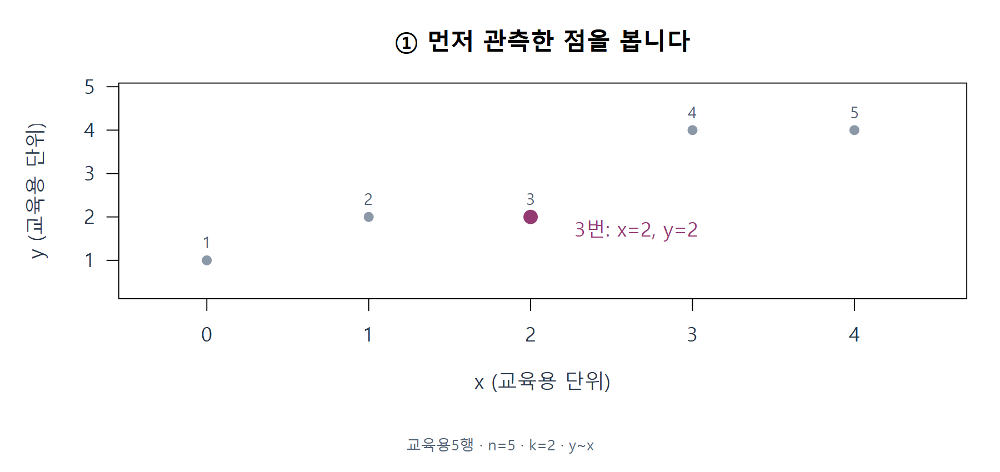
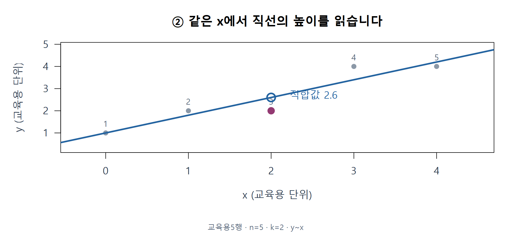
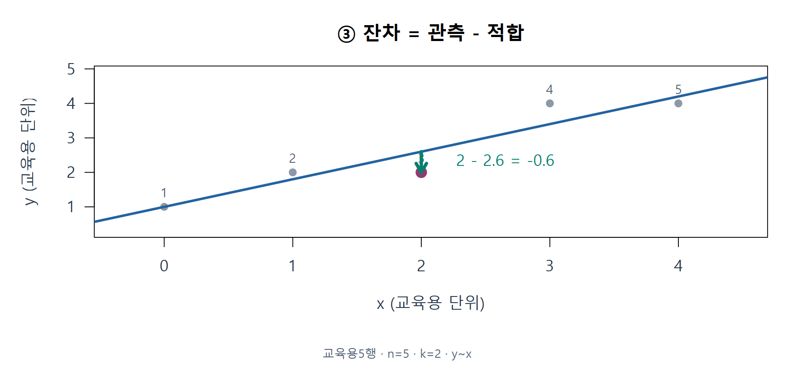
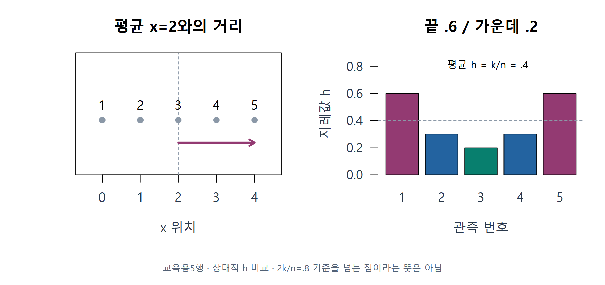

# W10B · 한 점에서 시작하는 연결 복습

회귀분석의 이해 · 2026-11-04 · W10B · 주교재 §5.8–5.15

이번에는 한 관측치를 제외하면 무엇이 달라지는지, 다른 설명변수의 선형 설명을 제거하면 어떤 좌표가 남는지 직접 확인합니다. 설명 예제 E01–E08을 읽은 뒤 다른 관측치의 L01–L06을 풀고, L07–L10으로 반복합니다.

[설치 없는 온라인 R](https://lunalab-ai.github.io/regre/w10b.html) · [코드를 편집하는 누적 앱](https://lunalab-ai.github.io/regre/apps/w10b/edit/index.html) · [R/QMD 다운로드](https://github.com/lunalab-ai/regre/tree/2026-fall-w10b/labs/student/w10b)

R Colab A는 강의 B의 **영향력**, R Colab B는 강의 C의 **변수 효과** 실습입니다. 두 편은 각각 준비 셀부터 독립 실행합니다. 이번 차시는 지난 B·C의 보강이며 제6장 §6.1–6.3은 다음으로 미룹니다. 새 성적 반영 과제나 제출 기한은 없습니다.

## E01 · 관측·예측·잔차를 한 점에서 구별하기

한 행은 관측 한 개입니다. 아래 자료는 설명을 위해 직접 만든 5행이며 실제 강이나 경주 자료가 아닙니다. x와 y는 교육용 단위입니다.

| 원래 행 | x | 관측 y |
|---|---:|---:|
| 1 | 0 | 1 |
| 2 | 1 | 2 |
| 3 | 2 | 2 |
| 4 | 3 | 4 |
| 5 | 4 | 4 |

F01 · 관측은 점 하나. W10A 연결 복습·주교재 §5.8에 근거하여 직접 계산·재구성했습니다.

이 5행에서 최소제곱으로 얻은 직선은 다음과 같습니다. 모형은 관계를 표현하는 식, 적합은 자료로 계수를 정하는 일, 적합값은 정한 식에 같은 관측의 x를 넣은 높이입니다.

$$
\hat y=1+0.8x.
$$

F02 · 직선 위의 적합값. W10A 연결 복습·주교재 §5.8에 근거하여 직접 계산·재구성했습니다.

3번의 x는 2이므로 적합값은 2.6입니다. 관측값 2에서 적합값 2.6을 빼면 잔차가 됩니다. 잔차는 알려지지 않은 참 평균에 대한 실제 오차와 구별합니다.

$$
\hat y_3=1+0.8(2)=2.6,\qquad e_3=y_3-\hat y_3=2-2.6=-0.6.
$$

F03 · 관측에서 적합을 뺀 잔차. W10A 연결 복습·주교재 §5.8에 근거하여 직접 계산·재구성했습니다.

관측점이 직선보다 아래에 있으므로 잔차가 음수입니다. 세로 거리를 그릴 때 언제나 **관측−적합** 순서를 먼저 확인하세요.

**C01 · 5번 관측의 잔차 부호를 예상하고, 직선의 어느 쪽에 있는지 설명하세요.**

## 같은 x 위치와 지레값 h

잔차는 y와 현재 적합의 차이입니다. 지레값은 다른 질문에 답합니다. **이 관측의 설명변수 위치가 다른 관측들과 비교하여 얼마나 특이한가**를 나타냅니다. 단순회귀에서는 x의 평균에서 멀수록 커집니다. 다중회귀에서는 설명변수들의 조합을 함께 봅니다.

$$
h_i=\frac1n+\frac{(x_i-\bar x)^2}{\sum_j(x_j-\bar x)^2}
\quad\text{(절편이 있는 단순회귀)}.
$$

F04 · 지레값은 X의 위치에서. W10A 연결 복습·주교재 §5.8에 근거하여 직접 계산·재구성했습니다.

이 자료의 가운데 3번은 h=0.2, 끝의 1번은 h=0.6입니다. 이는 같은 표본 안의 상대적 비교입니다. 일반적인 조사 기준 2k/n=0.8을 초과했다는 뜻은 아닙니다. k는 절편을 포함한 계수 수이므로 이 직선에서는 2입니다. h는 오류 확률이 아닙니다.

**C02 · 모든 x를 그대로 두고 y 하나만 바꾸면 h는 어떻게 될까요? 이유도 적으세요.**

## 앞으로 나오는 규모 s

전체 모형에서 남은 잔차제곱을 더한 SSE는 0.8입니다. 계수 2개를 추정했으므로 잔차 자유도는 5−2=3입니다.

$$
s=\sqrt{\frac{\mathrm{SSE}}{n-k}}=\sqrt{\frac{0.8}{3}}=0.516398.
$$

s는 y 단위의 잔차 규모 추정값입니다. 관측을 제외한 모형에서 구한 규모는 뒤에서 별도로 표시합니다. **h는 위치, e는 현재 적합과의 차이, s는 비교에 쓰는 규모**라는 세 역할을 구별하고 B로 넘어갑니다.
