# C · 같은 경주로 AV·CPR를 하나씩 만들기

회귀분석의 이해 · 2026-11-04 · W10B · 주교재 §5.8–5.15


주교재 §5.12–5.15를 ‘변수의 효과를 살피기 → 진단 뒤의 판단’ 순서로 연결합니다. 여기서 효과는 모형 안의 조건부 선형 연관이며 인과 효과를 자동으로 뜻하지 않습니다.

## 새 자료의 한 행과 단위

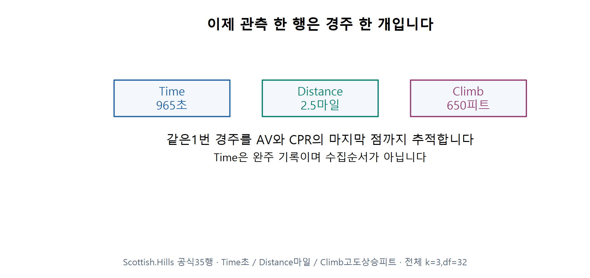

F21 · 자료와 단위 전환. 주교재 §5.13, 221–227쪽에 근거하여 직접 계산·재구성했습니다.

공식 Scottish.Hills 35경주의 첫 행은 Time=965초, Distance=2.5마일, Climb=650피트입니다. Climb은 각도 대신 고도상승량입니다. 공식 자료의 값과 단위를 유지합니다.

같은 35행의 전체모형은 다음과 같습니다. 거리 계수는 고도상승을 함께 포함했을 때의 조건부 연관을 초/마일로 읽습니다.

$$
\widehat{\mathrm{Time}}=-539.482907+373.072677\,\mathrm{Distance}
+0.662888\,\mathrm{Climb}.
$$

## E06 · AV의 첫째 뺄셈: 시간에서 Climb의 선형 설명 제거

다른 설명변수 Climb으로 Time을 예측하는 보조회귀를 구합니다. ‘보조’는 최종 전체모형을 대신하는 것이 아니라 좌표를 만들기 위한 회귀라는 뜻입니다. 절편을 포함합니다.

```r
time_from_climb <- lm(Time ~ Climb, data=hills)
```

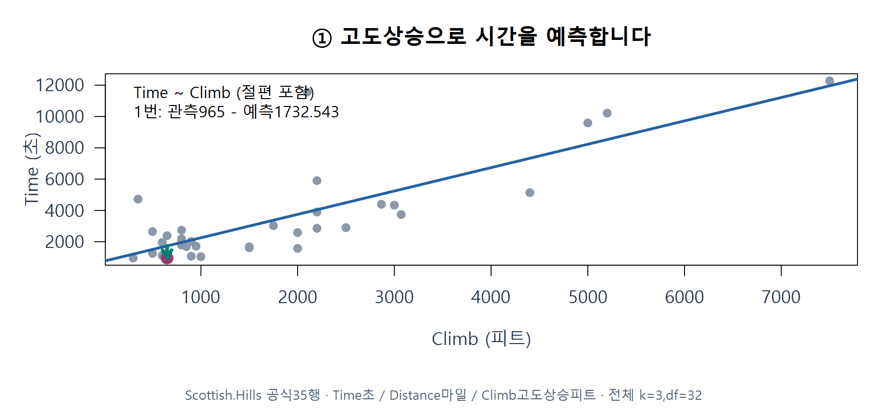

F22 · 첫 보조회귀. 주교재 §5.13, 221–227쪽에 근거하여 직접 계산·재구성했습니다.

1번의 예측 시간은 1732.542917초입니다. 실제 시간 965초에서 이를 빼면 시간 잔차가 됩니다.

$$
r_{Y,1}=965-1732.542917=-767.542917\text{초}.
$$

## 둘째 뺄셈: 거리에서도 같은 Climb의 선형 설명 제거

이제 Distance를 반응처럼 놓고 **같은 Climb, 같은 35행, 절편**으로 보조회귀합니다. 실제 경주에서 무엇이 원인인지 바꾼다는 뜻이 아니라 좌표 계산입니다.

```r
distance_from_climb <- lm(Distance ~ Climb, data=hills)
```

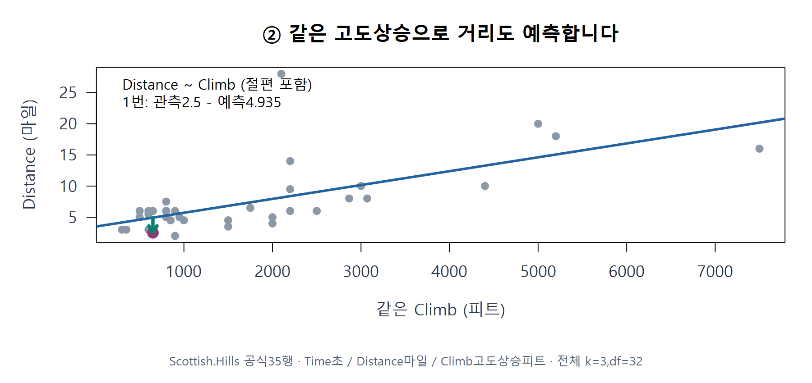

F23 · 둘째 보조회귀. 주교재 §5.13, 221–227쪽에 근거하여 직접 계산·재구성했습니다.

1번의 예측 거리는 4.935094마일입니다. 관측 거리 2.5마일에서 빼면 거리 잔차가 됩니다.

$$
r_{X,1}=2.5-4.935094=-2.435094\text{마일}.
$$

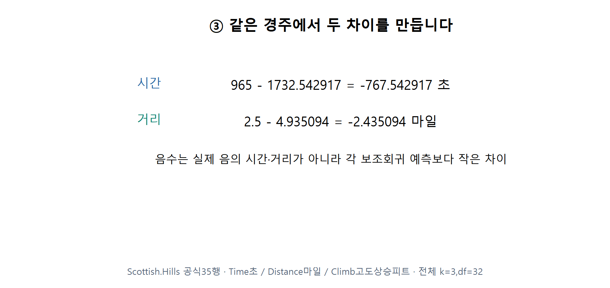

F24 · 두 개의 뺄셈. 주교재 §5.13, 221–227쪽에 근거하여 직접 계산·재구성했습니다.

**C10 · 거리 잔차가 음수인 것은 이 경주에서 실제로 음의 거리를 달렸다는 뜻인가요?**

## 두 잔차를 한 점으로 놓기

AV(첨가변수·부분회귀 플롯)의 가로는 거리 잔차, 세로는 시간 잔차입니다. 원 산점도의 Distance와 Time을 그대로 넣지 않습니다.

$$
(r_{X,1},r_{Y,1})=(-2.435094,-767.542917).
$$

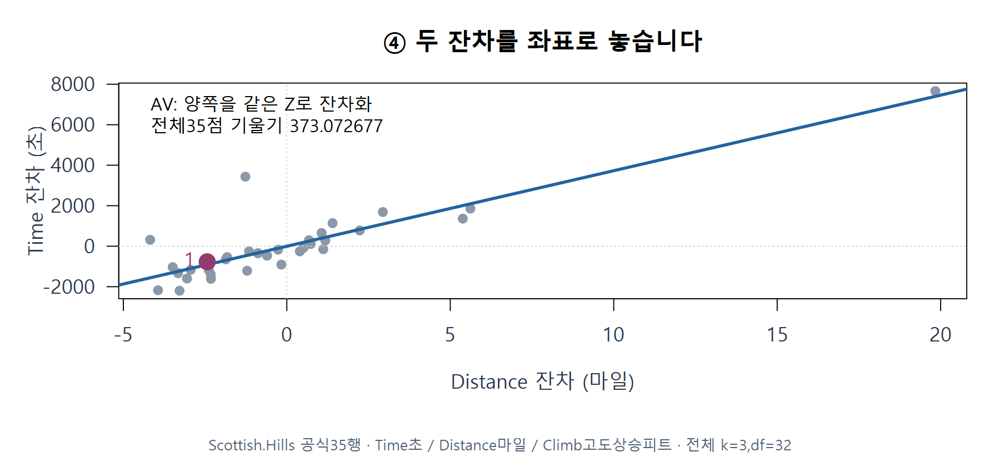

F25 · AV 점 만들기. 주교재 §5.13, 221–227쪽에 근거하여 직접 계산·재구성했습니다.

**C11 · Time에서만 Climb의 설명을 빼고 가로축에는 원래 Distance를 넣어도 같은 AV일까요?**

같은 다른 변수와 절편으로 양쪽을 잔차화하고 같은 행을 유지하면, 전체 35점에서 구한 AV의 기울기는 전체모형의 거리 계수와 같습니다.

$$
\hat\beta_{\mathrm{Distance}}
=\frac{\sum_i r_{X,i}r_{Y,i}}{\sum_i r_{X,i}^2}
=373.072677\text{초/마일}.
$$

이 식은 전체 점의 합을 사용합니다. 한 점의 세로값을 가로값으로 나누는 계산과 구별하세요.

**C12 · 1번 한 점의 세로/가로 비만으로 전체 AV 기울기를 구해도 될까요?**

## E07 · CPR의 첫 단계: 전체모형의 보통잔차

CPR(성분잔차·부분잔차 플롯)은 다른 좌표를 만듭니다. 먼저 전체모형 Time~Distance+Climb의 1번 예측 824.075979초와 관측 965초를 비교합니다.

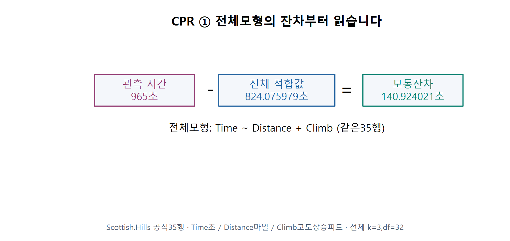

F26 · 전체모형 잔차. 주교재 §5.13, 221–227쪽에 근거하여 직접 계산·재구성했습니다.

$$
e_1=965-824.075979=140.924021\text{초}.
$$

이 잔차는 앞의 Time~Climb 보조회귀 잔차 −767.542917초와 다릅니다. 어떤 모형에서 나온 잔차인지 반드시 적습니다.

## 거리 성분을 더하고 원래 x에 놓기

거리 계수에 원래 거리 2.5를 곱한 값이 이 모형의 거리 성분입니다. 여기에 전체모형 잔차를 더합니다.

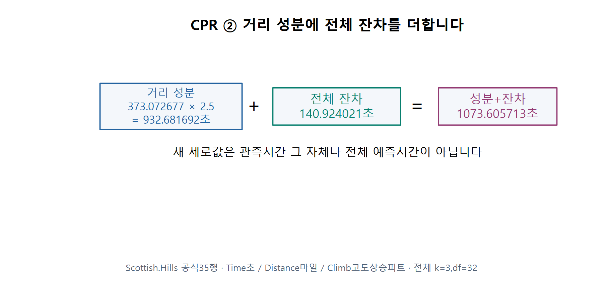

F27 · 성분과 잔차 더하기. 주교재 §5.13, 221–227쪽에 근거하여 직접 계산·재구성했습니다.

$$
\hat\beta_D D_1=373.0726769(2.5)=932.681692,
$$

$$
e_1+\hat\beta_D D_1=140.924021+932.681692=1073.605713\text{초}.
$$

CPR 가로는 원래 Distance이므로 점은 (2.5,1073.605713)입니다. 세로값은 성분과 잔차를 합친 재구성 값입니다. 관측 시간이나 전체 예측 시간으로 바꾸어 읽지 않습니다.

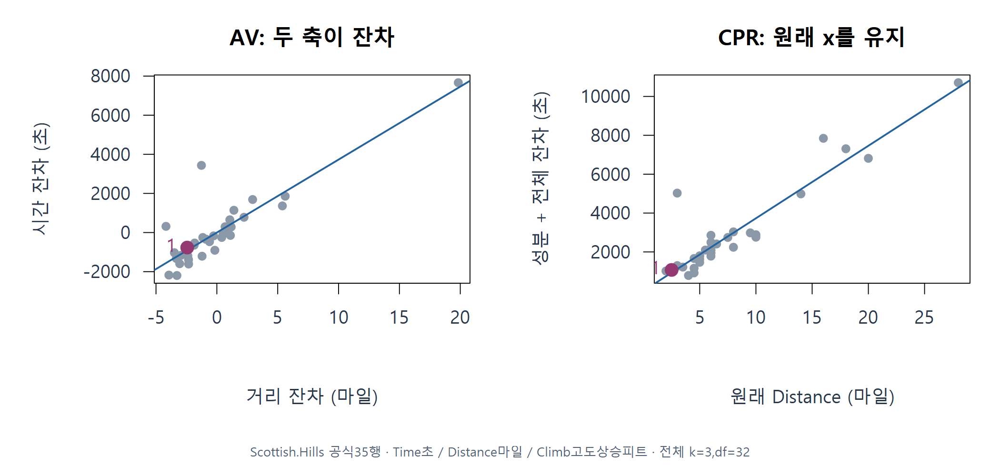

F28 · AV와 CPR의 축 비교. 주교재 §5.13, 221–227쪽에 근거하여 직접 계산·재구성했습니다.

| 그림 | 가로 | 세로 | 첫 경주의 좌표 |
|---|---|---|---|
| 원 산점도 | 원래 거리 | 관측 시간 | (2.5,965) |
| AV | 거리 보조회귀 잔차 | 시간 보조회귀 잔차 | (−2.435094,−767.542917) |
| CPR | 원래 거리 | 전체 잔차+거리 성분 | (2.5,1073.605713) |

**C13 · ‘원래 거리에서 함수 형태를 살펴보고 싶다’는 질문에 AV와 CPR의 가로축 중 어느 것이 직접 연결되나요?**

AV는 조건부 계수와 그 기울기를 형성하는 점을 읽는 데 유용합니다. CPR은 원래 설명변수의 척도에서 남은 곡선 패턴 등 모형 형태를 함께 살피는 데 유용합니다. 어느 한 그림만으로 모형의 타당성을 확정하지 않습니다.

## 변수를 추가할 때는 두 질문

같은35행에서 Distance만 넣은 기울기는 499.825262초/마일, Climb도 넣으면 373.072677초/마일입니다. 한편 새 Climb 계수의 t값은 5.387060, p값은 약 0.00000644입니다.

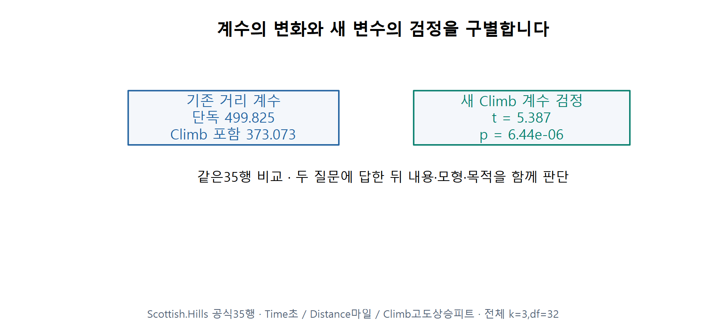

F29 · 변수 추가의 두 질문. 주교재 §5.14, 227–228쪽에 근거하여 직접 계산·재구성했습니다.

1. 새 변수의 계수에 대해 표본이 제공하는 근거는 어느 정도인가요?
2. 새 변수를 포함하면서 기존 관심 계수의 크기·해석은 얼마나 달라지나요?

첫째는 계수의 추정 불확실성을 포함하는 검정 질문이고, 둘째는 같은 자료에서 모형을 바꾼 비교입니다. 계수 차이 자체를 새 변수의 p값으로 대체하지 않습니다.

**C14 · 새 변수의 p값이 작다는 사실만으로 기존 거리 계수가 얼마나 바뀌었는지 알 수 있나요?**

§5.14의 네 경우는 아래 비교 카드로 반복합니다. ‘크다/작다’는 단위와 분석 목적에 연결하며 자동 변수선택 규칙으로 사용하지 않습니다.

| 새 변수의 근거 | 기존 계수 변화 작음 | 기존 계수 변화 큼 |
|---|---|---|
| 유의함 | 추가 설명과 비교적 안정된 기존 계수 | 추가 설명과 조건부 계수 변화 모두 살핌 |
| 유의하지 않음 | 이 표본의 추가 근거와 내용상 필요성 확인 | 불확실성·변수 관계·모형 목적을 더 확인 |

## E08 · 큰 잔차를 보았을 때의 선택

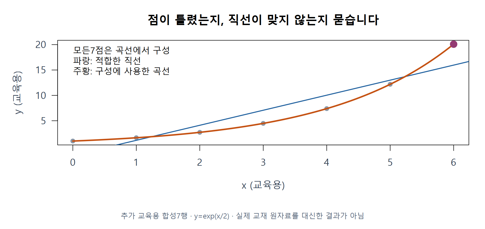

F30 · 큰 잔차와 모형 형태. 주교재 §5.12, 220–221쪽에 근거하여 직접 계산·재구성했습니다.

이 그림은 곡선에서 직접 만든 교육용7행입니다. 점들이 올바르게 기록되어 있어도 직선이 평균 관계에 맞지 않으면 큰 잔차가 생깁니다. 큰 잔차를 없애려고 유효한 관측을 기계적으로 지우지 않습니다. 실제 자료에서는 원기록·단위·자료 수집과정, 모형 형태, 제외 전후 민감도를 함께 확인합니다.

**C15 · 큰 잔차가 줄었다는 사실만으로 관측을 제외한 분석이 더 타당하다고 말할 수 있나요?**

## Huber의 역할: 잔차 기여를 완화하기

§5.15는 로버스트 회귀의 짧은 소개입니다. 아래 손실·가중치 계산은 이해를 돕는 추가 해설이며 전체 반복 추정 알고리즘은 이번 필수 실습이 아닙니다.

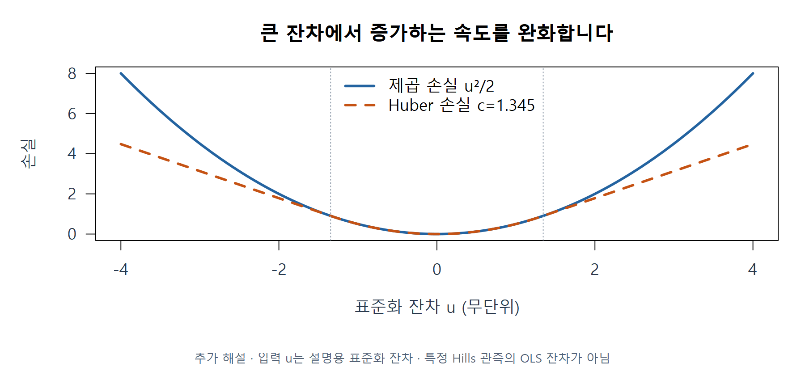

F31 · 제곱 손실과 Huber. 주교재 §5.15·MASS 공식 문서의 추가 해설에 근거하여 직접 계산·재구성했습니다.

표준화 잔차 u와 양의 기준 c에 대해 작은 잔차에는 제곱 손실을, 큰 잔차에는 완만하게 증가하는 손실을 사용합니다. Huber의 잔차 가중치는 다음과 같습니다.

$$
w(u)=\begin{cases}1,&|u|\le c,\\c/|u|,&|u|>c.\end{cases}
$$

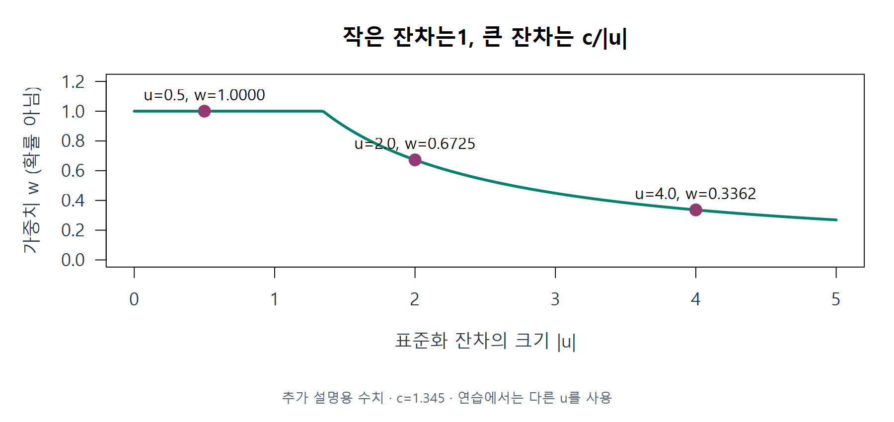

F32 · Huber 가중치 손계산. 주교재 §5.15·MASS 공식 문서의 추가 해설에 근거하여 직접 계산·재구성했습니다.

예를 들어 c=1.345, 설명용 u=(0.5,2,4)이면 가중치는 (1,0.6725,0.33625)입니다. 이는 오류일 확률이 아니라 적합에서 잔차 기여를 조정하는 수치입니다. u는 해당 로버스트 적합의 규모로 표준화한 잔차이며 OLS의 rstandard를 무조건 대신 넣지 않습니다.

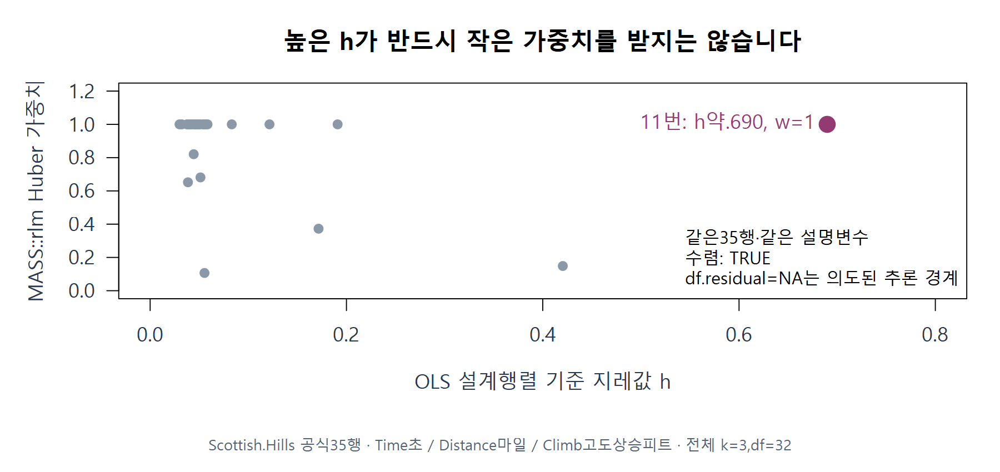

F33 · 높은 지레값의 실제 반례. 주교재 §5.15·MASS 공식 문서의 추가 해설에 근거하여 직접 계산·재구성했습니다.

같은 Hills35행의 실제 MASS::rlm 적합에서는 OLS 설계 기준 h가 약0.690인 11번이 가중치1을 받습니다. 잔차 기반 Huber M이 모든 높은 지레점을 자동 방어한다고 설명할 수 없습니다.

**C16 · MASS::rlm의 df.residual=NA가 보이면 수렴 실패인가요? 실제 수렴은 무엇으로 확인할까요?**

## 마지막에는 앱의 연결 한 곳을 직접 수정

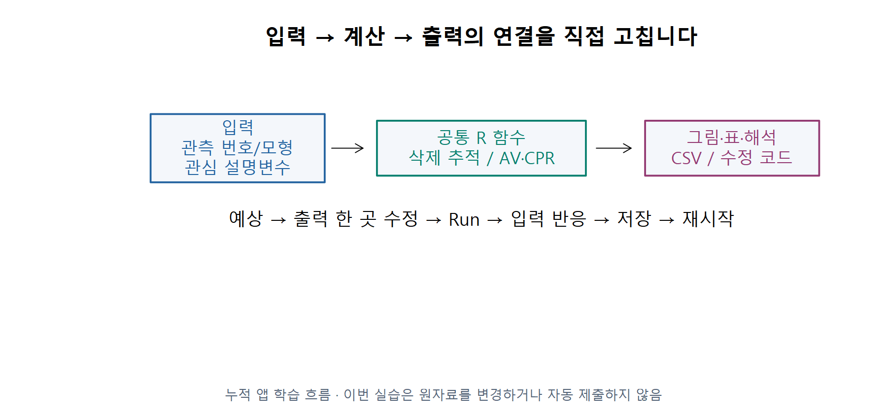

F34 · 앱의 입력과 함수와 출력. 수업용 추가 도식에 근거하여 직접 계산·재구성했습니다.

앱에서 번호를 고르면 공통 R 함수가 실제 제외 재적합을 하고 표와 그림을 바꿉니다. L06에서는 표시할 지표 필드와 제목을 바꿉니다. 예상→코드 수정→실행→입력 변경→CSV/코드 저장→재시작을 확인하세요. 이전 누적 실험실은 앱의 ‘이전 누적 기능’에서 이어 사용합니다.

[설치 없는 온라인 R](https://lunalab-ai.github.io/regre/w10b.html) · [코드를 편집하는 누적 앱](https://lunalab-ai.github.io/regre/apps/w10b/edit/index.html) · [R/QMD 다운로드](https://github.com/lunalab-ai/regre/tree/2026-fall-w10b/labs/student/w10b)

R Colab A는 강의 B의 **영향력**, R Colab B는 강의 C의 **변수 효과** 실습입니다. 두 편은 각각 준비 셀부터 독립 실행합니다. 이번 차시는 지난 B·C의 보강이며 제6장 §6.1–6.3은 다음으로 미룹니다. 새 성적 반영 과제나 제출 기한은 없습니다.

## 코드 없이 새 사례 설명하기

**X01 · 새 자료에서 한 점의 h가 다른 점보다 크지만, 제외 전후 두 직선은 거의 겹칩니다. 어떤 정보들을 구별해서 말해야 하나요?**

**X02 · 어떤 지표는 원래 모든 위치의 변화 제곱을 모으고, 다른 지표는 선택 관측 자신의 위치에서 방향을 남깁니다. 각각 무엇이며 부호를 어떻게 읽나요?**

**X03 · 다른 설명변수의 선형 관계를 제거한 거리 잔차가 −1.2마일입니다. 실제 거리와 어떻게 구별하고, 원래 거리 축에서 함수 형태를 보려면 어떤 그림을 함께 볼까요?**

## 근거와 데이터

- 주교재: Hadi·Chatterjee, 『Chatterjee 예제를 통한 회귀분석 제6판: R 활용』, 2024, §5.8–5.15. 그림은 정의·사례를 바탕으로 직접 계산·재구성했습니다.
- [저자 공식 자료 목록](https://www1.aucegypt.edu/faculty/hadi/RABE6/): NYRivers20행, Scottish.Hills35행. 교육용5행·곡선7행은 별도로 구성한 예시입니다.
- [R 삭제 진단](https://stat.ethz.ch/R-manual/R-devel/library/stats/html/influence.measures.html), [AV](https://search.r-project.org/CRAN/refmans/car/html/avPlots.html), [CPR](https://search.r-project.org/CRAN/refmans/car/html/crPlots.html), [Huber M 적합](https://stat.ethz.ch/R-manual/R-devel/library/MASS/html/rlm.html)의 공식 정의와 계산을 대조했습니다.
