# B · 한 점을 제외하면 무엇이 바뀔까

회귀분석의 이해 · 2026-11-04 · W10B · 주교재 §5.8–5.15

주교재 §5.8–5.11을 점·직선·계산표에서 시작합니다. 큰 잔차, 높은 지레값, 실제 영향력은 서로 다른 질문이며 한 관측이 여러 특징을 함께 가질 수 있습니다.

## 세 질문을 먼저 분리하기

1. **잔차:** 관측 y가 현재 적합값에서 얼마나 떨어져 있나요?
2. **지레값:** 설명변수 X의 위치가 다른 관측들과 얼마나 다른가요?
3. **영향력:** 그 관측을 제외하고 다시 적합하면 계수나 적합값이 얼마나 바뀌나요?

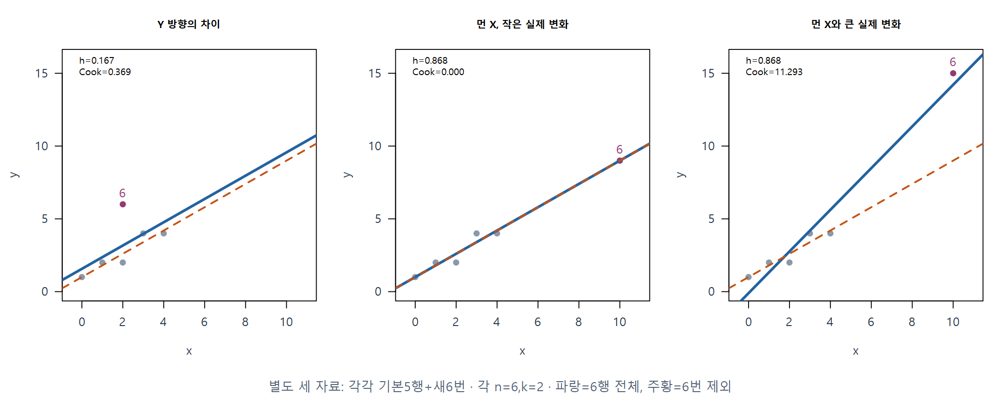

F05 · 세 질문은 서로 다릅니다. 주교재 §5.8에 근거하여 직접 계산·재구성했습니다.

이 그림의 세 패널은 각각 기본 5행에 새 6번을 더한 별도의 n=6 자료입니다. 파랑은 6행 전체, 주황은 6번을 제외한 직선입니다. 가운데 패널에서는 먼 x라도 새 점이 기존 관계 위에 있어 직선이 거의 바뀌지 않습니다. 오른쪽은 두 직선이 크게 달라집니다. 이 n=6의 지표를 아래 n=5 계산에 섞지 않습니다.

**C03 · 가운데 패널에서 h가 큰데 Cook은 거의 0인 이유를 두 직선을 가리키며 설명하세요.**

## E02 · 다시 원래 5행, 4번 제외의 실제 재적합

먼저 원래 5행과 직선을 확인합니다. 이제 선택한 관측은 4번입니다.

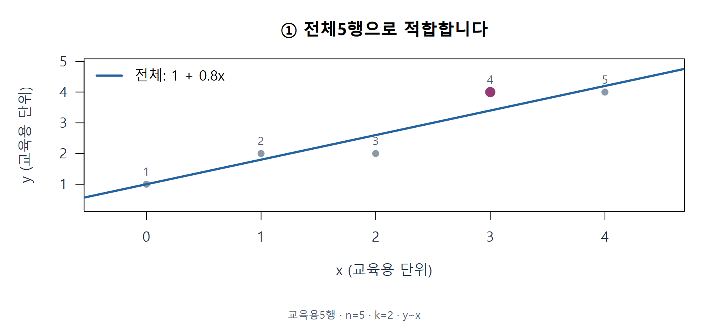

F06 · 전체 적합부터. 주교재 §5.9, 212–214쪽에 근거하여 직접 계산·재구성했습니다.

원자료는 보존하고 분석 사본에서만 4번을 제외합니다. 선택 관측을 빈 표시로 남겨 무엇을 비교하는지 기억합니다.

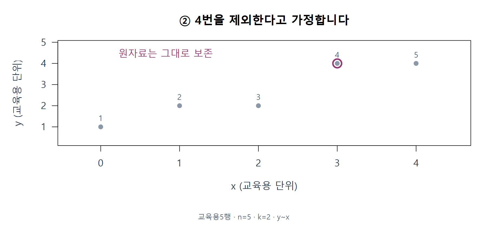

F07 · 분석 사본에서 관측 하나를 제외. 주교재 §5.9, 212–214쪽에 근거하여 직접 계산·재구성했습니다.

나머지 4행으로 계수를 새로 추정하면 절편 1, 기울기 0.714286이 됩니다. 원래 직선에서 점만 가리는 것과 실제 재적합을 구별하세요.

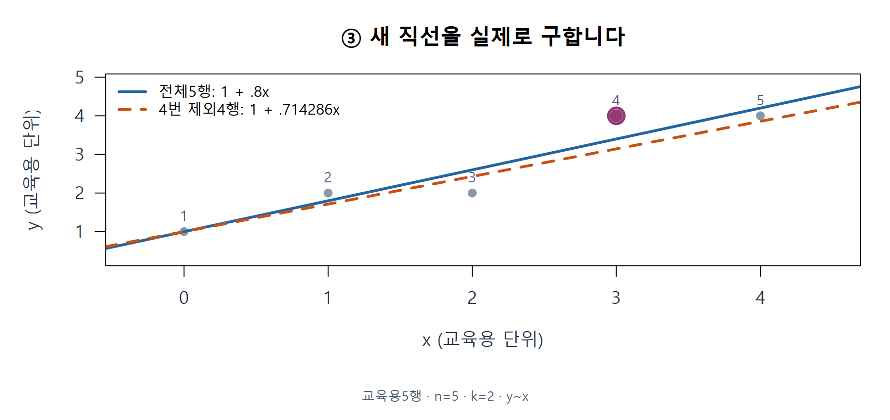

F08 · 제외 후 실제로 다시 적합. 주교재 §5.9, 212–214쪽에 근거하여 직접 계산·재구성했습니다.

| 적합 | 사용 행 수 | 계수 수 k | 잔차 자유도 | 절편 | 기울기 |
|---|---:|---:|---:|---:|---:|
| 전체 | 5 | 2 | 3 | 1 | 0.8 |
| 4번 제외 | 4 | 2 | 2 | 1 | 0.714286 |

R에서는 `lm(y ~ x, data=toy)`와 `lm(y ~ x, data=toy[-4,])`를 비교합니다. `toy[-4,]`는 제외한 사본이며 원래 toy를 덮어쓰지 않습니다. 전체 적합과 제외 적합은 사용하는 행 수와 잔차 규모가 달라집니다.

## E03 · Cook은 모든 원래 위치의 변화를 모으기

4번을 제외했어도 새 직선은 전체 x 구간에서 달라집니다. 따라서 **원래 5개 위치 모두**에 두 직선을 적용합니다. 제외한 4번 위치의 새 예측도 비교에 포함합니다.

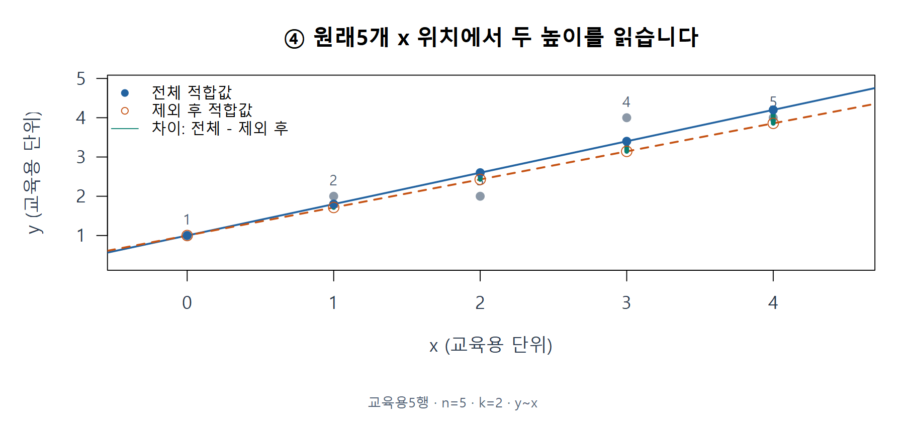

F09 · 원래 모든 위치에 두 예측. 주교재 §5.9, 212–214쪽에 근거하여 직접 계산·재구성했습니다.

| 원래 위치 $j$ | 전체 적합값 | 4번 제외 후 | 차이 $\Delta_j$ | 차이 제곱 |
|---|---:|---:|---:|---:|
| 1 | 1.000000 | 1.000000 | 0.000000 | 0.000000 |
| 2 | 1.800000 | 1.714286 | 0.085714 | 0.007347 |
| 3 | 2.600000 | 2.428571 | 0.171429 | 0.029388 |
| 4 | 3.400000 | 3.142857 | 0.257143 | 0.066122 |
| 5 | 4.200000 | 3.857143 | 0.342857 | 0.117551 |

**C04 · 4번을 제외하는데 왜 원래 1번부터 5번 위치의 예측을 모두 비교할까요?**

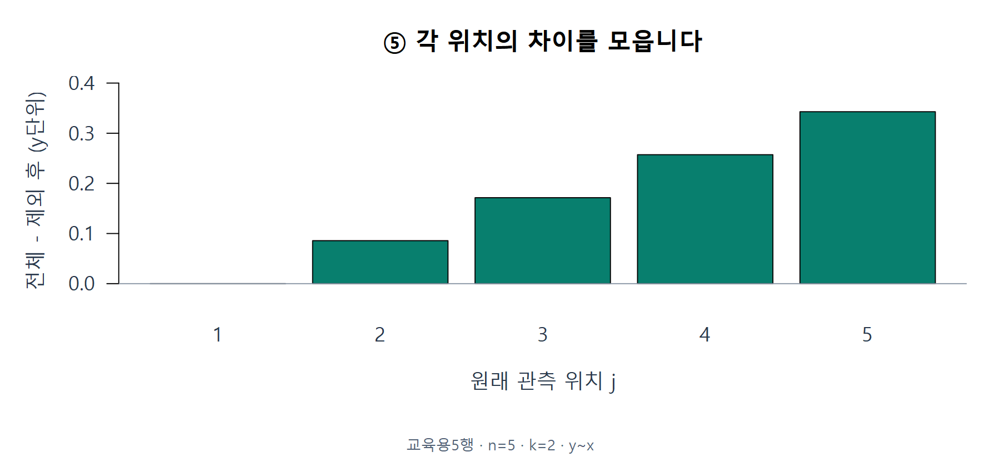

F10 · 변화 벡터. 주교재 §5.9, 212–214쪽에 근거하여 직접 계산·재구성했습니다.

각 차이를 제곱하면 방향이 사라지고 크기를 모을 수 있습니다. 양수·음수 변화가 단순 합에서 상쇄되는 문제도 피합니다.

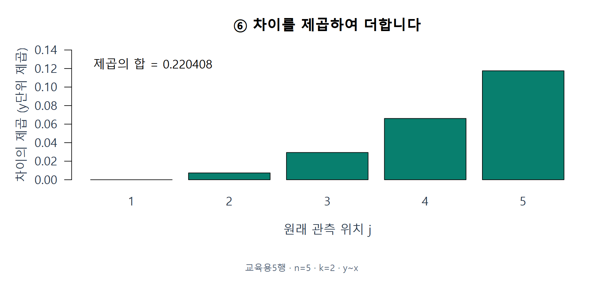

F11 · 변화의 제곱. 주교재 §5.9, 212–214쪽에 근거하여 직접 계산·재구성했습니다.

**C05 · 차이의 제곱합이 0이라면 두 적합의 예측은 원래 관측 위치에서 어떤 관계인가요?**

이 예제의 제곱합은 0.220408입니다. 이를 전체 적합의 s²와 계수 수 k로 규모화한 값이 Cook의 거리입니다. k는 관측 수 n이 아닙니다.

$$
\Delta_j^{(i)}=\hat y_j-\hat y_{j(i)},\qquad
C_i=\frac{\sum_{j=1}^{n}(\Delta_j^{(i)})^2}{k s^2}.
$$

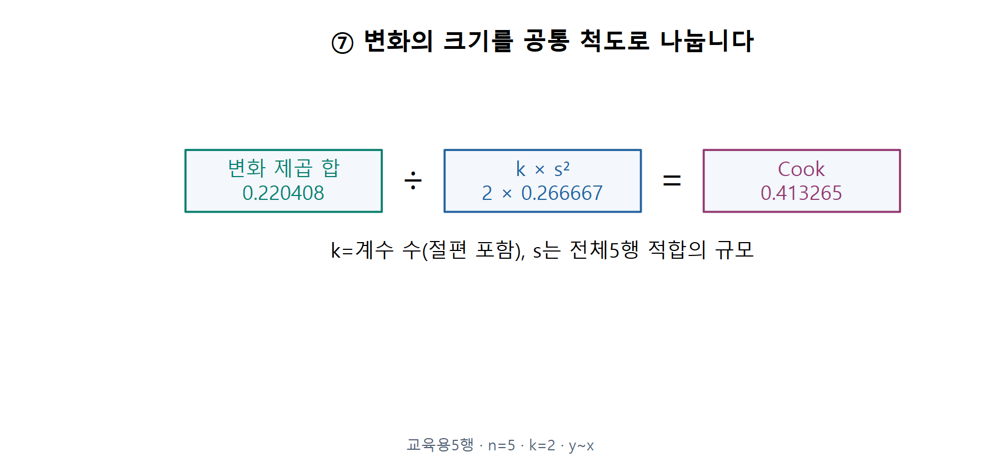

F12 · Cook의 규모화. 주교재 §5.9, 212–214쪽에 근거하여 직접 계산·재구성했습니다.

$$
C_4=\frac{0.2204081633}{2(0.8/3)}=0.4132653061.
$$

이제 짧은 계산식도 연결할 수 있습니다. r은 전체 s로 나눈 내적 표준화잔차입니다. 기호가 먼저 나오지 않도록 위의 두 예측과 표를 다시 가리켜 보세요.

$$
r_i=\frac{e_i}{s\sqrt{1-h_i}},\qquad
C_i=\frac{r_i^2}{k}\frac{h_i}{1-h_i}.
$$

## E04 · DFFITS는 자기 위치와 방향을 읽기

Cook이 원래 모든 위치를 모았다면 DFFITS는 i번째 **자기 위치의 적합값 차이**를 표준화합니다.

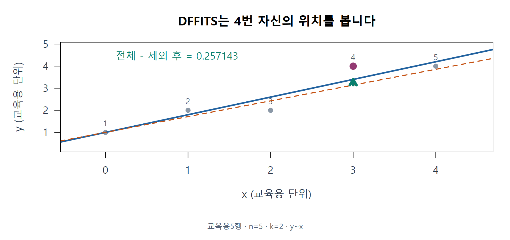

F13 · DFFITS의 평가 위치. 주교재 §5.9, 212–214쪽에 근거하여 직접 계산·재구성했습니다.

분자의 순서는 전체−제외 후입니다. 분모의 h는 원래 전체 모형의 지레값이며, s의 아래 (i)는 i번을 제외하고 다시 구한 잔차 규모를 뜻합니다.

$$
\mathrm{DFFITS}_i=\frac{\hat y_i-\hat y_{i(i)}}{s_{(i)}\sqrt{h_i}}
=r_i^*\sqrt{\frac{h_i}{1-h_i}},\qquad
r_i^*=\frac{e_i}{s_{(i)}\sqrt{1-h_i}}.
$$

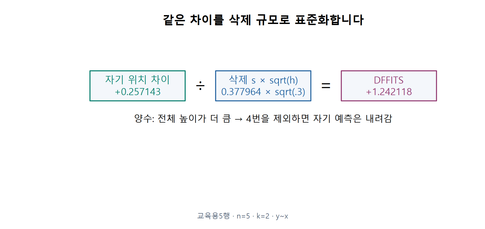

F14 · DFFITS의 부호와 삭제 규모. 주교재 §5.9, 212–214쪽에 근거하여 직접 계산·재구성했습니다.

4번 제외 모형의 SSE는 0.285714286, 잔차 자유도는 2입니다. 따라서 삭제 규모는 0.377964이고 DFFITS는 +1.242118입니다. 양수는 전체 적합값이 제외 후보다 높다는 뜻입니다. 이 경우 4번을 제외하면 자기 위치의 예측은 내려갑니다.

**C06 · DFFITS가 음수이면 관측을 제외한 뒤 자기 위치의 예측이 내려간 것일까요? 분자 순서로 설명하세요.**

## E05 · 교재 NYRivers로 같은 질문 적용하기

이제 공식 강 자료 20행으로 옮깁니다. Nitrogen은 원자료 척도, ComIndl은 상공업 용지비율(%)입니다. 이번 그림의 모형은 `Nitrogen ~ ComIndl`, n=20, k=2입니다. 질소의 물리단위는 확인되지 않은 단위를 붙이지 않습니다.

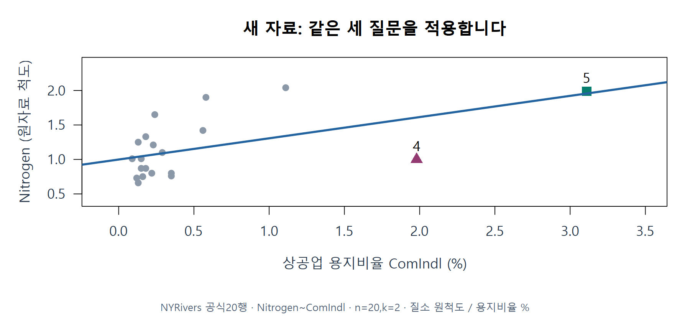

F15 · 교재 자료로 옮겨 보기. 주교재 §5.8–5.11, 206–219쪽에 근거하여 직접 계산·재구성했습니다.

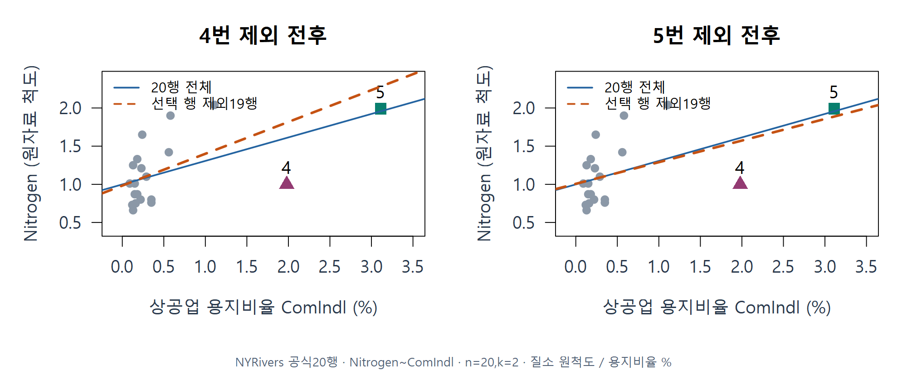

F16 · NY 관측 제외 비교. 주교재 §5.8–5.11, 206–219쪽에 근거하여 직접 계산·재구성했습니다.

**C07 · ‘한 관측을 제외했다’는 사실만 보고 원래 자료에서 지워도 된다고 판단할 수 있나요? 추가로 무엇을 확인할까요?**

잠재성 P는 지레값을 변환한 양입니다. 분모 1−h가 작아질수록 커집니다. 확률이 아닙니다.

$$
P_i=\frac{h_i}{1-h_i}.
$$

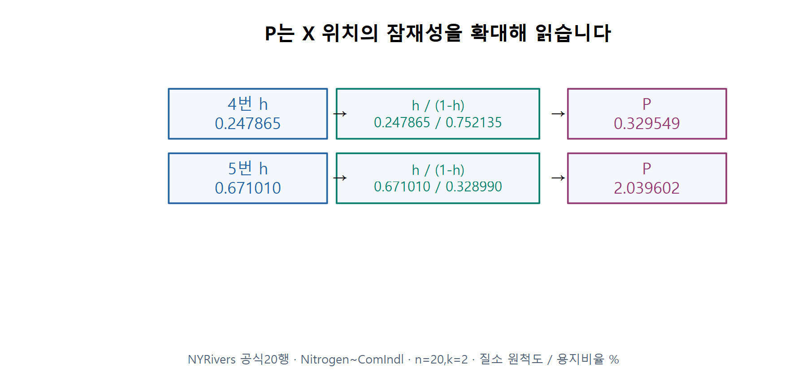

F17 · 잠재성 P 만들기. 주교재 §5.8–5.11, 206–219쪽에 근거하여 직접 계산·재구성했습니다.

Hadi의 잔차 성분 R은 보통잔차의 부호를 쓰지 않습니다. 먼저 전체 잔차제곱합 중 해당 잔차제곱의 몫 d²를 구한 뒤 다음 식에 넣습니다. 대문자 R은 여기서 진단 성분의 이름이며 R 언어와 구별합니다.

$$
d_i^2=\frac{e_i^2}{\mathrm{SSE}},\qquad
R_i=\frac{k}{1-h_i}\frac{d_i^2}{1-d_i^2},\qquad H_i=P_i+R_i.
$$

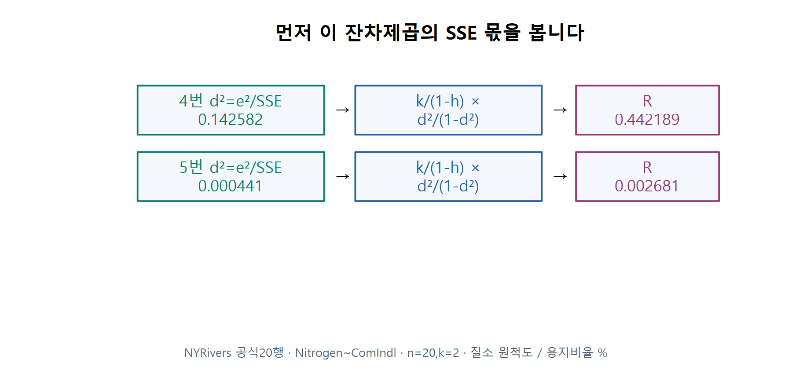

F18 · 잔차 성분 R 만들기. 주교재 §5.8–5.11, 206–219쪽에 근거하여 직접 계산·재구성했습니다.

가로에는 R, 세로에는 P를 놓습니다. 이는 기본 R의 잔차 대 지레값 그림과 축·정의가 다른 잠재성–잔차플롯입니다.

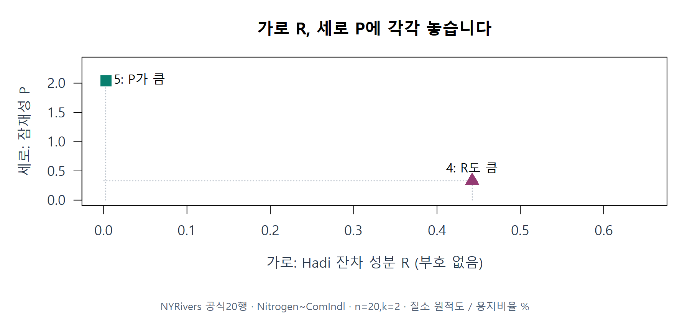

F19 · P-R 좌표 두 점. 주교재 §5.8–5.11, 206–219쪽에 근거하여 직접 계산·재구성했습니다.

| 강 번호 | h | Cook | DFFITS | P | R | Hadi |
|---|---:|---:|---:|---:|---:|---:|
| 4 | 0.247865 | 0.562255 | -1.144754 | 0.329549 | 0.442189 | 0.771738 |
| 5 | 0.671010 | 0.024593 | 0.215674 | 2.039602 | 0.002681 | 2.042283 |

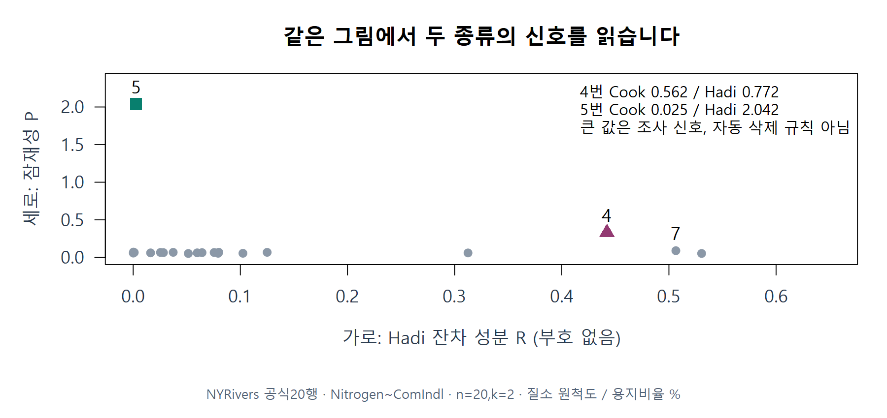

F20 · 전체 P-R와 지표 비교. 주교재 §5.8–5.11, 206–219쪽에 근거하여 직접 계산·재구성했습니다.

5번은 P가 매우 크지만 Cook은 작습니다. 4번과 비교하여 각 지표가 어떤 정보를 모으는지 읽으세요. 서로 다른 지표의 순위가 다르다는 사실만으로 하나가 잘못됐다고 판단하지 않습니다.

**C08 · 이 P–R 좌표만으로 원래 잔차가 양수인지 음수인지 알 수 있나요?**

## 가면·수렁과 조사 기준

가면(masking)은 특이 관측을 놓치는 현상, 수렁(swamping)은 정상 관측을 특이하다고 잘못 지목하는 현상입니다. 다른 관측이 직선을 끌어당기면 이런 일이 생길 수 있습니다. 한 관측씩 제외하는 비교만으로 여러 관측의 공동 영향을 모두 찾았다고 하지 않습니다.

평균 지레값은 k/n이고 2k/n은 조사에 사용하는 경험적 기준 중 하나입니다. NY 단순모형에서는 0.2입니다. Cook의 1, DFFITS의 아래 기준도 조사 신호로 읽습니다. 절댓값이 기준보다 작아도 다른 점보다 두드러진 변화는 살펴볼 수 있습니다.

$$
2\sqrt{\frac{k}{n-k}}=2\sqrt{\frac2{18}}=\frac23.
$$

검산 메모: 주교재 215쪽의 인쇄 수치 2.3은 제시식·코드에 n=20,k=2를 넣은 2/3과 일치하지 않습니다. 위에서는 직접 대입한 값을 사용합니다. 이 메모는 공식 정오표라고 확인한 내용이 아닙니다.

## 교재의 네 변수 모형은 따로 읽기

§5.8의 원 사례에는 `Nitrogen ~ Agr + Forest + Rsdntial + ComIndl`도 있습니다. 이 모형은 k=5입니다. 다음은 같은 공식 자료를 사용한 Rsdntial 계수의 t값 재계산입니다. 단순모형의 위 지표와 섞지 않습니다.

| 사용 자료 | n | k | Rsdntial 계수의 t값 |
|---|---:|---:|---:|
| 전체 | 20 | 5 | -0.214 |
| 4번 제외 | 19 | 5 | -3.147 |
| 5번 제외 | 19 | 5 | 4.081 |

**C09 · 단순모형과 네 변수 모형의 진단표를 비교하기 전에 n·k·모형식 중 무엇을 확인해야 하나요?**

## §5.11의 R 함수 연결

| 읽을 양 | R 함수 또는 공통 함수 |
|---|---|
| 보통잔차·지레값 | `residuals(fit)`, `hatvalues(fit)` |
| 내적·외적 표준화잔차 | `rstandard(fit)`, `rstudent(fit)` |
| Cook·DFFITS | `cooks.distance(fit)`, `dffits(fit)` |
| Hadi의 P·R·H | `diag_influence(fit)` |
| 실제 제외 재적합과 모든 위치 예측 | `w10b_deletion_trace(fit, row)` |

함수는 계산 도구입니다. 결과를 보기 전에 대상 모형, 같은 행, 계수 수, 분자와 분모의 의미를 먼저 확인합니다. h=1·제외 후 계수 추정 불가능·삭제 분산 0 등은 정의 불가 상태로 보고하며 0으로 바꾸지 않습니다.
