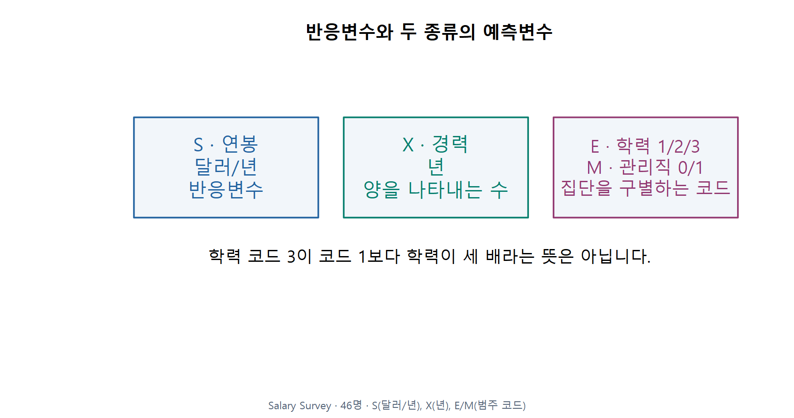
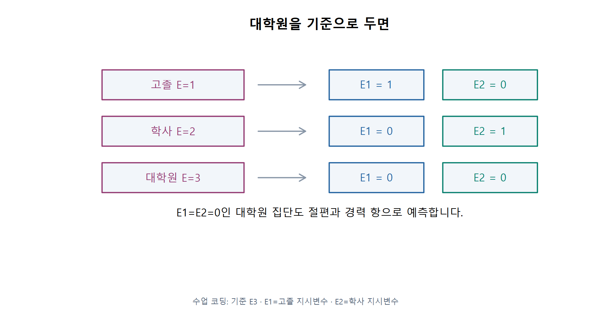
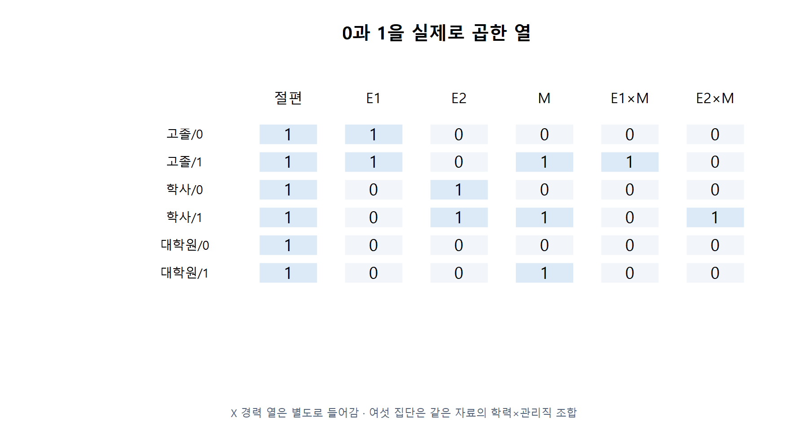
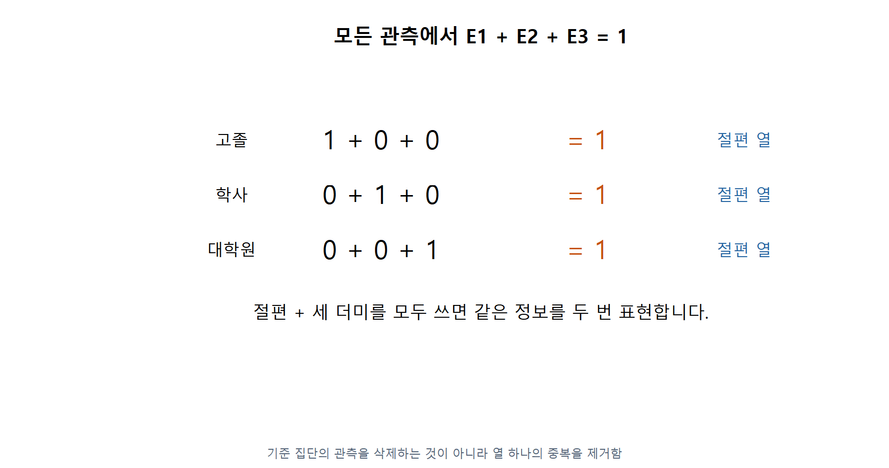

# 1 · 범주의 이름을 회귀식에 넣는 방법

회귀분석의 이해 · W11A · 2026-11-09 · 주교재 §6.1–6.2

[설치 없는 온라인 R](https://lunalab-ai.github.io/regre/w11a.html) · [수정하는 회귀 앱](https://lunalab-ai.github.io/regre/apps/w11a/edit/index.html) · [R/QMD 다운로드](https://github.com/lunalab-ai/regre/tree/2026-fall-w11a/labs/student/w11a)

[R Colab A · 지시변수와 급료조사](https://colab.research.google.com/github/lunalab-ai/regre/blob/2026-fall-w11a/notebooks/student/w11a_categorical.ipynb) · [R Colab B · 두 집단과 부분 F](https://colab.research.google.com/github/lunalab-ai/regre/blob/2026-fall-w11a/notebooks/student/w11a_groups.ipynb)

예상과 이유 → 작은 손계산 → R 실행 → 그림 비교 → 한 문장 설명 순서로 사용합니다. A/B는 각각 준비부터 독립 실행합니다. 새 성적 반영 과제나 제출 기한은 없습니다.

## 먼저 구별할 세 가지

한 행은 한 사람입니다. 반응변수는 설명하려는 연봉 S, 예측변수는 경력 X·학력 E·관리직 여부 M입니다. 연봉은 달러/년, 경력은 년입니다. 학력의 1·2·3과 관리직의 0·1은 **집단을 구별하는 코드**입니다.

F01 · §6.1–6.2, 242–244쪽에 근거해 직접 계산·재구성했습니다. Salary Survey · 46명 · S(달러/년), X(년), E/M(범주 코드).

경력 6년은 3년보다 3년 많습니다. 반면 학력 코드 3이 1보다 학력이 세 배라는 뜻은 아닙니다. E를 숫자 한 열로 그대로 넣으면 코드가 한 단계 커질 때마다 같은 연봉 차이가 난다는 제약을 의도하지 않게 넣습니다.

**C01 · E=1·2·3을 숫자 한 열로 넣으면 어떤 관계를 강제로 가정하게 될까요?**

## E01 · 학사 한 사람을 0과 1로 바꾸기

이 수업에서는 대학원(E=3)을 **기준범주**로 둡니다. 기준범주는 다른 집단의 차이를 설명하는 출발점입니다. 학력은 고졸(E=1), 학사(E=2), 대학원(E=3)입니다.

$$
E_1=\begin{cases}1&\text{고졸}\\0&\text{그 외}\end{cases},\qquad
E_2=\begin{cases}1&\text{학사}\\0&\text{그 외}\end{cases}.
$$

지시변수는 조건에 맞으면 1, 아니면 0인 열입니다. 더미변수라고도 부릅니다. 학사라면 E1=0, E2=1입니다. 관리직이면 M=1을 별도로 붙입니다. **곱항을 만들기 전에 두 열의 값을 먼저 확인합니다.**

F02 · §6.1–6.2, 243–245쪽에 근거해 직접 계산·재구성했습니다. 수업 코딩: 기준 E3 · E1=고졸 지시변수 · E2=학사 지시변수.

| 사람의 조건 | E1 | E2 | M | E1×M | E2×M |
|---|---:|---:|---:|---:|---:|
| 학사·관리직 | 0 | 1 | 1 | 0 | 1 |

곱항 E2×M은 학사이면서 관리직일 때만 1입니다. 관리직이라는 이유만으로 모든 학력 곱항이 1이 되지는 않습니다.

F03 · §6.2–6.3, 244–249쪽에 근거해 직접 계산·재구성했습니다. X 경력 열은 별도로 들어감 · 여섯 집단은 같은 자료의 학력×관리직 조합.

**C02 · 대학원·비관리직이면 E1=E2=M=0입니다. 그렇다고 예측 연봉이 0이 될까요?**

## 왜 학력 세 집단에 더미는 두 개일까

절편은 모든 행에 1인 열에 곱하는 계수입니다. 세 집단의 지시변수를 모두 만들면 매 행에서 합이 1이므로 그 합이 절편 열과 같습니다.

$$
E_1+E_2+E_3=1.
$$

F04 · §6.2, 244–245쪽에 근거해 직접 계산·재구성했습니다. 기준 집단의 관측을 삭제하는 것이 아니라 열 하나의 중복을 제거함.

절편과 세 학력 더미를 모두 넣으면 계수의 여러 조합이 같은 예측을 만듭니다. 따라서 절편을 포함한 일반적인 기준범주 코딩에서는 **집단 수−1개의 더미**를 사용합니다. 대학원 사람을 삭제하는 것이 아닙니다. 그 사람의 기준 높이를 절편이 담당합니다.

**C03 · 세 학력 더미 중 하나를 빼는 것과 그 학력 사람을 자료에서 빼는 것은 어떻게 다를까요?**

## 회귀식 읽는 법

가법모형은 각 항의 기여를 더합니다. 아래는 관측 연봉의 모형입니다. 오차는 개별 관측이 평균 관계에서 벗어나는 부분이며, 적합 후의 잔차는 관측−적합값입니다.

$$
S_i=\beta_0+\beta_X X_i+\beta_1E_{1i}+\beta_2E_{2i}+\beta_M M_i+\varepsilon_i.
$$

평균 연봉을 예측할 때에는 추정 계수를 넣고 오차항을 더하지 않습니다. 절편은 **경력0년·대학원·비관리직에서 모형이 정한 기준 높이**입니다. 이 자료의 경력은1–20년이므로 경력0년은 실제 관측 범위 밖입니다.

먼저 말로 집단을 적고, 해당 열에 0/1을 넣고, 살아남는 항만 더하세요. 다음 절에서는 이 순서로 실제 한 사람을 계산합니다.
