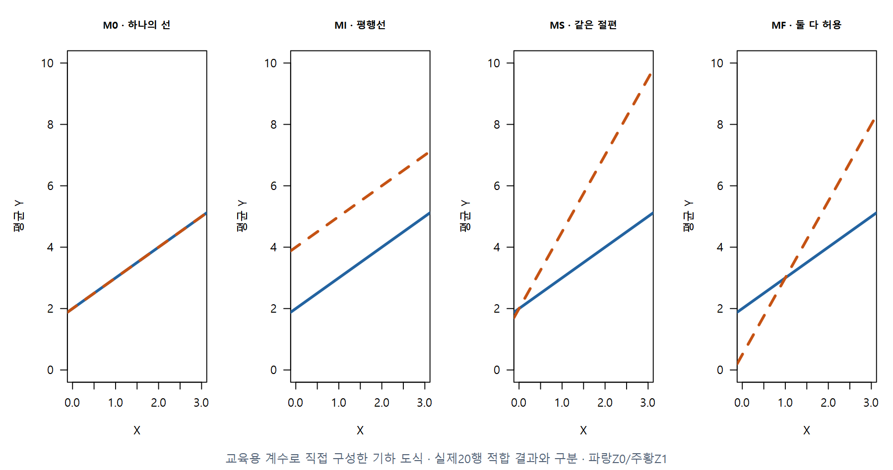
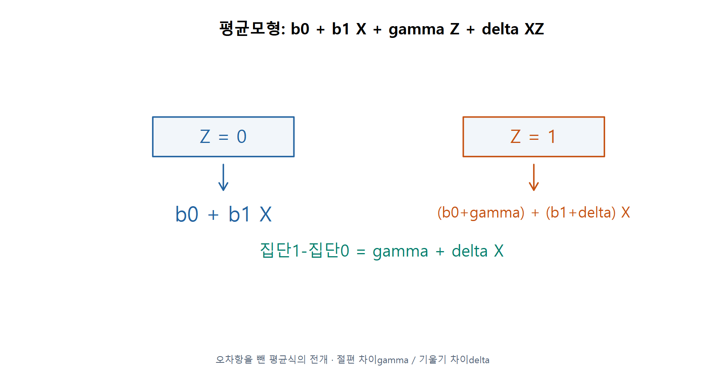
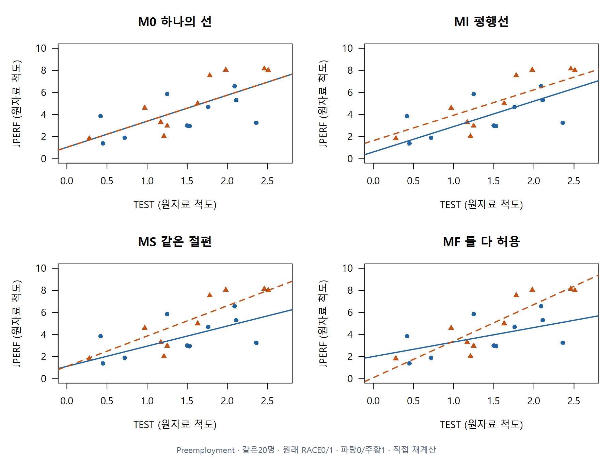
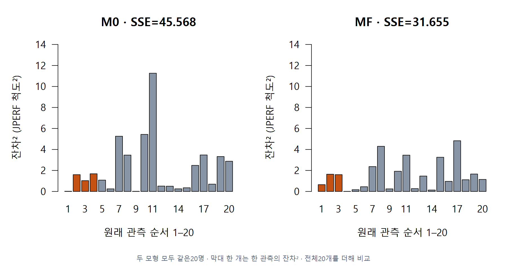
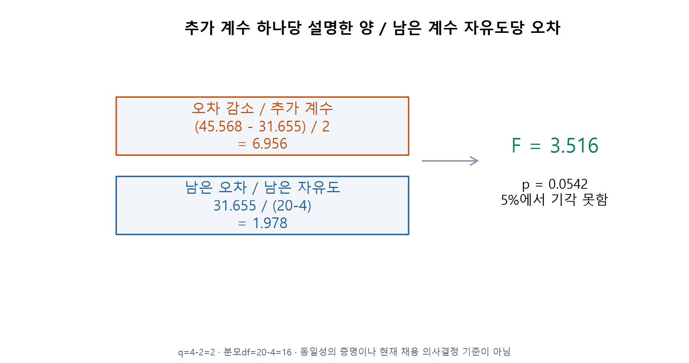
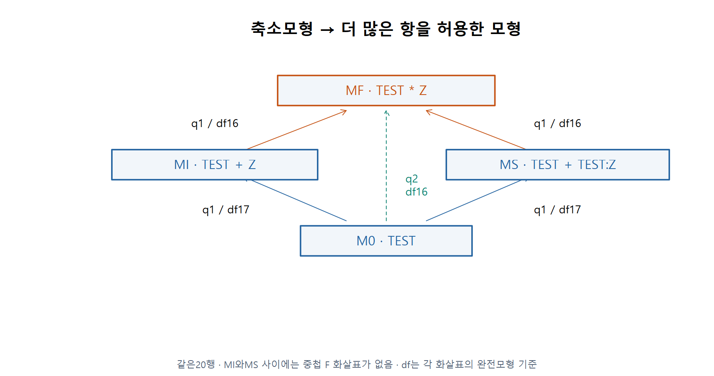
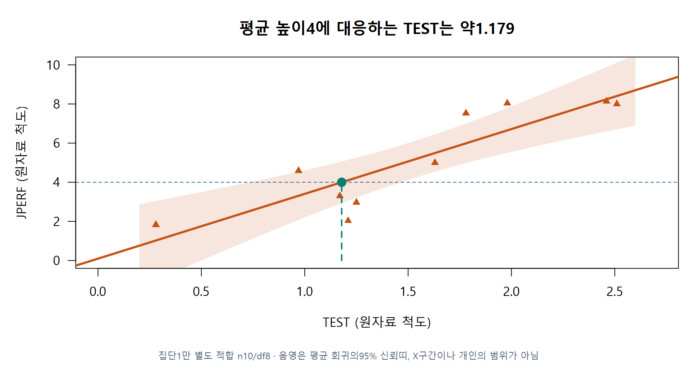
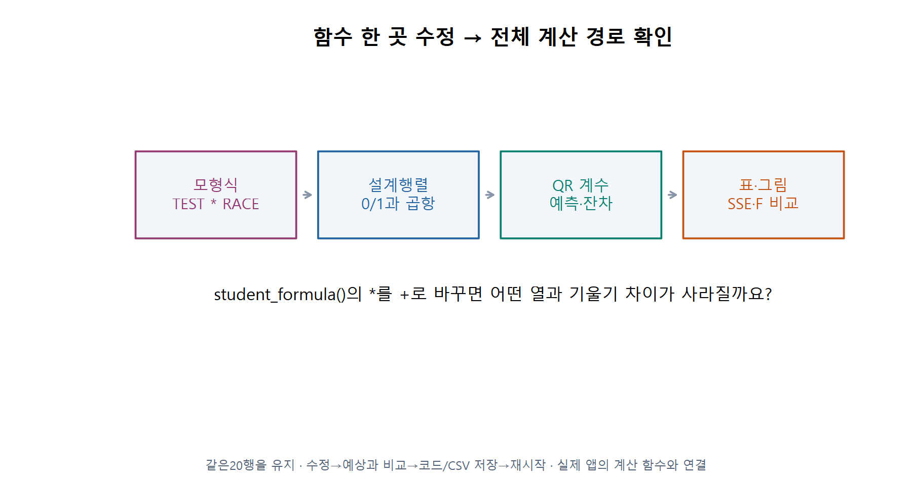

# 3 · 두 집단의 회귀선을 식·그림·검정으로 연결하기

회귀분석의 이해 · W11A · 주교재 §6.4.1–6.4.3

## 자료와 질문을 새로 확인하기

이제 급료조사에서 Preemployment 공식20명으로 바뀝니다. X는 검사점수 TEST, Y는 업무수행점수 JPERF, Z는 원자료의 RACE0/1입니다. 점수는 원자료 척도이며 물리 단위를 임의로 붙이지 않습니다. 교재의 역사적 사례에서0은 백인,1은 소수민족 집단을 뜻합니다. 그림에는 집단0/1을 사용하고 원래 코딩과 맥락을 보존합니다.

묻는 것은 **두 집단에서 TEST와 평균 JPERF의 관계를 같은 직선으로 설명할 수 있는가**입니다. 이 관찰자료만으로 집단의 인과 효과나 개별 채용 결정을 내리지는 않습니다.

F11 · §6.4, 253–266쪽에 근거해 직접 계산·재구성했습니다. 교육용 계수로 직접 구성한 기하 도식 · 실제20행 적합 결과와 구분 · 파랑Z0/주황Z1.

## E05 · Z=0과1을 직접 넣어 두 직선 만들기

절편과 기울기 차이를 모두 허용하는 완전모형은 다음과 같습니다. gamma는 절편 차이, delta는 기울기 차이입니다. 차이가 반드시 존재한다고 미리 확정하는 것이 아닙니다.

$$
Y_i=\beta_0+\beta_1X_i+\gamma Z_i+\delta X_iZ_i+\varepsilon_i.
$$

F12 · §6.4.1, 식6.4·256–257쪽에 근거해 직접 계산·재구성했습니다. 오차항을 뺀 평균식의 전개 · 절편 차이gamma / 기울기 차이delta.

$$
\begin{aligned}
Z=0:\quad&E(Y\mid X,Z=0)=\beta_0+\beta_1X,\\
Z=1:\quad&E(Y\mid X,Z=1)=(\beta_0+\gamma)+(\beta_1+\delta)X.
\end{aligned}
$$

공식20명으로 추정하면 $\widehat\beta_0\approx2.010282$, $\widehat\beta_1\approx1.313402$, $\widehat\gamma\approx-1.913167$, $\widehat\delta\approx1.997546$입니다. 따라서 집단0의 선은 $2.010282+1.313402X$, 집단1의 선은 $0.097115+3.310948X$입니다.

X=1.5이면 집단0의 예측은약3.980386, 집단1은약5.063537입니다. 두 평균의 차이는약1.083152이며 다음처럼 한 번에 계산할 수도 있습니다.

$$
\widehat Y_1-\widehat Y_0=\widehat\gamma+\widehat\delta X
=-1.913167+1.997546(1.5)\approx1.083152.
$$

**C08 · gamma만으로 두 집단의 모든 X에서의 차이를 설명할 수 있을까요?**

## 네 모형에서 같은20명을 비교하기

| 이름 | R의 평균모형 식 | 두 선의 제약 |
|---|---|---|
| M0 | `JPERF ~ TEST` | 하나의 절편·하나의 기울기 |
| MI | `JPERF ~ TEST + RACE` | 기울기 공통, 절편 차이 허용 |
| MS | `JPERF ~ TEST + TEST:RACE` | X=0에서 절편 공통, 기울기 차이 허용 |
| MF | `JPERF ~ TEST * RACE` | 절편·기울기 차이 모두 허용 |

공식에서 `TEST*RACE`는 `TEST+RACE+TEST:RACE`를 뜻합니다. `TEST:RACE`는 두 열의 곱항입니다. 일반적인 상호작용 모형에서는 주효과도 포함합니다. 여기서 MS는 **같은 절편이라는 명시적 제약**을 연구하기 위해 교재가 따로 둔 경우입니다.

F13 · §6.4, 표6.6–6.9·256–266쪽에 근거해 직접 계산·재구성했습니다. Preemployment · 같은20명 · 원래 RACE0/1 · 파랑0/주황1 · 직접 재계산.

**C09 · MS는 어디에서 두 집단의 평균이 같도록 제한하나요? X=1.5에서도 같아야 하나요?**

## E06 · 부분 F를 한 단계씩 계산하기

우선6.4.1의 M0 대 MF를 봅니다. 귀무가설은 gamma=delta=0입니다. 즉 두 추가 차이가 모두0인 하나의 회귀선으로 충분한지 묻습니다. **같은 반응값·같은20명·중첩된 모형**이어야 합니다.

각 모형에서 관측−적합으로 잔차를 구하고 제곱한 뒤20개를 합합니다.

$$
e_i=y_i-\widehat y_i,\qquad \mathrm{SSE}=\sum_{i=1}^{20}e_i^2.
$$

F14 · §6.4.1, 257–259쪽에 근거해 직접 계산·재구성했습니다. 두 모형 모두 같은20명 · 막대 한 개는 한 관측의 잔차² · 전체20개를 더해 비교.

M0의 SSE는45.568297, MF는31.655473입니다. 유연한 MF는 계수를 더 써서 오차를 줄일 수 있으므로, 감소량만 보고 결론 내리지 않습니다. 계수를 몇 개 더 썼는지와 남은 오차 규모를 함께 봅니다.

1. M0의 계수는 절편·기울기2개, MF는 절편·기울기·집단·곱항4개입니다.
2. 추가 계수 수는 q=4−2=2입니다.
3. MF의 잔차 자유도는20−4=16입니다.
4. 오차 감소를2로 나누고, 남은 오차를16으로 나눈 값과 비교합니다.

$$
F=\frac{(\mathrm{SSE}_{R}-\mathrm{SSE}_{F})/q}{\mathrm{SSE}_{F}/(n-k_F)}
=\frac{(45.568297-31.655473)/2}{31.655473/16}\approx3.516061.
$$

F15 · §6.4.1, 식6.5·257–259쪽에 근거해 직접 계산·재구성했습니다. q=4-2=2 · 분모df=20-4=16 · 동일성의 증명이나 현재 채용 의사결정 기준이 아님.

R의 상측 확률 `pf(F,2,16,lower.tail=FALSE)`는약0.054236입니다. 미리 정한 유의수준5%에서는 귀무가설을 기각하지 못합니다. 이는 두 집단의 회귀선이 완전히 같음을 증명한 결과가 아닙니다.

교재259–260쪽 일부 서술은 이5% 결론과 대조해 읽어야 합니다. 표6.8 절편의 t 표기1.19도 원자료 재계산약1.914와 다릅니다. 이 수업은 원자료 재계산을 사용하며 공식 정오표라고 부르지는 않습니다.

**C10 · p≈0.0542를 보고 ‘두 선은 같다’ 또는 ‘5%에서 다르다’고 단정해도 될까요?**

## E07 · 6.4.2와6.4.3에서 가설이 달라지는 이유

6.4.2는 **기울기가 같다는 제약을 먼저 둔** MI에서 절편 차이 gamma=0을 검정합니다. 비교는 M0 대 MI이며 q=1, 완전모형 잔차 자유도17입니다.

6.4.3은 **X=0에서 절편이 같다는 제약을 먼저 둔** MS에서 기울기 차이 delta=0을 검정합니다. 비교는 M0 대 MS이며 역시 q=1, 분모 자유도17입니다.

| 비교 | 이 비교가 묻는 질문 | q | 분모df | F | p |
|---|---|---:|---:|---:|---:|
| M0 → MF | 절편·기울기 차이 모두0인가 | 2 | 16 | 3.516061 | 0.054236 |
| M0 → MI | 평행선 제약 아래 절편 차이가0인가 | 1 | 17 | 2.212087 | 0.155246 |
| M0 → MS | 같은 절편 제약 아래 기울기 차이가0인가 | 1 | 17 | 5.319603 | 0.033949 |

F16 · §6.4.1–6.4.3, 257–266쪽에 근거해 직접 계산·재구성했습니다. 같은20행 · MI와MS 사이에는 중첩 F 화살표가 없음 · df는 각 화살표의 완전모형 기준.

MF에서 기울기 차이만0인지 묻는 비교는 MI → MF이며 분모df16입니다. MF에서 절편 차이만0인지 묻는 비교는 MS → MF입니다. 이 질문들을 위 두 제약모형의 검정과 섞으면 안 됩니다. MI와 MS는 서로 중첩되지 않으므로 둘을 바로 부분 F로 비교하지 않습니다.

MS의 같은 절편은 **원래 TEST=0**의 동일성입니다. TEST에서1을 빼어 중심화한 뒤 집단 항을 또 생략하면, 이번에는 원래 TEST=1에서 같다는 다른 제약이 됩니다. X=0은 두 집단 모두 관측 밖이므로 그 제약의 의미를 생각해야 합니다.

**C11 · 한 집단의 기울기 p는 작고 다른 집단의 p는 크면, 그것만으로 두 기울기가 다르다고 할 수 있을까요?**

## E08 · 회귀선에서 X를 거꾸로 읽기

집단1의 별도 적합선에서 평균 업무수행점수4에 대응하는 TEST 점추정은 다음과 같습니다.

$$
\widehat X_0=\frac{4-0.097115}{3.310948}\approx1.178782.
$$

F17 · §6.4.1, 262–263쪽에 근거해 직접 계산·재구성했습니다. 집단1만 별도 적합 n10/df8 · 음영은 평균 회귀의95% 신뢰띠, X구간이나 개인의 범위가 아님.

그림은 평균 높이4에서 수평으로 선을 만난 다음 아래로 내려가 TEST를 읽는 순서입니다. 회귀계수도 표본으로 추정했으므로 X0에도 불확실성이 있습니다. 그림의 음영은 **집단1 별도 회귀의 평균 신뢰띠**이며, 개인의 점수 범위나 X0의 신뢰구간 자체가 아닙니다. 교재의 X 구간 수치는 계산 조건을 별도로 검토하고, 본문에서는 점추정과 불확실성의 의미를 먼저 이해합니다.

## 실습의 계산 경로와 마무리

F18 · 수업에서 추가한 구현 연결 도식에 근거해 직접 계산·재구성했습니다. 같은20행을 유지 · 수정→예상과 비교→코드/CSV 저장→재시작 · 실제 앱의 계산 함수와 연결.

핵심 함수 정의가 R/QMD·온라인 R·Colab 본문에 펼쳐져 있습니다. 한 함수에서 설계행렬을 보고, 다음 함수에서 QR계수·예측·잔차·제곱합을 확인하고, 마지막에 부분 F를 계산합니다. `lm()`이 적합한 결과와 한 단계씩 대조합니다.

부분 F의 추론에는 선형 평균 관계, 오차의 독립성·공통 분산과 정규성 등의 조건을 검토해야 합니다. 모형별 잔차 그림을 확인하고, 잔차 범위가 비슷하다는 이유만으로 가정이 증명됐다고 말하지 않습니다.

**C12 · 처음 보는 식에서 먼저 두 집단의 선을 쓰고, 어떤 항을0으로 두는지 설명할 수 있나요?**
