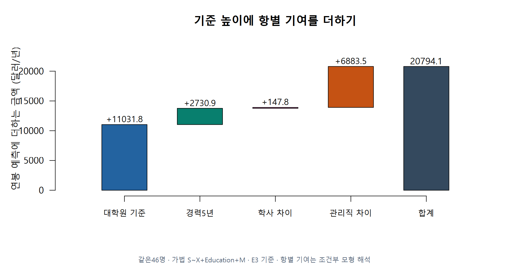
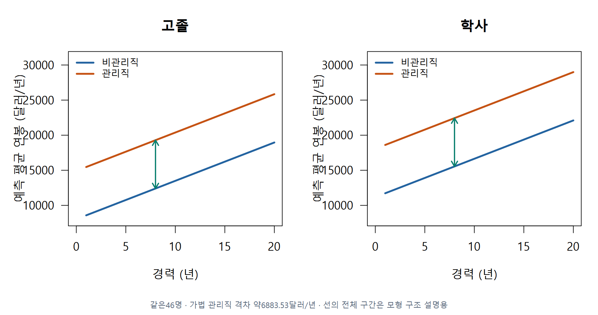
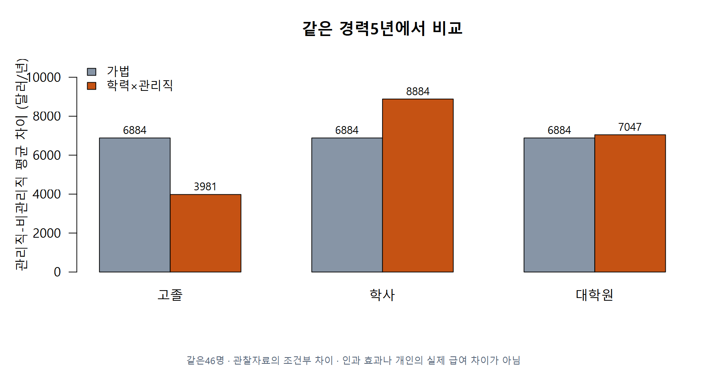
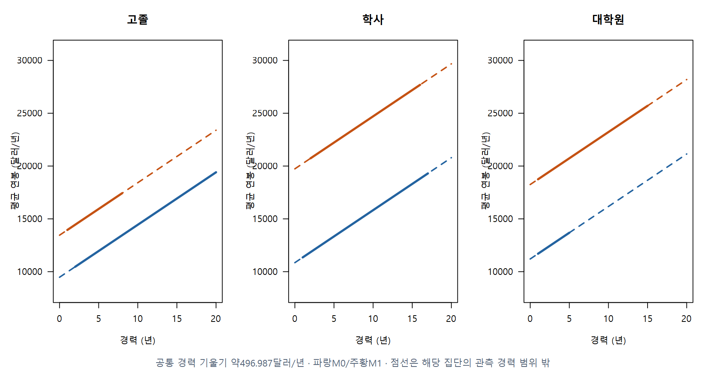
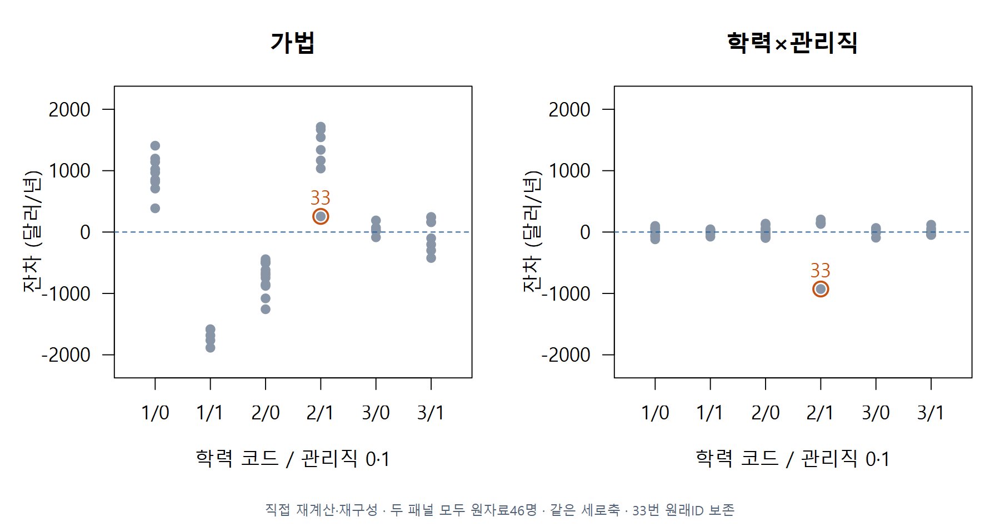
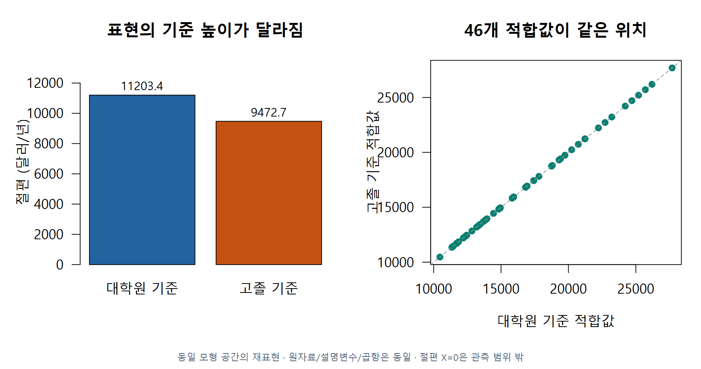

# 2 · 급료조사에서 예측과 상호작용을 한 항씩 읽기

회귀분석의 이해 · W11A · 주교재 §6.2–6.3

## E02 · 한 사람의 예측값을 기여분으로 나누기

Salary Survey의 공식46명을 사용합니다. 대학원 기준 가법모형의 추정값은 다음과 같습니다. 숫자는 설명을 위해 반올림했으며 R 검산은 전체 정밀도를 사용합니다.

$$
\widehat S=11031.808+546.184X-2996.210E_1+147.825E_2+6883.531M.
$$

학사·관리직·경력5년이면 (E1,E2,M)=(0,1,1)입니다. 순서대로 대입하면 다음과 같습니다.

$$
\begin{aligned}
\widehat S
&=11031.808+546.184(5)-2996.210(0)+147.825(1)+6883.531(1)\\
&=11031.808+2730.920+0+147.825+6883.531\\
&\approx20794.084\quad\text{달러/년}.
\end{aligned}
$$

F05 · §6.2, 245–247쪽에 근거해 직접 계산·재구성했습니다. 같은46명 · 가법 S~X+Education+M · E3 기준 · 항별 기여는 조건부 모형 해석.

막대는 각 항이 더하는 금액입니다. 첫 막대 위에 경력 기여가 올라가고, 이어 학력과 관리직 기여가 올라갑니다. 이 값은 해당 조건의 **평균 연봉 추정**이며 한 개인이 반드시 받는 연봉이 아닙니다.

**C04 · 같은 학력·관리직 조건에서 경력이1년 늘면 이 가법모형의 예측은 얼마나 달라질까요?**

## 가법모형이 강제하는 조건 찾기

같은 학력과 경력에서 관리직 M=1의 식에서 비관리직 M=0의 식을 뺍니다. 공통 항이 모두 없어지고 6883.531만 남습니다. 따라서 이 모형에서는 관리직 격차가 학력과 경력에 관계없이 같습니다.

F06 · §6.2, 245–247쪽에 근거해 직접 계산·재구성했습니다. 같은46명 · 가법 관리직 격차 약6883.53달러/년 · 선의 전체 구간은 모형 구조 설명용.

이것은 자료에서 미리 보장된 사실이 아니라 **현재 모형의 가정**입니다. 이 가정이 충분한지는 잔차를 살펴보고 더 유연한 모형과 비교합니다.

## E03 · 관리직 격차가 학력마다 다를 수 있게 하기

주교재6.3의 상호작용은 학력×관리직입니다. 상호작용은 한 변수의 차이가 다른 변수의 값에 따라 달라질 수 있도록 허용하는 항입니다.

$$
\widehat S=11203.434+496.987X-1730.748E_1-349.078E_2
+7047.412M-3066.035E_1M+1836.488E_2M.
$$

같은 학력·경력의 관리직과 비관리직을 빼면 다음 격차를 얻습니다. 곱항 계수만을 전체 관리직 격차로 읽지 마세요.

| 학력 | 살아남는 관리직 관련 항 | 평균 연봉 격차(달러/년) |
|---|---|---:|
| 고졸 | 7047.412−3066.035 | 약3981.377 |
| 학사 | 7047.412+1836.488 | 약8883.900 |
| 대학원 | 7047.412 | 약7047.412 |

F07 · §6.3, 247–251쪽에 근거해 직접 계산·재구성했습니다. 같은46명 · 관찰자료의 조건부 차이 · 인과 효과나 개인의 실제 급여 차이가 아님.

학사·관리직·경력5년을 이 모형에 다시 넣으면 약22223.191달러/년입니다. E02와 같은 사람의 조건이지만 **적합한 평균모형이 달라졌기 때문에** 예측이 달라집니다.

**C05 · 학사의 곱항 계수1836.488이 곧 학사의 전체 관리직 격차일까요? 무엇을 더해야 할까요?**

## 상호작용이 있어도 여기서는 경력 기울기가 같다

위 식에는 E1M·E2M이 있지만 XM이나 XE1·XE2는 없습니다. 경력 X의 계수는 모든 집단에서496.987입니다. 학력별 관리직 격차는 달라져도 각 직선의 경력 기울기는 공통입니다.

F08 · §6.3, 249–253쪽에 근거해 직접 계산·재구성했습니다. 공통 경력 기울기 약496.987달러/년 · 파랑M0/주황M1 · 점선은 해당 집단의 관측 경력 범위 밖.

실선은 해당 집단의 관측 경력 범위 안, 점선은 그 밖입니다. 전체 자료에 경력20년이 있다고 모든 집단에20년 관측이 있는 것은 아닙니다.

**C06 · 이 모형에서 경력이5년에서6년으로 늘면 학사 관리직과 고졸 비관리직의 증가량은 같을까요?**

## 같은 관측을 유지한 잔차 비교와33번 민감도

잔차는 관측 연봉에서 현재 모형의 적합값을 뺀 값입니다. 아래 두 패널은 **같은46명·같은 축**입니다. 가법모형에서 집단별로 치우친 잔차가 상호작용 모형에서 어떻게 달라지는지 읽습니다.

F09 · §6.3, 그림6.2–6.3·248–250쪽에 근거해 직접 계산·재구성했습니다. 직접 재계산·재구성 · 두 패널 모두 원자료46명 · 같은 세로축 · 33번 원래ID 보존.

잔차 규모 추정치는 가법모형 약1027.437, 상호작용 모형 약173.809달러/년입니다. 33번을 별도 분석 사본에서 제외한45명 적합에서는 약67.119입니다. 자료가 달라진45명 결과를 같은46명 모형 개선 효과와 섞어 설명하면 안 됩니다. 원래46명과33번 ID를 보존하고 오류·모형·민감도를 확인합니다.

## E04 · 기준을 바꿔도 사람의 예측은 그대로

대학원 기준의 절편11203.434에 고졸 차이−1730.748을 더하면 고졸 기준 절편9472.685입니다. 기준을 고졸로 바꾸면 나머지 학력 차이와 관리직 항도 함께 재표현합니다. 절편만 바꾸고 다른 계수를 그대로 두는 작업이 아닙니다.

F10 · §6.2–6.3, 244–253쪽에 근거해 직접 계산·재구성했습니다. 동일 모형 공간의 재표현 · 원자료/설명변수/곱항은 동일 · 절편 X=0은 관측 범위 밖.

같은46명·같은 항으로 기준만 바꾼 두 모형은 모든 적합값이 같습니다. R에서 `relevel()` 또는 기존 `salary_fit(...,reference=1)`을 사용하고 `max(abs(fitted(fit1)-fitted(fit2)))`로 비교합니다. 교재나 R 출력의 기준이 다르면 계수 표의 숫자가 달라질 수 있으므로 먼저 기준을 확인하세요.

**C07 · 기준범주를 바꾸는 일과 상호작용 항을 추가하는 일은 예측값에 어떤 차이를 만들까요?**

평균 연봉의95% 신뢰구간과 개인 연봉의95% 예측구간도 구별합니다. 예를 들어 학사·관리직·경력5년의 평균 신뢰구간은 약[22083.888,22362.494]입니다. 이 구간을 같은 조건 사람들의95%가 들어갈 개인 연봉 범위라고 해석하지 않습니다.
