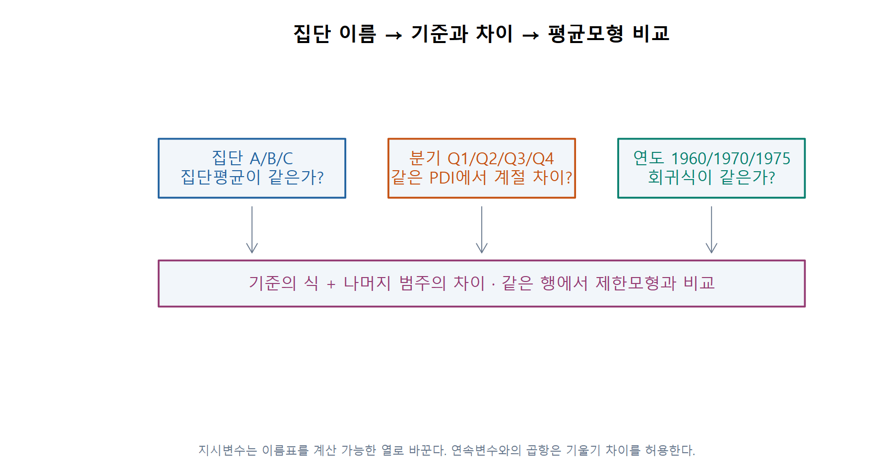
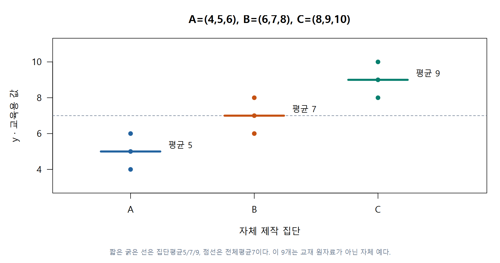
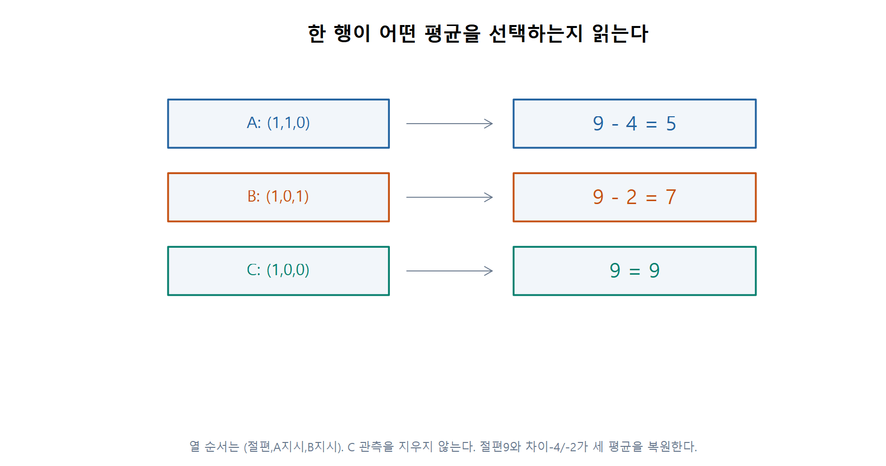
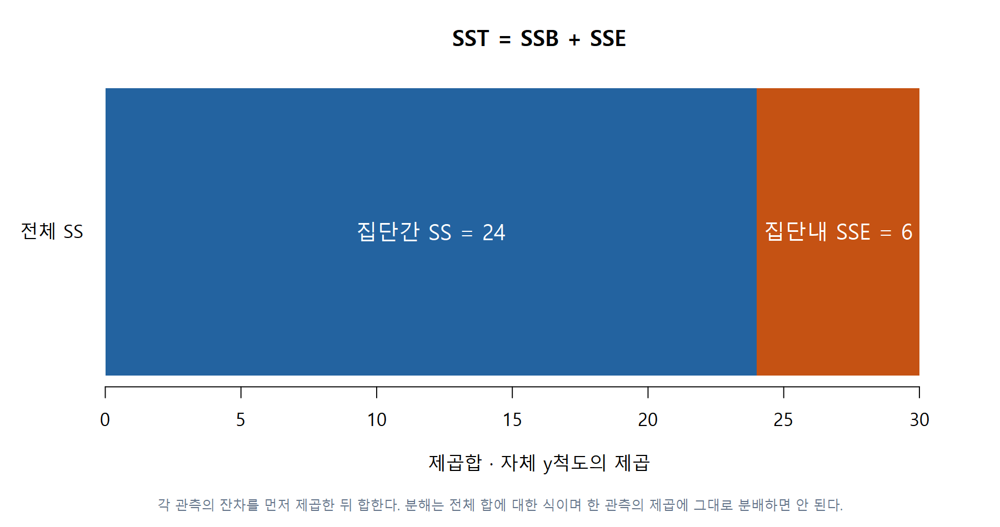
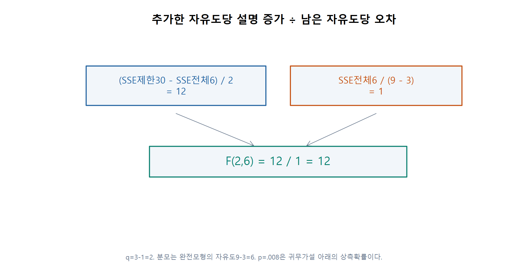

# 1 · 집단 평균 비교도 회귀분석이다

회귀분석의 이해 · W11B · 2026-11-10 · 주교재 §6.5, 266–267쪽

[설치 없는 온라인 R](https://lunalab-ai.github.io/regre/w11b.html) · [직접 수정하는 앱](https://lunalab-ai.github.io/regre/apps/w11b/edit/index.html) · [R/RStudio/QMD](https://github.com/lunalab-ai/regre/tree/2026-fall-w11b/labs/student/w11b)

[R Colab A · 평균과 계절성](https://colab.research.google.com/github/lunalab-ai/regre/blob/2026-fall-w11b/notebooks/student/w11b_mean_season.ipynb) · [R Colab B · 시간적 안정성](https://colab.research.google.com/github/lunalab-ai/regre/blob/2026-fall-w11b/notebooks/student/w11b_stability.ipynb)

예상 → 한 관측의 계산 → 실제 코드 실행·수정 → 표·그림 확인 → 한 문장 설명 순서로 사용합니다. 새 성적 반영 과제나 제출 기한은 없습니다.

## 세 응용을 잇는 한 가지 생각

집단·분기·연도는 **어느 범주인가**를 나타내는 이름입니다. 지시변수는 해당하면1, 아니면0인 열입니다. 기준범주를 하나 정한 뒤, 다른 범주가 기준과 얼마나 다른지 계수로 표현합니다.

F01 · 지시변수는 이름표를 계산 가능한 열로 바꾼다. 연속변수와의 곱항은 기울기 차이를 허용한다. §6.5–6.7에 근거해 직접 계산·재구성했습니다.

지난 시간에는 두 집단을 비교했습니다. 이번에는 집단이 셋 이상일 때, 같은 도구가 평균 비교·계절성·회귀식의 변화 검정에 어떻게 쓰이는지 계산합니다. 로지스틱 회귀는 이 지시변수를 다른 종류의 반응변수에도 쓰는 다음 학습의 예고이며, 이번 실습에서는 다루지 않습니다.

## E01 · 작은 아홉 값에서 시작

이 예는 설명을 위해 새로 만든 자료입니다. 교재의 비료·스키·교육비 자료와 구별합니다.

| 집단 | 관측값 | 관측 수 | 집단평균 |
|---|---|---:|---:|
| A | 4, 5, 6 | 3 | 5 |
| B | 6, 7, 8 | 3 | 7 |
| C | 8, 9, 10 | 3 | 9 |

F02 · 짧은 굵은 선은 집단평균5/7/9, 점선은 전체평균7이다. 이 9개는 교재 원자료가 아닌 자체 예다. 자체 수계산 예에 근거해 직접 계산·재구성했습니다.

전체9개 값의 합은63, 전체평균은7입니다. 집단평균은 각 집단의 중심이고, 각 관측값은 중심 주변에서 흩어집니다. **개별 관측과 그 집단의 평균을 구별합니다.**

## E02 · 기준 평균과 평균 차이를 식으로 쓰기

교재 식6.13처럼 마지막 집단 C를 기준으로 둡니다. A이면 $D_A=1$, B이면 $D_B=1$이며 그 외는0입니다.

$$
y_i=\mu_0+\mu_1D_{Ai}+\mu_2D_{Bi}+\varepsilon_i.
$$

$y_i$는 i번째 관측, $\varepsilon_i$는 평균식으로 설명하지 못한 오차입니다. $\mu_0$는 **기준 C의 평균**, $\mu_1$과 $\mu_2$는 각각 **A−C, B−C 평균 차이**입니다. 이 자료의 최소제곱 추정값은9, −4, −2입니다.

F03 · 열 순서는 (절편,A지시,B지시). C 관측을 지우지 않는다. 절편9와 차이−4/−2가 세 평균을 복원한다. §6.5를 자체9개 값으로 재구성에 근거해 직접 계산·재구성했습니다.

A는 $9-4=5$, B는 $9-2=7$, C는9입니다. 지시변수가0인 C의 평균이0이라는 뜻이 아닙니다. **절편을 포함하면 k개 집단에는 k−1개 지시변수**를 둡니다. k개를 모두 넣으면 매 행의 지시 합이 절편의1열과 겹칩니다.

**C01 · 기준집단의 더미가 모두0이면, 그 집단의 예측도0이 되나요?**

## E03 · 잔차와 제곱합을 손으로 확인

잔차는 관측−적합입니다. A의 세 잔차는 $4-5=-1$, $5-5=0$, $6-5=1$입니다. 제곱하면1,0,1이므로 A의 SSE는2입니다. B와 C도 각각2입니다.

$$
\mathrm{SSE}_{F}=2+2+2=6.
$$

한편 모든 관측에 전체평균7만 예측하면 잔차는 −3,−2,−1,−1,0,1,1,2,3입니다. 제곱합은30입니다. 전체평균만 쓰는 모형이 **제한모형 R**, 세 집단의 평균을 따로 허용한 모형이 **완전모형 F**입니다.

F04 · 각 관측의 잔차를 먼저 제곱한 뒤 합한다. 분해는 전체 합에 대한 식이며 한 관측의 제곱에 그대로 분배하면 안 된다. 자체9개 예 · 직접 계산에 근거해 직접 계산·재구성했습니다.

집단간 제곱합은 $3(5-7)^2+3(7-7)^2+3(9-7)^2=24$입니다. 전체 제곱합30은 집단간24와 집단내6의 합입니다. 이 분해는 전체 합에서 성립합니다.

## E04 · 변수가 늘면 SSE가 줄어드는 것만으로 충분할까

완전모형은 제한모형의 계수를 포함하고 더 자유롭게 적합합니다. 따라서 같은 관측에서 SSE는 늘지 않습니다. 그 감소가 추가 계수 수에 비해 충분한지, 남은 오차 크기를 기준으로 비교합니다.

$$
F=\frac{(\mathrm{SSE}_{R}-\mathrm{SSE}_{F})/(k_F-k_R)}{\mathrm{SSE}_{F}/(n-k_F)}.
$$

$k$는 절편을 포함한 추정 계수 수, $q=k_F-k_R$는 추가 자유도입니다. 이 예에서는 $n=9$, $k_R=1$, $k_F=3$, $q=2$, 분모 자유도는6입니다.

F05 · q=3−1=2. 분모는 완전모형의 자유도9−3=6. p=.008은 귀무가설 아래의 상측확률이다. §6.5 · 자체9개 예에 근거해 직접 계산·재구성했습니다.

$F=12$, 상측 $p=.008$입니다. 미리 정한5% 기준에서 세 평균이 모두 같다는 가설을 기각합니다. 이는 **어떤 차이는 있다는 근거**이며, 모든 집단 쌍이 다르다는 뜻은 아닙니다. 독립성·동분산·정규오차의 조건 아래에서 고전적 F분포를 사용합니다. 가정이 의심되면 검정값만으로 결론 내리지 않습니다.

**C02 · SSE가 감소했다는 사실과, 전체 검정이 유의하다는 사실은 무엇이 다른가요?**

실습 E01–E04에서는 `model.matrix → QR 계수 → 적합값 → 잔차² → SSE → q/df → F`를 실제 함수 본문에서 확인합니다. L01–L02는 기준과 숫자를 바꾼 독립 활동입니다. 교재6.9의 비료40구획은 같은 방법을 적용할 전이 문제로 남깁니다.

## 출처

주교재 『Chatterjee 예제를 통한 회귀분석 제6판: R 활용』(2024) §6.5, 266–267쪽. 그림과9개 수계산 예는 새로 제작했습니다. 실제 R의 [모형행렬](https://stat.ethz.ch/R-manual/R-devel/library/stats/html/model.matrix.html)과 [동일 자료의 중첩모형 비교](https://stat.ethz.ch/R-manual/R-devel/library/stats/html/anova.lm.html)를 연결합니다.
