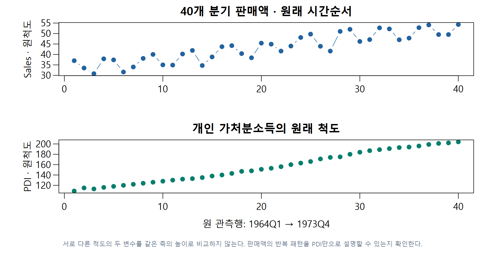
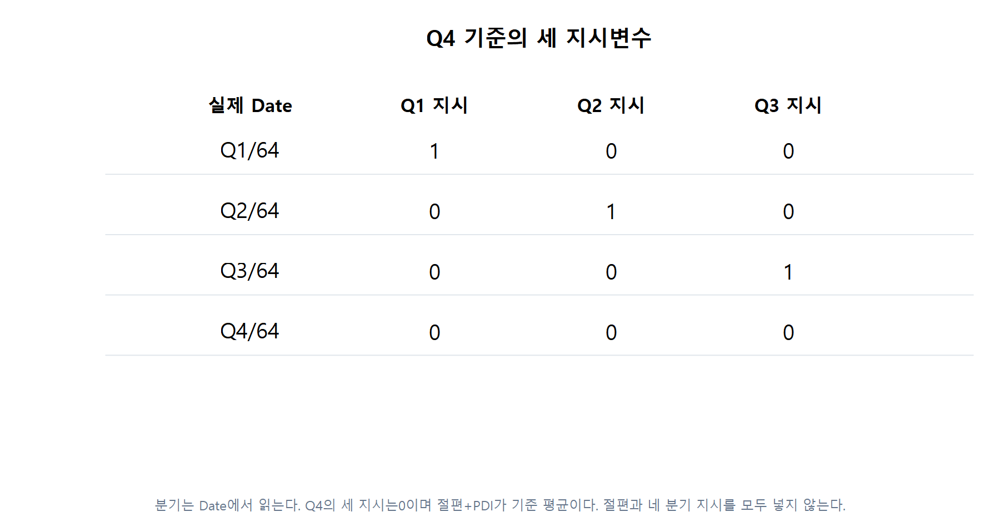
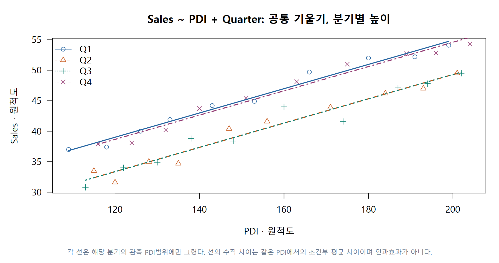
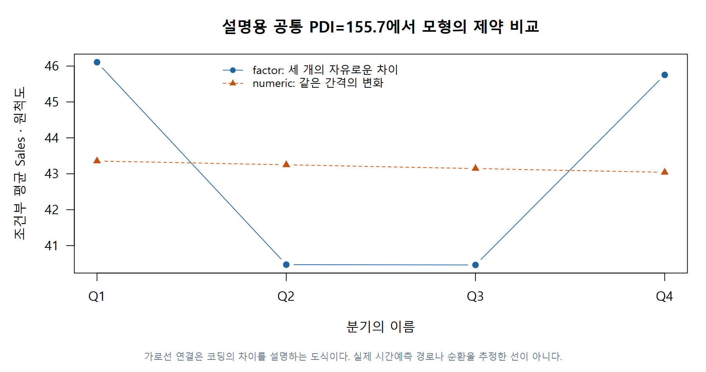
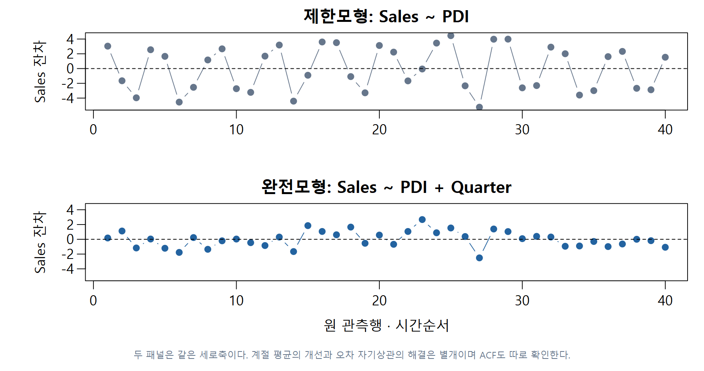

# 2 · 계절성: 분기라는 이름을 평균식에 넣기

W11B · 주교재 §6.6, 268–269쪽 · 교재6.4 연결

## 한 행은 한 분기

스키 자료는1964년1분기부터1973년4분기까지40행입니다. `Date`는 분기 이름, `Sales`는 판매액, `PDI`는 개인 가처분소득입니다. 수치의 원래 척도를 유지하며, 자료에 확인되지 않은 단위를 덧붙이지 않습니다.

F07 · 서로 다른 척도의 두 변수를 같은 축의 높이로 비교하지 않는다. 판매액의 반복 패턴을 PDI만으로 설명할 수 있는지 확인한다. §6.6 · 저자 Ski.Sales40행에 근거해 직접 계산·재구성했습니다.

PDI가 달라지면 평균 판매액도 달라질 수 있습니다. 여기에 매년 반복되는 분기별 평균 차이가 있는지를 봅니다. 계절성은 단순히 시간이 지나며 계속 증가한다는 추세와 다릅니다.

## E05 · Q4를 기준으로 세 스위치 만들기

$$
\mathrm{Sales}_t=\beta_0+\beta_1\mathrm{PDI}_t+\gamma_1D_{1t}+\gamma_2D_{2t}+\gamma_3D_{3t}+\varepsilon_t.
$$

$D_{jt}$는 t번째 관측이 j분기일 때1입니다. Q4에서는 세 지시가 모두0입니다. $\beta_1$은 분기마다 공통인 PDI 기울기, $\gamma_j$는 같은 PDI에서 Qj−Q4의 평균 차이입니다.

F06 · 분기는 Date에서 읽는다. Q4의 세 지시는0이며 절편+PDI가 기준 평균이다. 절편과 네 분기 지시를 모두 넣지 않는다. §6.6 · Ski40의 첫4행에 근거해 직접 계산·재구성했습니다.

교재의 `rep(1:4,10)`은 현재 원파일의 정렬에서는 맞습니다. 일반 준비 코드에서는 `Date`를 파싱하여 분기를 읽습니다. 행을 섞은 뒤에도 같은 날짜는 같은 분기여야 합니다.

**C03 · 분기1·2·3·4를 숫자 한 열로 넣으면, 범주형 분기와 어떤 점이 달라지나요?**

## E06 · 한 분기의 예측을 실제로 계산

40행을 적합한 계수는 다음과 같습니다. 출력은 표시 자리수로 반올림했습니다.

| 항 | 추정 계수 | 읽는 방법 |
|---|---:|---|
| 절편 | 14.772017 | Q4·PDI=0의 식 절편. 관측 범위 밖의0을 실제 사례로 해석하지 않음 |
| PDI | 0.199044 | 분기를 고정했을 때 PDI1단위당 평균 변화 |
| Q1−Q4 | 0.353116 | 같은 PDI의 Q1 평균 차이 |
| Q2−Q4 | −5.283824 | 같은 PDI의 Q2 평균 차이 |
| Q3−Q4 | −5.292103 | 같은 PDI의 Q3 평균 차이 |

첫 관측 Q1/64는 PDI109, Sales37입니다. Q1의 지시만1이므로 다음처럼 계산합니다.

$$
\widehat{\mathrm{Sales}}_1=14.772017+0.199044(109)+0.353116\approx36.820920.
$$

잔차는 $37-36.820920\approx0.179080$입니다. 이 한 잔차만 제곱하는 것과40개 잔차의 제곱을 모두 더하는 것은 다릅니다.

F08 · 각 선은 해당 분기의 관측 PDI범위에만 그렸다. 선의 수직 차이는 같은 PDI에서의 조건부 평균 차이이며 인과효과가 아니다. §6.6 · Ski40 · Q4기준에 근거해 직접 계산·재구성했습니다.

기준을 Q1로 바꾸면 절편과 차이 계수는 바뀌지만, 같은 완전모형의40개 적합값은 같습니다. 반면 숫자형 분기로 바꾸면 같은 모형의 표현 변경이 아니라 **새 제약**입니다.

F10 · 가로선 연결은 코딩의 차이를 설명하는 도식이다. 실제 시간예측 경로나 순환을 추정한 선이 아니다. §6.6 · 같은40행·두 다른 제약에 근거해 직접 계산·재구성했습니다.

## E07 · 세 계절 차이를 함께 검정

제한모형은 `Sales ~ PDI`로2계수, 완전모형은 `Sales ~ PDI + Quarter`로5계수입니다. 귀무가설은 $\gamma_1=\gamma_2=\gamma_3=0$입니다.

$$
F=\frac{(346.433289-47.244799)/3}{47.244799/35}\approx73.881833.
$$

같은40행에서 q3, 분모df35입니다. 고전적 가정 아래의 상측p는 약 $3.24\times10^{-15}$입니다. 그러나 이것은 **평균 계절 항의 검정**입니다. 시간 자료의 오차가 독립이라는 사실까지 확인한 결과는 아닙니다.

F09 · 두 패널은 같은 세로축이다. 계절 평균의 개선과 오차 자기상관의 해결은 별개이며 ACF도 따로 확인한다. §6.6 · 같은40행 비교에 근거해 직접 계산·재구성했습니다.

실습에서는 같은 세로축의 시간 잔차와 ACF를 봅니다. 잔차가 시간에 따라 묶여 움직인다면 오차 상관을 의심합니다. 상관오차의 새로운 추정 방법은 다음 범위이며, 이번에는 가정과 결론의 한계를 명확히 구별합니다.

**C04 · 분기 항을 추가해 SSE가 줄었다는 이유만으로 오차 자기상관이 해결됐다고 말할 수 있나요?**

L03–L04에서 행 순서·기준·자료형을 직접 바꿉니다. 선택 L07은 Q1/Q4와 Q2/Q3를 묶은 모형의 추가 제약을 비교합니다.

## 출처

주교재 §6.6, 268–269쪽. [저자 Ski.Sales 원자료](https://www1.aucegypt.edu/faculty/hadi/RABE6/Data6/Ski.Sales.txt)40행을 직접 재계산했고 그림은 새로 만들었습니다. 계절 지시변수와 잔차 가정의 구별은 [FPP3 회귀 장의 계절성 설명](https://otexts.com/fpp3/regression.html#seasonal-dummy-variables)도 참고했습니다.
