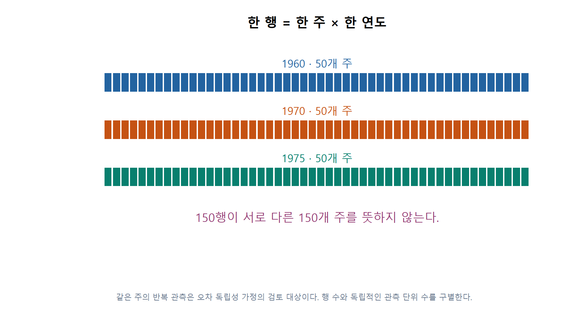
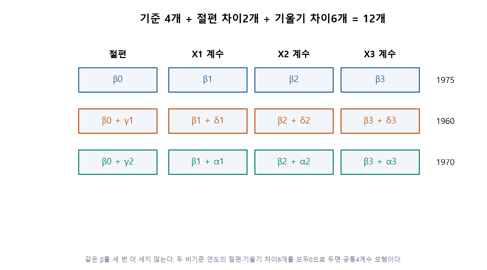
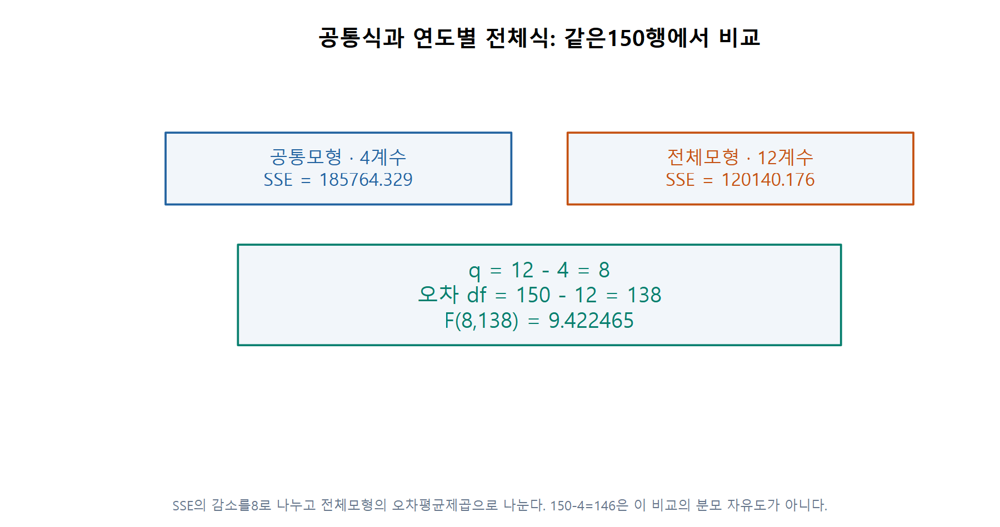
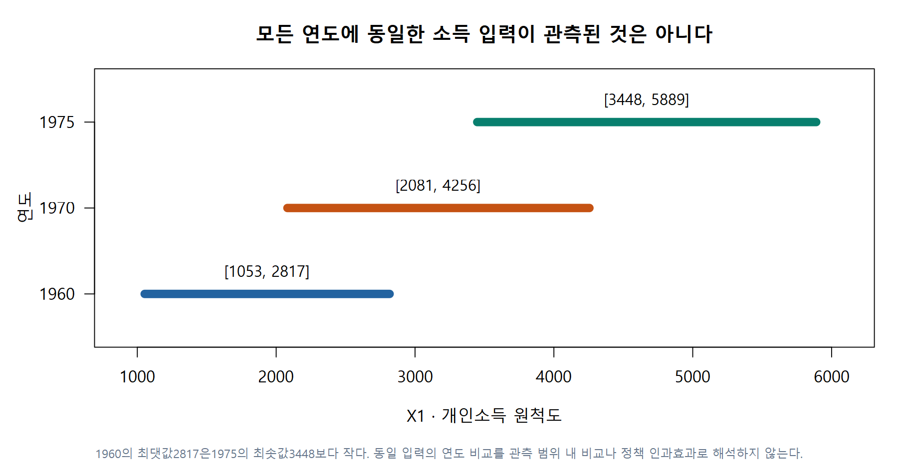
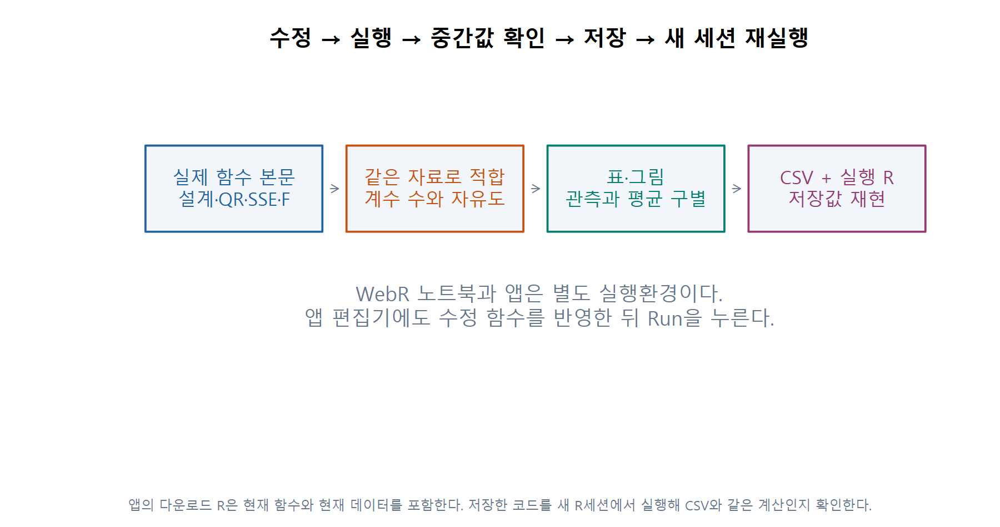

# 3 · 시간적 안정성: 세 연도의 회귀식이 같은가

W11B · 주교재 §6.7, 269–271쪽 · 교재6.5 연결

## 자료의 행과 변수를 먼저 정한다

교육비 자료의 한 행은 한 주의 한 연도입니다. 같은50개 주를1960·1970·1975년에 관측해150행입니다. `Y`는1인당 공공교육 지출, `X1`은 개인소득, `X2`는1000명당18세 미만 인구, `X3`는1000명당 도시 인구입니다. 금액은 원자료의 역사적 척도입니다.

F11 · 같은 주의 반복 관측은 오차 독립성 가정의 검토 대상이다. 행 수와 독립적인 관측 단위 수를 구별한다. §6.7 · Edu.Expend150행에 근거해 직접 계산·재구성했습니다.

시간적 안정성이란, 같은 설명변수에 대한 **평균 회귀관계가 연도에 따라 같은가**라는 질문입니다. Y의 연도 평균이 같은지를 묻는 것과 다릅니다. 설명변수의 분포가 연도마다 바뀔 수 있기 때문입니다.

## E08 · 연도별 세 식을 먼저 읽기

1975를 기준으로 $T_1=1$은1960, $T_2=1$은1970입니다. 그 외에는0입니다. $m_y(X)$를 해당 연도의 조건부 평균이라고 쓰면 교재의 식은 다음 세 식으로 나뉩니다.

$$
\begin{aligned}
m_{1975}(X)&=\beta_0+\beta_1X_1+\beta_2X_2+\beta_3X_3,\\
m_{1960}(X)&=(\beta_0+\gamma_1)+(\beta_1+\delta_1)X_1+(\beta_2+\delta_2)X_2+(\beta_3+\delta_3)X_3,\\
m_{1970}(X)&=(\beta_0+\gamma_2)+(\beta_1+\alpha_1)X_1+(\beta_2+\alpha_2)X_2+(\beta_3+\alpha_3)X_3.
\end{aligned}
$$

1975행에는 두 연도 지시와 그 곱항이 모두0입니다. 1960행은 $\gamma_1$과 세 $\delta$가,1970행은 $\gamma_2$와 세 $\alpha$가 기준 식에 더해집니다.

F12 · 같은 β를 세 번 더 세지 않는다. 두 비기준 연도의 절편·기울기 차이8개를 모두0으로 두면 공통4계수 모형이다. §6.7 · 교재의 β/γ/δ/α 기호 보존에 근거해 직접 계산·재구성했습니다.

기준4개를 한 번 세고, 두 연도의 절편 차이2개, 기울기 차이6개를 더해12개입니다. R의 `Y ~ (X1 + X2 + X3) * YearGroup`가 이 전체모형입니다. `*`는 주효과와 곱항을 함께 포함합니다.

**C05 · 연도는3개인데 전체 안정성 검정의 추가 제약은 왜8개인가요?**

## E09 · 실제 한 행의 예측을 네 기여로 접어 보기

첫 관측 ME·1960의 입력은 X1=1704, X2=388, X3=399이며 관측Y는61입니다. 위 식에서 기준계수와1960의 차이를 먼저 합하면 다음과 같습니다.

| 항 | 1960의 유효 계수 | 입력 | 기여분 |
|---|---:|---:|---:|
| 절편 | -11.404627 | 1 | -11.404627 |
| X1 | 0.044933 | 1704 | 76.565322 |
| X2 | 0.066223 | 388 | 25.694362 |
| X3 | -0.028954 | 399 | -11.552480 |

네 기여분의 합은 약 **79.302577**, 잔차는 $61-79.302577\approx-18.302577$입니다. 평균모형은 개별 관측을 그대로 복사하지 않습니다. 실습 E09는 이를12개 원래 열의 기여분으로도 펼쳐 같은 합이 나오는지 확인합니다. 표의 소수는 표시용 반올림입니다.

## E10 · 어떤 모형끼리 비교하는지 정한다

| 평균관계의 제약 | R의 식 | 계수 수 | 잔차df |
|---|---|---:|---:|
| 세 연도에서 같은 식 | `Y ~ X1 + X2 + X3` | 4 | 146 |
| 절편만 연도별로 다름 | `Y ~ X1 + X2 + X3 + YearGroup` | 6 | 144 |
| 절편·세 기울기가 모두 연도별로 다름 | `Y ~ (X1 + X2 + X3) * YearGroup` | 12 | 138 |

본문의 전체 안정성 귀무가설은 두 절편 차이와 여섯 기울기 차이가 **모두0**이라는 가설입니다. 그러면 전체12계수 모형이 공통4계수 모형으로 돌아갑니다.

F13 · SSE의 감소를8로 나누고 전체모형의 오차평균제곱으로 나눈다. 150−4=146은 이 비교의 분모 자유도가 아니다. §6.7 · 원자료 재계산에 근거해 직접 계산·재구성했습니다.

$$
F=\frac{(185764.328559-120140.175684)/8}{120140.175684/138}\approx9.422465.
$$

고전적 가정 아래의 상측p는 약 $2.48\times10^{-10}$입니다. 이는 세 연도의 모든 계수가 같다는 공동 제약에 대한 결과입니다. 각각의 계수가 모두 달라졌다는 뜻은 아닙니다. 절편만의 비교나 기울기만의 비교는 다른 제약을 갖는 별도 검정입니다.

## 관측 범위와 반복 관측의 한계도 함께 읽는다

F14 · 1960의 최댓값2817은1975의 최솟값3448보다 작다. 동일 입력의 연도 비교를 관측 범위 내 비교나 정책 인과효과로 해석하지 않는다. §6.7 · 전체150행의 연도별 범위에 근거해 직접 계산·재구성했습니다.

1960과1975의 소득 범위는 겹치지 않습니다. 같은 입력값에서 세 식의 예측을 계산할 수 있다는 것과, 그 값이 모든 연도의 관측 범위 안이라는 것은 다릅니다. X1범위의 겹침만으로 X1/X2/X3의 공동 지지범위까지 보장하지도 않습니다.

또한 같은 주의 세 관측은 관련될 수 있고 오차 분산도 연도마다 다를 수 있습니다. 고전적 독립·동분산 가정의 F를 계산했다는 사실을 정책의 인과효과나 반복관측 문제의 해결로 바꾸지 않습니다. 이번 수업에서는 모형·제약·계산·한계를 함께 설명합니다.

**C06 · 같은150행이라면 독립성 가정도 자동으로 만족하나요? 기준 변경과 모형 변경은 같은 작업인가요?**

## E11 · 본문 수정에서 실제 앱까지

F15 · 앱의 다운로드 R은 현재 함수와 현재 데이터를 포함한다. 저장한 코드를 새 R세션에서 실행해 CSV와 같은 계산인지 확인한다. 수업용 구현 흐름 · 직접 제작에 근거해 직접 계산·재구성했습니다.

R실습의 QR/SSE/F 함수 본문을 읽고, `student_formula()`의 `*`를 `+`로 바꿀 때 사라질 열을 예상합니다. 해당 함수를 호출한 뒤 계수 수·그림·F를 비교합니다. 앱은 별도 실행환경이므로 편집기에도 수정 함수를 반영하고 **Run**을 누릅니다. 현재 결과 CSV와 독립 실행 R을 내려받고, 새 R세션에서 같은 결과인지 확인합니다. 저장은 수업 서버 제출을 뜻하지 않습니다.

## 출처

주교재 §6.7, 269–271쪽. [저자 Edu.Expend 원자료](https://www1.aucegypt.edu/faculty/hadi/RABE6/Data6/Edu.Expend.txt)150행을 보존해 재계산했습니다. 그림은 직접 만든 것입니다. 부록6.A의 SAS 작업은 별도 R대응표로 정리했습니다.
