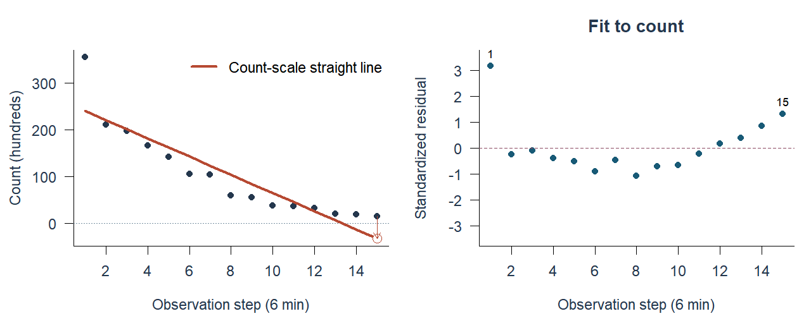
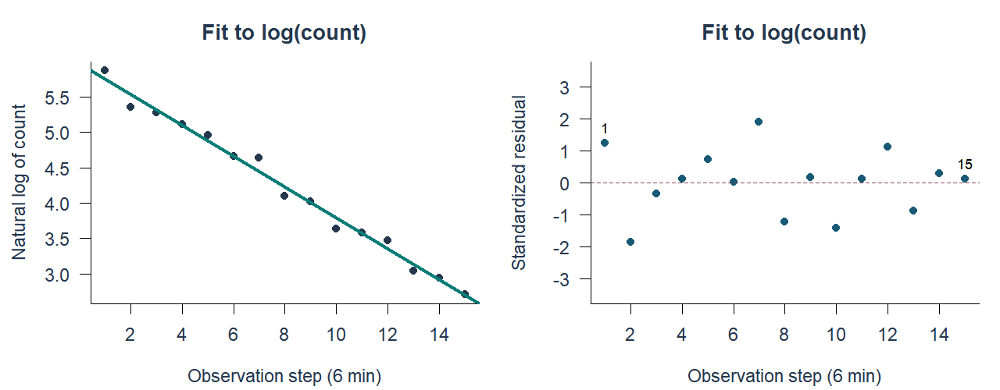
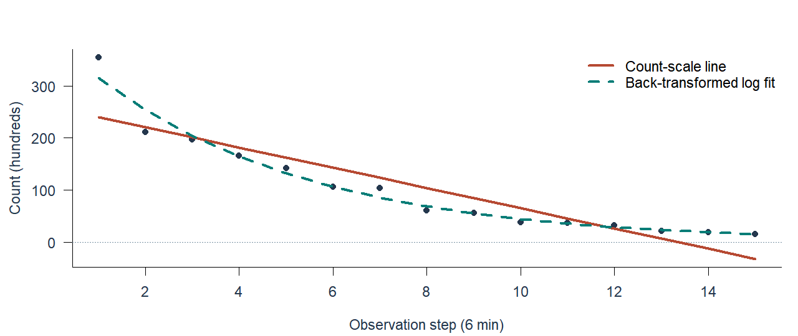
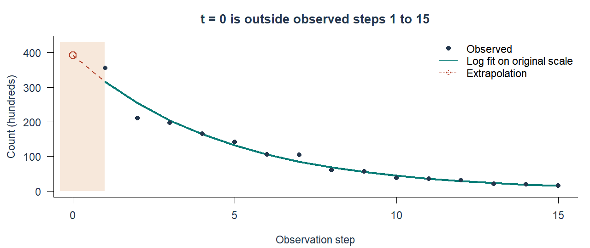

# 7.3 박테리아 관측값을 두 방식으로 적합하기

$t=1,\ldots,15$는 6분 간격의 관측 번호입니다. $N_t$의 단위는 100마리입니다. 같은 15행으로 **원자료 직선 → 로그 반응 직선 → 원척도 적합 곡선**을 비교합니다.

## 7.3.1 원척도에 직선 그리기

$$\widehat N_t=259.581-19.464t.$$

직선은 관측 간격마다 약 19.46만큼 감소한다고 적합합니다. $t=15$를 대입하면 약 −32.38이지만 실제 관측은 15입니다. 직선의 마지막 오차 $e_{15}=15-(-32.38)\approx47.38$은 양수입니다.

표준화 잔차는 잔차를 그 행에서 추정한 잔차 표준편차로 나눈 값입니다. 이 자료에서는 첫 관측이 양수이고, $t=2$부터 11까지 음수이며, 마지막 네 점은 양수입니다. $R^2\approx0.823$인 직선도 이 순서를 남깁니다. 잔차 모양을 근거로 곡선을 시도하고 같은 관측을 유지합니다.

## 7.3.2 로그 반응 직선과 역변환

$$\widehat{\log N_t}=5.97316-0.21843t.$$

$\log N_t=\beta_0+\beta_1t+\varepsilon_t$의 양변에 지수를 취하면 $N_t=e^{\beta_0+\beta_1t}e^{\varepsilon_t}$입니다. 로그 척도에 더해진 오차가 원척도에서는 곱해집니다.

실습 B2의 적합식과 역변환을 두 단계로 바꿉니다. `lm(log(N_t) ~ t)`가 만드는 적합값은 로그 단위입니다. 그림과 행별 오차를 원척도로 비교하려면 `exp(predict(fit))`를 씁니다.

## 같은 원척도에서 적합 오차 비교

| 같은 원자료 15행에서 계산 | 원자료 직선 | 로그 적합을 exp로 되돌린 곡선 |
|---|---:|---:|
| $t=15$의 원척도 적합값 | −32.38 | 14.83 |
| 적합 RMSE, 100마리 단위 | 38.94 | 16.36 |

RMSE는 각 행에서 관측값과 원척도 적합값의 차이를 제곱하고 평균하여 제곱근을 취한 값입니다. 여기서는 같은 15개 **수업 예제 안에서의 적합 오차**입니다. 서로 다른 반응 척도의 $R^2$는 각 척도의 총변동을 기준으로 하므로 이 표처럼 직접 비교할 수 없습니다.

## 기울기와 원척도에서의 의미

적합식의 $t$를 1 늘리면, 되돌린 값의 비율은 $e^{-0.21843}\approx0.804$입니다. 6분마다 직전 값의 약 80.4%가 남는 모형이므로 약 19.6% 감소합니다. 로그 기울기의 95% 신뢰구간 양끝을 지수로 되돌리면 잔존비는 약 0.792–0.815입니다.

$t=0$에는 관측값이 없습니다. $e^{5.97316}\approx392.74$는 모형을 관측 범위 밖으로 한 단계 연장한 값입니다. 단순히 exp로 되돌린 곡선은 곱셈 오차의 중심을 보여줍니다. 로그 오차의 조건부 중앙값을 0으로 두면 원척도의 조건부 중앙값으로 읽을 수 있고, 원척도 평균을 추정할 때는 별도 가정이 필요합니다.

수업용 재도해는 [저자 보조자료 Bacteria 15행](https://www1.aucegypt.edu/faculty/hadi/RABE6/Data6/Bacteria.txt)을 사용했습니다. 한국어판 표 7.2의 관측값을 대조했습니다.
