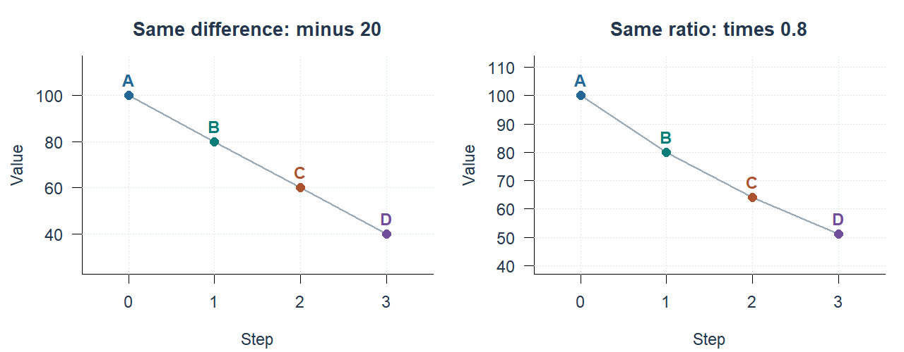
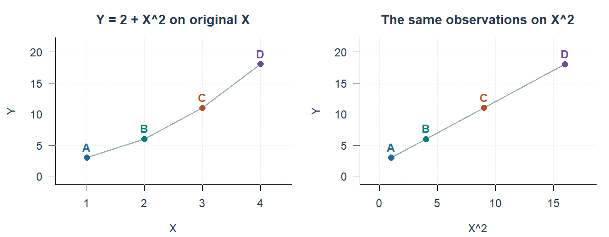

# 곡선을 직선으로 읽는 방법

회귀분석의 이해 · 12주차 1차시 · 2026년 11월 16일  
주교재 『Chatterjee 예제를 통한 회귀분석 제6판: R 활용』 7.1–7.3

## 7.1 같은 차이와 같은 비율

100 → 80 → 64에서 차이는 −20, −16입니다. 비율은 $80/100=64/80=0.8$입니다. 양이 일정하게 줄면 원척도에서 직선이 되고, 비율이 일정하면 양이 줄수록 같은 비율에 해당하는 감소량도 작아집니다.

**한 단계씩 계산하기.** 64의 다음 값은 $64\times 0.8=51.2$입니다. 로그를 취하면 곱셈이 덧셈이 됩니다. $\log 80-\log 100=\log 0.8$이고 다음 로그 차이도 $\log 0.8$입니다. 원척도의 일정한 비율이 로그 척도에서 일정한 차이로 보입니다.

## 무엇에 대해 선형인가

$Y=\beta_0+\beta_1X^2+\varepsilon$을 $X$축에 그리면 곡선입니다. $Z=X^2$라는 열을 만들면 $Y=\beta_0+\beta_1Z+\varepsilon$입니다. 두 계수가 각각 $1$과 $Z$에 곱해져 더해지므로 **계수에 대해 선형**입니다.

예를 들어 $\beta_0=2$, $\beta_1=1$이면 $X=1,2,3$에서 $Y=3,6,11$입니다. 새 축 $Z=1,4,9$에서 $\Delta Y/\Delta Z$는 두 구간 모두 1입니다. $Y=\beta_0e^{\beta_1X}+\varepsilon$의 원척도 식에서는 $\beta_1$이 지수 안에 들어갑니다.

## 변환한 뒤 잔차를 다시 그린다

변환의 출발점은 평균 관계의 굽음입니다. 산점도와 잔차에서 이를 확인하고, 변환 뒤에는 잔차의 퍼짐과 오차 분포도 다시 살핍니다. 오차가 **원척도에서 더해지는지**, **로그 척도에서 더해지는지**에 따라 적합할 식이 달라집니다. 7.3의 실제 자료로 이 차이를 확인합니다.

[온라인 R 실습 A/B](https://lunalab-ai.github.io/regre/w12a.html) · [계산 기록지 PDF](https://github.com/lunalab-ai/regre/releases/download/2026-fall-w12a/w12a-workbook-print.pdf)
