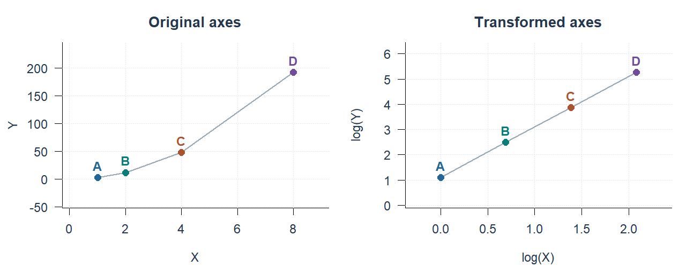
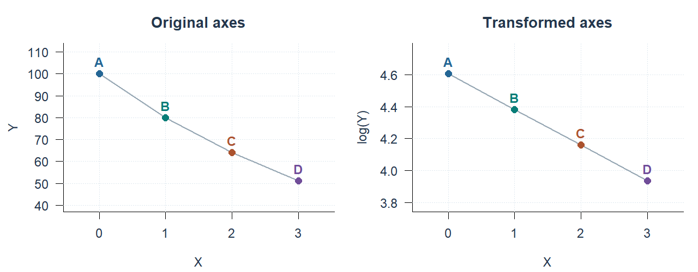
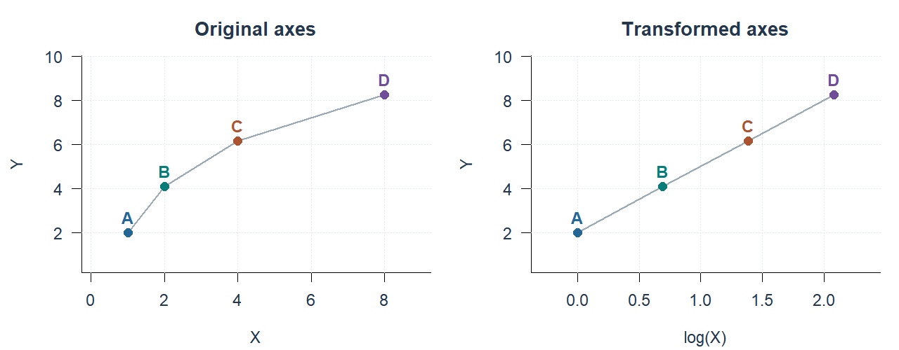
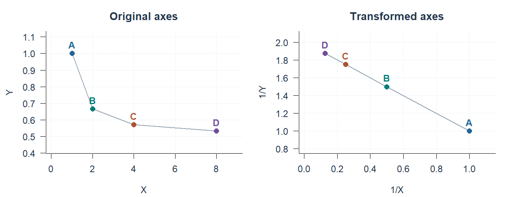
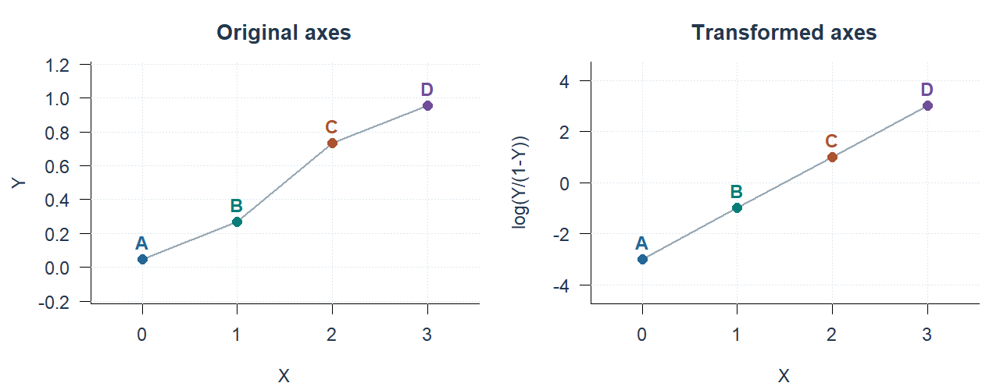

# 7.2 어느 축을 바꿀까

새 축을 $X^*$와 $Y^*$라고 쓰면 다섯 가지 모두를 $Y^*=\text{절편}+\text{기울기}\,X^*$로 읽을 수 있습니다. 그림마다 같은 색과 글자는 같은 관측값입니다. 아래 곡선은 교재 표 7.1의 원리를 보여주는 수업용 예입니다.

## 거듭제곱 · 양쪽에 로그

$Y=aX^b$이면 $\log Y=\log a+b\log X$입니다. $X,Y>0$에서 두 축을 바꿉니다. 기울기 $b$는 $\log X$가 한 단위 변할 때 $\log Y$가 변하는 양입니다. $X$가 2배면 이 식의 $Y$는 $2^b$배입니다.

$Y=3X^2$에서 $X$가 2→4면 $Y$는 12→48입니다. $\log(48/12)/\log(4/2)=2$이므로 기울기는 2입니다. 실습 A1에서 Y만 로그를 취한 그림에 X의 로그도 적용해 비교합니다.

## 지수 · Y에만 로그

$Y=ae^{bX}$이면 $\log Y=\log a+bX$입니다. $Y>0$입니다. $X$가 1 증가할 때 $Y$는 $e^b$배입니다. $100(0.8)^X$에서는 $b=\log(0.8)$입니다.

## 로그형 · X에만 로그

$Y=a+b\log X$이면 $\log X$를 새 X축으로 씁니다. $X>0$이며 이 변환에는 $Y$의 양수 조건이 필요 없습니다. $X$가 2배면 $Y$는 $b\log 2$만큼 변합니다. $Y=2+3\log X$에서 그 차이는 약 2.079입니다.

## 역수형 · 양쪽에 역수

$Y=X/(aX-b)$이면 $1/Y=a-b(1/X)$입니다. 원식에서 분모가 0이 아니고, 역수를 취할 두 값 $X,Y$도 0이 아니어야 합니다. 새 절편은 $a$, 새 기울기는 $-b$입니다. $a=2$, $b=1$, $X=2$이면 $Y=2/3$이고 $1/Y=2-1/2=1.5$입니다.

## 로짓 · 0과 1 사이의 비율을 로그 오즈로

$Y=0.25$의 오즈는 $0.25/0.75=1/3$입니다. 로짓은 $\log(1/3)\approx-1.099$입니다. $Y=0.50$은 오즈 1, 로짓 0이며 $Y=0.75$는 오즈 3, 로짓 약 1.099입니다. 로그 오즈를 값으로 바꾸려면 $\eta=\log[Y/(1-Y)]$에서 $Y=1/(1+e^{-\eta})$를 씁니다.

$0<Y<1$에서 유한한 로짓을 얻습니다. 실습 A2에서 $Y=0$과 $Y=1$을 넣어 경계를 확인합니다. 여기서는 비율을 로그 오즈로 변환합니다. 이항 로지스틱 회귀에서는 성공 횟수의 분포를 이항분포로 두고 그 우도에서 계수를 추정합니다.
