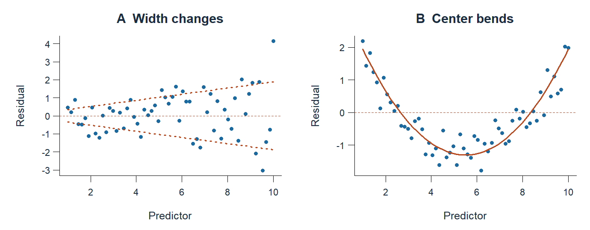
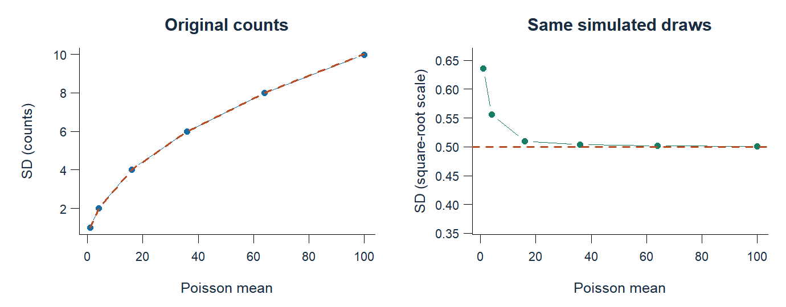
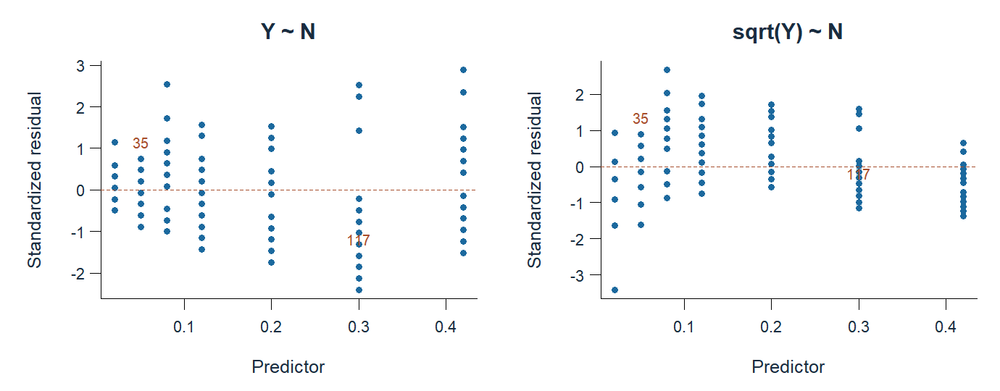
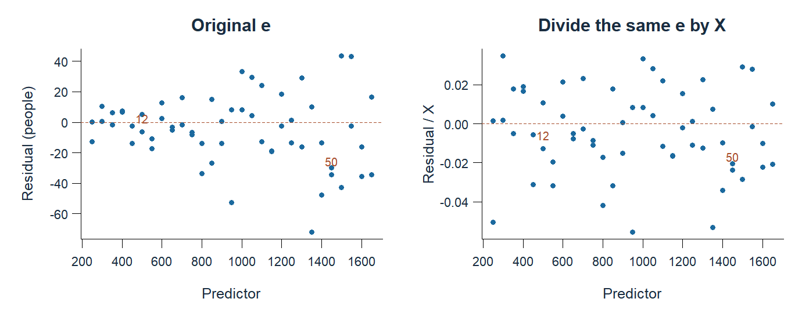
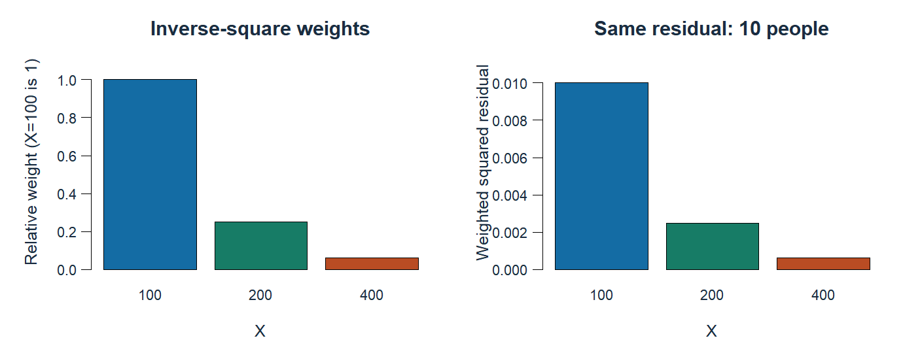
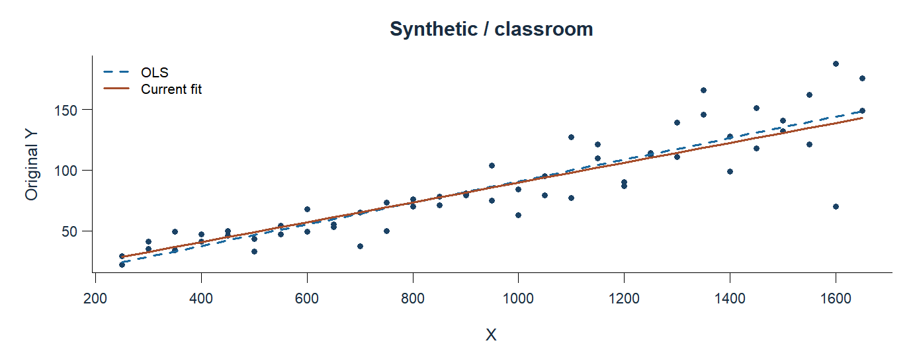

# 잔차의 퍼짐을 진단하고 변환과 가중치로 다루기

회귀분석의 이해 · W12B · 11월 18일  
주교재 『Chatterjee 예제를 통한 회귀분석 제6판: R 활용』 7.4–7.10

## S01 · 잔차의 중심과 폭

잔차 $e_i=y_i-\hat y_i$는 관측값이 맞춘 선에서 얼마나 벗어났는지 나타냅니다. 잔차 그림에서 두 가지를 따로 봅니다. **중심**은 점들이 대체로 어디를 따라가는지, **폭**은 그 중심에서 위아래로 얼마나 흩어지는지입니다.

**F01 · 두 그림의 가운데를 각각 손가락으로 따라가 보세요.** 왼쪽은 가운데가 0 부근인데 오른쪽으로 갈수록 폭이 커집니다. 오른쪽은 점들의 가운데가 U자에 가깝습니다. 두 패턴이 함께 나타나는 자료도 있습니다. 그림은 수업용 합성 예시입니다.

**계산 1.** 작은 $X$에서 잔차가 $-2,2$이고 큰 $X$에서 $-8,8$이면 두 평균은 모두 0입니다. 두 집단의 평균제곱잔차는 각각 $(4+4)/2=4$, $(64+64)/2=64$입니다. 중심은 같고, 일반적인 편차 크기는 2에서 8로 네 배가 됩니다. 각 구간에 관측이 여럿이면 평균과 퍼짐을 함께 읽을 수 있습니다.

## S02 · 7.4 분산안정화 변환

건수 $Y$가 고정 $X$에서 포아송 모형을 따른다고 생각해 봅시다. 평균이 $\mu$이면 분산도 $\mu$입니다. 조건부 평균이 큰 구간에서는 원래 건수의 변동도 크게 나타날 수 있습니다. 제곱근은 큰 건수의 간격을 더 많이 압축합니다.

**F02 · 같은 포아송 모의 관측을 두 척도로 비교.** 기대 건수가 커지면 원 건수의 표준편차 $\sqrt{\mu}$가 커집니다. 제곱근 척도에서 약 $0.5$라는 근사는 평균이 작을 때 정밀도가 낮아질 수 있습니다.

**계산 2.** 평균이 4일 때 건수의 표준편차는 2입니다. 평균 100에서는 10입니다. $\sqrt y$의 기울기는 평균 부근에서 $1/(2\sqrt\mu)$이므로 근사 표준편차는 각각 $2/(2\cdot2)=0.5$, $10/(2\cdot10)=0.5$입니다. 간격만 직접 계산해도 $\sqrt{9}-\sqrt{4}=1$이고 $\sqrt{105}-\sqrt{100}\approx0.247$입니다. 원 단위에서 같은 5건 차이가 큰 건수에서 더 작게 보입니다.

**계산 3.** 교재의 $N$은 운항 횟수의 비율입니다. 예를 들어 전체 2,000회 중 160회라면 $N=0.08$입니다. 공식 항공 자료 9개로 적합한 R 결과를 반올림하면 원 단위 예측은 $-0.140+64.975N$입니다. $N=0.08$에서 약 5.06건입니다. 제곱근 적합은 $1.169+11.856N$, 같은 $N$에서 제곱근 척도 약 2.12이고 단순 역변환하면 약 4.49건입니다. 뒤 값은 변환 적합을 원 단위에 표시한 예입니다. 조건부 평균으로 해석하려면 추가 가정과 보정이 필요합니다. 교재 표 7.6–7.8과 공식 자료로 검산했습니다.

**F03 · 합성 카운트에서 같은 행을 찾으세요.** 관측점 번호와 가로축은 그대로입니다. 표준화잔차의 상대적 퍼짐을 두 패널에서 비교합니다. 교재의 실제 자료에도 같은 절차를 적용하되 관측이 9개뿐인 그림에서 패턴을 읽을 때는 근거의 한계를 함께 적습니다. 표 7.5의 이항·음이항 사례도 평균과 분산의 관계에 맞춰 변환을 생각하는 같은 원리입니다.

## S03 · 7.5–7.7 이분산성 검출, 제거, 가중최소제곱

공장 자료의 $X$는 종업원 수, $Y$는 감독자 수입니다. $Y=\beta_0+\beta_1X+\varepsilon$에 맞춘 뒤, $X$가 커질수록 잔차 띠가 벌어지는지 봅니다. 아래 그림은 공장 사례의 구조를 따라 만든 양의 $X$ 수업 자료입니다.

**F04 · X로 나누면 폭이 어떻게 달라지나요?** 원잔차는 감독자 수 단위입니다. 오른쪽은 원래 잔차를 $X$로 나눈 값이라 세로축의 단위도 바뀝니다.

**계산 4.** $X=100,200$에서 잔차가 각각 $10,20$이라고 합시다. 원 제곱잔차는 $100,400$이지만 나눈 잔차는 $10/100=20/200=0.1$입니다. 두 행 모두 눈금이 달라진 잔차 제곱은 $0.01$입니다. 반대로 **같은** 10명의 오차라면 가중 제곱잔차는 $0.01$과 $0.0025$입니다. 규모가 큰 행의 변동이 더 크다고 가정했기 때문입니다.

**F05 · SD가 X에 비례하면 가중치는 역분산에 비례합니다.** $X>0$이고 $\operatorname{Var}(\varepsilon\mid X)=k^2X^2$라면 $\operatorname{Var}(\varepsilon/X\mid X)=k^2$입니다. 따라서 나눈 잔차 제곱을 더하는 것과 $1/X^2$를 준 가중 손실의 합은 같습니다.

$$
\sum_i(e_i/X_i)^2=\sum_i w_i e_i^2,\qquad w_i=1/X_i^2.
$$

공통 상수 $1/k^2$는 어느 회귀선이 합을 최소로 만드는지에 영향을 주지 않습니다. 이분산만 있고 오차의 조건부 평균이 0이라면 OLS 계수의 불편성은 유지됩니다. 통상 등분산 표준오차의 공식과 OLS의 효율성에는 영향이 있습니다. 어떤 가중치를 넣을지는 자료나 분산에 대한 지식에서 근거를 찾습니다.

**계산 5.** 식 전체를 $X$로 나누면 $Y/X=\beta_1+\beta_0(1/X)+\varepsilon/X$입니다. 변환식의 절편이 원식의 기울기입니다. 교재 공장 자료 27개에서는 변환식이 약 $Y/X=0.120990+3.803296/X$입니다. $X=700$이면 약 $0.126424$이고, 다시 700을 곱하면 $\hat Y\approx88.50$명입니다. WLS 원식 $3.803296+0.120990\times700$과 같습니다. 원래 $X$와 $Y$를 쓰고 계산하는 OLS는 같은 $X$에서 약 88.20명입니다.

**F06 · 선이 조금만 달라도 최소화하는 손실은 다릅니다.** 저자 공장 자료에서 원 단위 적합 RMSE는 OLS 20.91명, WLS 21.73명이었습니다. 이 수치는 관측에 맞춘 오차입니다. WLS가 줄이는 대상은 $\sum_i w_i e_i^2$입니다. 실습에서는 학생이 가중치 지수 0, 1, 2를 입력해 한 행의 가중치와 두 직선을 비교합니다. 같은 행에서 변환 OLS와 WLS의 원척도 예측이 일치하는지도 검산합니다.

다음 자료는 교재의 로그변환과 멱변환, 계산 기록지, 실습을 이어 읽습니다.
