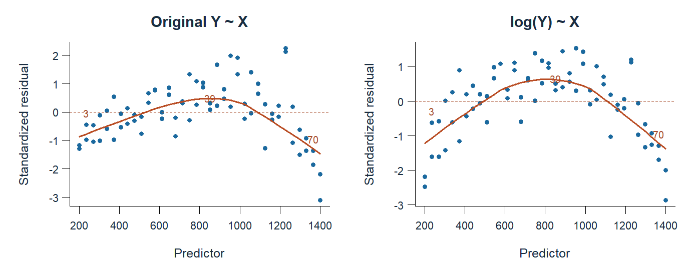
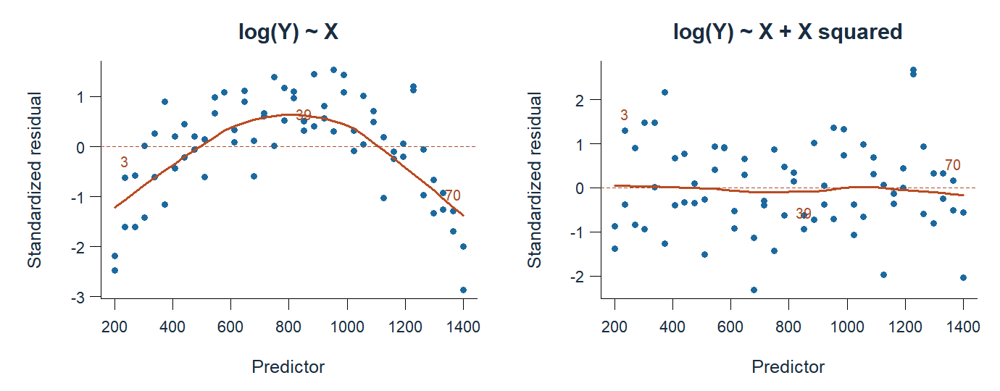
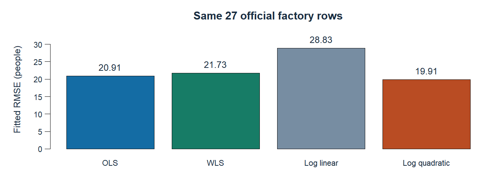
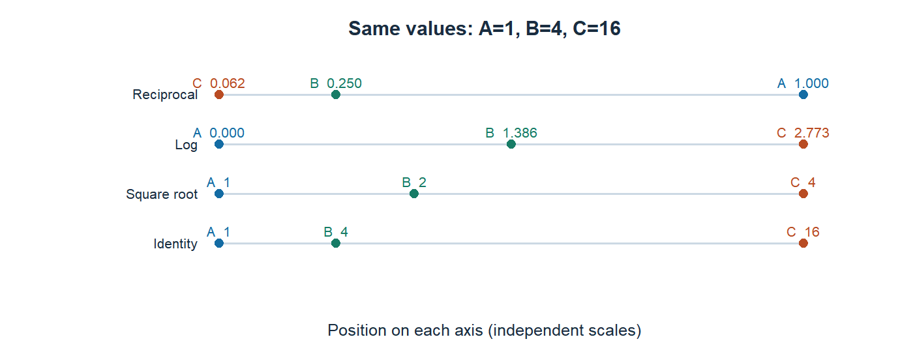
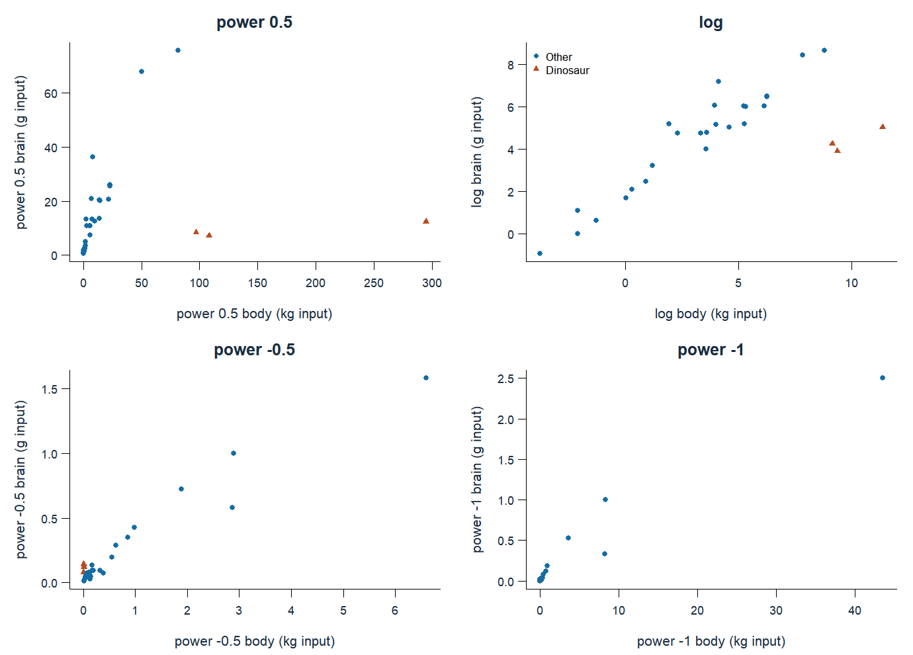
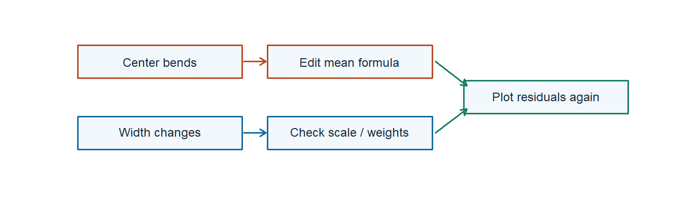

# 로그변환과 멱변환으로 다시 진단하기

회귀분석의 이해 · W12B · 주교재 7.8–7.10

## S04 · 7.8 로그변환 후 남은 굽음

$Y>0$에서 로그는 큰 값의 차이를 압축합니다. 로그를 취한 직선의 잔차 폭이 비슷해져도 중심이 곡선을 따라갈 수 있습니다. 교재는 감독자 자료에서 $\log Y$를 $X$에 적합한 뒤 남은 곡률을 보고 $X^2$를 추가합니다. 제곱항을 추가한 모형도 각 계수에 대해서는 선형입니다.

**F07 · 폭과 중심을 따로 표시합니다.** 왼쪽과 오른쪽 세로축은 각 모형의 표준화잔차입니다. 중심이 어디에 놓이는지 먼저 따라가고, 다음에 흩어진 폭을 봅니다.

**F08 · 양끝과 중간의 부호를 읽습니다.** 같은 합성 자료에서 오른쪽 식에 $X^2$를 더했습니다. 학생은 `lm(log(Y) ~ X + I(X^2))`의 `I(X^2)`를 직접 추가하고 그림이 어떻게 달라지는지 확인합니다. 원자료부터 새로 그려 어떤 패턴이 남았는지 확인한 뒤 해석합니다.

**계산 6.** 교재 공장 자료의 로그 이차 적합을 신중하게 반올림하면 $\log \hat Y=2.8516+0.00311267X-0.00000110226X^2$입니다. $X=1000$에서는 $2.8516+3.11267-1.10226\approx4.862$이고, 지수로 되돌리면 약 129.3명입니다. 숫자는 로그 적합의 단순 역변환입니다. 로그 오차의 조건부 중앙값이 0이면 원 단위 조건부 중앙값의 모형으로 읽을 수 있습니다.

**계산 7.** 관측값이 100과 200, 원 단위 예측이 90과 230이면 $e=(10,-30)$입니다. 적합 RMSE는 $\sqrt{(100+900)/2}\approx22.36$입니다. 두 모델을 비교할 때는 동일한 관측 행과 원 단위를 사용합니다. 교재 공장 자료의 같은 행에 대한 직접 계산은 다음과 같습니다.

| 적합식 | 비교에 사용한 원 단위 적합값 | 적합 RMSE(명) |
| --- | --- | ---: |
| 원 단위 OLS | OLS 적합값 | 20.91 |
| 원 단위 WLS | WLS 적합값 | 21.73 |
| 로그 선형 | 로그 적합값의 지수 | 28.83 |
| 로그 이차 | 로그 적합값의 지수 | 19.91 |

**F09 · 비교 단위는 감독자 수입니다.** 이 결과는 훈련 관측에 맞춘 값입니다. 새 공장의 예측력을 평가하려면 따로 남긴 관측으로 확인합니다. R에 표시되는 가중 $R^2$와 교재 표 7.11의 원 단위 $1-\mathrm{SSE}/\mathrm{SST}$도 계산 기준이 다릅니다. 로그나 제곱근 반응의 $R^2$는 해당 반응 척도에서 읽습니다.

## S05 · 7.9 멱변환의 사다리

몸무게(kg)와 두뇌중량(g)처럼 범위가 큰 두 변수에서는 처음 산점도만 보고 관계가 잘 보이지 않을 수 있습니다. 제곱근·로그·역제곱근·역수는 각각 관측점 간 거리를 다르게 바꿉니다. 양수 범위에서 $\lambda=0$은 이 수업에서 로그를 선택하는 표시입니다. 교재 각주에 나오는 $(u^\lambda-1)/\lambda$의 $\lambda\to0$ 극한도 $\log u$입니다.

**F10 · 점 A, B, C를 따라가세요.** 숫자는 같고 좌표만 달라집니다. 역수에서는 순서가 바뀌고 큰 값끼리 가까워집니다. 로그와 음의 멱은 이 자료에서 양수인 축에 적용합니다.

**계산 8.** $u=(1,4,16)$의 인접 차이는 원래 $3,12$입니다. 제곱근은 $(1,2,4)$라 차이가 $1,2$가 됩니다. 로그는 $(0,\log4,2\log4)$라 차이가 둘 다 $\log4$입니다. 역수는 $(1,0.25,0.0625)$입니다. 값 16이 가장 왼쪽에 놓입니다.

**F11 · 같은 종을 계속 표시합니다.** 공식 동물 자료를 R로 그렸습니다. 두 축에 같은 변환을 적용한 결과를 비교한 뒤, 실습에서 몸무게만 바꾸거나 두 축에 서로 다른 값을 선택합니다. 공룡 관측점들을 표시한 채 적합선을 비교하고, 포함 여부를 바꿨을 때의 결과는 감도 비교라고 기록합니다. 관측을 제외할 근거와 제외가 기울기에 미치는 영향을 각각 설명합니다.

**계산 9.** 로그–로그 선의 기울기가 예시로 $0.75$라면, 몸무게가 두 배일 때 모형의 두뇌중량 중심은 $2^{0.75}\approx1.68$배입니다. 이는 배율에 대한 예시입니다. R에서 실제 동물 자료의 추정 기울기를 읽고 같은 계산을 합니다.

## S06 · 7.10 자료에 맞는 다음 분석 제안하기

**F12 · 관찰 → 한 줄 수정 → 재진단.** 폭이 변하면 분산 가정을 설명하고, 중심이 굽으면 평균식을 다시 살핍니다. 두 문제가 같이 있으면 수정한 뒤 둘을 다시 봅니다. 앱에서 가중치 지수를 정해 앞에서 계산했던 한 행의 손실을 찾고, 바뀐 적합값을 CSV로 기록하세요.

### 교재와 실습 자료

본문 §7.8–7.10, 인쇄 309–317쪽을 따릅니다. 장말 연습 7.2–7.9의 항공·공장·멱변환을 실습 A/B와 연결했습니다. 연습 7.10–7.15는 맨 뒤 읽기 길잡이에서 다룹니다. 교재 그림의 질문 구조를 참고해 새 그림을 제작했습니다. 합성 도해와 공식 관측의 그래프는 각 캡션에 표시했습니다. [Hadi·Chatterjee 제6판 공식 자료](https://www1.aucegypt.edu/faculty/hadi/RABE6/)
