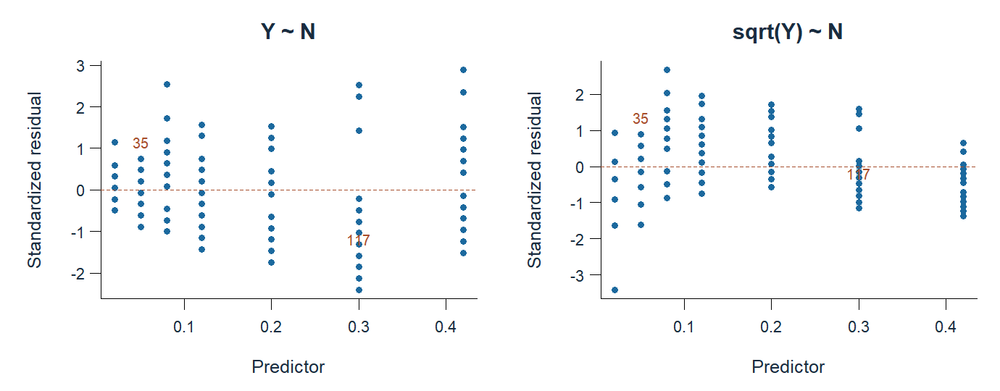
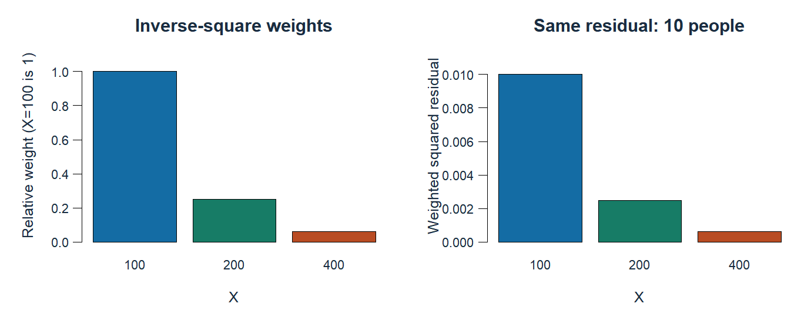
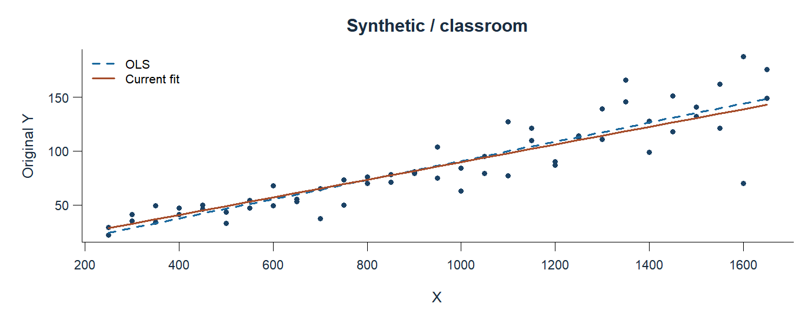
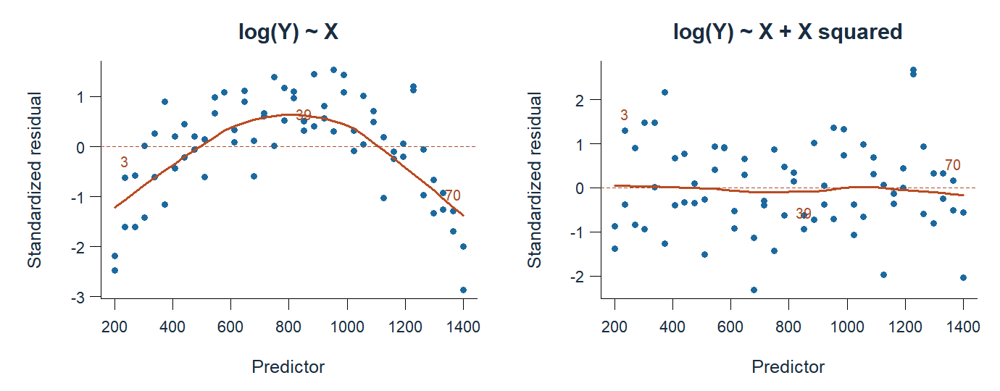
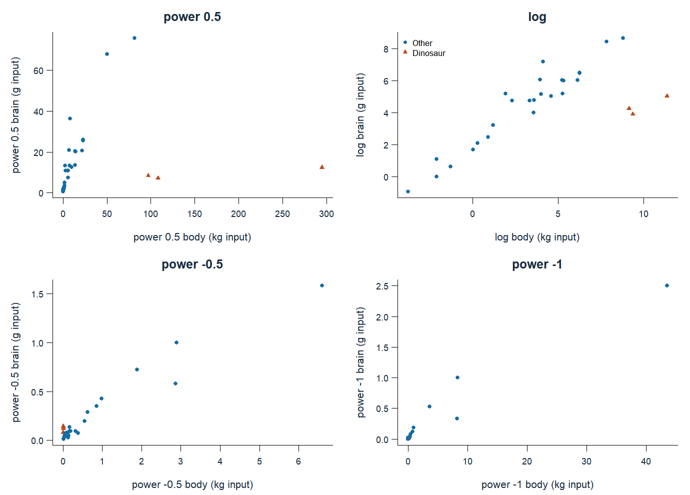
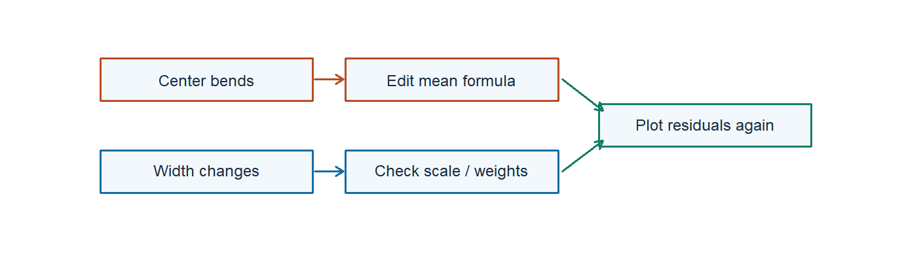

각 절의 결과를 먼저 예측합니다. 표시한 R 본문을 직접 고쳐 실행하고, 표에서 한 행과 그림에서 같은 점을 찾아 변경 이유를 적습니다. 실습 A와 B는 서로 독립적으로 시작할 수 있습니다.

## 자료 준비

```{r}
# Shared W12B data, model summaries and plots.
positive_axis <- function(x) {
  if (!is.numeric(x) || !length(x) || any(!is.finite(x)) || any(x <= 0)) {
    stop("This axis requires finite, strictly positive observations.")
  }
  invisible(x)
}

make_w12b_data <- function(kind) {
  set.seed(switch(kind, count=447L, factory=451L, animals=453L, stop("Unknown data kind.")))
  if (kind=="count") {
    N <- rep(c(.02,.05,.08,.12,.20,.30,.42),each=20)
    frame <- data.frame(N=N, Y=rpois(length(N),lambda=110*N))
  } else if (kind=="factory") {
    X <- rep(seq(250,1650,by=50),each=2)
    offset <- rep(seq(-1,.9,length.out=29),each=2)
    Y <- pmax(1,round(exp(4.5 + .9*offset - .34*offset^2) + .016*X*rnorm(length(X))))
    frame <- data.frame(X=X,Y=Y)
  } else {
    BodyWeight <- exp(seq(-3,8,length.out=25))
    BrainWeight <- exp(1.8 + .73*log(BodyWeight)+rnorm(length(BodyWeight),sd=.32))
    frame <- data.frame(Name=c(sprintf("Synthetic %02d",seq_along(BodyWeight)), "Synthetic A","Synthetic B","Synthetic C"),
                        BodyWeight=c(BodyWeight,9000,11500,70000),
                        BrainWeight=c(BrainWeight,52,70,151))
  }
  attr(frame,"mode") <- "Synthetic / classroom"
  frame
}

read_w12b_data <- function(kind, mode="official") {
  if (mode=="synthetic") return(make_w12b_data(kind))
  if (!identical(mode,"official")) stop("Choose official or synthetic.")
  definition <- switch(kind, count=list("Injury.txt",9L,c("Y","N")),
                       factory=list("Supervised.Workers.txt",27L,c("X","Y")),
                       animals=list("Animals.txt",28L,c("Name","BrainWeight","BodyWeight")),
                       stop("Unknown data kind."))
  file <- definition[[1]]
  cache <- file.path(tempdir(), paste0("w12b-official-",file))
  validate <- function(path) {
    d <- read.delim(path,check.names=FALSE,stringsAsFactors=FALSE)
    stopifnot(identical(names(d),definition[[3]]),nrow(d)==definition[[2]])
    for (col in names(d)[names(d)!="Name"]) positive_axis(d[[col]])
    if (kind=="count") stopifnot(all(d$Y==round(d$Y)),all(d$N<=1))
    if (kind=="animals") stopifnot(!anyDuplicated(d$Name),all(nzchar(d$Name)))
    attr(d,"mode") <- "Official / Hadi RABE6"
    d
  }
  original <- file.path("source_materials","textbook_data","rabe6",file)
  if (file.exists(original)) return(validate(original))
  if (file.exists(cache)) {
    d <- tryCatch(validate(cache),error=function(e) NULL)
    if (!is.null(d)) return(d)
  }
  url <- paste0("https://www1.aucegypt.edu/faculty/hadi/RABE6/Data6/",file)
  tryCatch({
    work <- tempfile("w12b-download-")
    on.exit(unlink(work),add=TRUE)
    old <- options(timeout=20)
    on.exit(options(old),add=TRUE)
    if (download.file(url,work,mode="wb",quiet=TRUE)!=0L) stop("Download failed.")
    d <- validate(work)
    if (!file.copy(work,cache,overwrite=TRUE)) stop("Could not cache the verified dataset.")
    d
  },error=function(e) {
    message("Official file unavailable (",conditionMessage(e),"). Using labeled synthetic data.")
    make_w12b_data(kind)
  })
}

basis_w12b <- function(x, lambda) {
  positive_axis(x)
  if (length(lambda)!=1L || !is.finite(lambda)) stop("Use a finite lambda.")
  if (lambda==0) log(x) else x^lambda
}

summarize_w12b_fit <- function(d, model, fitted_y=fitted(model)) {
  e <- d$Y-as.numeric(fitted_y)
  w <- weights(model)
  if (is.null(w)) w <- rep(1,nrow(d))
  data.frame(mode=attr(d,"mode"), row=seq_len(nrow(d)), X=d$X, observed=d$Y,
             fitted_y=as.numeric(fitted_y), residual=e, weight=w,
             weighted_residual=sqrt(w)*e, weighted_squared_error=w*e^2,
             fit_standardized=as.numeric(rstandard(model)))
}

w12b_rmse <- function(y, pred) sqrt(mean((y-pred)^2))

plot_w12b_residual <- function(x,e,label,ylab="Standardized residual",ids=integer(0)) {
  plot(x,e,pch=19,cex=.8,col="#1b699e",xlab="Predictor",ylab=ylab,main=label)
  abline(h=0,lty=2,col="#a64d2b")
  if (length(ids)) text(x[ids],e[ids],ids,pos=3,col="#a64d2b",cex=.8)
}

plot_w12b_comparison <- function(d, base, current) {
  idx <- order(d$X)
  plot(d$X,d$Y,pch=19,cex=.8,col="#1b4265",xlab="X",ylab="Original Y",main=attr(d,"mode"))
  lines(d$X[idx],base[idx],lty=2,lwd=2,col="#1b699e")
  lines(d$X[idx],current[idx],lwd=2,col="#a64d2b")
  legend("topleft",c("OLS","Current fit"),lty=c(2,1),lwd=2,
         col=c("#1b699e","#a64d2b"),bty="n",cex=.82)
}

lesson_mode <- "official"
```

## A01 · 제곱근과 분산

SQRT 척도를 적용하기 전 두 패널이 같은 이유를 말하세요. 함수 본문의 y를 sqrt(y)로 바꾼 뒤 점 1과 9를 찾습니다. Q02의 손계산과 연결합니다.



```{r}
d_counts <- read_w12b_data("count",lesson_mode)
cat("Data:",attr(d_counts,"mode"), "rows:",nrow(d_counts),"\n")
# A01 edit this response, keeping the N values and IDs.
student_count <- function(y) y
d_counts$edited <- student_count(d_counts$Y)
count_raw <- lm(Y ~ N,data=d_counts)
count_current <- lm(edited ~ N,data=d_counts)
print(data.frame(row=seq_len(nrow(d_counts)), d_counts[c("N","Y","edited")],
                 original=rstandard(count_raw), edited_residual=rstandard(count_current))[seq_len(min(9,nrow(d_counts))),])
par(mfrow=c(1,2))
plot_w12b_residual(d_counts$N,rstandard(count_raw),"Original counts",ids=c(1,9))
plot_w12b_residual(d_counts$N,rstandard(count_current),"Edited response",ids=c(1,9))
par(mfrow=c(1,1))
print(data.frame(mu=c(4,100),raw_sd=sqrt(c(4,100)),
                 approximate_sqrt_sd=sqrt(c(4,100))/(2*sqrt(c(4,100)))))
```

## A02 · 한 행의 가중 손실

표에서 E/X와 가중 제곱잔차를 계산합니다. student_weights의 지수를 0에서 1, 다시 2로 바꿔 같은 두 행에 부여된 값과 적합선을 비교합니다.



```{r}
small <- data.frame(X=c(100,200),e=c(10,20))
small$w <- 1/small$X^2
small$scaled <- small$e/small$X
small$weighted <- small$w*small$e^2
print(small)
d_factory <- read_w12b_data("factory",lesson_mode)
cat("Data:",attr(d_factory,"mode"), "rows:",nrow(d_factory),"\n")
# A02 change the exponent in this function. Keep the diagnostic code unchanged.
student_weights <- function(x) 1/x^0
weighted_fit <- function(d, weight_function) {
  w <- weight_function(d$X)
  positive_axis(w)
  stopifnot(length(w)==nrow(d))
  m <- lm(Y ~ X,data=d,weights=w)
  list(model=m, rows=summarize_w12b_fit(d,m))
}
ols <- lm(Y ~ X,data=d_factory)
current <- weighted_fit(d_factory,student_weights)
print(head(current$rows[c("X","observed","fitted_y","residual","weight","weighted_squared_error")],4))
print(rbind(ols=coef(ols),edited=coef(current$model)))
plot_w12b_comparison(d_factory,fitted(ols),current$rows$fitted_y)
par(mfrow=c(1,2))
plot_w12b_residual(d_factory$X,current$rows$residual,"Original residual","People")
plot_w12b_residual(d_factory$X,current$rows$weighted_residual,"Weighted residual","sqrt(w) * e")
par(mfrow=c(1,1))
```

## A03 · 나눠 적합한 결과 검산

변환 적합에서 나온 두 계수의 자리를 적고, X를 곱한 예측을 원 단위 가중 적합과 나란히 읽습니다. 원 제곱합과 가중 제곱합을 각각 비교하세요.



```{r}
# A03: swap the positions of the two coefficients when describing the original line.
positive_axis(d_factory$X)
divided <- lm(I(Y/X) ~ I(1/X),data=d_factory)
wls_two <- lm(Y ~ X,data=d_factory,weights=1/X^2)
from_divided <- d_factory$X*fitted(divided)
from_wls <- fitted(wls_two)
print(rbind(transformed=coef(divided),original_WLS=coef(wls_two)))
print(head(data.frame(X=d_factory$X,from_divided,from_wls,difference=from_divided-from_wls)))
print(c(max_abs_delta=max(abs(from_divided-from_wls)),
        SSE_OLS=sum(residuals(ols)^2),SSE_WLS=sum(residuals(wls_two)^2),
        WLS_loss_OLS=sum((residuals(ols)/d_factory$X)^2),
        WLS_loss_WLS=sum((residuals(wls_two)/d_factory$X)^2)))
```

## B01 · 로그 잔차의 가운데 추적

로그 제곱항을 추가하면 가운데 굽음이 어떻게 달라질지 예측합니다. student_log 함수에 I(X^2)를 넣고 두 그림과 원 단위 RMSE를 비교하세요. Q05에서 역변환을 한 번 손계산합니다.



```{r}
d_log <- read_w12b_data("factory",lesson_mode)
positive_axis(d_log$Y)
cat("Data:",attr(d_log,"mode"), "rows:",nrow(d_log),"\n")
# B01 insert the term I(X^2) inside this formula. Compare the same rows.
student_log <- function() log(Y) ~ X
student_to_original <- function(x) exp(x)
fit_raw <- lm(Y ~ X,data=d_log)
fit_log <- lm(log(Y) ~ X,data=d_log)
fit_edited <- lm(student_log(),data=d_log)
pred_y <- student_to_original(fitted(fit_edited))
pred_original <- cbind(OLS=fitted(fit_raw),WLS=fitted(lm(Y~X,d_log,weights=1/X^2)),
                       log_linear=exp(fitted(fit_log)),edited=pred_y)
print(apply(pred_original,2,function(v) w12b_rmse(d_log$Y,v)))
print(head(data.frame(X=d_log$X, observed=d_log$Y, edited=pred_y,
                      original_residual=d_log$Y-pred_y),4))
par(mfrow=c(1,2))
plot_w12b_residual(d_log$X,rstandard(fit_log),"Log-linear residuals")
plot_w12b_residual(d_log$X,rstandard(fit_edited),"Edited model residuals")
par(mfrow=c(1,1))
```

## B02 · 같은 종으로 멱변환

두 lambda를 0으로, 이어서 한 축만 1로 바꿉니다. 주황 점의 상대적 위치와 두 적합선 기울기를 비교합니다. 0이 들어갈 때의 오류를 따로 실행해 양수 조건을 확인합니다.



```{r}
d_species <- read_w12b_data("animals",lesson_mode)
cat("Data:",attr(d_species,"mode"), "rows:",nrow(d_species),"\n")
# B02 use an identity power 1, square root .5, log 0, or reciprocal -1.
student_lambda_x <- .5
student_lambda_y <- .5
axis_x <- basis_w12b(d_species$BodyWeight,student_lambda_x)
axis_y <- basis_w12b(d_species$BrainWeight,student_lambda_y)
mark <- grepl("Diplodocus|Triceratops|Brachiosaurus|Synthetic [ABC]$",d_species$Name)
plot(axis_x,axis_y,pch=ifelse(mark,17,19),col=ifelse(mark,"#B94C23","#146CA4"),
     xlab=paste("Transformed body (kg input), lambda",student_lambda_x),
     ylab=paste("Transformed brain (g input), lambda",student_lambda_y),
     main=attr(d_species,"mode"))
f_all <- lm(axis_y ~ axis_x)
f_other <- lm(axis_y ~ axis_x,subset=!mark)
abline(f_all,col="#1b699e",lwd=2)
abline(f_other,col="#B94C23",lty=2,lwd=2)
legend("topleft",c("All points","Without marked points"),lty=c(1,2),
       col=c("#1b699e","#B94C23"),bty="n",cex=.72)
print(rbind(all=coef(f_all), sensitivity=coef(f_other)))
print(data.frame(u=c(1,4,16), sqrt=basis_w12b(c(1,4,16),.5),
                 ln=basis_w12b(c(1,4,16),0), reciprocal=basis_w12b(c(1,4,16),-1)))
```

## B03 · 앱과 같은 한 행 계산

app_weights에서 지수를 2로 바꾸고 [편집 앱](https://lunalab-ai.github.io/regre/apps/w12b/edit/index.html)에서도 student_weights를 고쳐 실행합니다. 내려받은 CSV와 코드에서 같은 관측 행을 찾아 Q07을 채우세요.



```{r}
# B03: prepare one row to check in the web app's output.
app_data <- make_w12b_data("factory")
app_weights <- function(x) 1/x^0
app_fit <- lm(Y~X,app_data,weights=app_weights(X))
app_rows <- summarize_w12b_fit(app_data,app_fit)
print(app_rows[c(1,nrow(app_rows)),c("mode","row","X","fitted_y","weight","weighted_squared_error")])
```

## 계산 확인

```{r}
stopifnot(all(small$scaled==.1), all(abs(small$weighted-.01)<1e-12),
          max(abs(from_divided-from_wls))<1e-9,
          max(abs(unname(coef(divided)[2:1])-unname(coef(wls_two))))<1e-9,
          sum((residuals(wls_two)/d_factory$X)^2)<=sum((residuals(ols)/d_factory$X)^2)+1e-9)
if (identical(attr(d_factory,"mode"),"Official / Hadi RABE6")) {
  stopifnot(nrow(d_factory)==27L,abs(coef(wls_two)[[2]]-.1209903)<1e-7,
            abs(w12b_rmse(d_factory$Y,fitted(wls_two))-21.72517)<1e-5)
}
cat("W12B_A_OK\n")

stopifnot(nrow(d_species)==28L, all(is.finite(pred_y)),
          all.equal(basis_w12b(c(1,4,16),0),log(c(1,4,16))),
          inherits(try(basis_w12b(c(0,2),0),silent=TRUE),"try-error"),
          max(abs(app_rows$weight*app_rows$residual^2-app_rows$weighted_squared_error))<1e-10)
if (identical(attr(d_log,"mode"),"Official / Hadi RABE6")) {
  f_q <- lm(log(Y)~X+I(X^2),d_log)
  stopifnot(abs(w12b_rmse(d_log$Y,exp(fitted(f_q)))-19.91208)<1e-5)
}
cat("W12B_B_OK\n")
```
